# PG19 + ORCA + Daft 架构导读

> 本文解决“为什么这样集成、计划在哪里切、谁执行什么、数据如何传递”四个问题。  
> 先读本文建立整体模型，再读 `03_PG19_ORCA_Daft开发集成方案.md` 的接口与任务细节。  
> 文中的 DaftExec 是目标设计，当前尚未实现；已完成的是源码冻结以及 PG19/pg_orca 编译和运行基线。

## 1. 先用四句话建立整体模型

1. PostgreSQL 负责解析、事务、MVCC、catalog、权限/RLS、PostgreSQL 管理的 heap/index 扫描，以及向客户端返回结果；对于显式登记的 S3/Parquet 外部表，在授权、schema、external snapshot 和成本契约完成后，外部对象的字节读取可以由 PG ForeignScan 或 ORCA 选中的 Daft ExternalScan 执行。
2. ORCA 是本方案唯一的全局 CBO；Daft 已支持且适用于 PG 语义的规则必须在 ORCA 搜索阶段被登记、等价实现或明确拒绝，不能静默遗漏。
3. ORCA 不会机械地为每条 PG 计划复制一份 Daft 版本，而是只列出当前真实存在、结果正确且能满足上层要求的执行办法：普通关系算子如果同时有 PG 和 Daft 实现，就比较两种引擎；只有 Daft 能执行的 AI 函数不会虚构一个 PG 实现，而是比较它在 SQL 语义允许范围内的位置以及真实可用的批量、设备等方案。选定后，翻译器把胜出计划中相邻的 Daft 算子装进一个 `Custom Scan (DaftExec)`；此后只检查计划是否仍满足这些决定，不再改选引擎、算子位置或扫描方式。
4. 默认 PG-owned source 模式下，Daft 与 PG backend 同进程，PG 扫描受 MVCC 管理的 relation 并按批转成 Arrow，Daft 执行 CBO 选中的计算片段后把结果交回 PG；未来的 Daft-owned external source 模式可以由 Daft 直接扫描 S3/Parquet，但必须作为独立 physical alternative，并先补齐 catalog、权限、凭证和外部快照契约。

这不是“Daft 接管 PostgreSQL”，而是“PostgreSQL executor 中嵌入一个列式计算节点”。

对 external relation 还要区分控制面与数据面：PostgreSQL 始终负责 SQL、catalog relation、用户授权、**何时确定外部文件的可见清单，以及这份清单对哪些 SQL 有效**，并控制查询从开始、取消到结束的全过程；“由 Daft 直接扫描”只表示数据面上的 S3 Range GET、Parquet pruning/解码和 Arrow batch 生产由 Daft reader 完成。它不授权 Daft 读取任意 URI，也不允许 executor 绕过 ORCA 把 PG scan 临时改成 external scan。

这里原来使用的 `snapshot policy`，就是“何时确定外部文件的可见清单，以及这份清单对哪些 SQL 有效”，具体回答三个问题：

1. **何时确定快照**：每条 SQL 开始执行时确定，还是事务第一次访问该外部表时确定；
2. **这份清单在哪个范围内保持不变**：只保证当前 SQL 从头到尾使用同一份清单，还是同一事务中的后续 SQL 也继续使用它；
3. **SQL 是否指定固定版本**：如果 SQL 没有写 snapshot ID，PostgreSQL 在查询开始或事务第一次访问时，根据隔离级别确定当时可见的文件清单；如果 SQL 明确写入目标设计中的 `AS OF snapshot_id`，则固定读取该 ID 对应的历史文件清单。这里的 `AS OF snapshot_id` 是本集成方案需要实现的扩展语法或等价接口，不是 PostgreSQL 19 已有的通用原生语法。

这里的“快照”不是把全部 Parquet 文件复制一份，而是固定本次允许读取的**文件清单及其 object version/ETag**。文中 `manifest` 就是承载这份清单的元数据：它记录要读取哪些对象及其版本，而不是 Parquet 数据本身。PostgreSQL 负责确定并保存这组可见性信息，Daft 只能读取其中列出的对象。它只能为外部文件提供约定的查询内或事务内一致性，不能把 S3/Parquet 自动变成受 PostgreSQL MVCC 管理的数据。

因此，“复用”的对象只是这份**可见文件清单**，不是复用已经读取的数据、Arrow batch、查询结果、网络连接或缓存。例如事务第一次读取外部表时得到清单 `{A@v1, B@v3}`；若采用事务级规则，事务中的下一条 SQL 仍读取 `{A@v1, B@v3}`，即使此时 S3 已新增 `C@v1`。新事务才重新解析并可能得到 `{A@v1, B@v3, C@v1}`。

### 1.1 先区分当前事实与目标设计

| 层次 | 当前事实 | 本方案目标 |
|---|---|---|
| 优化器 | PG19 原生优化器和 pg_orca/ORCA 代码可编译运行；Daft 自身主要使用按批次执行的 rewrite 规则 | 由 ORCA 作为唯一全局 CBO，在同一搜索过程中比较合法计划以及其中真实存在的 PG、Daft 执行方式 |
| PG/Daft 集成 | 尚没有 `DaftExec`、PG-to-Arrow streaming bridge 或混合计划翻译器 | 在 PG backend 内以 `CustomScan` 驱动同进程 Daft fragment |
| 数据源归属 | PG relation 由 PG executor 扫描；Daft 已有 Parquet/CSV/JSON 等原生 reader，但尚未接入本方案 | P0-P2 先实现 PG-owned source；任务 `P3-002` 再把 Daft-owned S3/Parquet scan 作为独立 capability 和 costed physical alternative，不与 PG heap scan 混为一谈 |
| AI 与多模 | Daft 公开 API 已有图像、音频、视频、Embedding 和 Prompt 能力；多数模型 API 走 Python `UDFProject`，vLLM 走专门节点 | 分阶段把已经接入 PG 且验证正确的 Daft AI/多模态功能纳入 ORCA，使 ORCA 能比较它们与 Scan、Filter、Join、Aggregate 的组合位置。只有某项功能确实同时存在多个等价实现时，才比较由 PG 还是 Daft 执行，以及每次处理多少行或图片、使用 CPU 还是 GPU 所产生的总成本。尚未验证的功能不进入候选 |
| 交付状态 | 已完成源码冻结、PG19/pg_orca 构建运行基线和文档设计 | 按实施规格分阶段完成 P0-P2；本文的 `EXPLAIN` 和性能数字都是目标/示意，不是已实测结果 |

上表描述的是目标状态。要让某个具体函数进入这个目标状态，还必须先完成下面的端到端准入；这是实现前提，不是目标本身。

上表中的“每次处理多少行或图片”是批量执行方式。例如同样处理 1024 张图片，可以逐张调用，也可以每批处理 32 张；较大的批次通常能减少调用和数据搬运次数，但会占用更多内存，也可能增加单条请求的等待时间。“使用 CPU 还是 GPU”是设备执行方式，只在同一功能已经具备经过验证的 CPU 和 GPU 实现、且当前机器确实有可用设备时才参与比较。若某个函数只有 CPU 实现，ORCA 不会凭空生成 GPU 方案。

Daft 代码里存在某个函数，只能证明 Daft 自己实现了它，不能证明 PG 已经能调用它。这里的“PG 能调用”只要求 PG 登记 SQL 接口、把数据交给 Daft 并接回结果，**不要求在 PG 中重新实现一遍相同算法**。函数调用已经由 SQL 确定；ORCA 负责把已有的合法实现放进计划并比较可选的计划位置。只有实际存在多个等价实现时，ORCA 才有“由谁执行”的选择。

以 SQL 中已经要求调用 `decode_image(image_bytes)` 为例，端到端准入包括：

1. **PG 能认出它**：明确 SQL 函数名、参数类型、返回类型，以及它能否返回 NULL、是否可能报错；
2. **数据能送进去并拿回来**：把 PG 的输入值转换成 Daft 接受的列式数据，调用 Daft 的准确函数签名，再把结果转换成 PG 能继续处理或返回给客户端的类型；
3. **异常不会破坏 PG**：查询取消、解码失败、内存不足或 Daft 报错时，能够停止后台工作、释放内存，并按 PG 的规则结束当前语句；
4. **当前运行环境确实支持**：实际加载的 Daft bridge 必须明确报告该函数、输入输出类型以及 CPU/GPU 执行方式可用，不能只根据源码中“存在这个 API”来猜测；
5. **优化器知道怎样使用它**：在 ORCA 中登记“同一个 `decode_image` 由 Daft 执行”的实现、允许和哪些 Filter/Project 组合、输出什么数据格式，以及行数、批大小、设备和格式转换带来的大致成本；
6. **测试已经证明上述约定成立**：至少覆盖正常值、NULL、损坏输入、取消、重复执行和资源释放。通过 PG 调用 Daft 后得到的结果，必须符合这个函数预先定义的 SQL 行为；通常应与 Daft 单独运行或预先保存的正确结果比较。只有当同一个函数同时存在 PG 和 Daft 两种实现、并准备让 ORCA 在两者之间选择时，才需要额外证明两种实现对 SQL 用户表现一致。

这里的“一致”不是要求内部数据结构、执行步骤或性能相同，而是要求 SQL 能观察到的行为相同，包括返回值与类型、NULL、错误条件；涉及集合语义时还包括行数和重复行，涉及排序承诺时还包括顺序。确定性整数或文本结果通常要求完全相同；浮点、图像或向量计算只有在函数契约允许时才能采用明确的误差范围。模型、provider 或随机参数不同的 AI 调用不能仅凭输出格式相同就当作同一个函数的两个实现。

完成这些工作后，ORCA 仍然不是在 `decode_image` 和另一个不同函数之间做选择；SQL 的函数含义不能被替换，也不要求为了比较而专门开发一个 PG 版 `decode_image`。应分两种情况理解：

- **只有 Daft 实现**：ORCA 可以决定把它放在计划的哪个合法位置，并在实际存在时比较批大小或 CPU/GPU 实现；但不存在“PG 解码还是 Daft 解码”的选择。Daft 实现不可用时，该 SQL 无可执行实现，应在规划阶段报错；
- **恰好同时存在 PG 和 Daft 等价实现**：只有先证明两者对 SQL 用户表现一致，ORCA 才能把它们作为同一个计算任务的两个执行候选比较成本。这里的 PG 实现是已有的另一个实现，不是本方案强制重复开发的对照版本。

### 1.2 阅读路径

正文按一条主线展开：第 2 节先判断 Daft 在哪些场景可能有业务价值；第 3 节完整论证“ORCA 集成式 CBO + 嵌入式 Daft”，分别解释规划架构和执行部署架构，并记录被否决路线；第 4 节继续展开 AI/多模能力，避免拿未来能力证明首版收益；第 5 节统一术语，第 6 节说明各类 Daft 规则应在哪个规划阶段发挥作用，第 7-8 节展示 PG/Daft 混合计划最终长什么样；第 9-14 节落到同进程执行、Arrow 数据桥、S3 边界、成本与失败语义。只关心执行链路的读者可从第 7 节开始，但不能跳过第 1.1 节的“当前事实/目标设计”边界。

## 2. 引入 Daft 到底解决什么问题

本方案不预设“Daft 擅长所有计算密集任务”，也不把“计算量大”直接等同于“应该交给 Daft”。首版只是把以下两类工作列为 Daft 候选，最终是否采用仍由完整成本比较和实测决定：

1. 输入数据量较大、能够按列成批处理、而且包含一串连续算子的分析片段；连续执行有机会摊薄 PG 行数据与 Arrow 列数据之间的转换成本；
2. Daft 已有而 PG 没有同等执行能力的图像、音频、视频、Embedding 或模型流水线；这里的主要价值是获得能力和批处理调度，不应先验宣称比某个不存在的 PG 实现“更快”。

第一类候选可能长成：

```text
HashJoin -> HashJoin -> HashAggregate -> Sort -> Limit
```

它不尝试接管：

```text
PG heap/index 读取、MVCC visibility、权限、RLS、客户端网络输出
```

将第一类片段列为候选有以下代码事实基础：

- PostgreSQL executor 通常以 `TupleTableSlot` 为算子之间的行接口；Daft 的 `MicroPartition` 内承载 `RecordBatch`，HashJoin 和 Aggregate 等操作以批数据为输入；
- Daft 执行时，Filter、Project、Aggregate 等算子按照计划顺序处理一批包含多行的数据，而不是每次只在算子之间交接一行；
- 若一串连续算子都由 Daft 执行，数据可以只在片段入口做一次 PG 行数据到 Arrow 列数据的转换，在出口做一次反向转换，中间不必在每个算子处反复切换行列格式。

例如 PG 交给 Daft 一批 1000 行数据：Filter 可能留下 120 行，Project 对这 120 行计算新列，HashAggregate 用这 120 行更新分组汇总状态；随后再以同样方式处理下一批。全部批次处理结束后，HashAggregate 才输出最终汇总结果。所谓“按批执行”主要就是这个含义。

这些事实只证明 Daft 具备**批式、列式和流水线执行机制**，不证明它对同一段 HashJoin、Aggregate 或 Sort 必然快于 PG。PostgreSQL 的这些算子是成熟的原生实现，还可能使用并行执行和 JIT；Daft 方案则新增行列转换、Rust runtime 调度、内存管理及可能的 spill 成本。输入太少、片段太短、结果行很多或扫描占主导时，Daft 完全可能更慢。本方案使用 Swordfish，也就是 Daft 的单机执行器：它在当前 PG backend 进程中使用本机 CPU、内存和受限的工作线程执行 Daft 片段，不把任务提交给 Ray/Flotilla 集群。因此不能把 Daft 的分布式扩展能力算成首版收益。

因此，本文后续出现的“适合 Daft”都应理解为“有资格生成一个 Daft 执行候选并参与成本比较”，而不是“已经证明 Daft 更快”。当前集成尚未完成，也没有 PG19 与嵌入式 Daft 的同条件实测数据，不能把潜在收益写成既成事实。对应源码依据是 `daft/src/daft-micropartition/src/ops/join.rs`、`agg.rs`、`daft/src/daft-local-execution/src/pipeline.rs` 和 `docs/architecture/index.md`。

### 2.1 潜在高收益业务画像

潜在高收益场景分成两类，收益来源不同，不能只写传统关系算子。

#### A. 大批量关系分析

较可能获益的查询具有以下特征：

- 输入数千万到数亿行；
- 连续出现多个等值 HashJoin、HashAggregate、Sort；
- Join/Aggregate 的 CPU 时间明显高于扫描时间；
- 最终结果比输入小几个数量级；
- 数据已在 shared buffers/OS cache，或扫描本身不是绝对瓶颈。

典型候选业务是广告日报、订单维度报表、风控特征聚合、计费汇总和 TPC-H 风格查询。这只是候选画像，不是性能结论。

数据类型是否受支持是另一件事：它决定首版能不能安全生成 Daft 计划，不决定收益高低。首版只开放已经能够证明 PG 与 Daft 行为一致的类型和操作：

| 数据 | 首版允许范围 | 暂时限制的原因 |
|---|---|---|
| 布尔 | `bool` 可用于已验证的传输、Filter、Project、Group 和等值 Join | 仍需验证 PG 三值逻辑和 NULL 行为 |
| 整数 | `int2/int4/int8` 可用于首版白名单算子 | 仍需验证溢出、类型提升和聚合返回类型 |
| 日期和时间 | `date`、`timestamp`、`timestamptz` 只用于已验证的传输、过滤、分组和排序 | PG 与 Arrow 的 epoch、时区表示不同，需要明确转换 |
| 字符串 | 数据库编码为 UTF-8，并且比较或排序采用 `C` 或 `POSIX` 规则 | `C/POSIX` 基本按字节顺序比较，不处理中文拼音、德文变体等语言规则，较容易让 PG 与 Daft 得到相同顺序 |
| 浮点数 | 首版只传输或计算投影结果，不用于 Join、Group、Sort 或比较 | PG 与 IEEE/Arrow 对 NaN、相等和排序的行为可能不同 |
| `numeric`/Decimal | 推迟到后续阶段 | 精度、舍入、溢出和 NaN 契约尚未完成 |

这里的“证明行为一致”通常通过差异测试完成：准备同一批正常值、NULL 和边界值，分别走纯 PG 计划和 Daft 候选，比较返回值、行数、分组和排序结果。只有通过的“类型 + 操作”组合才开放；不是某个类型能传进 Daft，就自动允许它参与所有算子。

#### B. 昂贵的 AI 与多模态流水线

AI 函数运行时间长，并不自动说明“交给 Daft 就会更快”。真正可能产生较大收益的，是 ORCA 能在不改变 SQL 含义的前提下，让便宜的 Filter、Join、列裁剪、去重或元数据判断先执行，从而减少后续需要下载、解码、抽帧、生成 Embedding、分类或调用大模型的数据量；Daft 再对保留下来的输入做合适的批处理和资源调度。

下表中的步骤并非全是同一层次的“Daft 内建算子”。“当前 Daft 支持”至少要区分：Rust 内建函数、依赖 Python/provider 的公开 API、Python `Func/UDF`，以及用户自行组合的业务模型步骤。它也不等于“已经接入本方案的 PG/ORCA”。

| 业务场景 | 相关步骤 | 当前冻结 Daft 中的真实形态 | 值得全局比较的计划位置 | 潜在收益来自哪里 | 当前 PG/ORCA 集成边界 |
|---|---|---|---|---|---|
| 商品图片审核或分类 | `decode_image`、`resize`、`embed_image`、`classify_image` | 解码和缩放是 Rust builtin scalar；Embedding 和分类是公开 AI API，但当前通过 provider 加载模型并走 class-based Python UDF | 先按租户、日期、商品状态做 Filter/Join，再解码和推理 | 减少下载、解码像素数和模型输入数；对剩余图片成批处理 | 图像类型与错误契约尚待完成；Python/provider 模型路径当前 `BLOCKED` |
| 文档去重和语义索引 | 文本清洗、`embed_text`、向量距离 | `embed_text` 是公开 AI API 并走 provider/Python UDF；向量距离是 Rust builtin scalar；“文本清洗”只是业务步骤统称，不是一个特定 Daft API | 先做权限/类型过滤；在函数纯且确定时，评估对重复文本先去重、Embedding 后再 JoinBack | 减少模型调用数和重复向量计算 | Embedding 当前 `BLOCKED`；向量类型契约未完成；去重改写还要证明结果重数和错误语义不变 |
| 视频内容分析 | `video_frames`、`video_keyframes`、逐帧视觉模型 | 抽帧和关键帧是 Daft 公开函数，但当前实现为 Python `Func`；“逐帧视觉模型”需要再组合 `classify_image` 等 API 或用户 UDF，不是统一内建算子 | 先按业务表和视频元数据筛选，再对保留的视频抽帧 | 避免先把所有视频展开成大量帧，减少解码和模型调用 | Python/File/视频依赖尚未接入；全量抽帧与采样抽帧不是等价方案 |
| 音频处理 | `audio_metadata`、`resample`、后续 ASR | 元数据和重采样是 Daft 公开函数，但当前实现为 Python `Func`，并依赖 soundfile/librosa；ASR 主要是 benchmark 或用户自定义 UDF，不是 Daft 统一内建算子 | 先按格式、时长、采样率和业务条件过滤，再重采样或转录 | 减少音频读取、重采样和模型输入时长 | Python/File/Tensor 契约尚未接入，当前主要是中长期设计 |
| LLM Prompt 或 vLLM | `prompt`、内部 `VLLMProject` | `prompt` 是公开 AI API；普通 provider 走 Python UDF 路径，实验性 vLLM 路径可产生内部 `VLLMProject` 计划节点；`VLLMProject` 不是用户直接调用的函数名 | 仅把与模型输出无关、且确定安全的 Filter/Join 放到模型调用之前 | 减少请求数、token、远程费用；在支持时改善 batch、并发和模型复用 | Python/provider、凭证、副作用、GPU actor 和重试契约未完成，当前 `BLOCKED`；不能为了便宜而替换模型或 provider |
| Embedding 候选重排 | `cosine_distance`、`dot_product`、`TopN` | 距离和点积是 Rust builtin scalar；`TopN` 是普通关系物理算子，不是 AI 函数 | 先用业务条件和关系 Join 缩小精确候选集，再计算向量分数和 TopN | 减少参与向量计算和排序的候选数 | PG Embedding/Arrow 类型契约未完成；当前能力不是 ANN 索引检索 |

例如，一天有 1000 万张候选商品图片，而租户、日期、库存状态和审核状态的普通条件最终只保留 5 万张。若语义允许先执行这些普通条件，计划应比较“先对 1000 万张图片推理”与“先筛到 5 万张再推理”；后者把昂贵函数的输入数减少到原来的 `1/200`：


`1/200` 只表示这个例子中的 AI 输入条数，不表示端到端时间必然加速 200 倍。扫描、Join、模型启动、批处理、网络限流、结果写回和无法移动的算子仍有成本。若所有 1000 万张都必须推理，且没有更好的批处理、并发或模型复用方案，那么“AI 函数很慢”反而意味着总成本很高，并不构成使用 Daft 的性能证据。

<span style="color: red;"><strong>上述 AI 场景是选择 Cascades/ORCA 的重要中长期理由：昂贵函数与传统 Filter、Join、Aggregate 的相对位置可能改变调用次数和总成本。</strong></span>

它们不是当前首版已经获得的收益；当前纯 Rust embedded bridge、Python/GIL、GPU/model actor 和函数语义契约完成之前，相应候选必须保持关闭。第 4 节给出逐项函数、规则和接入状态。

### 2.2 低收益或负收益画像

- 主键点查和高选择性索引查询；
- 输入只有几千或几万行；
- 单表扫描后把绝大多数明细行返回客户端；
- 冷数据扫描占总时间 80% 以上；
- 复杂 PG UDF、自定义类型，或者使用中文、德文等 locale/ICU 语言排序规则而当前 Daft 尚不能保证相同结果，以及相关子查询或 NestedLoop rescan；
- 大量 OLTP 连接同时运行重量级查询；
- 所有输入都必须执行同一个昂贵 AI 函数，且没有可用的过滤、去重、批处理、并发或模型复用改进；
- 远程模型延迟主要受 provider 限流控制，增加本地并发也不能提高有效吞吐；
- AI 调用存在不可重复副作用、随机性或可观察错误顺序，因而不能安全地与 Filter/Join 重排。

对于 PG 和 Daft 都能完成的传统关系计算，是否选择 Daft 物理候选，应回归完整成本不等式：

```text
PG 原计算成本
>
PG->Arrow + Daft 计算 + Arrow->PG + runtime 调度成本
```

对于只有 Daft 实现的 AI 函数，不存在“PG 版函数与 Daft 版函数谁更快”的比较。ORCA 比较的是同一个 SQL 中昂贵函数的合法位置和已经真实存在的执行方式，核心成本关系是“为减少 AI 输入而增加的 Filter/Join/去重成本”是否小于“少做的下载、解码、抽帧、模型调用和向量计算成本”。

“巨大收益”不是设计结论，必须通过真实 SQL 差分 benchmark 证明。传统关系片段的潜在收益主要来自连续计算的列式批处理和减少中间转换；AI/多模态片段的潜在收益主要来自减少昂贵函数输入、避免无效预处理和改善已验证的批执行方式；两者都不能写成 PG 存储扫描必然被加速。

## 3. 为什么选择“ORCA 集成式 CBO + 嵌入式 Daft”

第 2 节只证明两件事：某些大批量关系片段**可能**从 Daft 的列式批处理中获益；某些 AI/多模态流水线**可能**通过减少昂贵函数输入获得更大收益。它没有证明 Daft 必然更快，也没有自动推出“必须使用 ORCA”。

这里的“统一 CBO（成本优化器）”是指：在最终计划确定之前，由同一个优化过程看到所有合法方案，使用同一套统计和成本口径比较整条方案，而不是 PG 先选一次、Daft 再局部改一次。

标题中的两个选择解决不同问题，不能混为一句口号：

- **ORCA 集成式 CBO**解决“最终计划确定以前，由谁统一比较 Join 顺序、算子位置、PG/Daft 执行方式、行列转换边界和成本”；“集成式”表示 Daft 候选直接进入 ORCA 的同一次计划搜索，不是在 ORCA 生成最终计划后再做第二轮下推判断。
- **嵌入式 Daft**解决“ORCA 选中 Daft 片段以后，PG 如何调用它并传递数据”；首期把 Daft bridge 和 runtime 加载到当前 PostgreSQL backend 进程，通过 C ABI 和 Arrow 内存批次交互，不经过 RPC 或网络 IPC。

因此，选择 ORCA 不能用来证明同进程部署更好，选择同进程也不能代替统一 CBO。前者是**规划架构**，后者是**执行与部署架构**。本节先论证统一 CBO 和 ORCA，最后再单独论证为什么 P0-P2 采用嵌入式 Daft。

### 3.1 先判断哪些目标真的需要统一 CBO

| 目标 | 是否需要统一全局搜索 | 原因 |
|---|---|---|
| 只增加一个固定的 Daft Scan、Filter、Project 或封闭 `CustomScan` | 不需要 | PG 的 `CustomPath/CustomScan` 足以把一个已知实现放进现有成本比较 |
| 传统关系算子仍完全服从 PG，只把 PG 已选中的固定片段交给 Daft 执行 | 不需要 | 没有保留多个 Join 顺序、PG/Daft 边界或格式转换组合的要求 |
| 让 Join 顺序、Filter/Projection 下推、PG/Daft 执行位置、行列格式转换和 Sort/TopN 共同选优 | 需要统一全局搜索 | 一个选择会改变另一个选择的行数、数据宽度、转换次数、排序和总成本，局部决定容易错过更好的组合 |
| SQL 中只有一个位置固定、只有 Daft 实现的 AI 函数 | 通常不需要 | 没有 PG/Daft 实现二选一，也没有合法位置或执行方式可搜索；只需正确执行固定节点 |
| 昂贵 AI 函数可以在语义安全时与 Filter、Join、去重、Aggregate 形成多个位置候选，或确实存在多个 batch、CPU/GPU 实现 | 需要统一全局搜索 | 这些选择会改变 AI 调用行数、模型输入量、资源占用和边界成本；必须连同普通关系算子一起计价 |
| 只在扫描层比较 PG ForeignScan 与 Daft ParquetScan，后续固定由 PG 执行 | 不一定需要 | 两种扫描可以作为 PG 路径比较；只要成本和输出契约完整，PG hooks 可以胜任 |
| 把上述两种外部扫描与 Filter 下推、Arrow 格式、后续 PG/Daft 片段一起选优 | 需要统一全局搜索 | 扫描选择会改变起始格式、可下推工作、转换次数和后续执行引擎，不能只比较扫描节点自己的成本 |

因此，本项目需要统一 CBO 不是因为“Daft 规则数量多”，而是因为本方案已经明确了下面这组目标：

1. 当前 Daft 规则必须全部登记并说明去向，不能静默遗漏；“全部登记”不等于全部执行；
2. 其中会改变 Join 顺序、算子位置、执行引擎、设备、数据格式、转换边界或总成本的选择，必须在最终计划确定前统一比较；
3. AI 函数只有一个 Daft 实现时，ORCA 不虚构 PG 对照实现；它只比较真实存在且语义合法的位置和执行方式；
4. 不修改 PostgreSQL core，且当前仓库已经以 pg_orca 接入 ORCA。

在这四项同时成立时，需要一套能保存同一计算任务的多个合法方案、并按完整成本选出最终计划的优化器。当前仓库已有 ORCA，因此本方案复用 ORCA。理论上也可以深改 PG optimizer、采用另一套成熟 Memo CBO，或放宽上述目标；ORCA 不是理论上唯一选择，而是当前仓库中增量最小的现成选择。

这也推翻了早期“ORCA 先生成最终 PG 计划，再挑最大子树交给 Daft”的方案。计划一旦选完，Join 顺序、AI 函数位置、PG/Daft 边界和转换次数都已经固定，后处理只能接受或拒绝，不能进行上述全局比较。最终计划遍历今后只负责核验和编码，不再做优化选择。

本章后续先核对 Daft 规则事实和纳管方法，再说明 ORCA 如何产生并比较候选，最后用 PG19 扩展点和源码解释为什么“有限 offload 可只用 PG hooks，而本项目完整目标更适合复用 ORCA”。这一区分很重要：**ORCA 的工程必要性来自既定优化范围，不来自 Daft 已经被证明比 PG 快。**

### 3.2 当前 Daft 优化器的代码事实

冻结提交 `b2fba655...` 中，`daft-logical-plan/src/optimization/optimizer.rs` 把规则组织成 Once 或 FixedPoint 的 `RuleBatch`。默认规则包括表达式简化、Filter/Projection/Limit 下推、CrossJoin 消除、子查询展开、Join predicate 下推、聚合下推以及 UDF/scan lowering 等。

Daft 当前并不是一个完整的 Cascades CBO：

- 大部分 `OptimizerRule::try_optimize()` 是按批次顺序执行的确定性 rewrite；
- `ReorderJoins` 是明确依赖统计信息的选择，最多 7 个关系时可 brute force，启用 DP-CCP 时代码上限是 12 个关系；
- DP-CCP 使用 `num_rows`、等值连接域估计和“中间结果基数之和”作为简化成本；
- `PlanStats` 当前主要只有 `num_rows`、`size_bytes`、`acc_selectivity`，源码 TODO 明确尚缺列级 min/max/NDV 等丰富统计；
- 分布式翻译器的 `determine_join_strategy()` 根据两侧 `size_bytes` 与 broadcast threshold 在 Broadcast 和 Hash 之间选择；
- 本方案采用的 native runner 当前会把 Broadcast/SortMerge 警告后退为 HashJoin，不能把分布式能力误报为 embedded 能力。

所以“纳入 Daft 规则”不能实现成在 ORCA 之后再调用一次 `LogicalPlanBuilder.optimize()`。那会形成两个互不知情的优化器，后者可能改变前者已经计价并承诺的 Join 顺序、物理属性和内存行为。

### 3.3 所有规则如何纳管

必须建立一个版本化的 `DaftRuleRegistry`，对冻结 Daft 提供的每条规则逐条登记，禁止只挑容易实现的规则。每条记录至少包含：

```text
rule_id
daft_source_file
daft_git_sha
semantic_preconditions
requires_stats
changes_cardinality_or_order
supported_execution_modes
orca_mapping
integration_status
capability_bit
differential_test
```

`integration_status` 只能取以下状态之一：

| 状态 | 含义 |
|---|---|
| `ORCA_EQUIVALENT` | ORCA 已有等价 Xform，已用规则级测试证明覆盖 |
| `PORTED_XFORM` | 将 Daft 规则语义移植为 ORCA logical/implementation Xform |
| `CBO_PHYSICAL_ALT` | 把真实存在的物理执行方式放入 Memo 并由统一成本模型选择；可能是 PG/Daft 二选一，也可能是 Daft-only 函数的不同 batch、设备或外部扫描方式 |
| `DAFT_LOWERING_ONLY` | 只影响已选 Daft 片段内部 batching/sharding/UDF lowering，不改变全局最优选择 |
| `NOT_APPLICABLE` | 仅适用于 Daft 原生 source/checkpoint 等 PG 场景不存在的能力，并有书面证据 |
| `BLOCKED` | PG 语义或 embedded executor 尚不支持；能力位关闭并有稳定拒绝原因 |

任何 Daft 新增规则没有登记状态时，capability checksum CI 必须失败；任何 `requires_stats=true` 的规则如果被标为 `DAFT_LOWERING_ONLY`，CI 也必须失败。

### 3.4 规则分层

| 规则类别 | Daft 代码示例 | 集成位置 |
|---|---|---|
| 无代价逻辑规范化 | `SimplifyExpressions`、`RewriteCountDistinct`、`LiftProjectFromAgg`、`RewriteOffset` | 复用 ORCA 等价 Xform 或移植为 logical Xform |
| 关系代数变换 | `PushDownFilter`、`PushDownProjection`、`EliminateCrossJoin`、`SimplifyNullFilteredJoin`、子查询 unnest | 放入 ORCA exploration；受 PG volatility、leakproof、RLS、NULL 语义约束 |
| 需要 CBO 的选择 | `ReorderJoins`，是否跨引擎执行 Join/Agg/Sort/TopN，以及昂贵 AI 函数与 Filter/Join/去重的合法相对位置 | 在 ORCA Memo 中枚举并按统一成本比较 |
| 物理策略选择 | Hash/SortMerge/Broadcast、build side、repartition、TopN 与 Sort+Limit，以及真实存在的 batch、CPU/GPU 实现 | 建成 ORCA physical alternatives；只开放 embedded runtime 当前真正支持的策略，不虚构实现 |
| Daft 执行 lowering | `DropIntoBatches`、`DropRepartition`、`SplitGranularProjection`、`MaterializeScans`、`ShardScans` | 只有规则的具体应用不改变引擎边界、资源选择、基数和已承诺物理属性时，才在 ORCA 选中片段后执行；例如 `SplitGranularProjection` 或 `ShardScans` 一旦影响物化、并行度、设备或 fragment boundary，就必须提升为有成本的物理候选 |
| Daft 专用能力 | checkpoint、VLLM、Python UDF、Daft 原生 scan pushdown | PG heap/index 的 Daft direct scan 为 `NOT_APPLICABLE/BLOCKED`；S3/Parquet 等 Daft-owned external scan 在数据源契约完成后可提升为 `CBO_PHYSICAL_ALT`；其他首版能力保持 `NOT_APPLICABLE` 或 `BLOCKED` |

“全部纳入”是指 **全部盘点、全部有状态、所有适用规则都进入正确优化层**，不是把不适用于 PostgreSQL 的 checkpoint/VLLM 规则强行执行。

### 3.5 ORCA 如何统一处理传统关系计算与 AI 候选

对于 PG 和 Daft 都能执行的传统关系算子，ORCA Memo 中应增加真实受支持的 Daft 物理实现，例如：

```text
CPhysicalDaftFilter
CPhysicalDaftProject
CPhysicalDaftHashJoin
CPhysicalDaftHashAgg
CPhysicalDaftSort
CPhysicalDaftTopN
```

同时增加执行格式属性：

```text
PG_ROW
DAFT_ARROW
```

PG 与 Daft 交界处通过显式的格式转换节点计价；ORCA 内部把这种为满足上层要求而补入的节点称为 enforcer：

```text
CPhysicalPgToArrow
CPhysicalArrowToPg
```

这样 ORCA 能比较：

```text
PG HashJoin + PG HashAggregate + PG Sort

与

PG Scan -> PgToArrow -> Daft HashJoin
        -> Daft HashAggregate -> Daft Sort -> ArrowToPg
```

成本不能只用原 PG `total_cost` 门槛，而应至少包含：

```text
DaftAlternativeCost
  = Daft startup
  + PG row-to-Arrow cost
  + Daft operator CPU cost
  + memory reservation and spill risk
  + repartition or ordering cost
  + Arrow-to-PG row cost
```

AI 函数要分开理解。若 `embed_image` 只有 Daft/provider 实现，ORCA 不会生成一个假的 PG `embed_image` 与它竞争。只有在语义证明允许时，ORCA 才保留下列真实方案：

| 可比较内容 | 代表性方案 | 关键前提 |
|---|---|---|
| AI 函数位置 | 先做普通 Filter/Join 再调用 AI，或先调用 AI 再执行依赖 AI 输出的 Filter | 移动后返回行、重复行、错误、副作用和安全语义必须不变 |
| 重复输入处理 | 逐行调用，或 `Distinct -> AI -> JoinBack` | AI 函数必须纯且确定，输出只依赖去重键，JoinBack 必须恢复原有重数 |
| 批处理方式 | 逐条、每批 32 条、每批 128 条 | 这些 batch 方式必须由当前实现真实支持并具有标定成本，不能枚举任意数字 |
| 执行设备 | CPU 或 GPU | 同一个函数必须确实存在语义等价的 CPU/GPU 实现，当前机器也必须有对应资源 |

AI 候选成本至少要覆盖：

```text
AICandidateCost
  = AI之前的Filter/Join/去重成本
  + AI函数成本(输入行数、输入字节数、batch和并发)
  + 模型启动、网络、设备和内存成本
  + PG与Daft边界转换成本
  + AI之后剩余关系算子成本
```

上式是成本维度说明，不表示所有模型成本都能简单线性相乘；远程限流、batch、缓存和模型预热通常需要分段或实测模型。模型、provider、版本和生成参数属于 SQL 函数含义的一部分，不能为了成本更低而被 ORCA 擅自替换。

传统关系计算所需的基数、宽度、NDV、NULL fraction、MCV/histogram 优先来自 PG/ORCA 统计体系。AI 位置选择还需要普通谓词选择率、Join 复制倍数、AI 输入 NDV、平均媒体大小、模型批成本和资源可用性。统计或成本尚未可靠到足以比较时，相应 AI 候选保持关闭。Daft 的 `EnrichWithStats` 启发式只能作为缺失统计时的显式低置信度 fallback，不能覆盖更丰富的 PG statistics。

### 3.6 ORCA 究竟怎样比较这些方案

前文的“ORCA 统一比较候选”不能解释成下面这种实现：

```text
先生成一条完整 PG Path
  -> 为这条 Path 无条件复制一条全 Daft 版本
  -> 最后在两棵完整树中二选一
```

ORCA 按“一段需要完成的计算任务”组织方案，而不是先生成一棵完整 PG 计划再复制。它先保留能够得到相同 SQL 结果的合法计划位置，再为每个位置列出当前真正存在的执行方式。普通 Filter 可能同时有 PG 和 Daft 实现；Daft-only AI 函数可能只有 Daft/provider 实现；没有实现的组合根本不会进入比较。

ORCA 内部把“完成同一计算任务的一组方案”叫作 logical Memo group，把“这一次需要满足的输出要求”叫作 optimization context。后文和代码定位仍会使用这些名称，但理解流程时只需记住：**先确认结果相同，再确认当前环境能执行，最后在满足上层要求的方案中比较总成本。**

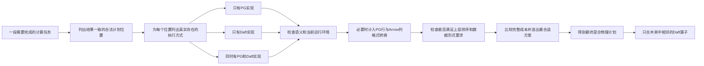

因此，“统一比较”不等于每个节点都有 PG/Daft 两份实现。它只要求所有**真实存在、结果正确并满足当前查询要求**的方案，在最终计划确定前使用一致的成本口径比较。

例如 Window 只能由 PG 执行，而且它要求下方结果按 `region, total_amount DESC` 排好序并以 PG 行格式返回。Window 下方这段计算可能有以下代表性方案，实际并不只有“纯 PG”和“全 Daft”两种：

```text
候选 A：
PG Sort
  -> PG Aggregate
       -> PG HashJoin

候选 B：
ArrowToPG
  -> Daft Sort
       -> Daft Aggregate
            -> Daft HashJoin

候选 C：
PG Sort
  -> ArrowToPG
       -> Daft Aggregate
            -> Daft HashJoin

候选 D：
PG Sort
  -> PG Aggregate
       -> ArrowToPG
            -> Daft HashJoin
```

为突出上层执行边界，上例省略了 `Daft HashJoin` 各 PG scan 输入前的 `PgToArrow`；真实候选必须把每个入口转换及其成本、宽度和内存生命周期完整计入。

`ArrowToPG` 在最终 PostgreSQL 对象树中通常由 `DaftExec` 的输出解码职责承载，不一定显示为独立 `Plan` 节点。候选 C/D 是否存在，取决于相应子计划是否能保持结果一致，并满足上层对排序、数据格式和重复读取的要求；不能为了制造更大的 Daft fragment 而跨过不支持节点。

Daft candidate 必须先过硬门禁，不能用“先生成再尽力执行”代替：

| 门禁 | 不满足时如何处理 |
|---|---|
| 查询模式和廉价 query-shape 预检允许考虑 Daft | 不启用相关 Daft implementation Xform |
| `DaftRuleRegistry` 已登记规则及其语义前提 | 不生成候选并记录稳定拒绝原因 |
| 当前实际加载的 Daft bridge 支持所需算子、函数和执行方式 | 不生成候选 |
| PG 类型/OID、Arrow 类型、表达式、NULL、异常和安全语义可等价映射 | 不生成候选 |
| collation、ASC/DESC、NULL ordering 等物理语义可完整满足 | 不生成对应候选；child group 仍可产生其他 Daft 候选 |
| parameterization、rescan、cursor、并行和资源要求在 capability 内 | 不生成不合法实现 |
| 该方案实际提供的排序、数据格式等能满足当前上层要求 | 不参加本次比较；在另一种上层要求下仍可能参加 |

成本不是上述合法性门禁。一个 Daft 方案即使结果正确、当前也能执行，仍可能因为转换、内存或网络成本过高而落败。相反，若成本函数尚未标定到可验证程度，应暂时关闭该 Daft 物理实现，而不是用零成本或一个拍脑袋的 `min_rows` 值让它进入生产搜索。

为避免“每个算子乘每个引擎边界”造成组合爆炸，实现必须同时控制搜索空间：

1. **Xform Promise**：明显不匹配时为 `ExfpNone`；连续 Daft fragment 有形成价值时提高 promise。Promise 负责调度优先级，不能绕过语义门禁。
2. **格式属性与 canonical enforcer**：分别优化 group 在 `PG_ROW` 和 `DAFT_ARROW` 要求下的最佳实现，不保存边界位置相同、只因机械包装不同的重复表达式。
3. **避免无意义的格式乒乓**：`PG -> Arrow -> Daft -> PG -> Arrow -> Daft` 通常应被属性/dominance 规则淘汰；只有 PG 语义屏障确实把两个合法 Daft fragment 隔开时才保留多 fragment 方案。
4. **Memo dominance 与 cost bound**：当候选不能提供新的 required properties，或其成本下界已不可能胜过当前 best cost 时停止展开。
5. **启发式门槛必须显式**：固定行数、固定算子数等启发式可能漏掉全局最优，只能作为可关闭的搜索模式，并用 full-search/force 模式做差分验证，不能冒充语义正确的硬剪枝。

因此，“Daft 规则全部纳管”表示每条规则都有登记状态、匹配条件、ORCA 归属和测试，不表示每条规则对每个 group 都触发，更不表示每条 PG Path 都完整尝试一次 Daft。

“选优结束后”的精确代码边界在 ORCA 内部：

```text
eng.Optimize()
  -> 对Memo alternatives做搜索、属性满足和成本比较

eng.PexprExtractPlan()
  -> 抽取根optimization context的胜出CExpression
  -> 至此才叫“选优结束”

CreateDXLNode(selected CExpression)
  -> 把胜出物理树翻译为Plan DXL

ConvertToPlanStmtFromDXL()
  -> 生成PostgreSQL PlannedStmt
```

目标翻译链应在 selected `CExpression -> DXL -> PlannedStmt` 过程中识别 **胜出树中的最大连续 Daft 物理子树**，把它编码为一个 DaftExec DXL/中立 IR 表示，再生成：

```text
CustomScan.custom_private = PgDaftPlan(selected Daft nodes)
CustomScan.custom_plans = [selected PG boundary children]
```

这里的“最大连续”只在 **已经被 CBO 选为 Daft 的相邻节点** 中机械融合，不允许吸收一个 CBO 选中的 PG 节点，也不允许重新改变 Join 顺序、算法或 fragment boundary。如果 selected expression 没有 Daft 节点，翻译器就生成纯 PG `PlannedStmt`，最终 validator 不会再插入 `DaftExec`。

### 3.7 优化和执行的最终边界

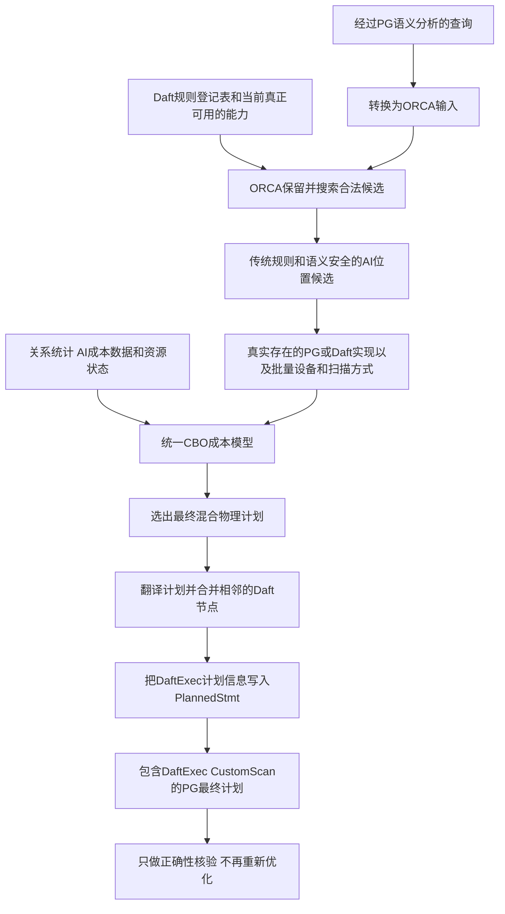

连续 Daft 节点仍会被融合成一个 Daft fragment，但“融合”只是把 CBO 已选中的相邻 Daft 物理节点编码为一个 CustomScan，不能再改变 Join 顺序或擅自吸收未被 CBO 选择的 PG 节点。

### 3.8 先把事实说清：PG 原生优化器不是“不能做 CBO”

不能用“PG 不是 CBO”或“PG 不能扩展”来论证 ORCA。PG19 本身会估算行数和成本、枚举扫描与连接路径、比较 `startup_cost/total_cost`，也是成本优化器；扩展还可以添加自己的执行路径：

| PG19 扩展点 | 确实能做什么 | 本项目遇到的边界 |
|---|---|---|
| `set_rel_pathlist_hook` | 给已经建立的基表 `RelOptInfo` 增加 `CustomPath` | 只解决该关系上的物理路径，不是任意关系代数规则入口 |
| `set_join_pathlist_hook` | 给当前 `outerrel + innerrel -> joinrel` 增加 Daft Join 路径 | 调用时当前 joinrel 已形成；源码还明确指出，此时无法找回先前被 `add_path()` 淘汰的路径 |
| `create_upper_paths_hook` | 在 `GROUP_AGG/WINDOW/DISTINCT/ORDERED/FINAL` 等固定阶段增加上层路径 | 是阶段式补充路径，不提供统一的 logical rewrite 注册、等价组和规则调度机制 |
| `join_search_hook` | 替换整个 `standard_join_search()` | 不是“注册一个 Join 规则”；一旦使用，扩展就要负责整个 Join 搜索并返回有完整实现路径的最终关系 |
| `planner_setup_hook` | 在 `subquery_planner()` 前观察或修改顶层 Query 和规划参数 | 可用于扩展自行做前置 rewrite，但不是 PG 固定预处理步骤内部的规则 hook，也不会替扩展维护等价候选 |
| `planner_hook` | 获得 `planner()` 全入口控制，可包裹 `standard_planner()`，也可直接返回另一优化器生成的 `PlannedStmt` | 若用它完成当前全局目标而不调用 standard planner，就必须接入或自研另一套优化器；pg_orca 正是这样接入 ORCA |
| `CustomPath/CustomScan` | 把扩展物理路径转换为可执行 Plan 节点 | 是执行接入点，不会自动提供 Memo、Xform、统计派生或跨引擎属性搜索 |

上述结论可直接由冻结 PG19 源码核验：

- `postgres19/src/include/optimizer/paths.h:39-58` 定义基表、Join 和 Join 搜索 hook；
- `postgres19/src/include/optimizer/planner.h:28-55` 定义整个 planner 和固定 upper-rel 阶段 hook；
- `postgres19/src/include/nodes/pathnodes.h:1964-2012` 的通用 `Path` 原生比较维度包含成本、参数化、并行和 `pathkeys`，没有 `PG_ROW/DAFT_ARROW` 执行格式属性；
- `postgres19/src/include/nodes/pathnodes.h:2225-2258` 说明 `CustomPath` 可由基表或 Join hook 注入，并保存 child paths/private data；
- `postgres19/src/backend/optimizer/path/joinpath.c:368-377` 明确说明 `set_join_pathlist_hook` 虽可增删路径，但调用已经太晚，无法找回被 `add_path()` 或 `add_partial_path()` 丢弃的路径；
- `postgres19/src/backend/optimizer/plan/planner.c:902-925,1381` 按固定顺序直接调用 SubLink pull-up、subquery pull-up、UNION ALL flatten 和 outer-join reduction，而不是通过通用扩展规则注册表调度。

因此，若需求只是“给 PG 的某个 Scan/Join/Agg 增加一个 Daft `CustomPath`，用一个总成本与 PG 路径竞争”，或者“在固定位置执行一个 Daft-only AI 函数”，完全可以优先使用 PG hooks，**不必为了这些有限目标引入 ORCA**。本文不把 ORCA 描述成所有 PG + Daft 接入的必选项。

### 3.9 为什么 PG hooks 不足以满足本项目的完整目标

本项目不是单算子 offload，而是要求 Daft 的适用规则全部纳管，并让传统关系计算、AI 函数位置、真实可用的执行方式、外部扫描方式和 Arrow 边界共同参与成本比较。这里存在组合依赖：

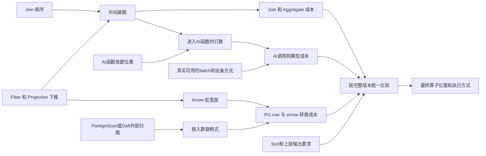

这些选择不能可靠地拆成“PG 先选一个树，Daft 再局部判断”：Join 顺序变了，中间基数和转换次数会变；Projection 是否提前下推会改变 Arrow 宽度；普通 Filter/Join 的位置会改变 AI 调用行数；Daft external scan 会改变起始数据格式；一个 Daft child 被选中后，父节点继续留在 Daft 可能省掉一次格式转换。必须在最终计划确定前保留这些合法组合，并比较完整成本。

PG 的 `RelOptInfo.pathlist + add_path()` 很适合 PG 自己的分阶段路径搜索，但公开 hook 并不是一套通用 Cascades 规则 API：

1. Daft 的 subquery/outer-join/filter 等逻辑变换，以及 AI 函数与 Filter/Join/去重的位置变换，没有统一的扩展注册入口。扩展可以在 `planner_setup_hook` 或包裹 `standard_planner()` 的 `planner_hook` 中自行预改 Query，但变换顺序、等价候选、语义证明和与 PG 后续固定 rewrite 的交互也全部由扩展承担；若要嵌入固定流程内部，则需要改 PG core 或接管规划。
2. `set_join_pathlist_hook` 面对的是 PG 已经建立的某一对 join inputs 和 joinrel，不等于持有跨多个逻辑等价式的 Memo；源码确认，被通用 `add_path()` 提前淘汰的候选无法事后复活。
3. `Path` 没有内建的 PG 行格式与 Daft Arrow 格式属性。仅把格式藏进 `custom_private` 不够：父子能否连接、何处插入格式转换、排序要求，以及“结果相同但输出格式不同”的方案是否应被保留，都需要由扩展自行纳入搜索和剪枝。
4. upper-rel hook 分散在 Group/Agg、Window、Distinct、Order、Final 等阶段。跨阶段片段若要统一计价，扩展需要自行维护候选血缘、格式、能力和成本状态，并保证不被每阶段的路径剪枝过早淘汰。
5. 即使写出一个巨型 `CustomPath` 封装整棵 Daft 子树，Daft 内部 Join 重排、AI 位置和边界选择仍必须由某个优化器完成。若扩展内部另建 Memo，它事实上已经是第二套优化器，并没有因为使用 PG hook 而消除优化器工程。

结论不是“PG 算不出好计划”，而是：**PG19 的现成扩展 API 没有提供本项目所需的、可注册全量 Daft 规则并对跨引擎组合做属性驱动搜索的统一框架。**

### 3.10 如果坚持不用 ORCA，真实工程成本是什么

不用 ORCA 并非不可能，但只能选择下面三条路，且都不是低成本替换：

| 路线 | 为满足本项目完整目标必须补齐的工作 | 实事求是的判断 |
|---|---|---|
| 只用现有 PG hooks | 在扩展内自建规则注册、候选等价关系、跨阶段状态、格式属性、转换节点、统计派生和全局计价，还要防止 PG 过早剪枝 | 名义上沿用 standard planner，实质上在它旁边再造半套优化器；最容易出现局部成本正确、全局组合错误 |
| 深改 PG optimizer core | 把 Daft logical rule 插入固定预处理流程；扩展 `Path/add_path` 的属性与 dominance；改 Join/upper-rel 搜索、cost、plan creation 和调试输出 | 技术可行，但形成长期 PG core fork；每次 PG beta、GA 和大版本升级都要重做 optimizer rebase 与语义回归 |
| 用 `planner_hook` 接入自研优化器 | 自己实现 Query 翻译、Memo/等价组、Xform 调度、统计、物理属性、成本、Plan 翻译、依赖收集和 fallback | 这就是重写 ORCA 已有的核心能力；除非已有另一套成熟优化器，否则没有经济合理性 |

这里的“大成本”首先是正确性和长期维护成本，而不是简单代码行数：

- SubLink、outer join、NULL、LATERAL、volatile/leakproof、RLS/security barrier 任一处理错误，都可能从性能问题升级为错误结果或安全边界问题；
- 搜索时必须同时考虑候选输出的是 PG 行还是 Arrow 列，以及上层算子需要什么；否则一个入口转换看似较贵的 Arrow 候选可能被过早淘汰，而它原本可以让后续多个 Daft 算子连续执行并省掉重复转换；
- 本项目冻结的 PostgreSQL 源码版本是 `19beta2`；若修改 optimizer core，后续对 PG19 正式版和 PG20 的升级不再只是编译适配，而是持续合并核心规划器变更；
- 必须同时维护纯 PG、混合 PG/Daft、能力变化、统计缺失、prepared plan 和 fallback 的组合回归。

本文不虚构“需要几个人月”的数字：没有团队历史数据时，给工期数字并不实事求是。但可以确认，替代 ORCA 至少要自行承担 **Memo/等价组、规则引擎、属性系统、统计派生、成本上下文、计划抽取和 PG Plan 翻译** 七类优化器基础设施；这不是增加几个 hook 回调可以消掉的工作。

### 3.11 ORCA 为什么是当前更小且可控的增量

冻结的 ORCA 代码已经存在本项目所需的骨架：

- `pg_orca/libgpopt/include/gpopt/search/CMemo.h:38-147` 明确把 `CMemo` 定义为动态规划表，保存 groups/group expressions，并能按 required properties 抽取计划；
- `pg_orca/libgpopt/include/gpopt/xforms/CXformFactory.h:26-92` 已分别维护 exploration 与 implementation Xform 集；
- `pg_orca/libgpopt/include/gpopt/base/COptimizationContext.h:48-93` 已保存 required plan/relational properties、统计上下文和 best cost context；
- `pg_orca/libgpopt/src/operators/CLogicalInnerJoin.cpp:65-86` 已为 InnerJoin 注册实现、交换律和结合律等候选；
- `pg_orca/libgpopt/src/operators/CLogicalNAryJoin.cpp:198-217` 已提供 DP、greedy、min-cardinality 等 Join 展开入口。

所以本方案是在现有 Memo/Xform/property/cost 框架中增加 Daft 规则映射、Daft 物理算子、`PG_ROW/DAFT_ARROW` 属性、转换 enforcer 和成本参数，而不是先在 PG core 里发明这一整套框架。ORCA 仍然有真实代价：DXL/PG19 适配、Memo 搜索空间膨胀、成本标定、fallback 和长期 pg_orca 维护都不能省；它也不保证简单 SQL 比 PG planner 更快。

最终决策边界如下：

| 目标 | ORCA 是否必要 |
|---|---|
| 只加速固定 Scan/Filter/Project 或一个封闭 Daft fragment | **不必要**，PG `CustomPath/CustomScan` 通常更轻 |
| Daft 只做执行器，所有 Join 顺序和规则仍完全服从 PG | **不必要**，但不满足“Daft 代价相关规则全部纳入 CBO”的当前前提 |
| 在固定位置执行一个只有 Daft 实现的 AI 函数 | **不必要**，注册函数或固定执行节点即可；不能为了使用 ORCA 而虚构 PG 版实现 |
| 让昂贵 AI 函数与普通 Filter、Join、去重共同选择位置，并比较真实可用的批量或设备方案 | **需要统一全局 CBO**，因为普通关系计划会改变 AI 调用次数，AI 成本也会反过来改变最佳关系计划 |
| 只在扫描层比较 PG ForeignScan 与 Daft ParquetScan | **不一定需要**，孤立比较可以通过 PG 路径完成 |
| 同时选择外部扫描、谓词下推、PG/Daft 后续算子和行列转换边界 | **需要统一全局 CBO**，否则扫描层的局部最优不一定是整条计划的最优 |
| 全量审计 Daft 规则，让适用逻辑规则、传统算子、AI 位置、真实物理实现和转换边界共同选优 | **需要能保留多种等价方案的统一 CBO** |
| 在本仓库且不深改 PG core 的条件下实现上一行 | **当前选择 ORCA 是工程上的关键项**；替代它意味着深改 PG、引入另一套成熟 CBO，或自行建设同等级优化器 |

因此最强而不夸大的结论是：**ORCA 不是 PostgreSQL 调用 Daft、执行固定 Daft 片段或调用 Daft-only AI 函数的技术前提；但在本项目已经确定的完整范围内，它是避免深度 fork PG、避免自研另一套同等级 CBO 的工程关键项。原始 PG 不是“不行”，而是它的标准扩展面没有直接提供“Daft 全量规则纳管 + 传统算子与 AI 位置联合搜索 + 外部扫描和行列边界统一计价”这套框架；若坚持只靠 PG hooks 补齐，扩展本身仍要承担接近一套优化器的工作。ORCA 的近期价值首先是建立正确的统一搜索边界，AI 收益和 Daft 性能收益仍必须由后续接入与 benchmark 证明。**

### 3.12 为什么 P0-P2 选择嵌入式 Daft

ORCA 选中 Daft 物理片段之后，还需要一种真实执行方式。P0-P2 选择“嵌入式”，不是因为 sidecar 永远不可取，而是首版的核心输入来自当前 PG executor：PG 主线程扫描受 MVCC、权限和 RLS 管理的 relation，再把批数据交给 Daft。此时同进程方案能先建立最短的正确闭环。

| 比较维度 | 同 backend 进程内嵌入 | 独立 Daft sidecar | P0-P2 的判断 |
|---|---|---|---|
| 数据传递 | Arrow C Data Interface 传递内存 buffer 所有权，不需要网络序列化 | 需要 Arrow IPC/Flight 或自定义协议，并处理分帧、连接和远端背压 | 首版优先减少一层协议和复制变量 |
| PG child plan | `DaftExec` 可在 PG 主线程安全地调用 `ExecProcNode()`，再把纯数据批交给 Rust worker | sidecar 不能调用 backend 内的 `ExecProcNode()`，PG 还要增加独立发送端 | PG-owned source 用嵌入式边界更直接 |
| 事务与取消 | backend 已持有当前快照、资源所有者和中断状态；仍需严格禁止 Rust 线程调用 PG API | 必须额外传播 query identity、取消、超时和外部快照 token | 同进程不能自动解决事务，但首版协调面更小 |
| 故障隔离 | Rust panic、内存破坏或 native bug 可能影响当前 backend | 进程隔离更强，可独立重启和限流 | 这是嵌入式的真实代价；可展开的 Rust panic 可用 `catch_unwind` 转成错误，但它拦不住 abort、段错误或内存破坏，还必须配合 FFI 审计、资源门禁和进程级回归测试 |
| 资源治理 | 每个 backend 都可能创建 runtime，容易形成连接数乘线程数的过度订阅 | 可集中管理 worker、GPU、模型和缓存 | 首版必须限制每 backend 线程、内存和并发；集中式 AI 服务可在 P3 重新评估 sidecar |
| 部署升级 | Bridge 可独立动态加载和关闭能力，但已加载库通常随 backend 生命周期存在 | 服务可以独立升级，协议兼容要求更高 | 首版用延迟加载和版本化 ABI 控制兼容性 |

嵌入式并不表示“把 Rust 代码静态编进 pg_orca”，也不表示让 Tokio worker 访问 PostgreSQL 内部对象。目标边界是：

```text
PG backend 主线程
  -> DaftExec 调用 PG child plan 并形成 Arrow batch
  -> 通过版本化 C ABI 把纯 Arrow 数据交给同进程 Daft bridge
  -> Rust worker 只处理自身拥有的 Arrow/Daft 对象
  -> PG 主线程取回输出 batch 并转换为 TupleTableSlot
```

当目标转为多个 backend 共享 GPU、模型缓存和统一资源池，或者需要把计算放到远端机器时，sidecar 可能更合适；这属于 P3 的独立架构选择，不能悄悄替换 P0-P2 的 ABI、事务和故障语义。

### 3.13 被否决的路线及其边界

下表记录的是本项目当前范围内为什么不选，而不是宣称这些技术在所有项目中都错误：

| 路线 | 当前不采用的原因 | 何时可以重新评估 |
|---|---|---|
| ORCA 生成最终 PG Plan 后，再按阈值替换最大子树 | Daft 规则、执行位置和转换边界没有进入统一搜索，无法满足“代价相关选择由同一 CBO 比较”的前提 | 目标退化为固定片段 offload，明确接受 PG 已经决定 Join 顺序和算子位置 |
| 把原 SQL 交给 Daft SQL planner | PG 与 Daft 的 SQL dialect、函数/OID、NULL、排序和安全语义并不天然相同，而且会丢失 ORCA 已选物理计划并触发第二次优化 | 独立产品以 Daft 作为 SQL 语义所有者，而不是嵌入 PG executor |
| 让 Rust bridge 直接解析 ORCA DXL | Daft 没有 DXL 支持，bridge 会与 ORCA XML 和 PG OID 语义强耦合 | 没有必要；本方案由 pg_orca 翻译器生成精简的中立物理 IR |
| 使用 Daft PostgreSQL connector 反向读取当前数据库 | 现有路径依赖 Python/psycopg，会产生递归连接、认证、快照、RLS 和取消一致性问题 | 面向另一个独立 PG 数据源、拥有明确连接和事务契约的外部查询场景 |
| 修改 PostgreSQL executor core | `CustomScan` 已提供执行接入点；core fork 会放大 PG19 beta 到 GA 以及后续版本的升级成本 | 现有扩展点被可复现证据证明无法满足正确性，且项目接受长期维护 PG fork |
| 首版采用 Arrow Flight sidecar | 增加进程、认证、网络 IPC、取消、快照与部署变量，妨碍先验证 PG-owned source 的最小正确闭环 | 需要跨机器计算、集中 GPU/模型服务或更强故障隔离时作为 P3 单独设计 |
| 将 Rust 静态链接进 pg_orca | Daft 能力无法独立启停和升级，panic、runtime 与依赖生命周期会和优化器扩展强绑定 | 发布环境明确要求单一制品，且能够接受共同升级和更大的故障域 |

这组决策最终形成一条清晰边界：ORCA 在规划期统一选，pg_orca 翻译胜出计划，`DaftExec` 在 PG executor 中驱动，Daft bridge 只执行已经选定的片段；任何一层都不能越过前一层重新解释 SQL 或改变全局计划。

## 4. AI 与多模态路线如何影响 Cascades 选择

如果后续目标只是把一个 AI 函数注册成 PG UDF，或用固定 `CustomScan` 执行一个不可变的模型流水线，Cascades 仍然不是必需。但如果要把 Daft 的 AI/多模态能力逐步变成可参与规则变换、资源选择和成本比较的一等查询算子，Memo/Xform 架构的长期价值会显著增加。

### 4.1 先盘点当前代码，不把 API 误写成 CBO 规则

冻结 Daft 代码当前对外公开的主要模型 API 是 5 个，不是几十个独立计划算子：

| 高层 API | 语义 | 当前主要计划承载 |
|---|---|---|
| `embed_text` | 文本生成 Embedding | 通用 `UDFProject` |
| `embed_image` | 图像生成 Embedding | 通用 `UDFProject` |
| `classify_text` | 文本分类 | 通用 `UDFProject` |
| `classify_image` | 图像分类 | 通用 `UDFProject` |
| `prompt` | LLM Prompt、结构化输出和多模态消息 | 普通 provider 使用 `UDFProject`；实验性 vLLM prefix-caching 使用专门的 `VLLMProject` |

另有已废弃、将由 `prompt` 替代的 `llm_generate`。源码依据是：

- `daft/daft/functions/ai/__init__.py:34-40` 的公开 AI API 列表；
- `daft/daft/ai/provider.py:84-90` 的 Google、LM Studio、OpenAI、Transformers、vLLM provider 注册；
- `daft/src/daft-logical-plan/src/logical_plan.rs:35-66` 的 `UDFProject/VLLMProject`；
- `daft/src/daft-local-plan/src/plan.rs:74-133` 的同名物理计划节点；
- `daft/daft/functions/ai/__init__.py:587-649` 表明 vLLM 直接产生专门表达式，其他 prompt provider 使用 UDF 路径。

Provider 的实际能力也不能按“已注册即全支持”推断：

| Provider | 文本 Embedding | 图像 Embedding | 文本/图像分类 | Prompt |
|---|---:|---:|---:|---:|
| Transformers | 支持 | 支持 | 支持 | 支持 |
| OpenAI | 支持 | 不支持 | 不支持 | 支持 |
| LM Studio | 支持 | 不支持 | 不支持 | 支持 |
| Google | 当前实现显式抛出 `NotImplementedError` | 不支持 | 不支持 | 支持 |
| vLLM prefix caching | 不支持 | 不支持 | 不支持 | 实验性支持 |

Daft 还提供大量 AI 前后处理能力。它们是 AI pipeline 的重要组成部分，但不能全部称为“模型推理算子”：

| 类别 | Daft API | 输入到输出 | AI pipeline 作用 | 当前 Daft 计划承载 |
|---|---|---|---|---|
| 图像解码 | `decode_image` | Binary -> Image | 把 JPEG/PNG 等编码字节变成可做视觉预处理的图像列；支持错误返回 NULL | Rust builtin scalar in `Project` |
| 图像文件解码 | `decode_image_file` | File -> Image | 从 Daft File 列直接解码，避免用户手工拆成下载与 decode | Rust builtin scalar in `Project` |
| 图像缩放 | `resize` | Image -> Image | 统一模型输入尺寸 | Rust builtin scalar in `Project` |
| 图像裁剪 | `crop` | Image + bbox -> Image | ROI、检测框裁剪、减少后续推理像素量 | Rust builtin scalar in `Project` |
| 色彩/通道转换 | `convert_image` | Image -> Image | 转 RGB/RGBA/L 等模型要求的 mode | Rust builtin scalar in `Project` |
| 图像转 Tensor | `image_to_tensor` | Image -> Tensor | 生成模型输入张量并推断 dtype/shape | Rust builtin scalar in `Project` |
| 图像编码 | `encode_image` | Image -> Binary | 将处理结果输出为指定图像格式 | Rust builtin scalar in `Project` |
| 图像属性 | `image_attribute`、`image_width/height/channel/mode` | Image -> scalar | 在昂贵推理前按尺寸、通道或 mode 过滤和路由 | Rust builtin scalar in `Project/Filter` |
| 图像文件元数据 | `image_file_metadata` | File -> Struct | 取得 width/height/format/mode，用于推理前的元数据过滤 | Rust builtin scalar in `Project` |
| 感知哈希 | `image_hash` | Image -> FixedSizeBinary | 近重复检测；支持 pHash/dHash/aHash/wHash/crop-resistant/colorhash | Rust builtin scalar in `Project` |
| 音频元数据 | `audio_metadata` | AudioFile -> Struct | 取得 sample rate、channels、frames、format、subtype，用于过滤和路由 | Python `Func` -> `UDFProject` |
| 音频重采样 | `resample` | AudioFile + sample rate -> Tensor[Float64] | 统一 ASR/音频模型输入采样率 | Python `Func` -> `UDFProject` |
| 视频元数据 | `video_metadata` | VideoFile -> Struct | 取得 width/height/fps/frame count/time base | Python `Func` -> `UDFProject` |
| 视频关键帧 | `video_keyframes` | VideoFile + time range -> List[Image] | 只抽关键帧，显著减少视觉模型调用量 | Python `Func` -> `UDFProject` |
| 视频帧抽取 | `video_frames` | VideoFile + range/sample/size -> List[Struct+Image] | 按时间、间隔、关键帧标志采样并可同步 resize | Python `Func` -> `UDFProject` |
| 指定视频帧 | `get_video_frame_by_idx` | VideoFile + index -> Image | 按帧索引抽取单帧做推理 | Python `Func` -> `UDFProject` |
| 向量距离 | `cosine_distance` | Embedding/FixedSizeList pair -> Float64 | 向量检索、相似性排序 | Rust builtin scalar in `Project/Filter/Sort` |
| 向量距离 | `euclidean_distance` | Embedding/FixedSizeList pair -> Float64 | L2 近邻、聚类或异常检测 | Rust builtin scalar in `Project/Filter/Sort` |
| 向量打分 | `dot_product` | Embedding/FixedSizeList pair -> Float64 | 召回或 rerank 打分 | Rust builtin scalar in `Project/Filter/Sort` |
| 向量相似度 | `cosine_similarity` | Embedding/FixedSizeList pair -> Float64 | 语义相似度、阈值过滤和 rerank | Rust builtin scalar in `Project/Filter/Sort` |
| 向量相似度 | `pearson_correlation` | Embedding/FixedSizeList pair -> Float64 | 相关性比较 | Rust builtin scalar in `Project/Filter` |
| 向量相似度 | `jaccard_similarity` | Embedding/FixedSizeList pair -> Float64 | 按非零元素集合计算交并比 | Rust builtin scalar in `Project/Filter` |
| 指纹距离 | `hamming_distance` | Integer/FixedSizeBinary pair -> UInt32 | 比较 `image_hash` 等指纹，做近重复过滤 | Rust builtin scalar in `Project/Filter/Sort` |

源码依据分别位于 `daft/daft/functions/image.py`、`image_file_.py`、`audio.py`、`video.py`、`distance.py` 和 `similarity.py`。其中图像和向量函数调用 `_call_builtin_scalar_fn()`，而当前音频/视频函数使用 Python `Func._from_func()`，两者的 embedded PG 接入难度不同。音频转录、目标检测等当前主要出现在 benchmark 的自定义 UDF 中，不能写成统一公开的内建 AI 算子。

### 4.2 优先纳入 Cascades 评估的组合候选

下表列出的是 **拟评估或拟新增的 ORCA 候选**，不是当前 Daft 已有的全局 CBO 规则。只有能证明语义等价的变换才能进入同一 Memo group；其他只能作为新的逻辑查询或被语义屏障禁止重排。

| 函数/算子 | 可组合的常规算子 | 可评估的候选与语义前提 | 当前实现状态 | 关键成本证据 | 潜在价值的准确表述 |
|---|---|---|---|---|---|
| `classify_text`、`classify_image` | `Scan`、`Filter`、`Join`、`Aggregate` | 普通 Filter/Join 与分类的位置；按输入去重或预聚合后分类。仅当函数纯、确定、输出完全由去重键决定，且 Join 类型、重数、异常和安全语义允许时才能重排 | 公开 API 已有，主要承载为 `UDFProject`；embedded PG Python/GPU 为 `BLOCKED`；拟新增 ORCA Xform | 普通谓词选择率、Join 过滤率/复制倍数、输入 NDV、单批成本 | 潜在高价值：只有当过滤率或重复率足以显著减少模型输入时成立，未经 benchmark 不宣称收益倍数 |
| `embed_text`、`embed_image` | `Scan`、`Filter`、`Join`、`TopN`、`Aggregate` | 先缩小候选集；纯函数条件下对重复输入做 `Distinct -> Embed -> JoinBack`。provider、model、version、dimensions 和输出契约是逻辑 identity，不得因为成本互换 | 公开 API 已有，主要承载为 `UDFProject`；embedded PG 为 `BLOCKED`；拟新增 ORCA Xform/资源 profile | 输入行数与 NDV、向量维度、模型加载、批处理和缓存命中率 | 潜在高价值；实际收益取决于候选缩小和重复度，不能把不同 provider 当作等价物理实现 |
| 向量距离/相似度 builtins | `Filter`、`Join`、`Sort`、`TopN`、`Aggregate` | 先做权限/库存/业务 Join 和普通 Filter，再在同一精确候选集上打分/rerank；只有两个实现数值语义一致时才比较 PG/Daft | 当前为 Rust builtin scalar；不是 ANN 索引 Join；PG Embedding/FixedSizeList 与 Arrow 类型契约完成前仍 `BLOCKED` | 候选基数、向量维度、TopN 大小、排序和边界成本 | 相对 Python 模型路径更接近首批 Rust 集成，但不等于 P0 已可用，也不能宣称 ANN 收益 |
| `prompt`、`VLLMProject` | `Filter`、`Join`、`Aggregate`、`Limit` | 默认设语义屏障。只有与输出无关的确定过滤，或不改变所选行集/顺序的 Limit，经证明后才可移动；provider/model 不互换 | 普通 provider 走 `UDFProject`，vLLM 走 `VLLMProject`；两者 embedded PG 首版均 `BLOCKED` | token 数、请求数、批大小、GPU/远程费用、prefix 命中率、重试 | 可能有高成本节省，但可搜索的逻辑变换比纯本地函数少；计费和副作用优先于性能重排 |
| `image_hash`、`hamming_distance` | `Scan`、`Filter`、`Join`、`Aggregate`、`Sort` | 先按业务键/时间/元数据缩小候选对，再做指纹比较。感知哈希等值或 Hamming 阈值是业务定义的近重复条件，不等于字节级相同，存在碰撞/漏检取舍 | 当前为 Rust builtin scalar；可作为类型契约完成后的早期候选 | 分块后候选对数、哈希宽度、阈值、重复率、中间数据量 | 潜在价值取决于候选对缩减比；“适合早期验证”只是实现路径判断，不是已证明的性能收益 |
| 图像/音频/视频元数据 | `Scan`、`Filter`、`Join`、`Aggregate` | 在不改变错误和安全语义的条件下，先用宽高、通道、fps、帧数、采样率等便宜特征过滤/路由，再下载、解码或推理 | 图像相关主要为 Rust builtin；当前音频/视频元数据为 Python `Func`，embedded PG 为 `BLOCKED` | 元数据读取成本、选择率和避免的 I/O/解码/模型成本 | 当元数据过滤高选择时可能有明显价值；否则多一次元数据计算可能得不偿失 |
| `decode_image`、`resize`、`crop`、`convert_image`、`image_to_tensor` | `Scan`、`Project`、`Filter`、`UDFProject/VLLMProject` | 比较相同输出语义下的 Download/Decode/Resize 拆分、融合、物化和边界。只有 bbox 已独立存在时 Crop 才能提前；若 bbox 依赖检测结果，顺序是逻辑依赖而非候选 | 图像函数当前为 Rust builtin；不代表已有 GPU 实现；设备候选只能按 runtime capability 枚举 | 编码/解码后宽度、像素数、批大小、物化和边界转换 | 主要是物理 pipeline 优化；仅不影响全局胜者的 fragment 内 morsel 微调留给 lowering |
| `video_frames`、`video_keyframes`、`get_video_frame_by_idx` | `Scan`、`Filter`、`Explode`、`Join`、`Window`、`Aggregate` | 先用不依赖帧输出的业务 Join/Filter 筛视频，再抽帧。只能比较产生相同帧集、时间范围、关键帧和采样语义的源端/UDF 实现；“全量”与“采样”不是等价物理候选 | 当前为 Python `Func`，embedded PG 为 `BLOCKED`；拟建基数膨胀统计和受限 Xform | 帧数、时长、fps、采样参数、`Explode` 倍数、解码/模型成本 | 可能出现数量级基数放大，因而值得全局评估；具体倍数必须由数据统计给出 |
| `audio_metadata`、`resample` | `Scan`、`Filter`、`Join`、`UDFProject` | 先按 sample rate、channels 和由 frames/sample rate 派生的时长过滤；只对必需输入重采样；比较保持相同采样语义的 fragment 边界 | 当前为 Python `Func`，embedded PG 为 `BLOCKED`；Daft 没有可统一宣称的公开内建 ASR 算子 | 音频时长、采样率转换比、中间 Tensor 宽度和过滤率 | 潜在价值取决于避免的音频解码/重采样数量；当前主要是中长期设计 |

最典型的 Cascades 候选是 `AI_f(R JOIN S)` 与 `AI_f(R) JOIN S`，但它们不是无条件等价。至少必须证明：`f` 只依赖 `R`、纯且确定；Join 类型和重数保留结果语义；异常时机、RLS/security barrier 和远程副作用不可观察。通过这些门禁后，才由 Join 过滤率/复制倍数、输入 NDV 和 AI 成本决定位置。

### 4.3 AI/多模场景下的 PG 与 Cascades 比较汇总

第 3 节已说明 PostgreSQL 原生优化器本身就是成熟 CBO。下表只汇总 AI/多模组合带来的额外差异，不再重复普通 Scan/Join/Agg 能力对比。

| 判断维度 | PostgreSQL 原生优化器 | Cascades/ORCA | 对本项目的实事求是结论 |
|---|---|---|---|
| AI Filter 与普通 Filter 的位置 | 能通过定制代码处理，但 UDF 语义、谓词排序和不同规划阶段需由扩展/core 逐项接入 | 可把合法的 `Filter-AIProject` 位置作为同一 group 的候选 | 当便宜谓词会大幅改变模型调用数时，Cascades 更适合统一比较；仍须守住 volatility/error/security 语义 |
| AI 在 Join 前还是 Join 后 | Join hook 面对 PG 已构建的 joinrel/inputs；跨多个逻辑等价树保留 AI 位置候选不是现成扩展能力 | `AIProject-Join` exploration Xform 可同时保留 Join 过滤收益和 Join 复制 AI 结果两类方案 | **框架适配度高**；这是本项目选择 Cascades 的典型理由，但只有通过纯函数、依赖列、Join 重数和异常语义门禁后才可枚举 |
| AI 与预聚合、去重、`JoinBack` | 可通过修改 PG core 或在扩展内自建等价式搜索实现，但不是几个 Path hook 的自然能力 | Memo 适合保留“逐行 AI”、“PreAggregate 后 AI”和“Distinct -> AI -> JoinBack” | **框架适配度高**；需要 NDV、函数确定性、重复输入复用语义和 JoinBack 正确性证明 |
| 视频抽帧/`Explode` 与 Join/Agg/Window | PG 没有面向 Daft 多模算子的通用逻辑 Xform 注册层；扩展需自行跨阶段管理基数膨胀候选 | 可将相同帧集语义下的抽帧实现、`Explode` 位置和关系算子位置放入等价搜索 | **框架适配度高**；但必须有帧数/采样率统计，否则只是扩大搜索空间，不能可靠选优 |
| 真实存在的 PG/Daft、CPU/GPU、sync/async、vLLM 物理选择 | 可继续增加 `CustomPath` 和 `custom_private`，但格式、设备、模型驻留、转换 enforcer 和父子 required properties 需扩展自行组织 | Implementation Xform 与 required/derived properties 适合表达这些候选 | **长期扩展性匹配**；只有同一函数确有 PG/Daft 等价实现时才比较引擎，不允许把不等价的 provider/model 当作物理候选互换，也不能枚举 runtime 实际不支持的 GPU/async 实现 |
| 未来持续新增 AI/多模算子和规则 | PG 可以继续扩展，但缺少面向 extension 的通用 Memo/Xform/物理属性注册 API；规则交互越多，core fork 或侧边自建优化器的压力越大 | 新逻辑算子、exploration/implementation Xform 和 cost model 可按统一抽象增加 | **这是选择 Cascades 最重要的长期理由**；原因是规则交互和全局候选搜索，而不是规则数量本身 |
| 计划优秀性保证 | 取决于候选、统计、成本模型和剪枝 | 同样取决于这些因素；Memo 只能在“已生成且未被剪掉”的候选中选择 | **Cascades 不能保证最优计划**；它提供全局比较机制，而计划质量仍依赖 AI 选择率、NDV、批成本、GPU/网络和边界成本标定 |
| 实现、搜索和维护成本 | 对少量物理 offload 成本低；若要补全跨阶段 AI 搜索，则需 core fork 或扩展内自建大量基础设施 | 已有 Memo/Xform 骨架，但仍要实现 PG/ORCA 语义翻译、Daft 算子、属性、cost、剪枝和回归 | **Cascades 不是低成本方案**；优势是避免在 PG hook 旁重造半套同类框架，而非消除优化器工程 |
| 首版直接收益 | PG + `CustomPath/CustomScan` 即可支持有限 Rust 算子 offload | ORCA 首先建立统一搜索与后续扩展基础 | 当 Python UDF、GPU Actor、vLLM 仍为 `BLOCKED` 时，AI 主张主要是中长期架构收益，不得写成首版已获得巨大性能收益 |

因此，本文中“使用 Daft 时 Cascades 非常关键”严格限定为：**Daft 不只提供固定物理执行，而是要把依赖统计/代价的规则与 PG 关系代数放入同一 CBO，并持续引入会与 Scan/Join/Agg/TopN/Explode 组合的 AI/多模算子。** 在这个冻结目标下，Cascades 是关键选择；但它只提供产生、保留和比较全局候选的必要机制，不会在缺少准确统计、成本标定、语义约束和搜索剪枝时自动保证优秀计划。

### 4.4 当前直接相关规则的准确边界

当前直接相关的优化规则主要是以下四条，再叠加通用 Filter/Projection/Limit 下推：

| 规则 | 匹配对象 | 典型改写形状 | 对 AI pipeline 的作用 | ORCA/CBO 归属 | 当前限制 |
|---|---|---|---|---|---|
| `SplitUDFsFromFilters` | predicate 中包含 UDF 的 `Filter` | `Filter[udf_pred] -> input` 改为 `Project[drop tmp] -> Filter[tmp] -> Project[*, udf_pred AS tmp] -> input` | 把模型/UDF 计算显式隔离成投影，便于后续建立 `UDFProject`、统计调用次数和处理 passthrough columns | “提取临时列”可做等价 logical normalization；任何把其他 Filter 移到 UDF 前后、从而改变调用行数的选择必须在 Memo 中做语义检查和计价 | 当前不判断模型成本；PG 首版 UDF capability 为 `BLOCKED` |
| `SplitUDFs` | Project 表达式树中含一个或多个 UDF | 复合 `Project[f(g(x)), h(x)]` 拆为 stateless `Project`、按依赖排列的多个单-UDF `UDFProject`、再加最终列裁剪 `Project` | 让每个模型/UDF 拥有独立 batch、concurrency、resource request、模型实例复用和错误边界 | 依赖保持的结构拆分可做 logical normalization；是否融合、物化、放在哪个引擎及使用何种资源是 physical alternatives，必须 CBO | list.map/list.filter 内 UDF 暂不拆；Coalesce 内保持短路；Python/GIL 尚未接入 PG |
| `SplitVLLM` | Project 表达式中的 `Expr::VLLM` | `Project[VLLM(x), y] -> input` 改为 `Project[vllm_output, y] -> VLLMProject[VLLM(x)] -> input` | 把 vLLM 调用提升为独立计划节点，暴露 GPU、concurrency、prefix routing、buffer 和 batch 参数 | 节点提取是 logical Xform；VLLM physical implementation、资源和 PG/Daft boundary 进入 CBO | 每个 Project 只支持一个 VLLM expression；源码明确未解决与 `SplitUDFs` 的完整交互；provider 为实验性 |
| `SplitGranularProjection` | 含 preferred batch size 的 async builtin 的 Project | `Project[decode(download(url))]` 拆为 `Project[decode(data)] -> Project[download(url)] -> Project[url]` | 隔离需要特殊 morsel/batch 大小的异步步骤，避免 download、decode、模型预处理共用错误批大小 | 若只在已选 Daft fragment 内调整 morsel，属于 `DAFT_LOWERING_ONLY`；若改变物化、设备、资源或 fragment boundary，必须形成 costed alternative | 当前主要识别 async builtin；源码把 Python UDF 支持留作 TODO |

这四条规则当前主要是按批次执行的确定性 rewrite，不是一套成熟的 AI CBO。尤其 `split_vllm.rs:11-16` 明确写着一个 Project 只支持一个 VLLM expression，且尚不确定与 `SplitUDFs` 等规则如何交互；`granular_projections.rs:15-17,44-50` 当前主要处理带 preferred batch size 的 async builtin。移植到 ORCA 时应复用其语义意图，但不能把 Daft 当前固定改写顺序原样放到 selected plan 之后执行。

### 4.5 统一成本维度与真实性边界

AI pipeline 会产生关系算子之外的新组合维度：

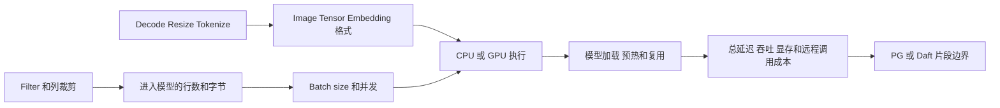

对于同一个、语义已冻结的模型调用，Cascades 式优化器可以在 Memo 中保留合法的 Filter/Projection/UDF 拆分位置，再比较真实存在的 CPU/GPU、batch、转换和模型启动方案；只有该函数确实同时存在 PG 和 Daft 等价实现时，才额外比较由哪个引擎执行。原生 PG 可以较容易注册一个 AI 函数或封闭 CustomPath，但标准 hook 没有通用 AI logical Xform、设备/批处理属性和跨阶段候选管理框架；若在 extension 内补齐，仍是在旁边自建优化器。

这里也必须保留三条真实性边界：

1. 模型、provider、模型版本、prompt 参数和 error policy 通常属于逻辑语义，CBO 不得因为价格或速度擅自把 OpenAI 换成 Transformers，除非存在经过证明的等价契约。
2. Cascades 只让扩展结构更系统，不会让端到端接入“极易完成”；每个 AI capability 仍要解决 Python/GIL、GPU、模型生命周期、凭证、重试副作用、类型/ABI、统计和成本标定。
3. 当前 embedded PG 首版采用纯 Rust bridge，Python UDF 与 VLLM 仍是 `BLOCKED`。所以 AI 是选择 Cascades 的强中长期理由，不是首版已经获得的收益，也不是当前 ORCA 必要性的唯一依据。

准确决策是：**若 AI 只是黑盒固定 UDF，不必引入 Cascades；若 AI/多模态算子要与 Filter、Join、Projection、预处理、CPU/GPU、batch 和执行引擎边界共同选优，则应优先采用 Cascades/Memo。ORCA 是本仓库已经存在的 Cascades 式实现基础。**

## 5. 术语表

| 术语 | 本文中的准确含义 |
|---|---|
| final Plan tree | ORCA 已选完物理算法并翻译成 PG `PlannedStmt->planTree` 的执行树 |
| DaftRuleRegistry | 对冻结 Daft 的每条优化规则记录语义、统计依赖、ORCA 映射、状态和测试的权威台账 |
| CBO physical alternative | ORCA 搜索中一个真实存在、结果正确且可计价的物理执行办法。普通算子可能同时有 PG 和 Daft 实现；Daft-only 函数也可以只有 Daft 实现，再比较其合法位置或真实存在的批量、设备方案 |
| fragment fusion | 将 CBO 已选中的连续 Daft 物理节点编码进同一个 DaftExec；只物化选择，不再做优化 |
| post-plan validation | 遍历最终计划核验 capability digest、schema、依赖和执行属性；不得改变 Join 顺序或执行引擎 |
| inspect final Plan tree | 当前仅指上述 post-plan validation；早期文档中的“最终计划后选最大子树”已废止 |
| fragment | CBO 选中的连续 Daft 物理节点在 PG 计划中的一个 DaftExec 表示 |
| PG-owned source | 由 PG executor 执行的 SeqScan/IndexScan/ForeignScan 等 child plan；负责 PG relation 的 MVCC、RLS、权限和访问方法语义 |
| Daft Source | Daft fragment 中接收某个 PG-owned source Arrow batch 的输入占位符；它不直接读取 PG heap/index |
| Daft-owned external source | Daft fragment 内直接读取 S3/Parquet 等外部对象的 scan 节点；它不是 PG relation 的替代扫描器，只有在独立 catalog、授权、凭证和文件快照契约下才允许进入 Memo |
| CustomScan/DaftExec | PG executor 中驱动 child scans、Bridge 和结果返回的扩展节点 |
| embedded Daft | Daft Rust library 与 PG backend 同进程、不同线程，不是 sidecar |
| Swordfish（Daft native runner） | Daft 的单机执行器。它接收已经确定的 `LocalPhysicalPlan`，在一台机器内按批运行 Filter、Join、Aggregate 等算子并返回结果；它不负责 SQL 解析、ORCA 选优或 PG 事务。在本方案中它作为 Rust library 运行在当前 PG backend 进程内。“本地”不表示只读本地文件，也不表示单线程，只表示不使用 Ray/Flotilla 分布式集群 |
| lazy dlopen | backend 第一次规划一个通过廉价 query-shape 预检、可能枚举 Daft alternative 的查询时，才按需加载 Rust `.so`；postmaster 阶段不加载、不启动线程。因为 capability 必须先于候选枚举冻结，所以不能等到“已经选中 Daft 候选”后才加载 |
| ABI query | 加载后检查函数、struct、内存所有权和版本是否兼容 |
| capability query | 检查当前 bridge 是否支持所需算子、类型、函数和 streaming 特性 |
| 独立 capability（独立执行能力） | 一项已经完成上述端到端准入、可以单独启用或关闭的准确执行方式。登记粒度至少要区分函数或算子、输入输出类型和执行设备，例如“CPU 执行 `decode_image(Binary -> Image)`”；不能只登记一个含义模糊的“Daft AI 已支持”总开关 |
| planning fallback | ORCA 丢弃不可用或更贵的 Daft 方案后选择其他合法方案，传统关系查询通常回到纯 PG；若 SQL 必须调用一个只有 Daft 实现的函数且该实现不可用，则没有纯 PG 方案，规划阶段必须报错 |
| runtime error | 已开始消费 child rows 后报错并中止事务，不能透明换回原计划 |

## 6. Daft 优化规则具体进入哪个阶段

Daft 规则必须按性质进入 ORCA 的 logical exploration、physical implementation 或选优后的 Daft lowering，不能统一塞进最终 Plan 后处理：

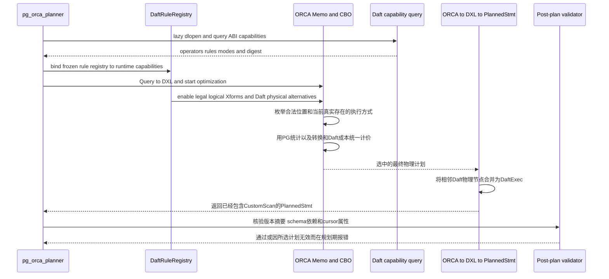

对应到 pg_orca 代码层次，需要新增四类插入点：

1. **优化前 capability 固定**：在调用 `GPOPTOptimizedPlan()` 前获取本 backend 的 ABI/capability snapshot；同一次优化期间不得变化。
2. **ORCA Xform 注册**：在 `CXformFactory` 和相关 logical operator promise/compatibility 检查中登记适用的 Daft 规则或 ORCA 等价规则。
3. **物理候选与成本**：新增 Daft physical operators、`PG_ROW/DAFT_ARROW` 属性、转换 enforcer，并扩展 cost model。
4. **翻译与融合**：在 ORCA selected expression 到 DXL、再到 `PlannedStmt` 的翻译链中生成 `CustomScan`；相邻 Daft 节点只做机械融合。

冻结代码中 `pg_orca.cpp:642-644` 的 `GPOPTOptimizedPlan()` 是整个 CBO 的外部调用边界，但规则和候选必须进入它内部的 Memo 搜索。`pg_orca.cpp:698` 之后、cursor Material 之前仍可放 post-plan validator，但这里已经太晚，不能再执行 `PgDaftRewritePlan()` 或“最大连续子树”选择。

prepared statement 在生成 custom/generic plan，或 PG 已判定 cached plan 失效并重新规划时，执行上述流程；普通 `EXECUTE` 可能直接复用已经选定的 generic plan。Envelope 只保存 capability-registry digest 和本片段实际需要的 runtime capability bits。registry digest 不同或当前 runtime bits 不包含所需 bits 时必须拒绝执行；在 registry digest 一致的前提下，当前 runtime bits 只是多开启了无关 bit 时仍可执行。P0 对 registry 定义或准入状态变化仍采用保守的整表 digest 失效策略。计划格式和 Bridge ABI 由 `dpg_open_v1()` 及独立 ABI 查询确定；生成器版本和成本模型版本只进入构建报告、EXPLAIN 或调试日志。**Envelope 中的这两个能力字段不会自动让 PostgreSQL 的 `CachedPlanSource` 失效**；显式失效机制完成前，执行前发现真正的语义或所需能力失配必须直接报错，不能声称会自动重规划。

## 7. 一个业务 SQL 的完整混合执行计划

业务：从 8 亿条广告事件中过滤当天约 1.5 亿条，关联两张维表，最终聚合为约 2,000 行并返回前 100 行。本例三张表都是 PostgreSQL 管理的 relation，因此使用默认 PG-owned source 模式；它不表示 S3/Parquet 外部源也必须由 PG 扫描。

```sql
SELECT
    a.industry,
    c.channel,
    count(*) AS event_count,
    sum(e.cost_cents) AS total_cost
FROM ad_events e
JOIN campaign c
  ON e.campaign_id = c.id
JOIN advertiser a
  ON c.advertiser_id = a.id
WHERE e.event_day = DATE '2026-08-08'
GROUP BY a.industry, c.channel
ORDER BY total_cost DESC
LIMIT 100;
```

目标 `EXPLAIN` 应在一棵树中显示两种执行器；数字仅为说明，不是实测：

```text
[PG] Custom Scan (DaftExec)
       (cost=1824932.18..1938721.42 rows=100 width=80)
     Output: a.industry, c.channel, count(*), sum(e.cost_cents)
     Optimizer: pg_orca
     Daft Fragment: 1
     Execution Mode: embedded

     -> [DAFT] Limit
          Count: 100
          Offset: 0

          -> [DAFT] Sort
               Sort Key: sum(e.cost_cents) DESC NULLS FIRST
               Estimated Rows: 2000

               -> [DAFT] HashAggregate
                    Group Key: a.industry, c.channel
                    Aggregates:
                      count(*) AS event_count
                      sum(e.cost_cents) AS total_cost
                    Estimated Input Rows: 150000000
                    Estimated Output Rows: 2000

                    -> [DAFT] Hash Join
                         Join Type: Inner
                         Build Side: Right
                         Hash Cond: e.campaign_id = c.id

                         -> [DAFT] Source 1: ad_events
                              -> [PG] Seq Scan on public.ad_events e
                                   Output: e.campaign_id, e.cost_cents
                                   Filter: e.event_day = '2026-08-08'::date
                                   Estimated Rows: 150000000

                         -> [DAFT] Hash Join
                              Join Type: Inner
                              Build Side: Right
                              Hash Cond: c.advertiser_id = a.id

                              -> [DAFT] Source 2: campaign
                                   -> [PG] Seq Scan on public.campaign c
                                        Output: c.id, c.advertiser_id, c.channel
                                        Estimated Rows: 2000000

                              -> [DAFT] Source 3: advertiser
                                   -> [PG] Seq Scan on public.advertiser a
                                        Output: a.id, a.industry
                                        Estimated Rows: 100000
```

这不是把整个计划交给 Daft：

- 三个 `[PG] Seq Scan` 真正读取 PG relation；
- 日期 Filter 已在 PG scan 中执行，未把 8 亿行全部送给 Daft；
- `[DAFT] Source` 只接收对应 PG scan 的批次；
- 两个 Join、Aggregate、Sort、Limit 是一个连续 Daft fragment；
- 最外层 CustomScan 本身仍是 PG executor 节点。

## 8. 遇到不支持节点时如何由 CBO 选择部分执行

下面保留“替换前/替换后”的直观对照，但它现在表示 **ORCA Memo 中的两个物理候选及最终翻译结果**，不再表示先生成一个最终 PG Plan、再用 walker 修改指针。假设 Window 必须由 PG 执行，而 Sort、HashAggregate 和 HashJoin 都存在经过规则注册与语义校验的 Daft 物理实现。

### 8.1 纯 PostgreSQL 物理候选

```text
PlannedStmt.planTree
  -> [PG] WindowAgg
       Window: row_number() OVER (...)

       -> [PG] Sort
            Sort Key: customer.region, total_amount DESC

            -> [PG] HashAggregate
                 Group Key: customer.region
                 Aggregates:
                   count(*)
                   sum(orders.amount_cents)

                 -> [PG] HashJoin
                      Join Type: Inner
                      Hash Cond: orders.customer_id = customer.id

                      -> [PG] SeqScan orders
                           Filter: order_day = '2026-08-08'::date
                           Output: customer_id, amount_cents

                      -> [PG] Hash
                           -> [PG] SeqScan customer
                                Output: id, region
```

如果 ORCA 最终选择纯 PG 候选，翻译后的对象关系是：

```text
PlannedStmt.planTree = WindowAgg
WindowAgg.plan.lefttree = Sort
Sort.plan.lefttree = Agg
Agg.plan.lefttree = HashJoin
HashJoin.outerPlan = SeqScan orders
HashJoin.innerPlan = Hash -> SeqScan customer
```

### 8.2 ORCA Memo 中产生和比较 Daft 候选

Window 不支持 Daft 时，相关 implementation Xform 不产生 `CPhysicalDaftWindow`；但它的 child group 仍可以同时包含 PG 与 Daft alternatives：

```text
Window group required property: ordered(region ASC, total_amount DESC)

Alternative A:
  CPhysicalWindow
    -> CPhysicalSort
         -> CPhysicalHashAgg
              -> CPhysicalHashJoin

Alternative B:
  CPhysicalWindow
    -> CPhysicalDaftSort
         -> CPhysicalDaftHashAgg
              -> CPhysicalDaftHashJoin
```

Alternative B 的处理分成“合法性”和“选优”两步：

1. DaftRuleRegistry 和 runtime capability 都声明相关规则、算子、类型、函数、collation 可用；
2. Daft Sort 的 derived order 能满足 Window 要求的 order property；

前两项是候选生成门禁；通过后，Alternative B 才能进入 Memo。随后 ORCA 计算包含 PgToArrow、Daft 计算、内存/spill 和 ArrowToPg 的完整成本，并在所需属性下与其他候选比较。成本较高并不使 B “非法”，只是使它不能成为该 optimization context 的最终胜者。

如果 B 胜出，翻译器在 selected physical expression 到 DXL/PlannedStmt 的过程中，把连续 Daft 节点融合并创建 `CustomScan`。概念代码是：

```cpp
if (IsSelectedDaftPhysicalSubtree(selected_expr))
{
    DaftFragmentIR ir = SerializeSelectedDaftNodes(selected_expr);
    List *pg_sources = TranslatePgBoundaryChildren(selected_expr);
    CustomScan *daft_exec = BuildDaftCustomScan(ir, pg_sources);
    window_plan->plan.lefttree = (Plan *) daft_exec;
}
```

这里没有 `old_sort_subtree`，也没有从最终 PG Plan 重新判断“是否值得替换”。选择已经由 ORCA CBO 完成；该代码只物化 selected expression。

### 8.3 CBO 选中 Daft 候选后的混合计划

```text
[PG] WindowAgg
     Window: row_number() OVER (...)

     -> [PG] Custom Scan (DaftExec)
          Daft Fragment: 1

          -> [DAFT] Sort
               Sort Key: customer.region, total_amount DESC

               -> [DAFT] HashAggregate
                    Group Key: customer.region
                    Aggregates:
                      count(*)
                      sum(orders.amount_cents)

                    -> [DAFT] HashJoin
                         Join Type: Inner
                         Build Side: Right
                         Hash Cond: orders.customer_id = customer.id

                         -> [DAFT] Source 1
                              -> [PG] SeqScan orders
                                   Filter: order_day = '2026-08-08'::date
                                   Output: customer_id, amount_cents

                         -> [DAFT] Source 2
                              -> [PG] SeqScan customer
                                   Output: id, region
```

最终 `PlannedStmt` 的对象关系是：

```text
PlannedStmt.planTree = WindowAgg
WindowAgg.plan.lefttree = CustomScan DaftExec
CustomScan.custom_plans[0] = SeqScan orders
CustomScan.custom_plans[1] = SeqScan customer
CustomScan.custom_private = PgDaftPlan(Sort/Agg/Join)
```

Daft Sort 必须产生 Window 所要求的 key direction、NULL ordering、类型和 collation；`WindowAgg` executor 会直接相信 child 已按要求排序。如果 Daft 不能派生出等价 order property，Alternative B 在 CBO 阶段就是非法候选，而不是等到计划生成后再拆掉 Sort。

### 8.4 为什么 CBO 选中后 PostgreSQL Plan 树里看不到 Sort

这里要区分三种不同的“计划视图”，否则容易误以为 Sort 被删除了：

1. **PostgreSQL 原生对象树**：只包含 PostgreSQL 能识别和执行的 `Plan` 节点；
2. **Daft 片段 IR**：序列化在 `CustomScan.custom_private` 中，运行时编译成 Daft `LocalPhysicalPlan`；
3. **混合 EXPLAIN 视图**：由 `ExplainCustomScan` 把前两者组合成人可读的一棵树。

当 CBO 选择 Daft Sort 时，原生 PG 对象树是：

```text
PlannedStmt
  planTree = WindowAgg                       -- PostgreSQL Plan 节点
               lefttree = CustomScan         -- PostgreSQL Plan 节点
                            custom_plans[0] = SeqScan orders
                            custom_plans[1] = SeqScan customer
                            custom_private = bytea(PgDaftPlan)
```

`custom_private` 中的中立 IR 则是：

```text
PgDaftPlan
  root = Sort
           -> HashAggregate
                -> HashJoin
                     -> ExternalInput(source_id=0)
                     -> ExternalInput(source_id=1)
```

这里不应再说“先创建的 PG Sort 被删除”。更准确的过程是：ORCA 同时考虑 PG Sort 与 Daft Sort，最终选中了 Daft physical alternative，所以 DXL-to-PlannedStmt 翻译时根本不为该位置创建 PG `Sort *`。排序语义进入 Daft IR 并由 Daft 执行。Daft IR 不是 PostgreSQL `Plan *`，PG 通用 walker 和 executor 不会把它看成一个原生 Sort 节点。

`ExplainCustomScan` 应把这个事实展示为：

```text
[PG] WindowAgg
  -> [PG] Custom Scan (DaftExec)
       Daft Fragment:
         -> [DAFT] Sort
              -> [DAFT] HashAggregate
                   -> [DAFT] HashJoin
```

这是一棵跨引擎的解释视图，不等于 PostgreSQL 内存中存在 `[DAFT] Sort` 这种 `Plan` 节点。

生成 Daft Sort 候选时，ORCA property 和翻译层不能只保存 EXPLAIN 中显示的列名。它必须完整携带最终 PG Sort 所需的等价信息：

```text
numCols
sortColIdx[]
sortOperators[]
collations[]
nullsFirst[]
```

在生成 `CustomScan` 时，翻译器再把 ORCA/DXL 的排序列绑定到 `custom_scan_tlist` resno 和 Daft IR column ID。只有类型比较、ASC/DESC、NULLS FIRST/LAST 和 collation 全部通过 capability 检查，Memo 中才允许存在这个 Daft Sort alternative。

如果 Daft 不能证明与 PG Sort 等价，例如查询使用尚未支持的 ICU collation，ORCA 不生成 Daft Sort 候选，但仍可选择 PG Sort 加其下方的 Daft Aggregate/Join 候选：

```text
[PG] WindowAgg
  -> [PG] Sort
       Sort Key: customer_name COLLATE "zh_CN"
       -> [PG] Custom Scan (DaftExec)
            Daft Fragment:
              -> [DAFT] HashAggregate
                   -> [DAFT] HashJoin
```

此时的指针关系是：

```text
WindowAgg.plan.lefttree = PG Sort
PG Sort.plan.lefttree = CustomScan DaftExec
CustomScan.custom_private = PgDaftPlan(Agg/Join)
```

因此，“最终 PG 树里没有 Sort”只适用于 **CBO 选中 Daft Sort** 的物理计划，不是所有混合计划的固定形态。必须为两种形态分别建立 Memo-alternative、cost-choice 和 final plan-shape 测试，并使用 ASC/DESC、NULLS FIRST/LAST、C/POSIX collation 及拒绝 Daft Sort 的 ICU collation 做结果差分测试。

### 8.5 候选生成与选择原则

每个 Daft implementation Xform 先做语义和 capability 检查；非法时不产生候选，合法时进入 Memo 并与 PG physical alternatives 比较成本。未知语义一律不产生 Daft 候选，不进行“尽力映射”。

不支持的 WindowAgg、SubPlan 或 rescan 只会阻止相应 Daft alternative；其 child group 仍可独立产生合法的 Daft 候选。只有所有 Daft 候选都非法或在相应 optimization context 中落败时，最终计划才完全使用 ORCA+PG executor。

最终 Plan validator 的失败不能一概理解为“关闭 Daft 后再跑一次 ORCA”。可预判的 source、schema、类型、物理属性和 payload 上界问题应在候选生成时排除，ORCA 在同一次 Memo 搜索中继续比较其余候选。若最终 IR 与获胜 expression 不一致、schema 映射对不上、required properties 丢失，或者同一次 `pg_orca_planner()` 调用混用了不同 capability digest，这是 translator、fusion 或 validator 的内部一致性缺陷，auto 和 force 都应报错，不能用纯 PG 计划掩盖。只有候选期已经按保守上界检查、最终 canonical serialization 才确认 payload 超过硬限制时，auto 才允许丢弃整份结果、关闭 Daft alternatives 并完整重跑一次 ORCA，且最多一次；force 报错。

另一类情况是计划生成以后 catalog、schema 或 capability 版本真的发生变化。此时原计划依赖已经失效，应在 executor 消费数据前通过显式计划失效机制让 PostgreSQL 重新进入 planner；机制尚未实现时直接报错。它不同于上述内部缺陷，也不同于普通候选不兼容。executor 已经开始消费数据后更不能现场换成未经 CBO 计价的片段。

## 9. 是同进程还是跨进程

P0-P2 默认是同进程嵌入式模式：

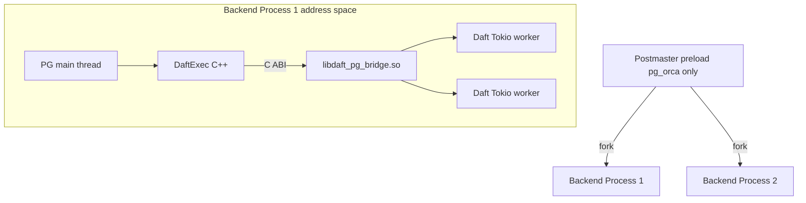

`pg_orca.so` 可由 `shared_preload_libraries` 加载，但 Daft bridge 不得在 postmaster 中加载或启动线程。backend fork 完成后，第一次规划一个通过廉价 query-shape 预检、可能枚举 Daft alternative 的查询，且需要在枚举前冻结 capability 时才：

1. `dlopen(path, RTLD_NOW | RTLD_LOCAL)`；
2. `dlsym` 完整 versioned vtable；
3. 查询 ABI major/minor、capability bits 和 capability digest；
4. 需要执行时才建立该 backend 的 Rust runtime/handle。

加载成功后不 `dlclose`，直到 backend 退出。多 backend 会各有 runtime，因此必须限制每 backend worker threads、内存和并发片段，避免连接数乘线程数造成过度订阅。

这里的 backend 特指普通客户端连接对应的 PostgreSQL backend。P0/P1 不允许 `DaftExec` 在 PostgreSQL parallel worker 或 background worker 中执行，也不生成同时含 `DaftExec` 与 `Gather/GatherMerge` 的最终计划。ORCA 可以比较纯 PG parallel plan 和普通 backend 内运行的非 PG-parallel Daft plan，但最终只能选择其中一种。计划和执行端分别把 `DaftExec` 标成 `parallel_aware=false`、`parallel_safe=false`，并在打开 Bridge 以前用 PG19 的 `IsParallelWorker()`、`AmRegularBackendProcess()` 做防御检查；PG parallel CustomScan 所需的 DSM 和 worker 初始化回调在 P0/P1 保持未实现。

这不表示 Daft 只能单线程。普通 backend 调用 `dpg_open_v1()` 后，嵌入式 Daft 可以在同一进程内启动受 `pg_orca.daft_worker_threads` 限制的 Tokio worker 线程。它们只处理 Arrow/Daft 批数据，不是 PostgreSQL parallel worker，也不能调用 `ExecProcNode()`、访问 catalog 或操作 PG `MemoryContext`。

`P3-001` 可选 sidecar 才是跨进程模式，需要 Arrow IPC/Flight/Unix socket；它不是当前默认方案，也不等于 `P3-002` 的 Daft-owned external scan。

## 10. PG 扫描数据如何进入 Daft

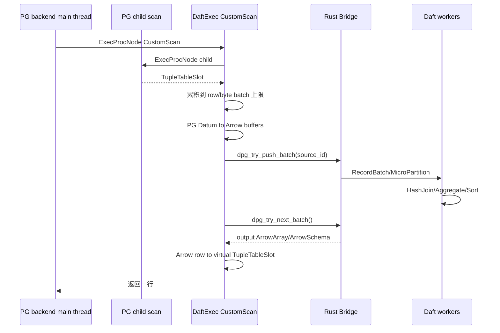

这不是 Arrow IPC。C ABI 传递 `ArrowArray/ArrowSchema` 及 buffer 地址，没有 socket、RPC 或序列化成字节流。

实现人员补充：Rust bridge 收到一个 `RecordBatch/MicroPartition` 后，Swordfish 需要安排各个 Daft 算子依次处理数据批。Daft 使用的 `Tokio` 是一个随 Rust 代码一起编译的任务调度库，负责运行任务、管理工作线程以及处理异步等待；它不是需要单独安装、启动或监听端口的系统服务。源码构建阶段需要 Rust 工具链和 Cargo，由 Cargo 下载或使用 vendored Tokio 源码并把它链接进 bridge 动态库；部署已经构建好的 bridge 时不需要再安装 Tokio。进程内 `mpsc` 队列是这些任务之间传递数据批和控制消息的内存队列，`mpsc` 表示“多个发送者、一个接收者”。这个机制只负责“什么时候处理下一批”和“下游忙时怎样让上游暂停”，不会改变算子顺序，也不是 PG 与 Daft 之间的数据协议。只需理解整体数据流的读者可以跳过这一实现细节。

但 PG heap/index child 给出的是逐行 Datum，而 Daft 消费列式 Arrow，因此 P0 构造 Arrow batch 时仍需一次 row-to-column 重组：定长值写入连续列 buffer，varlena 在 detoast 后写入独立 buffer。这是“从 PG 行构造 Arrow 列”的成本，不表示随后通过 Arrow C Data Interface 交付 buffer 时还要再完整复制一遍。Bridge 可以接管 buffer 所有权；未来已有兼容 Arrow buffer 的输入也可以在生命周期可证明时转移或共享。原则是：

- `slot_getallattrs()` 只能在 PG main thread 调用；
- text/bytea 等 varlena 必须 detoast 并复制；
- Arrow buffers 不得引用会被 reset 的 PG per-tuple context；
- 跨线程交给 Rust 的 buffer 使用 libc/bridge allocator，不使用要求在 PG context 中释放的 `palloc`；
- release callback 不能从 Tokio thread 调用任何 PG API；
- `dpg_try_push_batch=OK` 后 Rust 接管，`AGAIN/ERROR` 时 PG 仍拥有；
- 输出 batch 在 PG main thread 解码，batch 耗尽后 release。

现有 Daft `Input::InMemory(Vec<MicroPartitionRef>)` 是一次性输入，不能满足增量 PG scan。因此 P0 必须新增 bounded `StreamingScan`：Batch 不 Flush，Finish 才 Flush，Cancel 唤醒全部等待者。

## 11. 为什么接口必须非阻塞

同一个 PG main thread 既生产输入又消费输出。若 `push` 或 `next` 无限阻塞，bounded channel、HashJoin build/probe 和输出队列可能互相等待。

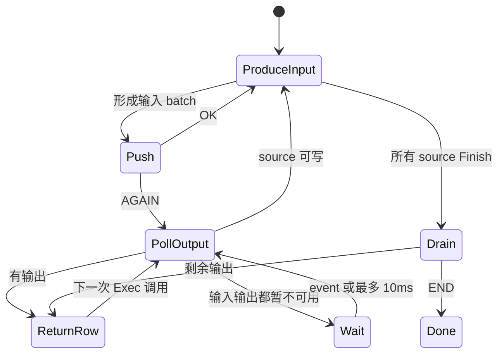

每次短等待后先执行 `CHECK_FOR_INTERRUPTS()`，从而响应 statement timeout、client cancel 和 backend shutdown。

## 12. 数据源归属与 S3 的关系

Daft 当前 native executor 的底层输入包括：

- `ScanTasks`：文件、数据库/Python source 生成的扫描任务；
- `InMemory`：已有 MicroPartitions；
- `GlobPaths`：文件路径元数据；
- `FlightShuffle`：分布式 worker 中间结果。

文件 reader 支持 Parquet、CSV、JSON、WARC、Text。S3 Parquet 通常不先落完整本地文件：Daft读取 footer、选中列和 row group，再发 S3 Range GET，把所需字节流入内存。若查询所有行列，累计网络字节仍可能接近整文件；operator spill 到本地盘是另一件事。

### 12.1 两种 source ownership

这里必须区分两种 source ownership，不能笼统写成“PG 一定负责所有扫描”：

| 模式 | 谁产生原始数据批 | 适用对象 | 当前状态 |
|---|---|---|---|
| PG-owned source | PG `SeqScan/IndexScan/ForeignScan`，随后 PG row-to-Arrow | PG heap/index，以及需要保留既有 FDW 事务、权限和 pushdown 语义的 foreign table | P0-P2 默认模式 |
| Daft-owned external source | Daft `ScanTasks`/文件 reader 直接产生 Arrow/MicroPartition | 显式登记为 Daft external table 的 S3/Parquet/CSV/JSON 等对象 | 任务 `P3-002`；当前未实现且默认关闭 |

当前默认集成故意不让 Daft 直接扫描 PG relation，也暂不启用 Daft-owned S3 scan：

```text
PG relation 或 PG ForeignScan -> PG child plan -> Arrow -> Daft compute
```

因此它保持 PG snapshot/RLS/权限，但对外部 Parquet 若仍经普通 PG/FDW 路径读取，可能无法获得 Daft 原生 column/row-group pruning、并行 Range GET 和文件 reader pipeline 的全部潜在收益。

### 12.2 “独立 physical alternative”是什么意思

“独立”表示 Daft direct scan 是 ORCA Memo 中一个显式、有自身 capability、物理属性、统计和成本的实现，不是 Daft executor 在运行时看到 URI 后偷偷绕过 PG scan。假设 PG catalog 中的逻辑 relation `external_ad_events` 已明确绑定一个 S3 manifest，则其 logical scan group 才可能拥有两个物理实现：

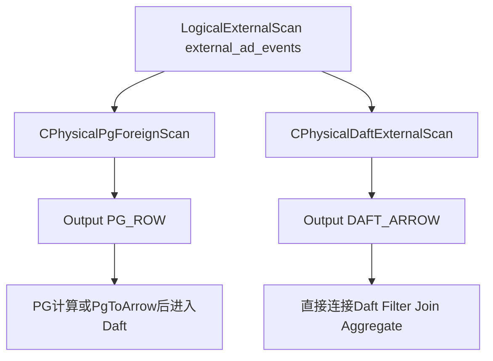

| 独立维度 | PG/FDW scan alternative | Daft external scan alternative |
|---|---|---|
| ORCA operator | `CPhysicalPgForeignScan` 或现有等价实现 | 新 `CPhysicalDaftExternalScan` |
| runtime capability | PG access method/FDW 自身能力 | 例如 `S3_PARQUET_SCAN`、projection/predicate/row-group pruning，可分别开关 |
| derived format | `PG_ROW` | `DAFT_ARROW` |
| 统计与成本 | FDW rows/cost、PG tuple 形成、可能的 PgToArrow | 文件数、footer、列/row-group pruning、Range GET、网络、缓存、解压、解码和重试 |
| 最终计划 | PG `ForeignScan` 是真实 child plan | Daft IR 中有真实 `ParquetScan` 叶子，该 source 没有伪造 PG child |
| 不可用时 | 仍可参与或胜出 | 不生成候选；不能在 Begin/执行期间临时切换读取方式 |

因此 ORCA 比较的不是一个隐藏开关，而是两棵性质不同的物理计划：

```text
候选 A：
PG ForeignScan external_ad_events
  -> PgToArrow
       -> Daft Filter
            -> Daft Aggregate

候选 B：
Daft ParquetScan external_ad_events
  -> Daft Filter
       -> Daft Aggregate
```

候选 B 省去了 PG row-to-Arrow，并可能获得 Parquet pruning，但不因此自动更便宜；小文件数量、远端网络、footer 请求、缓存命中和重试都可能使它落败。成本较高只表示 B 不是本次 optimization context 的 winner，语义或 capability 不满足才表示 B 不应生成。

还要区分两个容易混淆的节点：

| 节点 | 数据从哪里来 | 是否对应 `custom_plans` child |
|---|---|---:|
| `[DAFT] Source`/`ExternalInput` | PG executor 已扫描并推入的 Arrow batch | 是 |
| `[DAFT] ParquetScan`/`ExternalScan` | Daft reader 自己读取的外部对象 | 否 |

若业务核心是几十 TB S3 Parquet，应新增 `CPhysicalDaftExternalScan` 一类物理候选，而不是把所有扫描继续固定给 PG。一个合法的混合候选可以同时包含两种 source：

```text
[PG] Custom Scan (DaftExec)
     -> [DAFT] HashJoin
          -> [DAFT] ParquetScan
               URI: s3://analytics/events/
               Columns: campaign_id, cost_cents
               Predicate: event_day = DATE '2026-08-08'
          -> [DAFT] Source 1
               -> [PG] IndexScan campaign
```

这个 `DaftExec` 的 `custom_plans` 只有 PG `IndexScan campaign`；Parquet scan 作为 Daft IR 中的叶子自行产出 Arrow batch，不需要一个伪造的 PG child plan。

### 12.3 何时允许两个 scan 进入同一个 Memo group

Daft-owned external scan 要进入 Memo，至少必须先冻结以下契约：

- PG catalog 中如何登记 URI、format、schema、partition 和 owner，哪些 SQL relation 对应同一外部数据快照；
- 文件清单、对象 version/ETag 或 manifest 如何按隔离级别在 statement/transaction 执行边界固定；普通 cached plan 不能把规划时的 current manifest 当成永久执行快照；
- 权限/RLS/security barrier 在 PG 侧保留还是经过证明后下推；不能因为绕过 PG scan 而绕过访问控制；
- 凭证如何通过短期 credential handle 传入，不能进入 DXL、`custom_private`、EXPLAIN 或日志；
- Parquet logical type、timestamp/timezone、decimal、NULL 和 collation 如何映射到 PG OID 语义；
- 成本模型如何计入 LIST/HEAD/Range GET、footer、row-group pruning、网络带宽、缓存、解码和重试；
- 取消、statement timeout、对象变化和部分读取失败如何映射为 PG ERROR。

只有当同一个 catalog relation 同时存在 PG/FDW scan 与 Daft external scan 且两者的快照、权限和结果语义被证明等价时，ORCA 才能把它们放进同一 logical group 作为物理替代方案。不能拿一个普通 PG heap relation 的 `SeqScan`，直接替换成读取某个同名 S3 路径的 Daft scan。

### 12.4 Daft 直接扫描外部对象后的事务边界

Daft 直接读取 Parquet 后，该数据不会自动进入 PostgreSQL MVCC。PG 仍能控制 statement/transaction 生命周期、取消、超时、错误传播和资源释放，但不能仅凭一个 PG snapshot 决定 S3 中哪些对象版本可见。必须区分以下能力：

| 控制维度 | Daft-owned external scan 的准确边界 |
|---|---|
| PG 查询生命周期 | 仍由 PG 控制；Daft 必须响应 cancel、timeout，并把失败映射为 PG ERROR |
| PG heap/index MVCC | 不受影响，PG-managed relation 仍由 PG executor 按 PG snapshot 扫描 |
| 外部文件可见性 | 不使用 PG MVCC；必须由 external snapshot/manifest 协议固定文件集合和 object version/ETag |
| PG 与外部源的全局原子快照 | 默认没有；两套 snapshot 只是组合在一个查询中，不得宣称跨系统 Serializable |
| 外部写入、提交与回滚 | 当前方案不支持；只读 scan 的 PG rollback 只能取消执行和丢弃结果，不能回滚其他系统对 S3 的修改 |

不允许每个 worker 在执行时自行对 `s3://.../*.parquet` 重新 glob。一个可重复的 external snapshot 至少要绑定：

```text
snapshot_id
manifest_version
object_key + version_id/ETag
schema_fingerprint
partition metadata
```

Daft reader 只能读取该 snapshot 列出的精确对象版本。若对象存储没有版本能力、文件可被原地覆盖且无法通过 manifest 固定，则相应 direct-scan capability 必须关闭。

PG 隔离级别与外部 snapshot policy 的最低映射为：

| PG 查询语义 | external snapshot policy | 处理原则 |
|---|---|---|
| `READ COMMITTED` | `STATEMENT_SNAPSHOT` | 每条 statement 在 `ExecutorStart` 解析一次 snapshot，同一 statement 内固定 |
| `REPEATABLE READ` | `TRANSACTION_SNAPSHOT` | transaction 第一次访问该 external binding 时解析，随后在同一 transaction 中复用 |
| `SERIALIZABLE` | 需要外部冲突检测/统一协调 | 当前能力不足时不生成 Daft direct-scan candidate；不能静默降级为 statement snapshot |
| 显式 `AS OF`/time travel | `EXPLICIT_SNAPSHOT` | 查询明确指定不可变 snapshot ID 时，可以跨执行复用该 ID |

prepared/generic plan 尤其不能在普通“读取当前数据”的规划时刻永久写死 manifest：

```text
错误：PREPARE时绑定current manifest A
      数天后每次EXECUTE仍隐式读取A

正确：cached plan保存source_binding + snapshot_policy
      ExecutorStart按当前statement或transaction解析snapshot token
```

只有显式 `AS OF snapshot_id` 查询才能把固定 snapshot ID 作为逻辑语义写入计划。普通计划可以保存用于成本估算的 planning statistics/version，但它不能冒充执行期可见性 token。

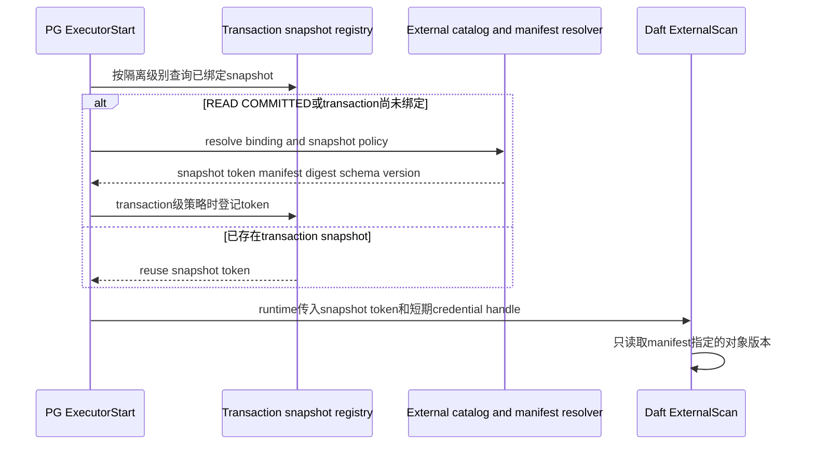

事务一致性是 Daft scan candidate 的 **合法性属性**，不是成本项。ORCA 必须为 external scan 增加类似 `STATEMENT_SNAPSHOT/TRANSACTION_SNAPSHOT/SERIALIZABLE_EXTERNAL` 的 required/derived consistency property。当前事务要求高于候选能力时，implementation Xform 不得生成该候选，即使它预计更快。

同理，PG ForeignScan 与 Daft ExternalScan 只有在二者接受同一个 snapshot binding，并提供当前查询要求的隔离、权限和错误语义时，才能作为同一 logical group 的物理替代方案。如果 FDW 和 Daft reader 分别解析“当前文件”，它们并不构成已证明的语义等价候选。

## 13. 用时间分解判断是否值得

以下数字仅用于理解。

CPU 密集报表的原执行时间：

| 阶段 | ORCA + PG executor |
|---|---:|
| PG scan/filter | 20 s |
| 两个 HashJoin | 50 s |
| HashAggregate | 35 s |
| Sort/Limit | 1 s |
| 总计 | 106 s |

混合执行假设：

| 阶段 | ORCA + PG/Daft |
|---|---:|
| 同一 PG scan/filter | 20 s |
| PG -> Arrow | 12 s |
| Daft Join/Aggregate/Sort | 19 s |
| Arrow -> PG 100 行 | 接近 0 s |
| 总计 | 约 51 s |

如果原计划的扫描本身要 80 s、计算只要 20 s，即使 Daft 把计算降到 5 s，再加 5 s 转换，总时间仍约 90 s，只提升约 11%。

对于同时存在 PG 与 Daft 执行办法的传统关系 SQL，上线前必须比较：

```text
PG planner + PG executor
ORCA planner + PG executor
ORCA planner + Daft executor
```

并分别记录 scan、encode、Daft engine、decode、wait、peak memory、spill 和结果差异。

若 SQL 含有只有 Daft 才能执行的 AI 函数，就不存在可执行的“纯 PG 同函数”基线。此时应比较同一 SQL 含义下真实存在的函数位置、批量或设备方案，并用 Daft 单独运行结果、确定性 mock provider 或预先保存的正确结果做语义校验，不能为了凑齐三组数据虚构 PG 实现。

## 14. 规划回退与运行错误

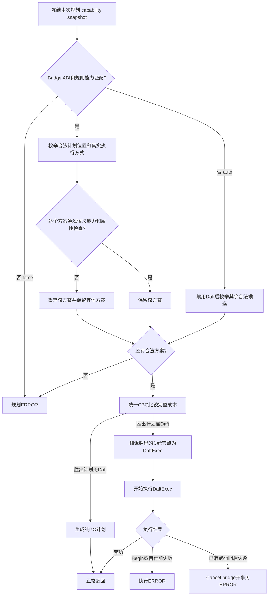

不能在已经消费 child row 后切回原计划，因为 scan 位置、volatile effects 和 operator state 已不可恢复。可靠的是规划期回退，不是运行期透明回退。

## 15. 从这里进入实现细节

| 需要了解的内容 | 阅读位置 |
|---|---|
| 架构约束和不可违反的执行契约 | 实施规格第 1 节 |
| 源码 SHA、构建基线、Xerces 缺口 | 实施规格第 2 节 |
| Daft 规则纳管、AI 能力准入和支持/拒绝矩阵 | 实施规格第 4 节 |
| ORCA 统一 CBO 代价模型 | 实施规格第 5 节 |
| 计划选择时序、fragment 融合和各算子保存边界 | 实施规格第 6 节 |
| CustomScan state/lifecycle | 实施规格第 7 节 |
| PostgreSQL/ORCA 与 Daft 的完整 Bridge 接口契约 | 实施规格第 8 节 |
| 计划 IR、Envelope 和 Node/Expr schema | 实施规格第 8.1 节 |
| Arrow 类型、epoch/Datum 和批数据所有权 | 实施规格第 8.2 节 |
| C ABI、流式驱动、取消和资源释放 | 实施规格第 8.3 节 |
| Daft StreamingScan 改动 | 实施规格第 9 节 |
| 启用开关、成本与资源 GUC、EXPLAIN 和运行指标 | 实施规格第 10 节 |
| 各项设计对应的源码和测试落点 | 实施规格第 4.8、5.14、6.4、7.5、8.4、9.4、10.3、13.2 节 |
| 分阶段实施顺序和硬门槛 | 实施规格第 11 节 |
| 跨仓库构建、安装、启动、升级和回滚 | 实施规格第 12 节 |
| 事务、安全与资源边界 | 实施规格第 1.3 节 |
| 规划回退和执行期故障边界 | 实施规格第 6.5、7.4 节 |
| 测试设计 | 实施规格第 13 节 |
| 大模型唯一实施入口、不可变边界、完成定义和交付清单 | 实施规格第 14-15 节 |
| Daft-owned external scan 的可执行任务 | 实施规格第 3.6、4.7.2、8.1.6、11.5 节与任务 `P3-002` |
| 可领取任务与依赖 | `04_PG19_ORCA_Daft实施任务清单.yaml` |

最终边界可以概括为：

> ORCA 把适用的 Daft 规则、合法算子位置以及当前真实存在的 PG/Daft 执行方式放在同一个搜索过程中统一计价；PG 始终拥有 SQL、catalog、权限和数据库生命周期，PG-managed relation 由 PG 按 MVCC 语义扫描，而显式登记的外部对象只有在独立能力完成后才可由 Daft 直接扫描；Daft 执行 CBO 选中的 Arrow 批片段，结果最终回到 PG。
