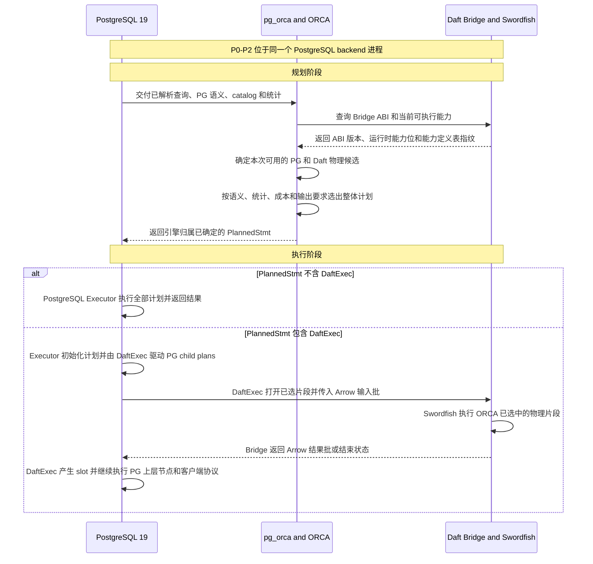
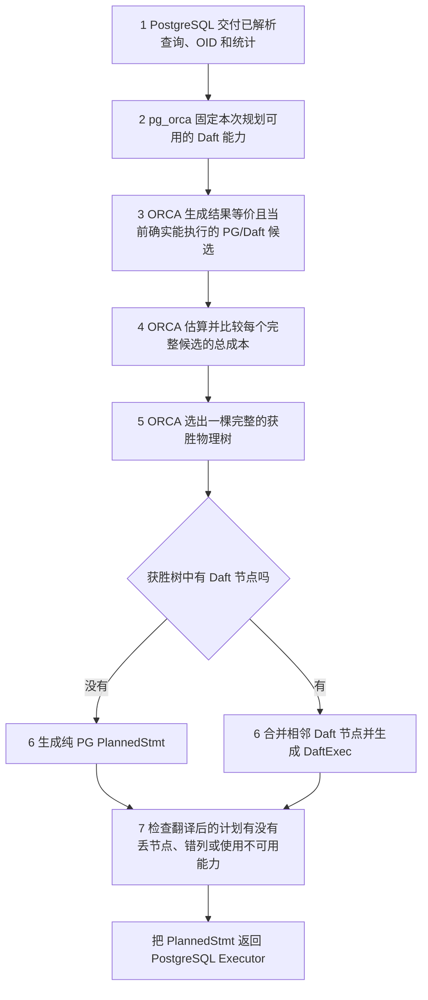
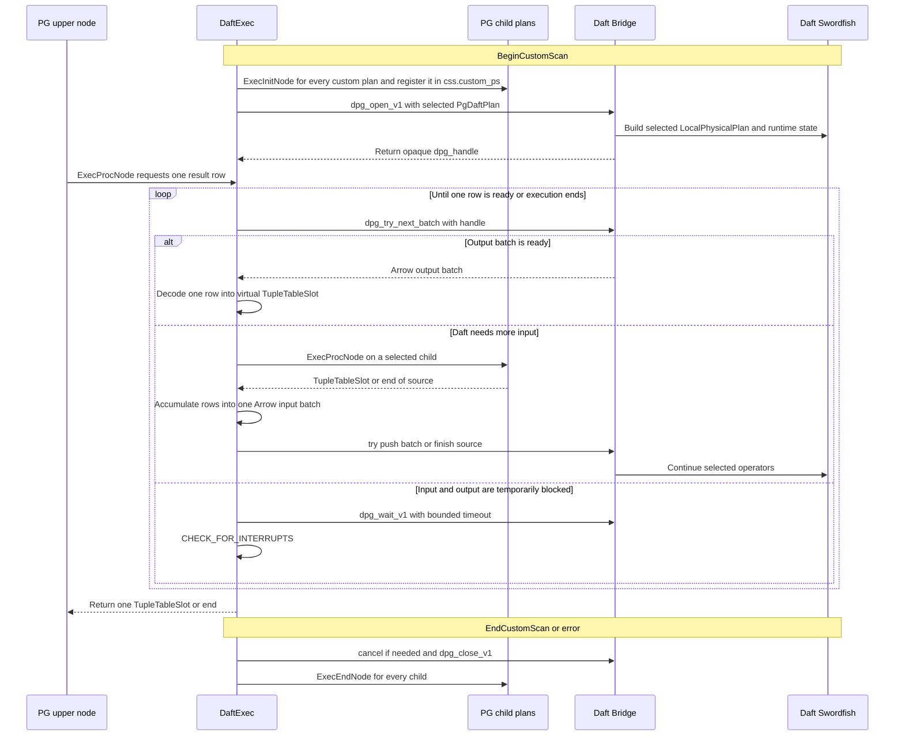
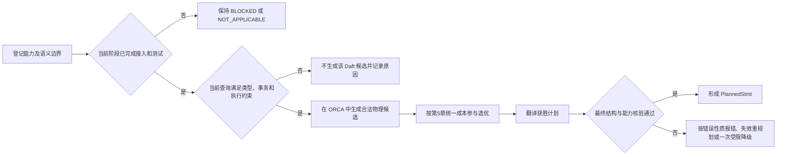
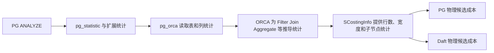
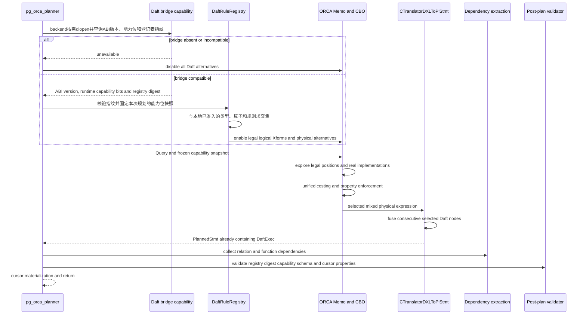
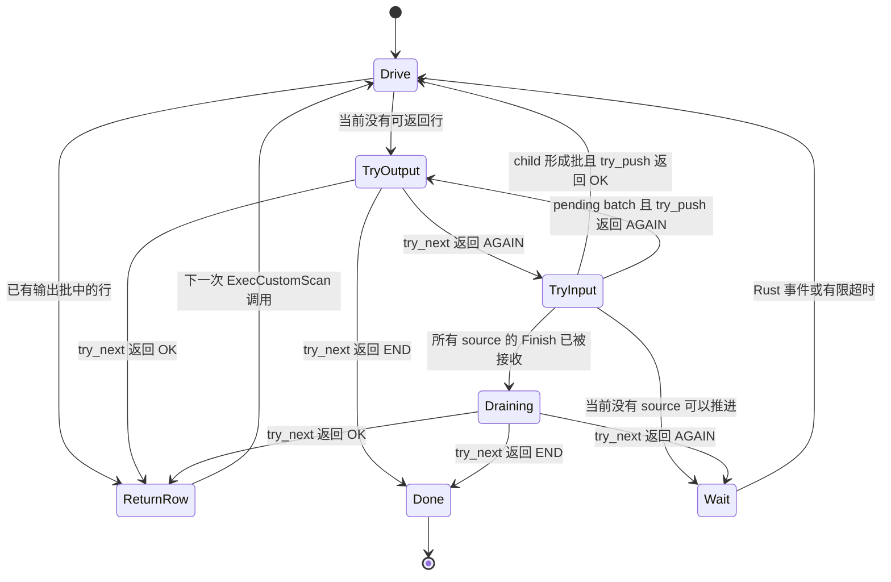
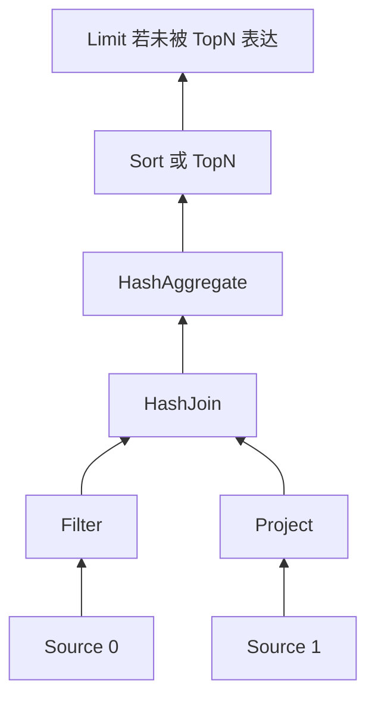
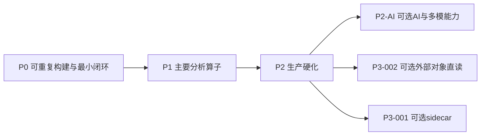

# PostgreSQL 19 + pg_orca + Daft 开发集成实施规格

> 文档状态：本文已经把核心路线 `P0`、`P1` 和 `P2-001` 拆成了有源码范围、实施步骤、测试命令和验收条件的任务，可以据此开始开发；这不表示相应代码已经实现或测试通过。`P2-002` AI/多模、`P3-001` 跨进程 sidecar、`P3-002` Daft 直读外部对象目前仍然延期并默认关闭。若以后决定启动其中一项，必须先取得人工批准，再单独写清并评审该能力的接口、权限与凭据、安全风险、成本计算、测试方法和失败处理，不能直接按当前概念设计编码。  
> 工作区：`/home/qiumc/data/code/cpp`  
> 源码冻结日期：2026-08-08  
> 01-07 与执行包一致性刷新：2026-08-11  
> 图示约束：本文所有流程图、时序图、状态图均使用 Mermaid。  
> 目标读者：能够读写 C/C++/Rust、但不具备 PostgreSQL 或 Daft 专家知识的一般能力大模型。

阅读顺序：先读同目录 [架构导读](02_PG19_ORCA_Daft架构与执行流程详解.md) 建立业务、计划、进程和数据流的整体模型，再用本文指导实现。本文描述的是目标系统应当怎样实现；当前源码已经具备什么、尚缺什么，只以第 2 章“代码现状”和执行包中的真实构建与测试证据为准。

## 1. 契约与约束

本章冻结实现开始前已经确定的架构选择和开发红线。完整的选型依据、PG 原生优化器与 ORCA 的实事求是比较、嵌入式与 sidecar 的取舍，以及被否决路线，统一见 [02 第 3 节](02_PG19_ORCA_Daft架构与执行流程详解.md#3-为什么选择orca-集成式-cbo--嵌入式-daft)。本文不再维护第二套选型论证，只从同一抽象层级回答三个问题：组件各自负责什么，计划和数据怎样跨组件流动，事务、安全和资源边界不能越过什么线。

### 1.1 架构与组件职责边界

| 已冻结的架构决定 | 对组件职责的直接约束 |
|---|---|
| ORCA 是本项目的统一 CBO | Daft 的适用逻辑规则、物理实现、执行位置和格式转换必须在 ORCA 的计划搜索中登记、生成候选并计价；不得交给执行器临时决定 |
| 不采用最终计划后分片 | ORCA 选出胜出物理树以前不得确定 Daft fragment；胜出以后只允许机械地合并相邻 Daft 节点，不得改变 Join 顺序、算法、算子位置或数据源 |
| 不运行第二套全局优化器 | Bridge/Swordfish 只能把已选片段变成可执行 pipeline；不得重新解析 SQL，也不得运行会改变全局选择的完整 Daft logical optimizer |
| P0-P2 使用嵌入式 Daft | Bridge 在 PostgreSQL backend `fork` 完成后按需 `dlopen()`；同地址空间通过 C ABI 和 Arrow C Data Interface 交换数据，不设计 socket、RPC 或 Arrow IPC 主路径 |
| PostgreSQL API 只属于 backend 主线程 | Rust/Tokio worker 只能处理已经与 PG 对象和 MemoryContext 解耦、生命周期独立且所有权明确的 Arrow/Daft 批数据，不能访问 `TupleTableSlot`、catalog 或调用 `ExecProcNode()`；这不要求跨 C ABI 时再次复制每个 buffer |
| PG-managed relation 保持 PG-owned source | heap/index 仍由 PG executor 在当前 MVCC 快照下读取，然后通过 `DaftExec` 的 child 输入进入 Daft；禁止使用 Daft PostgreSQL connector 反向读取当前数据库 |
| external relation 是单独的后续能力 | 只有显式登记且完成 catalog、权限、凭证、immutable manifest/snapshot 和成本契约的对象，才能同时产生 PG ForeignScan 与 Daft ExternalScan 候选；Daft 不得在执行期自行换源 |
| 连续 Daft 节点物化为一个执行片段 | selected expression 翻译为 `PlannedStmt` 时，使用一个 `Custom Scan (DaftExec)` 保存中立物理 IR（Intermediate Representation，中间表示）；这里特指 `PgDaftPlan`，即不依赖 PostgreSQL C++ 对象或 Daft Rust 对象的跨语言物理计划描述。PG 边界 child 则放入 `custom_plans` |
| 能力和成本是候选生成门禁 | Bridge 未报告、语义未验证、成本未标定或所需资源不可用的实现不能进入 ORCA 搜索，不能靠运行期“试一下” |
| 最终计划检查不负责优化 | 可预判的 source、schema、类型、物理属性、资源和 payload 上界问题必须在候选生成时排除，不触发第二次 ORCA。validator 只核对胜出计划是否忠实保留这些前提：IR 非法、schema 对不上或 required properties 丢失属于 translator/validator 实现错误，auto 和 force 都直接报错；真正的 catalog、schema 或 capability 版本变化必须使计划失效并重新进入 planner。只有经过候选期保守估算后、到最终序列化才确认的精确 payload 超限，auto 才允许关闭 Daft 候选并完整重跑一次 ORCA，且最多一次；force 直接报错。任何情况都不得在原计划上局部换树 |

### 1.2 规划与执行边界

以下合同按一次查询的实际顺序描述，任何阶段都不能把责任临时交给另一组件：

| 阶段 | 必须发生的事情 | 明确禁止 |
|---|---|---|
| 查询入口 | P0 首版只接受只读 `SELECT`，Daft 默认关闭；PostgreSQL 继续拥有 SQL、catalog、权限、锁和客户端协议 | Daft 解析 SQL、访问 PG catalog 或接管客户端协议 |
| 规划 | ORCA 逐项检查规则、语义、能力、统计和成本，比较合法 PG/Daft alternatives | 执行器根据运行情况临时决定是否下推，或用 force 绕过语义门禁 |
| 胜出计划翻译 | 连续胜出的 Daft 节点编码进一个 `DaftExec` 的中立 IR；最终检查只验证并注册依赖 | 最终 Plan 后重新选最大子树、改变 Join、算子位置或数据源 |
| PG-owned 输入 | PG executor 在 backend 主线程按当前计划驱动 heap/index child，产生 `TupleTableSlot` | Daft connector 反向连接当前数据库；Rust worker 调用 `ExecProcNode()` 或其他 PG API |
| 输入边界 | PG 在主线程把 slot 物化为生命周期不依赖 PG per-tuple context、所有权明确的 Arrow C Data batch | 通过 Python、PyArrow、pyo3、Arrow C++ ABI 或悬空 PG 内存指针传数据 |
| Daft 执行 | Bridge/Swordfish 只执行 selected IR 对应的 physical pipeline | 重新解析 SQL、运行改变全局选择的 logical optimizer 或重排 Join |
| 输出边界 | Arrow 输出按批转成 PG virtual slot，继续交给 PG 上层节点和客户端协议 | Rust worker 直接构造或返回依赖 PG MemoryContext 的对象 |
| 失败处理 | 规划期不合格时丢弃候选或完整重规划；一旦消费 child，失败必须 cancel、`ERROR` 并中止当前事务 | 消费部分输入后透明切回另一棵 PG 计划 |
| 代码归属 | PG 侧实现在 pg_orca，Daft 侧实现在独立 Rust bridge 和最小通用 streaming API | 修改 PostgreSQL core，或在 C ABI 内复制整个 Daft executor |

规则分类、阶段门槛和源码落点分别由第 4、6、7～10、11 和 14 章展开；这里不重复具体 Xform、ABI 函数或任务操作命令。

### 1.3 事务、安全与资源边界

这些边界与规划、执行合同处于同一层级，从 P0 第一条端到端路径开始生效。具体实现办法在后文章节定义：

| 边界 | 从一开始就必须成立的不变量 | 具体实现位置 |
|---|---|---|
| PG 事务视图 | PG-managed relation 始终由 PG child 在当前 snapshot、RLS 和权限下读取；Daft 只看到读取后的批数据 | 第 3.4、7、13 章 |
| 外部对象一致性 | external scan 只能读取显式授权 binding 和已固定 snapshot；不能宣称受 PG MVCC 保护，也不能虚构跨 PG/S3 的全局 Serializable | 第 3.6、4.7.2、8.1.6 节 |
| 敏感信息 | payload、EXPLAIN、日志和错误不得包含行值、密码、DSN、凭据、签名 URL 或用户 SQL 全文 | 第 8、10、13 章 |
| 不可信输入 | IR 和 Arrow metadata 必须先校验长度、结构和整数溢出，再分配或读取 buffer | 第 8.1、8.2 节 |
| 跨线程内存 | 交给 Rust worker 的 buffer 不能依赖 PG `palloc` 生命周期；release callback 不得从 worker 回调 PG API | 第 7.3、8.2 节 |
| 查询级隔离 | runtime 可以复用，但 query state、cancel、错误、内存统计和资源释放必须按 handle 隔离 | 第 7.3、7.4、8.3、9 章 |
| 资源上限 | 每个 backend 的 active fragment、worker、inflight batch、内存和 spill 都必须有限；spill 使用受控目录并在成功、错误和取消后清理 | 第 9.2、10.1、13 章 |
| 进程与线程 | 不在 postmaster preload 阶段启动线程；只在普通客户端 backend 已由 postmaster 创建后惰性启动 runtime。P0/P1 不允许 `DaftExec` 在 PostgreSQL parallel worker 或 background worker 中运行，也不把 `DaftExec` 与 `Gather/GatherMerge` 混在同一最终计划；这不限制普通 backend 内 Daft/Tokio 按 `daft_worker_threads` 使用线程并行 | 第 3.2、7.5、9、10.1 节 |

后续第 3～15 章分别把这些边界落实为组件关系、ORCA 候选、成本、计划、Bridge、Daft 实现、测试、模型执行规则和交付清单；后文示例不得放宽本章任何一项。

## 2. 代码现状

本章只记录当前工作区已经存在、已经验证或已经确认缺失的代码事实，不把后文的目标设计写成现成功能。源码版本、构建结果或前置缺口发生变化时，必须先更新本章和执行包中的证据，再重新判断第 1 章约束及后续实现是否仍然成立。

### 2.1 冻结源码

| 组件 | 本地目录 | 上游/状态 | 冻结提交 |
|---|---|---|---|
| PostgreSQL 19 | `postgres19/` | `REL_19_BETA2`，工作树干净 | `7873db5369b967dd53984df34fd800003410d04f` |
| pg_orca | `pg_orca/` | `quantumiodb/pgorca` `main`，工作树干净 | `55339728f8987ff351d3e88e033a0dc3be78465f` |
| Xerces-C 子模块 | `pg_orca/third_party/xerces-c/` | 已初始化 | `53c16411466bf90c62617831fe92ed0f41e70882` |
| Daft | `daft/` | `Eventual-Inc/Daft` `main`，工作树干净 | `b2fba655a96fe8f2cc5c21915ddc81dbe9610d3a` |

实际 PG 基线是 `PostgreSQL 19beta2`，`CATALOG_VERSION_NO=202607071`，不能在文档或代码中假称为 PG19 GA。升级源码后必须重新执行本方案的全部 ABI、回归与隔离测试。

许可证：PostgreSQL 使用 PostgreSQL License；pg_orca 与 Daft 使用 Apache-2.0。发布物必须保留三者许可证和 NOTICE 要求。

### 2.2 已完成验证

PG19 已用以下调试配置完整完成 `world-bin` 编译与安装：

```bash
cd /home/qiumc/data/code/cpp/.build/pg19-debug
../../postgres19/configure \
  --prefix=/home/qiumc/data/code/cpp/.install/pg19-debug \
  --enable-debug --enable-cassert \
  --without-icu --without-readline --without-zlib
make -j8 world-bin
make install-world-bin
```

该配置仅用于最小依赖的开发验证；生产构建不得照搬 `--without-icu/--without-zlib/--without-readline`。

pg_orca 已针对上述 PG19 headers 编译、安装并运行通过。实测查询：

```sql
SET pg_orca.enable_orca = on;
EXPLAIN (ANALYZE, COSTS OFF, SUMMARY OFF)
SELECT b, count(*)
FROM orca_smoke
WHERE a > 10
GROUP BY b
ORDER BY b;
```

实测计划为 `Seq Scan -> HashAggregate -> Sort`，并出现 `Optimizer: pg_orca`。扩展必须通过 `shared_preload_libraries='pg_orca'` 加载，不能只执行 `CREATE EXTENSION` 后假设后续 backend 已安装 planner hook。

### 2.3 已知前置缺口

pg_orca 默认 bundled Xerces 配置成功，但干净构建会在 `orca_core` 首批编译单元失败：

```text
fatal error: xercesc/sax2/DefaultHandler.hpp: No such file or directory
```

原因与证据：

- `pg_orca/CMakeLists.txt:102-109` 声称 `xerces-c` target 会传播 PUBLIC include，但 Xerces 3.2.5 target 没有提供所需 INTERFACE include。
- `target_include_directories(... PUBLIC ... SYSTEM ...)` 把 `SYSTEM` 放在参数组内部，实际生成了无意义的 `-I.../SYSTEM`。
- 临时向 `CMAKE_CXX_FLAGS` 加入 Xerces source/build include 后，1248 个 Ninja 步骤全部完成并生成 `pg_orca.so`。

正式实现的第一个提交必须修复 CMake，而不是保留全局 `CMAKE_CXX_FLAGS` 绕过方案。建议修复：

```cmake
if(PG_ORCA_BUNDLED_XERCES)
    target_include_directories(xerces-c SYSTEM INTERFACE
        "$<BUILD_INTERFACE:${_xerces_src}/src>"
        "$<BUILD_INTERFACE:${CMAKE_CURRENT_BINARY_DIR}/third_party/xerces-c/src>")
endif()

# 将每个 target 原有的普通 include 与系统 include 拆成两个合法调用：
target_include_directories(orca_core PUBLIC
    # 仅 pg_orca 自有 include
)
target_include_directories(orca_core SYSTEM PUBLIC
    ${PG_SERVER_INCLUDEDIR}
    ${PG_INCLUDEDIR}
    ${XERCES_INCLUDE}
    ${EXTRA_SYSTEM_INCLUDES}
)
```

Daft 尚未在本机编译：当前主机只有 Python 3.9.9，且当前命令环境找不到 `rustc/cargo/rustup/uv`；Daft 要求 Python `>=3.10`，并在 `daft/rust-toolchain.toml:1-3` 固定 `nightly-2025-09-03`。这是工具链前置条件，不是代码兼容失败。Tokio 不需要作为独立软件安装或运行；它是 Cargo 依赖，构建 bridge 时随 Rust 代码一起编译。需要安装的是上述 Rust 工具链以及本方案构建步骤要求的其他开发依赖。原子任务 `P0-002-A` 明确负责盘点、取得人工批准并在批准范围内完成实际安装或用户级配置；`P0-002-B` 再从新 shell 验证固定版本能够重复进入，`P0-002-C` 才运行未修改 Daft 的基线。没有 APPROVED DEC 时只能报告领取前阻塞或在已领取后留证阻塞，不能把“已经记录缺失项”当成工具链任务完成。

### 2.4 实施源码锚点

下面列出直接用于实施和复核的源码位置；它们证明当前代码提供了哪些接入点、又缺少哪些能力，不承担架构选型论证。

PostgreSQL 19：

- `postgres19/src/include/optimizer/planner.h:28` 的 PG19 planner hook 带 `ExplainState *`。
- `postgres19/src/backend/optimizer/plan/planner.c:321` 在 hook 与 `standard_planner()` 之间分派。
- `postgres19/src/include/nodes/plannodes.h:932-954` 定义 `CustomScan` 的 `custom_plans/custom_private/custom_scan_tlist`。
- `postgres19/src/include/nodes/extensible.h:112-162` 定义 `CustomScanMethods/CustomExecMethods` 与注册 API。
- `postgres19/src/backend/executor/nodeCustom.c:25-110` 表明 provider 创建扩展 state，默认使用 virtual slot，并由 provider 的 `BeginCustomScan` 做最终初始化。
- `postgres19/src/include/nodes/plannodes.h:962-976` 明确外连接的 `joinqual` 与 `plan.qual` 不可互换。

pg_orca：

- `pg_orca/pg_orca.cpp:561-729` 是 planner hook；`562-566` 已包含 PG19 签名条件分支。
- `pg_orca/pg_orca.cpp:642-650` 调用 `GPOPTOptimizedPlan()` 并用 `ORCA_PLAN_ID=0x4F524341` 标记计划。
- `pg_orca/gpopt/utils/COptTasks.cpp` 先产生 ORCA DXL，再通过 `CTranslatorDXLToPlStmt` 得到 PostgreSQL `PlannedStmt`。
- `pg_orca/gpopt/translate/CTranslatorDXLToPlStmt.cpp` 已完成 DXL 物理节点到 PG Plan 节点和 PG OID 语义的翻译。
- `pg_orca/pg_orca.cpp:674-697` 在返回计划前提取 relation/function 依赖。
- `pg_orca/compat/executor/dyn_scan.c:104-149,215-344` 已提供同仓库可复用的 CustomScan 注册、child 初始化、Exec/End/ReScan 范式。
- `pg_orca/pg_orca.cpp:969-1008` 已有 hook 链、CustomScan 注册和 `_PG_fini` 恢复逻辑。

Daft：

- `daft/src/daft-logical-plan/src/logical_plan.rs:29-66` 是 Daft logical plan enum。
- `daft/src/daft-logical-plan/src/optimization/optimizer.rs` 把默认规则组织为 Once/FixedPoint batches；这些规则必须进入规则台账并映射到正确优化层。
- `daft/src/daft-logical-plan/src/builder/mod.rs:1024-1061` 的 `optimize()` 会顺序运行规则和 join reorder；selected ORCA plan 不得再经过这条完整链，否则会形成不可计价的二次优化。
- `daft/src/daft-logical-plan/src/optimization/rules/reorder_joins` 的 brute-force/DP-CCP 使用 `num_rows` 与连接域估计选择 Join 顺序，是必须由 ORCA CBO 覆盖的代价相关能力。
- `daft/src/daft-distributed/src/pipeline_node/join/translate_join.rs:22-66` 按 `size_bytes` 与 broadcast threshold 选择 Join strategy；本方案嵌入的单机 Swordfish 不支持的策略必须在 capability 中关闭。
- `daft/src/daft-local-plan/src/plan.rs:71-127` 是可直接构造的 `LocalPhysicalPlan`，已有 Project、Filter、Limit、Sort、TopN、HashAggregate、HashJoin 等节点。
- `daft/src/daft-local-plan/src/plan.rs:872-898` 的 HashJoin 构造器显式接收 build side、null equality 和 join type，适合保留 ORCA 物理选择。
- `daft/src/daft-local-plan/src/translate.rs:429-495` 表明 native translation 对非等值 Join 未实现，Broadcast/SortMerge 会退为 HashJoin；因此首版不能声称支持 ORCA MergeJoin/NestLoop。
- `daft/src/daft-local-execution/src/run.rs:408-669` 是纯 Rust `NativeExecutor`；`ExecutionEngineResult::next()` 在 `679-686` 仍是私有方法。
- `daft/src/daft-local-execution/src/pipeline.rs:474-491` 与 `sources/in_memory.rs:20-121` 的现有 `InMemoryScan` 每个输入接收一次完整 `Vec<MicroPartitionRef>`，随后发送 Flush，不满足 PG child 的增量流输入。
- `daft/src/daft-ext/src/abi/arrow.rs` 已有仓库自有 `#[repr(C)]` ArrowSchema/ArrowArray/ArrowArrayStream 定义。
- `daft/src/daft-ext-internal/src/function.rs:148-208` 已演示 Daft ABI 与 Arrow 59 FFI 的所有权转换。
- `daft/daft/catalog/__postgres.py` 的 PostgreSQL connector 是 psycopg/Python 路径，不适用于 backend 内嵌执行。

## 3. 目标架构

本节只回答系统由哪些组件构成、组件在哪个进程、谁拥有规划与执行决策、数据如何穿过边界。具体候选门禁、成本和计划选择在第 4～6 章，`DaftExec`、Bridge、Daft 改动及运行控制在第 7～10 章，测试矩阵在第 13 章；本章不重复这些实现细节。本节描述的是待实现目标，不表示当前代码已完成集成。

### 3.1 一句话架构定义

**PostgreSQL 19 拥有 SQL 语义、事务和客户端会话，pg_orca/ORCA 在规划阶段统一选择 PG 与 Daft 物理实现，`DaftExec` 在执行阶段通过同 backend 进程内的 C ABI Bridge 把已选中的连续 Daft 片段交给 Swordfish 按 Arrow 批数据执行。**

核心 P0-P2 只实现同进程、PG-owned source 路线。P3 sidecar 和 Daft-owned S3/Parquet external scan 会改变进程或数据源归属，因此不放入第 3.2 节核心时序图，并且当前不属于可用架构。

### 3.2 组件、进程与存储边界

下图只串联核心 P0-P2 中一次查询的主线：先在规划阶段确定是否使用 Daft，再在执行阶段按已选计划运行。图中的 PostgreSQL、pg_orca/ORCA 和 Daft 都位于同一个 PostgreSQL backend 进程；三个参与者表示责任边界，不表示三个进程。



这张图从上到下表达三个连续事实：

1. **规划输入仍由 PostgreSQL 提供。** PostgreSQL 已经完成 SQL 解析并确定 OID、catalog、权限和查询语义；pg_orca 把这些信息送入 ORCA。规划期对 Bridge 的调用只是确认“当前真的能执行什么”，不传入业务数据，也不启动 Swordfish 查询执行。
2. **是否使用 Daft 在 ORCA 选优时已经确定。** ORCA 只比较当前真实可执行且不改变 SQL 含义的方案。返回 PG 的 `PlannedStmt` 要么完全是 PG 节点，要么已经在确定位置含有 `DaftExec`；执行期不再决定是否临时下推。
3. **Daft 只在 Executor 遇到 `DaftExec` 时参与数据执行。** `DaftExec` 是 PG 计划树中的 `CustomScan`；它驱动下方 PG child plans，把 child 产生的行数据成批转成 Arrow 交给 Daft，再把 Daft 的 Arrow 结果批转成 PG slot，交给上方 PG 节点或客户端。

图中的 PostgreSQL 参与者特指普通客户端 backend。P0/P1 可以比较“纯 PG parallel plan”和“普通 backend 中运行的非 PG-parallel Daft plan”，但最终只选其中一种；不生成同时含 `DaftExec` 与 `Gather/GatherMerge` 的混合计划，也不允许 parallel worker 或 background worker 初始化 Bridge。这里限制的是 PostgreSQL 的多进程执行路径，不是 Daft 内部的线程并行。

| 组件 | 在主线中负责什么 | 不能越过的边界 |
|---|---|---|
| PostgreSQL 19 | 提供 SQL 语义、事务、权限、catalog 和统计；运行 PG Executor；扫描 PG 管理的 heap/index | PG 对象和 `TupleTableSlot` 不交给 Rust worker 线程 |
| pg_orca/ORCA | 在规划期统一比较 PG 与 Daft 方案，决定算子归属、片段边界和最终计划 | 不执行业务数据，不在选优结束后重新换引擎 |
| Daft Bridge/Swordfish | Bridge 在规划期报告可执行能力；Swordfish 在执行期只运行已选中片段 | 不重新解析 SQL、不重排 Join、不访问 PG heap/index 或 PG 内部指针 |

因此，“同进程”不等于“无边界”：三者不使用 RPC，但仍只能通过稳定 C ABI、中立计划 IR 和 Arrow C Data 交换信息。PG heap/index 数据始终由 PG 扫描。P3 Daft-owned external scan 和 sidecar 会改变 source ownership 或进程边界，所以不混入这张核心图；external scan 分别在第 3.6、4.7.2、8.1.6 节和 P3 任务中单独定义，sidecar 则只在 P3 独立任务中定义。

### 3.3 规划控制面：一条 SQL 如何选出 PG/Daft 计划

这里的“规划控制面”就是**做计划决定的链路**。它只处理查询含义、可用能力、统计、成本和计划结构，不读取表中的业务行，也不传输 Arrow 数据批；真正搬运和计算数据的是第 3.4 节的执行数据面。

一次规划按下面的顺序完成：



图中的每一步分别回答一个具体问题：

| 步骤 | 谁提供或执行 | 实际做什么 | 得到什么 |
|---|---|---|---|
| 1. 明确查询含义 | PostgreSQL | 完成 SQL 解析、类型和函数 OID 绑定，提供 catalog relation、权限检查所需元数据、统计，以及上层要求的输出列、排序方式等信息 | 一份含义已经确定的查询输入，不是原始 SQL 字符串；权限检查仍由 PostgreSQL 按自身阶段执行 |
| 2. 确认本次可用能力 | pg_orca 查询 Bridge | 检查 ABI、能力定义表指纹和当前运行时能力位，再与 pg_orca 本地已经实现并通过测试的类型、算子和规则登记求交集 | 本次规划允许使用的 Daft 功能快照。Bridge 不返回 ORCA 规则，也不在这里启动 Tokio runtime |
| 3. 生成合法候选 | ORCA 中显式登记的规则 | 对同一个计算任务生成真实存在的执行办法。例如 HashAggregate 可以有 PG 实现和 Daft 实现；不支持某种类型、collation、rescan 或资源上界时，不生成对应 Daft 候选 | 若干结果等价、能够执行的候选；不是给每个 PG 节点无条件复制一个 Daft 版本 |
| 4. 统一计价 | ORCA 唯一 CBO 成本模型 | 在同一尺度上计算 PG/Daft 算子成本，同时计入 PG 行转 Arrow、Arrow 转 PG 行、片段启动、内存、spill、统计风险和上层所需排序等成本 | 每个完整候选的可比较成本 |
| 5. 选择获胜树 | ORCA | 在所有合法候选中选择总成本最低的一棵完整物理执行树，同时确定 Join 顺序、算法、每个算子由 PG 还是 Daft 执行以及格式转换位置 | ORCA 内部的获胜物理树；到这里引擎归属已经确定 |
| 6. 翻译为 PG 计划 | pg_orca translator | 将获胜树翻译为 `PlannedStmt`。相邻且已经获胜的 Daft 节点机械合并为一个 `Custom Scan (DaftExec)`；它下面的 PG-owned source 保存到 `custom_plans` | 纯 PG `PlannedStmt`，或已经包含一个或多个 `DaftExec` 的混合 `PlannedStmt` |
| 7. 检查翻译结果 | post-plan validator | 逐项确认 PG/Daft 节点归属和 child 对应关系仍与 ORCA 获胜树一致，输出列、类型和排序没有丢失或错位；同时登记计划引用的 PG relation/function，并确认计划要求的 Daft 能力当前可用 | 检查通过后返回整份计划；翻译不一致直接报错。数据库对象以后变化由 PostgreSQL 现有依赖机制使缓存计划失效；Daft 能力变化在显式失效机制完成前拒绝复用，完成后重新进入 planner。这里不重新比较成本、不换引擎、不重排 Join |

以“PG 扫描两张表，Join 和 Aggregate 是否交给 Daft”为例，ORCA 比较的是完整办法，而不是执行时再做开关判断：

```text
候选 A：全部由 PostgreSQL 执行

[PG] HashAggregate
  -> [PG] HashJoin
       -> [PG] Scan orders
       -> [PG] Scan customers

候选 B：PG 扫描，Daft 执行 Join 和 Aggregate

DAFT_ARROW_TO_PG_ROW
  -> [DAFT] HashAggregate
       -> [DAFT] HashJoin
            -> PG_ROW_TO_DAFT_ARROW
                 -> [PG] Scan orders
            -> PG_ROW_TO_DAFT_ARROW
                 -> [PG] Scan customers
```

如果 B 语义合法、Bridge 当前支持且包含两次输入转换和一次输出转换后的总成本仍更低，ORCA 才选择 B。translator 随后把 B 中连续的 Daft HashJoin 和 HashAggregate 保存进同一个 `DaftExec`；执行器只照此计划运行。如果 Daft HashJoin 不支持该查询的类型，B 根本不会生成；如果 B 合法但更贵，A 正常获胜。两种情况都不需要在最终 PG Plan 上临时替换节点。

因此，规划期传递的是查询元数据、能力快照、候选和成本，**不传递 `TupleTableSlot`、业务行、Arrow 数据批或查询执行 handle**。候选资格与最终核对见第 4 节，唯一 CBO 成本模型见第 5 节，具体能力查询、候选进入时点、选优和翻译源码链路见第 6 节。

### 3.4 执行数据面：`DaftExec` 如何驱动数据

“执行数据面”指 planner 已经返回 `PlannedStmt` 以后，Executor 真正读取业务数据并产生结果的过程。只有最终计划中出现 `DaftExec` 时，Daft 才参与执行；纯 PG 计划完全走原有 PostgreSQL Executor。

沿用第 3.3 节候选 B，真正保存并执行的计划形态是：

```text
[PG] upper plan，例如 Sort、WindowAgg 或客户端结果出口
  -> [PG] Custom Scan (DaftExec)
       custom_private = PgDaftPlan(HashAggregate, HashJoin)
       custom_plans[0] = [PG] Scan orders
       custom_plans[1] = [PG] Scan customers
```

`HashJoin` 和 `HashAggregate` 不再作为原生 PG Plan 节点保存在树中，而是记录在 `DaftExec.custom_private` 的中立物理 IR 中。两个 PG scan 仍是 `custom_plans` 中真实的 PG child plans，继续由 PostgreSQL 负责 MVCC、RLS、权限和 heap/index 访问。

一次执行按下面的顺序推进：



各阶段的职责如下：

| 阶段 | `DaftExec` 做什么 | Bridge/Daft 做什么 |
|---|---|---|
| `BeginCustomScan` | 校验 `PgDaftPlan`；对每个 `custom_plans` child 调用一次 `ExecInitNode()`，同时追加到标准的 `css.custom_ps` 并登记到按 `source_id` 索引的私有数组；再建立批次内存和 ResourceOwner，最后调用 `dpg_open_v1()` | 校验 IR，直接构造已选中的 `LocalPhysicalPlan`，创建本片段运行状态，并返回一个 opaque `dpg_handle *` |
| PG 上层请求结果 | PG 的上层节点调用 `ExecProcNode(DaftExec)`；对上层仍是普通同步取行接口 | 不直接响应 PG 上层，只通过 Bridge 接受 `DaftExec` 的推进调用 |
| 需要输入 | backend 主线程选择一个尚未结束的 PG child，调用其 `ExecProcNode()`，把多行 `TupleTableSlot` 组成 Arrow batch | Rust worker 不调用任何 PG API，只等待 Bridge 收到输入批 |
| 交付输入 | 调用 `dpg_try_push_batch_v1(handle, source_id, ...)`；child 到达末尾时调用 `dpg_finish_source_v1()` | 接管成功推入的 Arrow buffers，将对应 `source_id` 喂给 Daft Source 节点并继续 Filter、Join、Aggregate 等算子 |
| 获取输出 | 调用 `dpg_try_next_batch_v1(handle, ...)`；取得 Arrow 输出批后，在 backend 主线程解码 | 返回当前可用的 Arrow 结果批、`AGAIN`、永久 `END` 或错误 |
| 向 PG 返回 | 将输出批的一行放入 virtual `TupleTableSlot`，本次 `ExecCustomScan()` 返回；同一输出批的其余行在后续调用中继续返回 | 保留该 fragment 尚未结束的 pipeline 状态 |
| 结束、取消或错误 | 调用 cancel/close，释放 Arrow、handle、memory context 和 PG children；消费 child 后发生错误时终止查询，不换计划 | 停止 tasks，释放 channel、Daft 对象、内存和 spill 文件；`dpg_close_v1()` 将调用方 handle 置为 `NULL` |

这里的 `dpg_handle *` 只代表**本次 `DaftExec` 的执行状态**。它在 `BeginCustomScan` 中创建，后续 push、finish、next、wait、cancel 和 close 都用它找到同一个 Daft 执行实例；它不写入 `PlannedStmt`、计划 JSON 或 cached plan，也不在规划期创建。

还要明确四个容易误解的点：

1. **“驱动 PG child”发生在 PG backend 主线程。** Rust/Tokio worker 不能调用 `ExecProcNode()`；当 Daft 需要输入时，是 `DaftExec` 主动从 `custom_plans` 取行。
2. **多 source 不是机械地把一张表全部喂完再喂下一张。** `pg_source_drive_order` 只是初始优先级；遇到 `AGAIN`、已有输出或另一个 Join 输入可推进时，drive loop 必须切换方向，避免有界队列互相等待。
3. **转换按批发生，不是每个 Daft 算子各转换一次。** 多个 `TupleTableSlot` 组成一个 Arrow 输入批；**每个输入批**只在进入 fragment 时做一次 PG row-to-Arrow 构造。连续 Daft Filter、Join、Aggregate、Sort 之间保持列式批；每个输出批离开整个 fragment 时才转回 PG slot。一条查询通常包含很多输入和输出批，不是整条查询只转换一次。
4. **Arrow C Data 不是 Arrow IPC。** P0-P2 在同一个 backend 进程内通过 C ABI 交接内存 buffer 及其所有权，没有 socket 或网络序列化；但从 PG 行构造 Arrow 列本身仍有重排、detoast 和必要复制成本。

`ExecCustomScan(DaftExec)` 对 PG 上层保持同步：一次调用可以在内部驱动很多 child 行，直到得到一行输出、永久结束或报错。Bridge 的 push/next 则必须能返回 `AGAIN`，只有所有方向暂时都不能推进时才允许有限等待并检查取消。第 7 章定义 `DaftExecState`、child 生命周期和资源清理，第 8 章定义计划、Arrow 所有权及 C ABI，第 9 章定义 Daft streaming source 和执行 handle 的内部实现。

### 3.5 组件职责边界

| 层 | 必须负责 | 明确不负责 |
|---|---|---|
| PG19 | SQL 解析、类型/OID、catalog、权限/RLS、MVCC、锁、PG-managed relation 扫描、PG executor 和客户端协议 | 不理解 Daft 内部 plan/type，不调度 Tokio 任务 |
| pg_orca/ORCA | Daft 规则台账、合法候选、统一统计与成本、引擎/格式选择、selected expression 翻译和最终 PG Plan | 不运行数据计算，不在选优后重新换引擎 |
| `DaftExec` | 作为 PG `CustomScan` 管理 child plans、row/column 边界、Bridge handle、输出 slot、interrupt 和 PG 资源清理 | 不决定要不要下推，不在运行失败后换计划 |
| Daft bridge | 校验中立 IR、从已选节点直接构造 `LocalPhysicalPlan`、Arrow 所有权、非阻塞推送/拉取、取消和错误隔离 | 不解析 SQL/DXL，不运行全链 Daft optimizer，不访问 PG 对象 |
| Swordfish | 在当前 backend 进程内使用本机 CPU、内存和受限工作线程，按批执行选中的 Daft `LocalPhysicalPlan` | 不负责 SQL、ORCA、PG 事务/catalog，不把核心路径提交到 Ray/Flotilla 集群 |

### 3.6 数据源归属和阶段边界

目标架构保留两种明确的 source ownership，但它们不是执行时开关的两种读法：

| 模式 | 计划叶子 | `DaftExec.custom_plans` | 本规格状态 |
|---|---|---|---|
| PG-owned source | PG `SeqScan/IndexScan/ForeignScan -> PgToArrow` | 每个 PG source 都有对应 child plan | P0-P2 唯一启用模式 |
| Daft-owned external source | Daft IR 中的 Parquet/CSV/JSON/S3 scan leaf | 该 source 没有伪造的 PG child；IR 保存不含秘密的 source binding | 可选任务 `P3-002`，当前必须 `BLOCKED` |

PG heap/index 在任何阶段都只能走 PG-owned 路径。P3 external source 只能针对显式登记的 external relation，并与语义上同一个不可变 external snapshot 建模为独立 ORCA physical alternative；Daft 不得在执行时把 PG scan 换成 S3 scan。其候选资格、成本和事务一致性细节见第 4.7.2 节，IR 扩展见第 8.1.6 节。

以上架构有五个不可破坏的系统级不变量：

1. SQL 语义、PG 事务和 PG-managed storage 归 PostgreSQL。
2. 全局逻辑/物理选择归 ORCA，不存在选后第二个优化器。
3. PG 对象只由 backend 主线程访问，跨语言数据只用 Arrow C Data 和稳定 C ABI。
4. 能力不存在或语义不合法时在规划期不生成候选；开始消费 child 后失败只能报错。
5. 任何 P3 虚线扩展都不能借用核心架构名义默认开启。

## 4. 能力登记与 CBO 候选准入

本章只回答三个问题：某项 PG/Daft 能力是否已经可以使用；通过能力检查的实现能否作为 ORCA 候选；ORCA 选出整棵计划后，翻译结果是否仍与获胜方案一致。成本公式集中在第 5 章，具体选择时序集中在第 6 章，执行器和 Bridge 分别集中在第 7、8 章。本章不得重复实现第二套成本模型或第二次选优。

### 4.1 判定流程与状态口径

一项能力从“代码中存在”到“可以出现在最终计划”必须依次经过以下门禁：



这里有三类登记信息，不能混用：

| 所在对象或字段 | 取值示例 | 人话解释 | 对当前规划的影响 |
|---|---|---|---|
| registry 条目的当前状态 | `BLOCKED` | Daft 或 PG 代码里可能已有相关部分，但本集成还没有完成端到端语义、接口、成本或测试准入 | ORCA 不得生成依赖该条目的 Daft 候选 |
| registry 条目的当前状态 | `NOT_APPLICABLE` | 该上游能力不适用于当前 embedded PG 架构或当前执行模式 | 当前模式不生成候选；只有架构条件变化后才重新评估 |
| registry 条目的目标归属 | `ORCA_EQUIVALENT` / `PORTED_XFORM` | 准入后由 ORCA 现有规则等价覆盖，或将 Daft 的等价改写移植成 ORCA Xform | 它说明将来放在哪里，不代表当前已经启用 |
| registry 条目的目标归属 | `CBO_PHYSICAL_ALT` | 准入后成为一个必须与其他实现统一计价的物理选择 | 必须在 ORCA 选优前生成并按第 5 章计价 |
| registry 条目的目标归属 | `DAFT_LOWERING_ONLY` | 准入后只负责把已选 Daft 片段变成可运行的批或流水线，不改变逻辑、引擎边界和全局胜者 | 只能在 ORCA 选优后对已选片段做结构落地 |
| Bridge 运行能力位 | `HASH_JOIN`、`EXTERNAL_PARQUET_SCAN` 等 | 运行库这一次真实支持哪些可复用执行入口；它不是“每条规则一个 bit” | 候选实际需要的所有 bit 都必须开启；多开启无关 bit 不影响已有计划 |
| 任务清单状态 | `deferred` | 可选任务不属于当前批准的核心交付范围，尚未排期 | 不能领取实现；批准后先冻结独立子规格，再生成新的实现任务 |

例如 `P3-002` 当前是 **任务 `deferred`，能力 `BLOCKED`**：本轮 P0、P1、P2-001 不实现 Daft 外部直读；这不是永久取消，而是要求另行批准和设计后再启动。上游 Daft 已经能够读取 Parquet，也不能越过这两个状态直接让 ORCA 生成 `DaftExternalScan`。

### 4.2 P0/P1 计划节点候选范围

先看普通 PostgreSQL 计划节点是否能形成 Daft 物理候选。表中的“边界”表示该节点仍由 PG 执行，但它的输出可以作为一个 Daft fragment 的输入；“条件支持”表示只有本行及第 4.4 节的全部门禁满足时才生成候选。

| 逻辑/物理语义 | P1 Daft alternative | 处理 |
|---|---:|---|
| Seq/Index/IndexOnly/BitmapHeap/Foreign Scan | Boundary | 保留 PG executor，连同 scan qual、RLS 与 snapshot |
| Daft-owned ExternalScan | 否（P3-002） | 延期的 P3-002；external snapshot、binding、权限、凭据和成本契约完成前保持 `BLOCKED` |
| Result | 是 | one-time filter/volatile/SRF 为否；普通 projection/qual 映射 |
| Hash | 是 | 仅作为 HashJoin inner wrapper，结构性吸收 |
| HashJoin | 条件支持 | 见第 9.3.4 节 |
| Agg | 条件支持 | `AGG_HASHED/AGG_PLAIN`，无 grouping sets/ordered/distinct/filter，agg 白名单 |
| Sort | 条件支持 | 非增量排序；所有 key/type/collation 白名单 |
| Limit | 条件支持 | 常量 count/offset，无 `WITH TIES` |
| Material | P2 | P1 作为 boundary；不得擅自删掉其 rewind 语义 |
| Append/MergeAppend | P2 | P1 boundary |
| NestLoop/MergeJoin | 否 | Daft 当前 native 不能精确保留这些 ORCA 物理选择 |
| WindowAgg/SetOp/Unique/RecursiveUnion | 否 | boundary |
| Gather/GatherMerge | 否 | P0/P1 不实现 parallel-aware CustomScan；含 `DaftExec` 的最终计划不得同时含 `Gather/GatherMerge`，纯 PG 获胜计划仍可正常使用 PG parallel query |
| LockRows/ModifyTable | 否 | 非只读 |
| Memoize/SubqueryScan/FunctionScan/ValuesScan | 否 | P1 boundary 或整片拒绝 |
| 未知 CustomScan | 否 | 仅已知安全 PG child boundary；不得嵌套吞并 |

### 4.3 Daft 优化规则的完整登记与归属

以下清单来自冻结 Daft `optimizer.rs::with_default_optimizations()` 及其可选 builder stages。这里写的是每条规则最终应由谁负责，不代表当前已经实现；在对应代码、成本数据和测试通过前，registry 中的实际 capability 必须保持 `BLOCKED`。

| Daft 规则 | 是否需要统一 CBO | 目标归属 |
|---|---:|---|
| `LiftProjectFromAgg` | 否 | `ORCA_EQUIVALENT` 或 `PORTED_XFORM` |
| `RewriteCountDistinct` | 否 | `ORCA_EQUIVALENT` 或 `PORTED_XFORM`；保留 PG aggregate OID/NULL 语义 |
| `UnnestScalarSubquery` | 可能 | ORCA exploration；相关性、单行错误语义未证明前 `BLOCKED` |
| `UnnestPredicateSubquery` | 可能 | ORCA exploration；Semi/Anti/NULL 三值语义未证明前 `BLOCKED` |
| `EliminateSubqueryAliasRule` | 否 | DXL canonicalization，`ORCA_EQUIVALENT` |
| `ExtractWindowFunction` | 否 | ORCA/DXL normalization；Daft Window 未开放时仅规范化，不产生 Daft physical alt |
| `SplitExplodeFromProject` | 否 | `PORTED_XFORM`；Explode capability 未开放前 `BLOCKED` |
| `SimplifyExpressionsRule` | 否 | ORCA scalar normalization；必须受 PG volatility、collation 和错误时机约束 |
| `FilterNullJoinKey` | 可能 | ORCA exploration candidate；由成本选择，不得在 outer/null-safe join 上无条件应用 |
| `PushDownAntiSemiJoin` | 是 | ORCA exploration + CBO；Semi/Anti capability 未开放前仅比较 PG candidates |
| `DropRepartition` | 否 | `DAFT_LOWERING_ONLY`，且必须保持 ORCA distribution property |
| `DropIntoBatches` | 否 | `DAFT_LOWERING_ONLY`，只改变 morsel/batch 组织 |
| `PushDownFilter` | 可能 | ORCA exploration；跨 RLS/security barrier/volatile 表达式禁止 |
| `PushDownProjection` | 可能 | ORCA exploration；同时影响 Arrow 转换列宽，进入成本计算 |
| `EliminateCrossJoin` | 是 | ORCA exploration + Join CBO；不得改变 outer/lateral 约束 |
| `SimplifyNullFilteredJoin` | 可能 | ORCA logical Xform；严格证明 NULL-rejecting predicate |
| `PushDownJoinPredicate` | 可能 | ORCA exploration；按 join side、join type 和 leakproof 约束 |
| `EliminateOffsets` | 否 | `ORCA_EQUIVALENT` 或 `PORTED_XFORM` |
| `RewriteOffset` | 否 | `ORCA_EQUIVALENT` 或 `PORTED_XFORM` |
| `PushDownLimit` | 可能 | ORCA exploration；无确定 order 时不得改变可观察结果 |
| `SplitUDFsFromFilters` | 可能 | PG UDF capability 首版 `BLOCKED`；以后进入 ORCA 并计 UDF 成本 |
| `SplitUDFs` | 可能 | PG UDF capability 首版 `BLOCKED`；不能作为选后逻辑改写 |
| `SplitVLLM` | 可能 | embedded PG 首版 `NOT_APPLICABLE/BLOCKED` |
| `DetectMonotonicId` | 否 | PG 无等价已开放函数时 `NOT_APPLICABLE` |
| `PushDownAggregation` | 是 | scan/engine physical alternatives；比较 PG aggregate、Daft aggregate 和 source pushdown |
| `PushDownShard` | 可能 | embedded 单机首版 `NOT_APPLICABLE`；分布式 mode 进入 CBO |
| `RewriteCheckpointSource` | 否 | PG 当前没有 Daft checkpoint source，`NOT_APPLICABLE` |
| `MaterializeScans` | 否 | Daft 原生 source lowering；PG StreamingScan 使用独立 `DAFT_LOWERING_ONLY` 路径 |
| `ShardScans` | 可能 | embedded 单机首版 `NOT_APPLICABLE`；分布式 mode 进入 CBO |
| `ReorderJoins` | 是 | 由 ORCA Memo Join exploration 和统一 cost model 覆盖，必须做 join-graph/cost-choice 对照测试 |
| `EnrichWithStats` | 是 | 使用 PG/ORCA statistics bridge；Daft heuristic 只能作为标记低置信度 fallback |
| `SplitGranularProjection` | 可能 | 若只改变 morsel size 则 `DAFT_LOWERING_ONLY`；若改变资源/并发成本则必须回到 CBO |

Daft 分布式 translator 中不属于 `OptimizerRule`、但依赖统计信息的 `determine_join_strategy()` 也必须登记为 `CBO_PHYSICAL_ALT`。Hash、SortMerge、Broadcast、build side、repartition 等候选只能按当前 execution mode 的真实 capability 枚举；本方案使用的单机 Swordfish 会 fallback 的策略不得作为合法 embedded alternative。

registry CI 必须从冻结 Rust rule catalog 与 canonical YAML 双向校验：Rust 新增、删除或改名规则但 YAML 未更新时构建失败；YAML 声称 `ORCA_EQUIVALENT` 却没有 Xform ID、语义测试和源码证据时构建失败。

### 4.4 查询级候选生成门禁

本节检查的是“当前查询的这一段能不能生成 Daft 候选”，发生在 ORCA 搜索期间。某个 Daft 候选被拒绝，只表示这个实现不参加当前比较，不表示整条 SQL 失败；其他合法 PG/Daft 候选继续搜索。只有 SQL 必须调用 Daft-only 函数且不存在任何可执行实现时，规划阶段才明确报错。

当前查询未走 ORCA planner 时，不注册或运行 Daft Xforms；`ORCA_PLAN_ID` 只用于最终计划归属核验，不是 Memo 内单个候选的生成条件。满足下列任一条件时，对应 implementation Xform 不得生成 Daft candidate：

- 查询不是只读 `SELECT`，或者包含 rowMarks、ModifyTable、`SELECT FOR UPDATE/SHARE`；
- Bridge 不存在，或者 ABI、capability registry digest、IR schema 不匹配；
- 候选子树包含未映射的 SubPlan、`PARAM_EXEC`、相关参数或不兼容 initPlan；
- 上层要求 mark/restore、backward scan、rescan 或 parallel-aware，或者当前进程是 PostgreSQL parallel worker/background worker；
- 表达式包含尚未准入的 volatile/stable/SRF、自定义函数、cast 或 operator；
- 类型未准入，字符串语义依赖非 C/POSIX collation，或者数据库编码不是 UTF8；
- source 数超过 `max_sources_per_fragment`，预计 payload 超限，或任何必要成本项尚无 canonical 参数；
- schema 包含无法保真的 dropped/system/composite 列或 typmod；
- 任何计划语义、事务属性或执行要求无法明确映射。未知即拒绝，禁止“尽力执行”。

force 测试模式也不能绕过上述语义检查。只有当前查询最终不存在任何合法 Daft 方案时，它才输出稳定的 group/expression ID 和拒绝原因；不能因为搜索过程中自然淘汰了某个组合就终止整次搜索。

### 4.5 获胜计划的最终核验与失败处理

本节检查的是“ORCA 已经选中的方案有没有被正确翻译”，发生在 selected expression 翻译成 `PlannedStmt` 之后。它与第 4.4 节职责不同：第 4.4 节决定是否生成候选；本节只接受或拒绝已经获胜并完成翻译的整份计划，不能局部换引擎、重新排列 Join 或补做一次未计价下推。

validator 必须核对：

- `DaftExec` IR 与获胜 expression 的节点、source 和输出 schema 一致；
- capability-registry digest 与本次规划冻结的快照一致；
- 当前 runtime capability bits 覆盖本片段实际需要的 bits；runtime bits 可以是所需 bits 的超集，多开启无关能力不应拒绝计划；
- schema fingerprint、catalog 依赖、rescan/parallel/cursor properties 和上层 required properties 没有丢失；
- IR 大小、深度、引用关系和 payload digest 合法。

validator 发现问题后的处理取决于问题性质，而不是一律重跑 ORCA：

| validator 发现的问题 | 问题性质 | 处理方式 |
|---|---|---|
| 最终 IR 与获胜 expression 不一致、IR 结构非法、schema 映射不一致或 required properties 丢失 | translator、fusion 或 validator 的内部一致性缺陷 | auto、force 均报错并记录稳定 reason code；不能用纯 PG 重规划掩盖缺陷 |
| 本次规划冻结的 capability-registry digest 与 translator 使用的 digest 不一致 | 同一次 planner 调用错误地混用了两个能力快照，属于实现缺陷 | auto、force 均报错；同一次调用中不得重新查询能力后继续拼装原计划 |
| catalog、schema 或 capability 版本在计划生成后真实变化 | 原计划的依赖前提已经失效 | 在 executor 消费数据前由 PostgreSQL 计划失效机制重新进入 planner；该机制尚未实现时直接报错 |
| 候选期已经按保守上界检查，但最终 canonical serialization 才确认单片段 payload 超过硬限制 | 可安全降级的晚期尺寸失败，不改变 SQL 语义 | auto 丢弃整份结果、关闭 Daft alternatives 并完整重跑 ORCA，最多一次；force 报错。记录估算值、实际字节数和 reason code，用于修正估算器 |

因此，正常的不兼容只会少生成一个 Daft candidate，不会让 ORCA 运行两遍；完整重规划只用于真实计划失效，或上表明确限定的单次 payload 应急降级。执行器开始消费任何 child tuple 后，不得再换计划或透明回退。

### 4.6 候选进入统一成本比较的条件

本节只规定合法候选如何使用第 5 章的唯一成本模型，不定义第二套“收益公式”。Daft physical alternative 从首次开放起必须在与 PG alternatives 相同的 `ICostModel` 和 ORCA 搜索中计价；缺少本算子任一 canonical 系数时不生成该 candidate。

每个候选按以下顺序处理：

1. **先判断合法性**：SQL 语义、类型/OID、collation、上层所需排序或数据格式、runtime capability、rescan/parallel、内存硬上限必须满足；不合法候选不进入成本比较。
2. **取得同源统计**：PG 与 Daft alternatives 使用同一逻辑关系派生的行数、宽度、NDV、选择率和置信度，不允许 Daft candidate 单独换一套更乐观的统计。
3. **计算本地物理成本**：PG 节点继续走 `CCostModelPG`；Daft operator 和格式转换严格使用第 5.5 至 5.12 节对应公式。
4. **加入子节点和边界成本**：ORCA 把 PG child、每个 PgToArrow、Daft operators、每个 ArrowToPg 以及 fragment startup 成本相加；selected-plan fusion 不得重算或删除成本。
5. **处理统计不确定性**：中低置信度按第 5.4 节计入风险成本；无法给出资源安全上界时直接不生成候选。
6. **由 ORCA 选择最低总成本**：纯 PG、混合 PG/Daft 和合法 external alternatives 正常竞争；最终 validator 只能验证获胜计划，不能再按阈值换引擎。

对典型混合 fragment，EXPLAIN 中应能对账为：

```text
PG candidate total
  = existing CCostModelPG tree cost

Daft candidate total
  = PG child costs
  + PgToArrow boundary costs
  + selected Daft operator local costs
  + ArrowToPg cost
  + one startup_cost per fragment
  + spill and statistics-risk costs when applicable
```

`daft_min_rows` 和 `daft_min_cost` 只能作为防止候选爆炸的 Xform promise/搜索剪枝提示，不能覆盖最终成本、强迫 Daft 获胜或给候选赋零成本。测试 profile 可以改变 canonical 参数来验证 winner flip，但生产 profile 必须来自第 5.13 节的标定报告。另有一个明确例外是第 5.3.1 节的 `daft_prefer_plan`：它是用户显式要求的排名偏置，必须在 trace 中标明，不得当作 calibrated cost 或自然性能胜出。

Daft-only AI 函数没有虚构的 PG 实现可比较。ORCA 只比较第 5.11 节中真实存在且语义相同的位置、batch、设备和边界方案；若只有一个合法执行办法，仍计算它与周围 Filter、Join、Aggregate 和转换边界的总成本，但不会制造另一个 provider 或 PG stub 作为竞争候选。

### 4.7 延期能力的独立准入设计

P2-002 AI/多模和 P3-002 Daft 外部直读都不是 P0、P1、P2-001 的完成条件。保留以下设计，是为了规定将来如何安全扩展，而不是授权当前任务提前实现。

#### 4.7.1 AI 与多模态算子清单及后续接入契约

本节登记冻结 Daft 的当前 AI 能力，避免两个相反错误：一是遗漏 AI 路线对 Cascades 扩展性的要求；二是把 Python/provider 层已有 API 误报成 embedded PG 首版已经支持的物理算子。

##### 使用 Daft 时 Cascades 是否关键的实施判定

| Daft 使用模式 | 是否需要 Cascades/Memo | 本方案的实施决策 |
|---|---|---|
| 仅把固定、语义已冻结的物理片段交给 Daft | 不需要；PG `CustomPath/CustomScan` 通常足够 | 不得以此场景声称 ORCA 具有必要性 |
| Daft 规则只做已选 fragment 内的 batching、morsel、sharding 或结构 lowering | 不需要进入 Memo，前提是不会改变全局胜者 | 在 registry 中标记 `DAFT_LOWERING_ONLY`，禁止伪装成 CBO 规则 |
| Daft 规则会改变 Join 顺序、中间基数、物理算法、物化或 PG/Daft 边界 | 需要同一 CBO 中的等价候选和统一计价 | 登记为 `PORTED_XFORM` 或 `CBO_PHYSICAL_ALT`，选优后不得再用 Daft optimizer 改树 |
| AI/多模算子要与 `Scan/Filter/Join/Aggregate/TopN/Explode` 重排，并比较真实存在的 CPU/GPU、sync/async、batch 实现；只有确有等价双实现时才比较 PG/Daft | Cascades/Memo 是关键架构能力；只用 PG 公开 hook 时需在扩展内自建大量等价搜索和属性机制 | 这是本项目选择 Cascades 的最重要理由；当前以仓库已有 ORCA 作为实现基础 |
| 要求“保证优秀或全局最优计划” | 任何优化器都不能仅靠架构保证；还取决于候选完整性、语义正确性、统计、cost model、剪枝和搜索预算 | 必须完成 AI 选择率/NDV、批处理、模型驻留、GPU/网络、`Explode` 膨胀和 Arrow 边界成本标定；不得宣传“用了 Cascades 即保证最优” |

实施结论限定为：**使用 Daft 本身不要求 Cascades；本项目已冻结的“代价相关 Daft 规则全局纳管 + 未来 AI/多模算子与传统算子联合选优”目标，需要一套能保留等价方案并统一计价的优化架构。** ORCA 是本仓库已有的具体实现基础；在不深改 PG core、也不引入另一套成熟 Memo CBO 的当前交付路线中，它是工程关键项，但不是理论上唯一解。

##### 高层模型 API 与计划映射

| API | 用途 | 已实现 Provider | Daft 计划表示 | embedded PG 首版 |
|---|---|---|---|---|
| `embed_text` | 文本 Embedding | Transformers、OpenAI、LM Studio | `UDFProject` | `BLOCKED` |
| `embed_image` | 图像 Embedding | Transformers | `UDFProject` | `BLOCKED` |
| `classify_text` | 文本分类 | Transformers | `UDFProject` | `BLOCKED` |
| `classify_image` | 图像分类 | Transformers | `UDFProject` | `BLOCKED` |
| `prompt` | LLM Prompt、结构化输出、多模态消息 | Transformers、OpenAI、LM Studio、Google；vLLM prefix caching 为实验性 | 普通 provider 为 `UDFProject`；vLLM 为 `VLLMProject` | `BLOCKED` |
| `llm_generate` | 旧 LLM 生成 API | vLLM、OpenAI | legacy UDF | `NOT_APPLICABLE`；Daft 已标记 deprecated |

证据位置：

- `daft/daft/functions/ai/__init__.py:34-40,72-649` 定义 5 个公开 API、UDF wrapper 以及 vLLM 专门分支；
- `daft/daft/functions/llm.py:11-114` 定义 deprecated `llm_generate`；
- `daft/daft/ai/provider.py:84-90` 注册 provider；
- `daft/daft/ai/google/provider.py:43-47` 表明 Google text embedding 尚未实现，不得因接口存在而标成支持；
- `daft/daft/ai/vllm/provider.py:20-25` 将 prefix-caching provider 标为高度实验性；
- `daft/src/daft-logical-plan/src/logical_plan.rs:35-66` 与 `daft/src/daft-local-plan/src/plan.rs:74-133` 定义逻辑/物理 `UDFProject` 和 `VLLMProject`。

##### AI 前后处理能力

这些能力应逐函数进入 operator/function capability registry，但要与模型推理区分：

| 类别 | Daft API | 输入/输出契约 | Pipeline 用途 | 实现形态 | PG 集成状态 |
|---|---|---|---|---|---|
| 图像 | `decode_image` | Binary -> Image；`on_error=raise/null`，可指定 mode | 解码模型输入 | Rust builtin scalar | P2+；Image Arrow/错误语义完成前 `BLOCKED` |
| 图像 | `decode_image_file` | File -> Image；可指定 mode/error policy | 直接解码 Daft File | Rust builtin scalar | PG 当前无 Daft File 契约，`BLOCKED` |
| 图像 | `resize` | Image + constant width/height -> Image | 统一输入尺寸 | Rust builtin scalar | P2+ 独立 capability |
| 图像 | `crop` | Image + tuple/list bbox -> Image | ROI/检测框裁剪 | Rust builtin scalar | P2+；bbox/越界错误语义先差分 |
| 图像 | `convert_image` | Image + ImageMode -> Image | RGB/RGBA/L 等 mode 归一化 | Rust builtin scalar | P2+ 独立 capability |
| 图像 | `image_to_tensor` | Image -> inferred Tensor | 生成模型输入 Tensor | Rust builtin scalar | Tensor Arrow/shape 契约完成前 `BLOCKED` |
| 图像 | `encode_image` | Image + format -> Binary | 序列化处理结果 | Rust builtin scalar | P2+；编码格式逐项开放 |
| 图像 | `image_attribute`、`image_width/height/channel/mode` | Image -> UInt32/mode scalar | 廉价过滤、路由、统计 | Rust builtin scalar | P2+；可优先于模型推理开放 |
| 图像 | `image_file_metadata` | File -> Struct(width,height,format,mode) | 推理前的元数据过滤 | Rust builtin scalar | PG 无 Daft File 契约，`BLOCKED` |
| 图像 | `image_hash` | Image -> FixedSizeBinary | pHash/dHash/aHash/wHash 等近重复指纹 | Rust builtin scalar | P2+；method/hash-size 为 logical identity |
| 音频 | `audio_metadata` | AudioFile -> Struct(sample_rate,channels,frames,format,subtype) | 输入筛选和路由 | Python `Func` | Python/GIL/File 契约前 `BLOCKED` |
| 音频 | `resample` | AudioFile + rate -> Tensor[Float64] | 统一 ASR/音频模型采样率 | Python `Func`，依赖 soundfile/librosa | Python/GIL/Tensor 契约前 `BLOCKED` |
| 视频 | `video_metadata` | VideoFile -> Struct(width,height,fps,frame_count,time_base) | 输入筛选和成本估计 | Python `Func` | Python/GIL/File 契约前 `BLOCKED` |
| 视频 | `video_keyframes` | VideoFile + time range -> List[Image] | 减少后续视觉模型调用 | Python `Func` | P2-AI；`BLOCKED` |
| 视频 | `video_frames` | VideoFile + range/sample/size -> List[frame metadata + Image] | 采样、解码、可同步 resize | Python `Func` | P2-AI；输出膨胀统计和 Python 契约前 `BLOCKED` |
| 视频 | `get_video_frame_by_idx` | VideoFile + row-wise index -> Image | 指定帧推理 | Python `Func` | P2-AI；`BLOCKED` |
| 向量 | `cosine_distance` | Embedding/FixedSizeList pair -> Float64 | 向量距离、排序和阈值 | Rust builtin scalar | 定义 PG Embedding/FixedSizeList 后逐项开放 |
| 向量 | `euclidean_distance` | Embedding/FixedSizeList pair -> Float64 | L2 检索、聚类 | Rust builtin scalar | 同上 |
| 向量 | `dot_product` | Embedding/FixedSizeList pair -> Float64 | 召回/rerank 打分 | Rust builtin scalar | 同上 |
| 向量 | `cosine_similarity` | Embedding/FixedSizeList pair -> Float64 | 语义相似度和阈值过滤 | Rust builtin scalar | 同上 |
| 向量 | `pearson_correlation` | Embedding/FixedSizeList pair -> Float64 | 相关性比较 | Rust builtin scalar | 同上 |
| 向量 | `jaccard_similarity` | Embedding/FixedSizeList pair -> Float64 | 非零元素集合交并比 | Rust builtin scalar | 同上 |
| 指纹 | `hamming_distance` | Integer/FixedSizeBinary pair -> UInt32 | `image_hash` 等指纹近重复判断 | Rust builtin scalar | 整数/FixedSizeBinary 分开开放 |
| benchmark 自定义模型 | 音频转录、视频目标检测、文档 Embedding 等 | 用户 UDF 自定义 | 端到端 AI 示例 | benchmark UDF | 不得登记为统一内建 operator |

对应冻结源码：`daft/daft/functions/image.py:12-288`、`image_file_.py:11-53`、`audio.py:21-177`、`video.py:23-233`、`distance.py:8-65`、`similarity.py:8-64`。registry 不得只按“图像/音频/视频/向量”设一个粗粒度 bit；每个函数及关键方法、数据类型和 error policy 必须能单独启停。

##### AI 相关规则的准确边界

| 规则 | 匹配与改写形状 | 规划收益 | ORCA 集成分类 | 必须守住的语义/实现边界 |
|---|---|---|---|---|
| `SplitUDFsFromFilters` | `Filter[udf_pred] -> input` 改为 `Project[drop tmp] -> Filter[tmp] -> Project[*, udf_pred AS tmp] -> input` | 显式隔离 UDF predicate，便于生成 UDF 节点、计算调用成本和管理 passthrough columns | 临时列提取为 logical normalization；改变其他 predicate 与 UDF 的相对位置时生成 logical alternatives 并 CBO | volatility、purity、idempotence、短路、错误时机、RLS/security barrier；首版 `BLOCKED` |
| `SplitUDFs` | 复合 `Project[f(g(x)),h(x)]` 拆为 stateless Project、按依赖排序的单-UDF `UDFProject` 链和最终 Project | 每个 UDF 可独立绑定 batch、concurrency、resource request、模型复用和故障边界 | 依赖保持的拆分可 normalization；融合/物化/engine placement/resource 为 physical alternatives | list.map/list.filter 内 UDF 暂不拆；Coalesce 保持短路；不得在选优后改变 fragment boundary |
| `SplitVLLM` | `Project[VLLM(x),y]` 改为 `Project[vllm_output,y] -> VLLMProject[VLLM(x)] -> input` | 将 vLLM 提升为可见节点，暴露 GPU、concurrency、prefix routing、buffer、batch 参数 | logical extraction + costed VLLM physical alternative | 每 Project 一个 VLLM expression；与 SplitUDFs 交互未解决；provider 实验性；保持 `BLOCKED` |
| `SplitGranularProjection` | `Project[decode(async_download(url))]` 拆成 URL preparation、async download、decode 等多个 Project | 让特殊 preferred batch/morsel 的步骤独立调度 | 只改已选 fragment 内 morsel 时 `DAFT_LOWERING_ONLY`；改变物化、设备、资源或边界时 `CBO_PHYSICAL_ALT` | 当前只识别带 preferred batch size 的 async builtin；Python UDF 支持为源码 TODO |
| 通用 Filter/Projection/Limit 下推 | 在上述节点上下移动 Filter、裁剪列或 Limit | 改变进入模型的行数、列宽和调用次数，通常是 AI pipeline 最大收益来源 | 受 semantic fence 约束的 ORCA logical alternatives + unified CBO | 远程、非确定或有副作用模型不能按普通 immutable 表达式移动 |

所以不能写成“Daft 每个 AI API 已有大量成熟 CBO 规则”。准确结论是：Daft 已有丰富 AI API、通用 UDF 计划承载、专门 VLLM 节点以及若干拆分规则；Cascades 的价值在于以后能持续加入等价逻辑表达式和物理实现，而不是自动复用一套已经成熟的 AI CBO。

##### P2+ ORCA 扩展模型

AI capability 只有在独立任务通过后才允许进入 Memo。目标模型如下：

```text
Logical identity（不可由 CBO 擅自改变）
  = function/protocol
  + model and provider identity/version
  + prompt/generation parameters
  + output schema
  + determinism/purity/idempotence
  + retry/error policy

Physical alternatives（只列真实存在且通过等价性验证的方案）
  = legal plan position
  + CPU or GPU, when both really exist
  + sync or async, when both really exist
  + supported batch size and concurrency
  + model instance reuse/warm state
  + PG_ROW/DAFT_ARROW conversion boundaries
  + PG or Daft execution, only when equivalent implementations exist on both sides
```

不得把不同模型/provider 默认视为物理替代品。即使调用接口相同，OpenAI、Google、Transformers 和 vLLM 的输出也不满足关系代数意义上的天然等价。

Daft-only 函数仍需要 PostgreSQL catalog 中的函数 OID、参数类型、返回类型、volatility、parallel 和安全属性，才能完成 SQL 解析与依赖跟踪；这只是 **SQL 身份登记**，不是 PG 版算法实现。其 PG 调用入口只能是稳定报出“当前查询没有可用 Daft 实现”的保护性 stub，ORCA 不得把包含该 stub 的 PG 物理计划当作等价候选。注册设计还必须阻止 PostgreSQL 在常量折叠或其他规划期简化中提前调用这个 stub；若无法证明 planner-safe，就保持该函数 capability 关闭，不能靠谎报 volatility 绕过。若 Daft capability 关闭且不存在其他真实实现，规划阶段就应失败；计划形状测试必须保证正常执行永远不会碰运气落到这个 stub。

AI 方案使用第 5.11 节的统一 AI 成本子模型；本节不再维护第二套公式。batch/concurrency 等 runtime lowering 不得突破 ORCA 已选的设备、资源上限、模型身份、顺序和 engine boundary。远程 AI 调用还必须解决凭证隔离、日志脱敏、重试副作用、取消和事务失败语义。

当前 bridge 选择纯 Rust native execution，尚未定义 Python interpreter/GIL、Python package、GPU/model actor 和 postmaster fork 安全契约。因此所有 `UDFProject/VLLMProject` capability 默认 false；本节是 P2+ 扩展规格，不改变 P0/P1 完成定义。

#### 4.7.2 P3-002 Daft-owned external source 物理候选与一致性

本节是目标架构第 3.6 节所述后续扩展的详细设计，不属于 P0、P1、P2-001 核心路径。Daft-owned external scan 只有在 catalog relation、schema/OID、文件 manifest/version、权限/RLS、credential handle、类型语义、成本和取消/错误契约全部冻结后，才能作为 `CPhysicalDaftExternalScan` 候选进入 ORCA。它只能与读取同一个外部数据快照的 PG/FDW scan 比较，绝不能替换普通 PG heap relation。

这里的“独立 physical alternative”必须落实为以下实现对象，不能只是 `DaftExec` 内部的布尔开关：

| 层次 | PG/FDW scan | Daft-owned external scan |
|---|---|---|
| logical identity | 同一个已登记 external relation 和 snapshot binding | 同左；若 binding 不同，两种扫描返回的就不是同一份数据，ORCA 不得把它们当作等价实现比较 |
| ORCA implementation | `CPhysicalPgForeignScan` 或既有等价 operator | 新 `CPhysicalDaftExternalScan` implementation Xform |
| capability | PG access method/FDW capability | source/format/pushdown 粒度 capability bits，例如 S3、Parquet、projection、predicate、row-group pruning |
| derived property | `PG_ROW`，并派生 order/distribution/rewindability | `DAFT_ARROW`，并独立派生 order/distribution/rewindability |
| cost/statistics | FDW estimate、tuple materialization、可选 PgToArrow | file/row-group stats、LIST/HEAD/footer/Range GET、网络、缓存、解压、解码、重试 |
| plan translation | 生成 PostgreSQL `ForeignScan` child | 生成 feature-gated Daft IR scan leaf；该 source 不占用 `custom_plans` slot |
| fallback | 正常作为另一个 Memo candidate | capability/语义失败时不生成；运行时不得隐藏切换到 PG/FDW scan |

候选形状必须显式可见：

```text
LogicalExternalScan(external_ad_events)

Alternative A:
  CPhysicalDaftFilter [DAFT_ARROW]
    -> CPhysicalPgToArrow
         -> CPhysicalPgForeignScan [PG_ROW]

Alternative B:
  CPhysicalDaftFilter [DAFT_ARROW]
    -> CPhysicalDaftExternalScan [DAFT_ARROW]
```

候选 B 可能避免 row-to-Arrow 并利用 Parquet pruning，但必须按完整 I/O 和网络成本竞争，不得赋零成本或在 executor 内按文件类型临时选择。

external consistency 不是 cost model 中“贵一点或便宜一点”的参数，而是决定候选是否合法的硬条件。实现中至少要用以下强类型值表达查询要求的一致性等级，以及每个扫描方案实际能提供的等级：

```text
STATEMENT_SNAPSHOT
TRANSACTION_SNAPSHOT
SERIALIZABLE_EXTERNAL
EXPLICIT_SNAPSHOT(snapshot_id)
```

候选生成规则：

| 当前查询要求 | Daft external scan capability | ORCA 行为 |
|---|---|---|
| `READ COMMITTED` | 能在每个 `ExecutorStart` 固定 statement manifest | 可生成，执行期间不得重新 glob |
| `REPEATABLE READ` | 能在 transaction 第一次访问时绑定并复用同一 snapshot | 可生成；token 纳入 transaction-lifetime registry |
| `REPEATABLE READ` | 只能提供 statement snapshot | 不生成 Daft candidate |
| `SERIALIZABLE` | 没有外部冲突检测/统一协调 | 不生成；force 模式给明确规划错误 |
| 显式 `AS OF` | 能验证并读取指定不可变 snapshot | 可生成，snapshot ID 属于逻辑语义 |

PG ForeignScan 与 Daft ExternalScan 要被 ORCA 当作“同一个读取任务的两种实现”进行比较，还必须由同一个 external snapshot provider 解析 binding，或通过测试证明二者使用完全相同的 snapshot token。若两端分别对“当前 S3 目录”做 LIST/glob，它们可能看到不同文件，因此不能当作语义等价的物理候选。

混合查询的 PG snapshot 与 external snapshot 默认只是一个 composite read view：PG relation 继续满足 PG MVCC，external relation 满足自己的 manifest snapshot；没有跨系统事务协调器时，不保证两个系统处在同一个全局提交序列，也不支持对 Parquet 写入、提交、回滚或 two-phase commit。该限制必须出现在 EXPLAIN、文档和 capability 输出中。

### 4.8 ORCA 候选、规则和能力登记的源码落点

本章规则准入、physical alternative 和 capability registry 对应以下 pg_orca 文件，不再集中到后文另列一份文件清单：

```text
pg_orca/include/pg_orca/daft/pg_daft_rule_registry.h
pg_orca/gpopt/daft/rule_registry.cpp
pg_orca/gpopt/daft/capability_snapshot.cpp
pg_orca/gpopt/daft/physical_operators.cpp
pg_orca/gpopt/daft/implementation_xforms.cpp
pg_orca/gpopt/daft/execution_format_property.cpp
pg_orca/spec/pg_daft_capabilities.yaml
pg_orca/tools/gen_daft_capabilities.py
pg_orca/compat/executor/daft_ai_functions.cpp        # P2-002 optional
```

同时修改 `CXformFactory` 及相关 operator/xform 注册，使 Daft alternatives 只能在 registry 准入后出现。`pg_orca--1.0.0.sql` 或正式升级脚本只在 P2-002 登记已经逐项准入的 Daft-only SQL 函数身份和保护性 stub；不得提前暴露整个 Daft AI API。`daft_ai_functions.cpp` 也只属于可选 P2-002，核心 P0-P2 构建不得依赖它。

到这里，第 4 章已经回答“哪些规则和物理实现有资格参与搜索，以及胜出后如何验证”。第 5 章先冻结所有合法候选共用的成本口径；第 6 章再按时间顺序说明 ORCA 如何生成和选择候选，以及胜出算子最终保存在哪里。

## 5. ORCA 统一 CBO 代价模型

本节是 P0-P3 成本计算的唯一权威定义。第 4.6 节只规定候选满足什么条件后使用本章成本参与选优，第 4.7.2 节只补充 external snapshot 和候选合法性，不得再定义同名参数或另一套总成本公式。“收益”不是独立模型，只是两个合法候选的成本差：`benefit(Daft) = cost(PG winner) - cost(Daft candidate)`；ORCA 实际选择成本最低者。

至少新增执行格式 derived/required property：`PG_ROW` 与 `DAFT_ARROW`。受支持算子需要对应 Daft physical operator，边界需要 `CPhysicalPgToArrow` 和 `CPhysicalArrowToPg` enforcer。连续 Daft 节点的 fragment fusion 发生在选优以后，但融合不能改变 Memo 中已经计算的成本。

### 5.1 当前方案的统计信息来源、推导与共用方式

统计信息是所有成本公式的输入。当前核心方案不让 PostgreSQL 和 Daft 各自估算同一段数据，也不让 Bridge 在执行前重新采样；由 PostgreSQL 保存基础表统计，由 ORCA 根据查询谓词、Join 和聚合逐层推导中间结果统计，PG 与 Daft 物理候选读取同一份推导结果。这样比较的是“同样预计输入下谁更便宜”，而不是让某一侧使用更乐观的行数。



冻结代码中的基础统计入口是 `pg_orca/gpopt/translate/CTranslatorRelcacheToDXL.cpp`：它读取 `pg_statistic`、`pg_statistic_ext` 及 relcache 信息，将行数、平均宽度、NULL 比例、NDV、MCV、直方图和相关性转换为 ORCA metadata/statistics。ORCA 的统计处理器再为 Filter、Join、Group By、Limit 等逻辑表达式推导输出 `CStatistics`。进入物理成本函数时，`SCostingInfo` 提供当前表达式的输出行数/宽度以及各 child 的行数/宽度；`CCostModelPG.cpp` 已按这种方式读取基础表和 Join 统计，新增 Daft cost 函数必须沿用同一路径。

同源统计必须遵守以下约束：

- PG 与 Daft alternatives 必须读取同一个 ORCA logical expression 派生出的统计对象；不得为 Daft 单独调用一套更乐观的 heuristic。
- Daft Bridge 和 Swordfish 只执行获胜 IR，不在执行启动时重新估算 Join 顺序、build side、group 数或是否下推。
- 普通 PG heap/index 的基础统计仍由 `ANALYZE` 更新；统计过旧会影响两类候选，但不能授权执行器自行换计划。需要自适应重优化时必须另立能力和语义规格。
- P3 external scan 的文件数、row-group、字节数和 snapshot version 来自独立 external statistics provider；只有统计对应的 binding/snapshot 适用时才能计价，不能拿“当前目录”的统计替代执行期固定 snapshot。
- P2-AI 所需的图片尺寸、帧数、token、模型选择率或调用耗时若没有 PG/ORCA 可用统计和已标定 profile，相关候选保持关闭，不能套用普通数值列默认值。

第 5.4 节进一步定义成本函数实际读取的字段和统计置信度处理；后续每个算子公式都只能使用这里规定的同源统计链。

### 5.2 成本单位及与 `CCostModelPG` 的关系

冻结代码的真实基线是：`pg_orca.cost_model` 默认选 `pg`，`COptTasks::GetCostModel()` 因而创建 `CCostModelPG`；`CCostModelPG::Cost()` 先取得 child cost，再加当前物理算子的 local cost，并返回一个标量 `CCost`。它读取 `seq_page_cost`、`random_page_cost`、`cpu_tuple_cost`、`cpu_operator_cost`、`work_mem` 等 PG 参数，并已实现 Scan、Filter、Project、Limit、HashJoin、Aggregate、Sort、NestLoop、MergeJoin 等 PG 侧公式。实现位置分别是 `pg_orca/pg_orca.cpp:142-153,852-857`、`gpopt/utils/COptTasks.cpp:499-509`、`libgpdbcost/src/CCostModelPG.cpp:3217-3382`。

因此必须遵守以下单位合同：

- PG 和 Daft physical expressions 必须由同一个 `ICostModel` 实例返回同一尺度的 `CCost`，才能在一个 optimization context 中比较。
- Daft benchmark 采集的秒数只是标定原始数据，不能直接与 PG 的抽象 cost unit 相加。每个硬件 profile 先用 PG 基准查询拟合 `orca_cost_units_per_second`，再把 Daft 的每秒、每字节或每行测量值转换为 ORCA cost unit；转换方法、样本和误差必须进入标定报告。
- calibration profile 必须同时冻结上述 PG cost GUC、`work_mem/hash_mem_multiplier`、Daft batch/线程/内存配置和硬件 fingerprint。规划时找不到与当前配置匹配且覆盖当前输入范围的 profile，就关闭依赖该 profile 的 Daft alternatives，不能跨机器或跨 GUC 套用系数。
- `CCost` 只有一个比较标量，不保存 PG `Path` 的 startup/total 二元值。本方案中的 `startup_cost` 仅表示“一次 Daft fragment 的固定局部成本”，不是另一个 `startup_cost` 字段。
- P1 不允许 rescan 的 Daft candidate，资格检查必须保证 `NumRebinds() = 1`；不能靠乘一个估计次数把不支持的执行语义伪装成可用。
- `pg_orca.cost_model=gpdb` 下首版必须禁用全部 Daft physical Xform，除非另行完成 GPDB cost unit 的完整标定；不能把为 `CCostModelPG` 拟合的系数直接复用。

### 5.3 总成本、计费位置与禁止重复计费

对一棵物理表达式，ORCA 继续使用现有递归形式：

```text
C_total(expression)
  = sum(C_total(child_i))
  + C_local(expression)
```

一个连续 Daft fragment 的成本由 Memo 中的物理节点和格式转换边界共同组成：

```text
C_fragment
  = sum(C_PgToArrow for every PG-owned input boundary)
  + sum(C_DaftOperator for every selected Daft physical node)
  + C_ArrowToPg
  + C_fragment_startup
  + C_spill_if_any
  + C_low_confidence_risk
```

计费位置必须固定：

| 成本 | 在哪个物理节点计入 | 约束 |
|---|---|---|
| PG child scan/join 等成本 | 现有 PG physical child | 继续由 `CCostModelPG` 计算，Daft 层不得复制 |
| PG row-to-Arrow | 每个 `CPhysicalPgToArrow` | 多 source fragment 每条 PG 输入边界各计一次 |
| Daft Project/Filter/Join/Aggregate/Sort/TopN/Limit | 对应 Daft physical operator | 只计当前算子的 local work，child cost 由 ORCA 递归相加 |
| Arrow-to-PG slot | 每个 `CPhysicalArrowToPg` | 每个 fragment 出口一次 |
| `startup_cost` | `CPhysicalArrowToPg` local cost | 同时作为 fragment 出口标记，保证连续 fragment 只计一次；translator 吸收该 enforcer 时不得丢掉成本 |
| spill | 实际可能 spill 的 Join/Aggregate/Sort local cost | 不得再由 fragment 根重复计费 |

P0-P2 嵌入式单机模式没有 repartition、broadcast 或网络 distribution 实现，因此通用公式中不得虚构 `distribution_cost`。排序要求由 required order property 决定是否需要真实 Sort/TopN enforcer；只有 P3 sidecar 或未来分布式 capability 真实存在后，才增加相应独立参数。

#### 5.3.1 显式 Daft 计划优先策略

`pg_orca.daft_prefer_plan` 是默认关闭的用户选计划策略，用于集成验证、故障定位，以及用户明确愿意优先试用 Daft 的场景。它不是性能标定系数，也不表示 Daft 的真实运行时间变成原来的十分之一。

开启后，ORCA 仍然先按类型、SQL 语义、Bridge 能力、执行格式、资源要求和 calibration profile 排除不合法的候选。只对已经合法、可完整执行的连续 Daft fragment，在它的 `CPhysicalArrowToPg` 出口将整个候选已累积的比较成本乘一次 `0.1`：

```text
C_ranked_daft_fragment = 0.1 × C_total_daft_fragment
```

这个折扣只在 fragment 出口施加一次，不会随 Daft Project、Limit、Join 等节点层数反复相乘；否则计划越深就会获得越大的虚假优势。它也不会让原本因语义、类型、能力或资源条件不满足而没有生成的 Daft 候选“强行出现”。

`pg_orca.daft_trace=on` 必须同时打印 `daft_prefer_plan=on|off` 和 `daft_plan_cost_multiplier=0.1|1.0`，使用者能区分“真实标定成本自然胜出”与“用户优先策略改变排名”。开启该 GUC 后得到的运行时可用于连通性、正确性和性能探索，但不得冒充 production calibration 或自然 CBO winner 证据。关闭时 multiplier 为 `1.0`，必须完全恢复原始成本比较。

### 5.4 成本函数读取的统计字段与置信度

每个 Daft local cost 函数必须从 `SCostingInfo`、ORCA statistics、当前物理算子和已冻结运行 profile 读取以下 canonical 输入：

| 变量 | 当前来源 | 主要使用者 |
|---|---|---|
| `N_in[i]`、`W_in[i]` | `SCostingInfo::PdRows()[i]`、`GetWidth()[i]` | 边界转换、Join、Aggregate、Sort、AI |
| `N_out`、`W_out` | `SCostingInfo::Rows()`、`Width()` | 输出转换、Filter、Join、Aggregate |
| NDV、MCV、NULL fraction、直方图 | ORCA column statistics，由 PG 基础统计和上层逻辑表达式推导 | Filter 选择率、Join 基数、group 数 |
| key 数、表达式操作数、聚合函数数 | 当前 physical operator 及其 scalar children | Project、Filter、Join、Aggregate、Sort |
| fixed/varlena 字节 | PG 类型映射、`avg_width` 和实际 projected columns | PG/Arrow 双向转换 |
| `M_limit` | Daft fragment memory limit 与已冻结的硬件/运行 profile | Join、Aggregate、Sort spill 判断 |
| `B_rows`、`B_bytes` | batch GUC 与已冻结 profile | batch 数、handoff、向量效率和峰值内存 |

统计置信度分三档：

- **高**：目标列有适用统计，Join/Group key 的 NDV、NULL 和 MCV 可用；正常计价。
- **中**：部分使用默认选择率或相关性未知；使用估计值并加已标定的 `stats_risk_multiplier_medium`。
- **低**：缺少决定调用次数、hash table 大小、spill 或外部读取量的统计；能给出保守上界时用上界和 `stats_risk_multiplier_low`，无法给出资源安全上界时不生成 Daft candidate。

风险项只能表达估计误差，不能把语义不合法、内存硬上限或缺失 runtime capability 变成“成本贵一点”。这些情况必须在第 4.4 节的候选资格检查中直接拒绝。

### 5.5 PG Row 与 Arrow 边界成本

对每个输入边界：

```text
input_bytes_fixed   = N_in × projected_fixed_width
input_bytes_varlena = N_in × projected_varlena_avg_width
input_batches       = ceil((input_bytes_fixed + input_bytes_varlena) / effective_batch_bytes)

C_PgToArrow
  = input_bytes_fixed   × pg_to_arrow_fixed_width
  + input_bytes_varlena × pg_to_arrow_varlena
  + input_batches       × batch_handoff
```

对 fragment 出口：

```text
C_ArrowToPg
  = output_bytes_fixed   × arrow_to_pg_fixed_width
  + output_bytes_varlena × arrow_to_pg_varlena
  + output_batches       × batch_handoff
```

PG `TupleTableSlot` 到 Arrow 即使是 fixed-width 类型也需要 validity、列式 buffer 填充和行列重组，不能按零拷贝计价；varlena 还要计 detoast、offset 和 payload copy。只有通过所有权测试证明某条具体路径零拷贝后，才能为该类型建立单独低成本 capability，不能全局下调参数。

### 5.6 Project、Filter 与 Limit

```text
C_Project
  = N_in × sum(project_expr[class(expr_j)])

C_Filter
  = N_in × sum(filter_predicate[class(predicate_op_j)])
  + N_out × filter_emit

C_Limit
  = N_out × limit_emit
```

P0 canonical `project_expr` 只适用于已用微基准证明成本同阶的 input reference 和首批简单表达式，`filter_predicate` 同理。以后开放 cast、字符串、图像或其他 builtin 前，必须在新 `cost_model_version` 中增加 `project_expr.<semantic_class>` 或 `filter_predicate.<semantic_class>` 参数；不能继续套用整数表达式系数。Filter 的 `N_out` 来自同一 predicate 的 ORCA 选择率。Limit 只有在 required row-goal 能沿所选 Daft pipeline 安全传播、执行器确实会停止 child 时，才能减少其上游成本；否则 Limit 只计自身成本，不能凭 SQL 中出现 `LIMIT` 就把全子树成本按比例缩小。

### 5.7 HashJoin

对 ORCA 已经确定的 build/probe side：

```text
M_hash = N_build × (W_build + hash_entry_overhead)

C_HashJoin
  = N_build × W_build × hash_build
  + N_probe × key_count × hash_probe
  + N_out   × W_out × hash_emit
  + spill_bytes(M_hash, M_limit) × spill
```

Join cardinality必须使用 ORCA 的 NDV、MCV、NULL 和谓词统计，不得由 Bridge 再跑一次 Daft join reorder 或 build-side heuristic。若 `M_hash > M_limit` 且当前 HashJoin 没有已验证 spill capability，该 Daft candidate 非法；有 spill capability 时才计算分批、写入、读取和额外 hash CPU。Inner 的左右 build alternatives 可以分别计价；Left Join 首版固定保持语义安全的 build side，不能只因估计更便宜而交换 preserved side。

### 5.8 HashAggregate

```text
M_agg = N_groups × (group_key_width + aggregate_state_bytes + hash_entry_overhead)

C_HashAggregate
  = N_in × (group_key_count + aggregate_transition_count) × aggregate_update
  + N_groups × aggregate_count × aggregate_finalize
  + spill_bytes(M_agg, M_limit) × spill
```

`N_groups` 使用 ORCA group cardinality；`aggregate_state_bytes` 和 transition/final 成本按 COUNT、SUM、MIN/MAX 等准入函数分别登记。缺少函数级状态大小或成本时，只关闭该 aggregate alternative，不能用 COUNT 的系数代替所有聚合。`AGG_PLAIN` 使用 `N_groups=1`，但仍按全部输入行计算 transition。

### 5.9 Sort 与 TopN

```text
C_Sort
  = N × log2(max(2, N)) × key_count × sort_compare
  + N × W × sort_move
  + spill_bytes(N × W, M_limit) × spill

K = max(2, limit + offset)
C_TopN
  = N × log2(K) × key_count × topn_compare
  + K × W × sort_move
```

collation、ASC/DESC 和 NULLS FIRST/LAST 先决定候选是否合法，再影响适用的 compare coefficient。输入已经满足 required order 时不生成 Sort；不满足时必须显式生成并计价，不能在 Daft lowering 中免费排序。TopN 只有与 PG `Sort + Limit` 语义等价时才是独立 physical alternative；普通无序 Limit 不能偷换成 TopN。

### 5.10 内存、spill、batch 与并行

- `M_peak` 必须按同时存活的 hash table、aggregate state、sort buffer、在途 Arrow batches 和输出 buffer 计算，不得简单把各算子峰值全部相加或只取最大值而不看 pipeline 生命周期。
- 内存硬上限是资格条件。可 spill 算子使用 `spill_bytes × spill` 计实际 I/O/CPU；不可 spill 算子超限直接不生成候选。
- `memory_risk` 只对接近软上限的排队、碎片和估计误差加惩罚，不得与 spill I/O 重复计费。
- `worker_threads` 的收益使用 benchmark 得到的 `parallel_efficiency(operator, rows, width, threads)` 曲线，不能把 CPU 成本直接除以线程数。
- `batch_rows/batch_bytes` 同时影响 batch handoff、向量效率、峰值内存和首批延迟，必须作为一个 profile 联合标定；不得分别选取每个参数的乐观值拼成不存在的组合。

P1-005-B 先实现 **Sort 的执行期应急 spill**，用于候选原本合法、但因统计误差或实际 batch 分布导致 retained state 超过片段预算的场景。Sort 以片段内存上限的一半作为 blocking retained limit：在内存中形成不超过该上限的有序 IPC run，随后以有界 batch 做两路外部归并，最终 run 也逐 batch 送回 pipeline，禁止把最终文件整体读回内存。单行本身超过 retained limit 时以稳定 reason code `PGDAFT_SPILL_ROW_EXCEEDS_LIMIT` 失败。没有配置安全 spill 目录时保留 `PGDAFT_SORT_MEMORY_LIMIT` 硬失败语义。

这项应急路径不等于全局 spill capability 已准入：HashJoin、Aggregate、TopN 尚未全部具备同等级外排实现，因此 `dpg_capabilities()` 的 `SPILL` runtime bit 继续保持关闭，ORCA 也不得据此生成原本预计会超内存的 Daft candidate。只有相关 blocking 算子全部实现并完成成本标定与门禁后，才能另行开启 planner-wide spill eligibility。

### 5.11 AI 专用成本

AI 函数沿用同一 `CCost` 单位，但使用独立、按函数和 provider 准入的子模型：

```text
C_AI
  = preprocessing(input rows, bytes, pixels, frames)
  + model_load_cold × cold_probability
  + model_warmup_amortized
  + batches × scheduling_and_queue
  + tokens_or_pixels_or_frames × inference_unit
  + gpu_memory_and_transfer
  + remote_requests × network_rate_limit_retry_risk
  + output_conversion
```

AI 调用次数由其在 ORCA logical alternatives 中的位置决定，例如先 Filter 再调用模型与先调用模型再 Filter 的 `N_in` 不同。不同模型或 provider 不是等价物，不得通过成本模型互换；只有 SQL 逻辑身份相同且真实存在的 CPU/GPU、sync/async、batch、并发或模型复用方式才能比较。远程限流、重试副作用、凭证或确定性不满足时属于 capability/语义拒绝，不得仅加风险成本后放行。P2-AI 子规格未冻结前所有相关系数保持空值、physical Xform 保持关闭。

### 5.12 Daft-owned external scan 成本

P3 external scan 使用同一 cost unit，且必须与第 4.7.2 节证明语义等价的 PG/FDW candidate 比较：

```text
C_ExternalScan
  = list_head_footer_requests
  + range_get_bytes
  + cache_hit_or_miss
  + decompress_bytes
  + decode_rows_and_columns
  + retry_risk
  + residual_rows × downstream_cost
```

partition pruning、row-group pruning、projection 和 predicate pushdown 只能减少有统计证据的文件数、字节数或行数。external snapshot、权限、credential 和隔离级别是候选合法性，不是成本项。若只能估计“当前目录”而不能固定与 PG/FDW 相同的 snapshot，两者不得进入同一 logical group，无论估计成本多低。

### 5.13 Canonical 参数、标定、EXPLAIN 与测试

P0/P1 canonical 参数名由 `执行包/specs/performance_gate.initial.json` 冻结，代码、文档和 EXPLAIN 必须使用同名参数：

| 参数 | 单位 | 首次使用阶段 |
|---|---|---|
| `orca_cost_units_per_second` | ORCA cost units/second | P0 标定基础 |
| `startup_cost` | ORCA cost units/fragment | P0 |
| `batch_handoff` | ORCA cost units/batch/direction | P0 |
| `pg_to_arrow_fixed_width`、`pg_to_arrow_varlena` | ORCA cost units/input byte | P0 |
| `arrow_to_pg_fixed_width`、`arrow_to_pg_varlena` | ORCA cost units/output byte | P0 |
| `project_expr`、`filter_predicate` | ORCA cost units/input row/op | P0/P1 |
| `filter_emit`、`limit_emit` | ORCA cost units/output row | P0/P1 |
| `hash_build`、`hash_probe`、`hash_emit` | 分别为 build row-byte、probe row-key、output row-byte 的 ORCA cost units | P1 |
| `aggregate_update`、`aggregate_finalize` | input row-operation、output group-operation 的 ORCA cost units | P1 |
| `sort_compare`、`sort_move`、`topn_compare` | `N log N key`、input byte、`N log K key` 的 ORCA cost units | P1 |
| `spill`、`memory_risk` | spilled byte、soft-limit excess byte 的 ORCA cost units | P1 |
| `stats_risk_multiplier_medium`、`stats_risk_multiplier_low` | dimensionless multiplier | P1 |

每个非空参数必须记录 `cost_model_version`、硬件和软件 fingerprint、benchmark SQL/数据生成器、warm/cold 状态、样本数、p50/p95、置信区间、拟合方法、有效行数/宽度范围和原始报告路径。初始值保持 `null`；缺少本算子所需任一系数时，对应 physical Xform 默认关闭。

普通 `EXPLAIN (VERBOSE, COSTS ON)` 通过 `ExplainCustomScan` 至少输出获胜 Daft fragment 的统计输入及置信度、每个 canonical 成本项、child/local/total cost、内存与 spill 判断以及 profile/version。测试或诊断时先设置 `pg_orca.daft_trace=on`，由 planner trace 额外记录同一 Memo context 中落败候选和未生成候选的原因；不能虚构 PostgreSQL 不支持的 EXPLAIN option。任何模式都不得输出原始数据、凭证或 JSON payload。

测试至少包括：

- 单项微基准拟合及留出集误差；
- 在固定统计下逐一改变行数、宽度、NDV、选择率、group 数、内存、batch 和转换系数，winner 在可解释边界翻转；
- 同一查询比较 PG planner、ORCA+PG executor、ORCA cost-selected Daft executor 的计划与实测时间；
- 估计与实测严重背离、缺少系数或超出 profile 有效范围时，保持 Daft candidate 关闭或施加保守惩罚；
- 计划选择正确不等于性能收益证明，最终仍必须通过 `performance_gate.initial.json` 的正确性、灾难回归和代表性收益门槛。

### 5.14 成本模型的源码落点

统一成本实现放在 `pg_orca/gpopt/daft/cost_model.cpp`，并通过 `CCostModelPG` 或独立的同单位组合成本层接入 ORCA；不得在 translator、`DaftExec` 或 Rust lowering 中再维护第二套选优成本。相关头文件应放在 `pg_orca/include/pg_orca/daft/`，具体命名与现有 pg_orca cost model 目录约定保持一致。`CCostModelPG` 的注册和创建路径只负责选择同一个成本模型实例，所有 Arrow boundary、Daft compute、memory/spill 和 property cost 都从本章 canonical 参数生成。

## 6. 计划选择过程

本章描述一次查询从能力确认、候选生成、统一计价、胜出计划抽取到 `PlannedStmt` 翻译的完整控制过程。这里传递的是查询、能力、候选、成本和计划，不是执行期的业务数据；执行期的 PG 行、Arrow 批数据和 Bridge 驱动见第 7～10 章。

### 6.1 选择时序与规划阶段



上图中的能力查询必须区分三个概念：

| 概念 | 存放什么 | 何时产生或使用 |
|---|---|---|
| 能力定义表 | 每项能力的稳定编号、名称、阶段、依赖、语义约束和准入状态 | 以 `pg_daft_capabilities.yaml` 为唯一来源，构建时生成 pg_orca 的 C++ 登记表和 Bridge 的 Rust 登记表 |
| 运行时能力位 | 对登记表中可用运行时特性的紧凑开关；位为 `1` 才表示当前 Bridge 和依赖确实可执行 | backend 规划时通过 `dpg_capabilities()` 读取快照，不传输整张定义表 |
| 能力定义表指纹 | 完整能力定义表的 SHA-256，只用来检查 C++ 与 Rust 是否对编号和含义有相同理解 | 规划期通过 `dpg_capability_digest_v1()` 读取并校验；它是校验值，不是压缩后的能力清单 |

Bridge **不会**在每次规划时返回全部类型、算子和 ORCA 规则。ORCA 规则始终由 pg_orca 定义和管理；pg_orca 先校验 ABI 与登记表指纹，再将“本地已实现并通过准入的规则和算子”与“Bridge 当前开启的运行时能力位”求交集，得到本次规划允许生成的 Daft 候选。查询本身必须是轻量级纯函数，不启动 Tokio runtime，也不创建查询执行状态。

能力定义项与 64 个运行时 bit **不是一一对应**。能力表可以有超过 64 项类型、函数、算子和规则；`dpg_capabilities()` 的 64 个 bit 只保存多个登记项可以共用的运行时前提，例如“Arrow C Data v1 可用”、“embedded Swordfish 可用”、“HashAggregate 执行入口可用”或“vLLM provider 当前可用”。每个能力表条目记录它依赖的零个或多个 bit；一个 bit 可被多个条目共用。

例如，`HASH_AGGREGATE` 条目必须自身已通过语义与差分测试准入，同时它要求的 `PLAN_V1`、`ARROW_C_DATA_V1`、`EMBEDDED_SWORDFISH` 和 `HASH_AGGREGATE` 运行时 bit 全部为 `1`，ORCA 才可以生成 Daft HashAggregate 物理候选。`PushDownAggregation` 则是 pg_orca 本地的 ORCA 规则登记项，它没有“由 Daft 返回的规则位”；只有当它可能产生的目标算子、类型和执行前提都可用时，pg_orca 才启用该规则。

本设计不再有单一的“最终 Plan 后分片插入点”。实现必须覆盖以下阶段：

1. `pg_orca_planner()` 调用 `GPOPTOptimizedPlan()` 前：lazy-load bridge，只查询 ABI 版本、运行时能力位和登记表指纹，不启动 Tokio；校验指纹后与 pg_orca 本地登记表求交集，并冻结本次规划允许使用的 Daft 能力快照。
2. ORCA 初始化与 exploration：注册或启用 Daft logical Xforms、physical implementation Xforms、执行格式属性和转换 enforcers。
3. ORCA costing：用同一个 optimization context 比较 PG 与 Daft physical expressions。
4. selected expression translation：在 `CExpression -> DXL -> PlannedStmt` 链路上生成 Daft DXL 表示，并把连续 Daft 节点融合为一个 `CustomScan`。
5. `pg_orca.cpp:698` 之后、cursor Material 之前：只做依赖、digest、schema 和 property validation，不再做收益判断或改写 Join/算子归属。

按需加载仍必须发生在 backend fork 以后。capability query 不得隐式启动执行 runtime；runtime 在第一次 `dpg_open_v1()` 时初始化。成功加载后不在 backend 生命周期内 `dlclose()`。如果 bridge 不存在或 ABI 不兼容，ORCA 禁用 Daft alternatives 并继续搜索其余合法 candidates；P0/P1 的传统关系查询通常回到纯 PG，必须依赖 Daft-only 函数的查询则在没有实现可用时规划报错。

禁止保留旧方案中的以下调用：

```cpp
// 禁止：此时 CBO 已结束，改树会绕过 Memo 与统一成本模型。
result->planTree = PgDaftRewritePlan(result, result->planTree);
```

新的选择模型是：

```text
for each logical memo group:
  apply engine-neutral and Daft-applicable logical Xforms
  list every legal physical implementation that really exists
  a group may be PG-only, Daft-only, or have both implementations
  generate Daft implementations only from the capability registry
  add PG_ROW to DAFT_ARROW and reverse enforcers where required
  reject alternatives that cannot satisfy semantics or required properties
  cost every remaining alternative in one ORCA optimization context
  retain best expression for each required physical property
```

这里的生成单位必须理解为 `logical Memo group + optimization context`，不是“每形成一条完整 PG Path，就复制一条完整 Daft Path”。同一 logical group 只有在 Xform pattern、registry 语义、runtime capability、类型/OID、collation、rescan/parameterization 和 required properties 全部允许时，才产生 Daft implementation；成本较高只表示候选在该 context 中落败，不表示它在语义上非法。

搜索空间控制属于实现正确性的一部分：

- 将 `PG_ROW/DAFT_ARROW` 纳入 required/derived properties，分别保留各 context 的 best cost expression；
- 使用 Xform Promise 避免在明显不匹配的 group 上调度 Daft Xform；
- 使用 canonical format enforcer、property dominance 和 cost bound，淘汰只增加无意义 `PG -> Arrow -> Daft -> PG -> Arrow` 往返的表达式；
- 只有 PG 语义屏障确实隔开两个合法 fragment 时，才保留多个 Daft fragment；
- 固定 `min_rows`、固定 fragment 节点数等启发式会漏掉全局最优，只能是可关闭的搜索模式，必须用 full-search/force 模式做差分验证；
- “全部规则纳管”表示每条规则都有登记状态、匹配条件、ORCA 归属和测试，不表示每条规则对每个 group 都触发。

“选优完成”的代码边界是 `CEngine::Optimize()` 完成搜索后，`CEngine::PexprExtractPlan()` 已抽取根 optimization context 的胜出 `CExpression`；不是 `PlannedStmt` 已经生成。只有在之后的 selected `CExpression -> DXL -> PlannedStmt` 翻译链中，才允许把胜出树中已经连续标记为 Daft physical implementation 的节点机械融合为 `DaftExec`。融合不得吸收 PG 节点、改变 Join 顺序或重新移动 boundary；如果 selected expression 没有 Daft 节点，translator 必须生成纯 PG 计划。

### 6.2 胜出计划翻译与通用算子存储规则

胜出计划中的连续 Daft physical nodes 会被编码为一个 `PgDaftPlan`，并由一个 PostgreSQL `Custom Scan (DaftExec)` 承载。PostgreSQL 原生 Plan 树在该位置不再为 fragment 内部计算另外创建对应的 `HashJoin`、`Agg`、`Sort`、`Limit` 等节点；Project 和 Filter 在 PG 中通常表现为节点的 `targetlist`/`qual`，这里也不保留一份重复计算，只有 `DaftExec` 自己用于向上层交付结果的输出 targetlist。混合 EXPLAIN 中显示的 `[DAFT]` 子节点是对 `PgDaftPlan` 的解释，不是 PostgreSQL 原生 `Plan *`。

| ORCA 胜出的计算或边界 | PostgreSQL `PlannedStmt` 中的保存方式 | `PgDaftPlan` 中的保存方式 | 不满足 Daft 条件时 |
|---|---|---|---|
| Daft Project | 不创建额外 PG `Result` 来重复执行该 projection；`DaftExec` 只保留输出 targetlist | `Project` 节点和表达式 | 使用 PG targetlist/`Result`，或让 Project 留在 Daft fragment 之外 |
| Daft Filter | 不在 fragment 外重复保存同一 `plan.qual` | `Filter` 节点和 predicate | Filter 保留在相应 PG 节点，Daft child 仍可独立胜出 |
| Daft HashJoin | 不创建同位置的 PG `HashJoin`/`Hash` | `HashJoin`、join type、keys、build side、join/post filter | 使用 PG HashJoin、MergeJoin 或 NestLoop；不得由 Bridge 临时换算法 |
| Daft HashAggregate | 不创建同位置的 PG `Agg` | `HashAggregate`、group keys 和 aggregate identity | 使用 PG Agg；其合法 Daft child 仍可保留 |
| Daft Sort | 不创建同位置的 PG `Sort` | `Sort` 及完整排序属性 | 使用 PG Sort；第 6.3 节给出与 WindowAgg 的组合 |
| Daft TopN | 不创建同位置的 PG `Sort + Limit` | 语义等价的 `TopN` | 回退为 PG Sort + Limit；无序 Limit 不得偷换成 TopN |
| Daft Limit | 不创建同位置的 PG `Limit` | 常量 count/offset 的 `Limit` | 使用 PG Limit；无法安全传播 row goal 时不能减少上游成本 |
| PG-managed Scan | 仍是原生 PG `SeqScan/IndexScan/ForeignScan` boundary | 对应一个由 PG 推入 Arrow 批的 `Source` | 始终由 PG executor 扫描，不得换成 Daft PostgreSQL connector |
| PG-only 上层算子，如 `WindowAgg`、`LockRows` | 保留为原生 PG Plan 节点，并把 `DaftExec` 或其他 PG 节点作为 child | 不进入同一 Daft fragment | 它只截断相应 fragment，不否定 child group 中其他合法 Daft 候选 |
| Daft-owned external scan | 不伪造 PG child plan | feature-gated external scan leaf | 候选不生成；不得在执行期换源 |

一个 `DaftExec` 只融合胜出树中**相邻且已被 ORCA 选为 Daft 实现**的节点。PG-only 节点会截断 fragment；两个 Daft fragment 被 PG 节点隔开时必须分别拥有自己的转换边界和成本。`custom_private` 保存 fragment IR，`custom_plans` 只保存 PG-owned source 或其他明确的 PG boundary children。

如果 Window 只有 PG 实现，而其 child group 的最优表达式是 Daft Sort/Agg/Join，translator 会直接生成下面的最终结构：

对应的核心结构变化必须是：

```text
PlannedStmt.planTree = WindowAgg
WindowAgg.plan.lefttree = CustomScan DaftExec
CustomScan.custom_private = PgDaftPlan(Sort -> Agg -> HashJoin)
CustomScan.custom_plans = [PG Scan orders, PG Scan customer]
```

### 6.3 Sort、WindowAgg 与其他算子的选择和回退

上面的结构只描述 PostgreSQL 原生 `Plan *` 对象树。`WindowAgg` 当前只有 PG 实现，所以保留为 PG 上层节点；它所要求的排序可以由 PG Sort 提供，也可以由满足完全相同 order property 的 Daft Sort 提供。这里不是先创建 PG `Sort *` 再删除，而是 CBO 选中了 Daft Sort physical alternative；translator 将它序列化为 `PgDaftPlan::Sort`，因此该位置从一开始就不创建 PG Sort。必须同时区分以下三种表示：

| 表示 | Sort 位于何处 | 谁执行 |
|---|---|---|
| PG 原生对象树 | Daft Sort 胜出时该位置只有 `CustomScan`，PG Sort 胜出时才有真实 `Sort *` | PostgreSQL executor 执行原生节点；`CustomScan` 再驱动 Daft 执行 IR 中的 Sort |
| `custom_private` 中立 IR | `PgDaftPlan::Sort` | Daft bridge 编译后由 Daft 执行 |
| 混合 EXPLAIN | `[DAFT] Sort` 显示在 `[PG] Custom Scan` 下 | 仅用于解释跨引擎执行关系 |

选择 Daft Sort 时，实际存储关系必须是：

```text
PlannedStmt.planTree = WindowAgg
WindowAgg.plan.lefttree = CustomScan DaftExec
CustomScan.custom_private = PgDaftPlan(Sort -> Agg -> HashJoin)
CustomScan.custom_plans = [SeqScan orders, SeqScan customer]
```

Daft Sort implementation Xform 必须依据 ORCA required/derived order property 完整保留排序表达式、operator family、collation、方向和 NULL 顺序。translator 再生成等价的 `numCols`、`sortColIdx[]`、`sortOperators[]`、`collations[]`、`nullsFirst[]`/IR 字段并绑定 target-list resno。只有 capability 能证明等价时才生成候选；上层 `WindowAgg` 不会在运行时重新验证顺序。

若任一排序属性无法等价映射，Memo 中不生成 Daft Sort alternative，但可选择 PG Sort 加 Daft child：

```text
PlannedStmt.planTree = WindowAgg
WindowAgg.plan.lefttree = PG Sort
PG Sort.plan.lefttree = CustomScan DaftExec
CustomScan.custom_private = PgDaftPlan(Agg -> HashJoin)
```

例如 `ORDER BY customer_name COLLATE "zh_CN"` 在 Daft 未声明对应 ICU collation 能力时，必须使用后一种结构。`ExplainCustomScan` 需要打印 Daft IR，但不得让开发者误以为 `[DAFT] Sort` 是 PostgreSQL 原生 `Plan` 节点。验收测试必须同时断言上述两种 plan shape，并覆盖 ASC/DESC、NULLS FIRST/LAST、C/POSIX collation 和 ICU collation 拒绝下推。

### 6.4 胜出计划翻译、融合和验证的源码落点

```text
pg_orca/include/pg_orca/daft/pg_daft_plan_validator.h
pg_orca/gpopt/daft/fragment_fusion.cpp
pg_orca/gpopt/daft/plan_validator.cpp
```

同时修改 `CTranslatorExprToDXL`、DXL physical node/token 与 `CTranslatorDXLToPlStmt`：把已经胜出的 Daft physical expression 物化为中立 IR，机械融合连续 Daft 节点并生成 `CustomScan`。translator 不重新选择引擎，`plan_validator.cpp` 也只验证最终计划，没有权修改 join order、算子归属或 fragment 边界。

### 6.5 规划回退与执行故障边界

回退必须在计划选择过程里按发生时点定义。候选资格问题在同一次 Memo 搜索中排除，不叫“重规划”；只有计划依赖真实失效，或最终序列化才发现 payload 超过硬限制时，才可能完整重规划。进入 executor 并消费数据后没有第二棵可安全恢复状态的计划，因此只能结束并报错，不能透明换树。

| 时点 | 故障 | auto | force |
|---|---|---|---|
| 规划前 | bridge 缺失/ABI 不匹配 | 禁用 Daft Xforms并搜索其余合法 candidates；传统关系查询通常为纯 PG，Daft-only 函数无实现时规划 ERROR | ERROR |
| 规划期本地合同 | capability registry 缺项或 C++/Rust digest 不匹配；当前 cost model 无法为候选计价 | 禁用全部 Daft alternatives | ERROR，带 reason code |
| Memo exploration | 某个节点/类型/表达式/物理属性组合不支持 | 只丢弃对应 Daft candidate，其他合法 candidates 继续搜索 | 搜索继续；仅当被测查询最终没有合法 Daft 方案时输出诊断 ERROR |
| CBO | Daft candidate 成本更高 | 正常选择纯 PG candidate | 正常选择纯 PG candidate，并输出成本分解 |
| selected plan 最终编码 | 候选期已做保守估算，但 canonical serialization 才确认 payload 超过硬限制 | 放弃本次结果，以 Daft alternatives disabled 完整重跑一次 ORCA；只允许一次并记录估算误差 | ERROR |
| selected plan 翻译/验证 | IR 非法、schema 映射不一致、required properties 丢失，或同一次 planner 调用混用了不同 capability digest | ERROR；这是内部一致性缺陷，不用纯 PG 重规划掩盖 | ERROR |
| cached plan 执行前 | ABI major/minor 不满足、capability-registry digest 失配、当前 runtime bits 缺少计划所需位，或 PG 已确认 catalog/schema 依赖失效 | 显式计划失效机制完成前报 ERROR；完成后让 PG 重新进入 planner，不能在 executor 内改树 | ERROR |
| Begin 且尚未消费 child | library 被替换/open 失败 | ERROR；P1 不做执行期换计划 | ERROR |
| 已消费任意 child | panic/OOM/Arrow/Daft 错误 | cancel + ERROR + 事务 abort | 同左 |

“规划回退”是可靠功能；“执行期透明回退”明确属于非目标。第 7.4 节继续定义 executor 怎样取消和清理，但不得改变本表的计划边界。

## 7. PostgreSQL `DaftExec` CustomScan

第 6 章已经说明 ORCA 如何选出 Daft physical fragment；本章接着从 PostgreSQL executor 一侧说明由哪个 Plan 节点承载该片段、怎样驱动 PG child、怎样向上返回行以及何时释放资源。这里先定义调用方及其生命周期，第 8 章再集中定义它与 Daft 交换计划和批数据时必须遵守的 Bridge 接口。

### 7.1 计划节点构造

新 `CustomScan` 必须：

- `scan.scanrelid = 0`；
- `flags = 0`，P1 不声明 parallel/mark/rewind/backward 支持；
- `custom_plans` 按 `source_id` 顺序保存所有 PG source boundary plans；
- `custom_private = [Const bytea payload]`；`payload_sha256` 和 capability registry digest 已在 payload 内，不得再保存可能漂移的外部副本；计划格式版本由 `dpg_open_v1()` 入口确定；
- `custom_scan_tlist` 是所选 Daft 物理子树的完整输出 tuple 描述，包括上层需要的 resjunk；
- `scan.plan.targetlist` 是逐列引用 `INDEX_VAR` 的简单 projection；
- `scan.plan.qual = NIL`，因为吸收节点的 quals 已进入 IR；
- rows/width/cost/parallel fields 来自 ORCA 已选中的 Daft 物理表达式及其统一成本结果；不得从一棵假想的“原 PG 子树”复制后再补成本；
- `methods` 指向静态 `DaftExecScanMethods`。

不能在 CustomScan struct 后嵌入自定义字段；PG 注释在 `plannodes.h:925-927` 已明确 Plan tree 会被复制，全部 plan data 必须放标准字段。

### 7.2 执行 state

```cpp
struct DaftExecState {
    CustomScanState css;                 // 必须是第一个字段
    uint32_t nchildren;
    PlanState **children;                // 按source_id索引；镜像css.custom_ps，不取代它
    PgArrowBatchBuilder **input_builders;
    bool *source_finished;
    uint32_t *source_drive_order;        // payload中source_id到child的驱动优先级
    uint32_t source_drive_cursor;
    PendingArrowBatch pending_input;
    LoadedBridgeVTable *bridge;
    dpg_handle *handle;
    ArrowArray output_array;
    ArrowSchema output_schema;
    int64_t output_row;
    MemoryContext input_batch_cxt;
    MemoryContext output_batch_cxt;
    ResourceOwner owner;
    DaftExecMetrics metrics;
};
```

`DaftExecState` 由 `palloc0` 分配，因此结构体本身不得内嵌 `std::vector`、`std::string` 等需要 C++ 构造/析构的对象；动态数组在 `BeginCustomScan` 中按 `nchildren` 使用 PG 内存分配器建立，并在 PG main thread 释放。`BeginCustomScan` 必须自行对每个 `custom_plans` 调用一次 `ExecInitNode()`；`nodeCustom.c` 不会替 provider 初始化这些 children。每个返回的 `PlanState *` 必须同时进入两个位置：

```cpp
PlanState *child = ExecInitNode(child_plan, estate, eflags);
state->css.custom_ps = lappend(state->css.custom_ps, child);  // PG 标准 child 列表
state->children[source_id] = child;                           // DaftExec 按 source_id 驱动
```

`css.custom_ps` 是 PostgreSQL 的标准 `CustomScanState` child 列表，`EXPLAIN`、通用 PlanState walker 以及其他扩展 hook 都通过它发现 child；`children[source_id]` 只是执行循环的快速索引，不能取代前者，也不能对同一 child 再次 `ExecInitNode()`。两者保存的是同一批指针，不产生两套 child state。现有 `dyn_scan.c:250-255` 可作单 child 初始化参考，但本实现还必须完成 `custom_ps` 登记。

### 7.3 生命周期

| Callback | 必做事项 |
|---|---|
| Create | `palloc0` state；设置 `T_CustomScanState` 与 methods |
| Begin | 解包并校验 payload；加载 ABI；逐个 init child 并同时登记 `css.custom_ps` 和 `children[source_id]`；建 memory contexts；open bridge；注册 ResourceOwner |
| Exec | 先消费已有输出行；否则运行非阻塞 drive loop；每轮检查 interrupt |
| ReScan | P1 不应出现；资格检查保证 `extParam/allParam` 空且上层不要求 rescan。若仍调用，明确 `ERROR_FEATURE_NOT_SUPPORTED`，不得返回旧数据 |
| End | cancel；释放 Arrow；close bridge；对 `css.custom_ps` 中每个 child 恰好调用一次 `ExecEndNode()`；清空私有镜像指针；forget ResourceOwner；删除 contexts |
| Explain | 输出片段、算子、source、拒绝原因或运行 metrics，不输出 payload/数据值 |

PG19 `ResourceOwnerDesc` 在 `postgres19/src/include/utils/resowner.h:91-152` 提供扩展资源清理。为 bridge handle 定义 `RESOURCE_RELEASE_BEFORE_LOCKS` descriptor；ReleaseResource 只能做不失败的 cancel/close。每次显式 close 前先 `ResourceOwnerForget()`。

回归测试必须同时覆盖三条路径：`EXPLAIN (VERBOSE)` 能列出全部 PG boundary children；PG/pg_orca 的标准 PlanState walker 能从 `css.custom_ps` 到达每个 child；正常、ERROR 和 cancel 清理都不会漏掉或重复 `ExecEndNode()`。只验证私有 `children[]` 能取数，不足以关闭该生命周期闸门。

### 7.4 异常与取消

- 所有进入 bridge 或转换批次的区域用 `PG_TRY/PG_CATCH`，catch 内 cancel/release 后 `PG_RE_THROW()`。
- `statement_timeout`、客户端取消和 backend termination 通过频繁 `CHECK_FOR_INTERRUPTS()` 触发。
- Rust 使用每 handle 独立 `CancellationToken`；禁止一个查询 cancel 全局 NativeExecutor。
- backend 退出时 ResourceOwner 是最后保险；正常路径必须由 End 释放，无资源泄漏 WARNING。

### 7.5 PostgreSQL 执行端源码落点与 PG19 边界

`DaftExec` 的 PostgreSQL 执行端实现放在 `pg_orca/compat/executor/daft_exec.cpp`；`CustomScanMethods` 注册入口由第 10.3 节所述 `pg_orca.cpp` 调用。该文件负责 `CustomScanState`、PG child 驱动、slot 返回、ResourceOwner、interrupt、取消、EXPLAIN callback 和 P0 最小运行指标，但不实现 Arrow 类型转换或 Bridge 动态加载；后两项分别属于第 8.2、8.3 节。

PostgreSQL 19 core source **不修改**。PG19 只提供现成的 CustomScan、PlanState、TupleTableSlot、MemoryContext、ResourceOwner 和 interrupt 机制；集成 harness 放在工作区 `integration/`，不得把本项目的脚本或 Daft 依赖提交到 `postgres19/` 源码树。

#### 7.5.1 P0/P1 的 PostgreSQL 进程与并行边界

本节所说的限制，特指 P0/P1 暂不让 `DaftExec` 进入 PostgreSQL 的 parallel worker 和 background worker 执行路径；它不是说 Daft 只能单线程，而是把两种并行机制分开：

| 执行位置或并行方式 | P0/P1 是否允许 `DaftExec` | 具体含义 |
|---|---|---|
| 普通客户端 backend 的 PG 主线程 | 允许 | `DaftExec` 在这里调用 `ExecProcNode()`、完成 PG/Arrow 转换并驱动 Bridge |
| 同一普通 backend 内的 Daft/Tokio worker 线程 | 允许 | 线程只处理已经与 PG 对象解耦的 Arrow/Daft 数据；数量受 `pg_orca.daft_worker_threads` 限制，不能调用 PostgreSQL API |
| PostgreSQL parallel worker 进程 | 不允许 | worker 不得创建 `DaftExecState`、加载 Bridge、启动 runtime 或执行 `DaftExec` |
| PostgreSQL background worker 进程 | 不允许 | 即使某个扩展 background worker 通过 SPI 发起 SQL，也必须关闭 Daft candidates；P0/P1 不为其建立事务、资源和 runtime 生命周期合同 |

P0/P1 必须同时落实规划期、计划结构和执行期三层门禁：

1. 规划期只在普通客户端 backend 中生成 Daft candidates；parallel worker 或 background worker 上下文中全部关闭。
2. `DaftExec` 的 `Plan.parallel_aware` 和 `Plan.parallel_safe` 均设为 `false`，最终 validator 拒绝同时包含 `DaftExec` 与 `Gather/GatherMerge` 的计划。ORCA 仍可比较纯 PG parallel plan 与非 PG-parallel Daft plan。
3. `CustomExecMethods` 中 `EstimateDSMCustomScan`、`InitializeDSMCustomScan`、`ReInitializeDSMCustomScan`、`InitializeWorkerCustomScan` 和 `ShutdownCustomScan` 等 PG parallel CustomScan 回调在 P0/P1 不实现。
4. `BeginCustomScan` 在 `dlopen()` 或 `dpg_open_v1()` 以前做防御检查：PG19 的 `IsParallelWorker()` 为真，或 `AmRegularBackendProcess()` 为假时，返回稳定的 `FEATURE_NOT_SUPPORTED` 错误，保证意外进入该路径也不会启动 Rust runtime。

这些检查对应当前冻结 PG19 源码的 `src/include/access/parallel.h:62`、`src/include/miscadmin.h:387-390` 和 `src/include/nodes/extensible.h:140-153`。后续若要支持 PostgreSQL parallel query，必须另行设计 DSM 中的 fragment 状态、worker 初始化、Arrow 输入划分、错误和取消传播、资源总量控制及成本模型；不能仅把 `parallel_safe` 改成 `true`。

## 8. PostgreSQL/ORCA 与 Daft 的 Bridge 接口契约

本章统一定义 PostgreSQL/ORCA 与嵌入式 Daft 之间的一条完整接口。三部分不能缺少任何一项，但也不能混为一谈：计划接口告诉 Daft“执行什么”，数据接口传递“对哪些批数据执行”，调用接口规定“两端怎样安全地发起、推进和结束执行”。

| 接口层 | 本章位置 | 传递内容 | 不传递什么 |
|---|---|---|---|
| 计划接口 | 第 8.1 节 | 已由 ORCA 选中的 Daft 物理片段、表达式、输入输出 schema 和所需能力 | 业务行数据、PG/Daft 进程内对象指针 |
| 数据接口 | 第 8.2 节 | 输入和输出列式批的地址、布局、所有权及 PG/Arrow 类型语义 | 查询优化决策、算子 DAG |
| 调用接口 | 第 8.3 节 | 打开片段、推送输入、拉取输出、等待、取消、关闭和能力查询函数 | C++ STL、Rust 对象或 PostgreSQL 私有结构 |

一次典型调用按以下顺序串联三层接口：`BeginCustomScan` 通过 `dpg_open_v1()` 交付 `PgDaftPlan`；执行期间通过 `dpg_try_push_batch_v1()` 和 `dpg_try_next_batch_v1()` 交换 Arrow C Data；查询结束或异常时通过 `dpg_cancel_v1()`、`dpg_close_v1()` 收回资源。它们都是同一个 Bridge 的接口契约，而不是三个相互独立的子系统。

### 8.1 计划接口：`PgDaftPlan v1` 中立物理 IR

#### 8.1.1 格式选择

P0 使用可 canonicalize 的 UTF-8 JSON，计划格式版本由 `dpg_open_v1()` 这个 C ABI 入口确定，不在 JSON 内重复保存。理由是两端已有成熟 JSON 库、易诊断、易做 golden tests。payload 存入 `CustomScan.custom_private` 的 `BYTEAOID Const`，不是裸 C 指针；这样 `copyObject()`、prepared plan 与 `nodeToString()` 均可安全复制。限制单片段 payload 默认 1 MiB：候选生成时先按保守上界排除预计超限的 Daft fragment；若最终 canonical serialization 的精确字节数仍意外超限，auto 才禁用 Daft alternatives 并完整重跑一次 ORCA，且最多一次，force 模式报错。不能在最终 Plan 上局部换树。

不得把 `PlannedStmt *`、`Expr *`、OID 指针地址或 Daft Rust 对象地址写入计划。

#### 8.1.2 Envelope

Envelope 只传递“怎么执行这个已选中片段”的计划合同，不携带业务行数据。`DaftExec` 在 `BeginCustomScan` 中把该 JSON 字节传给 `dpg_open_v1()`；后续数据仍通过 Arrow C Data 批量传递。

为了把计划与 JSON 一一对上，使用下面的最小查询。这里假定 ORCA 已经选中 Daft `Project + Limit` 候选；该例只用于说明合同映射，不表示这种小查询在真实成本比较中必然值得交给 Daft。

```sql
SELECT order_id
FROM orders
LIMIT 10;
```

选中后的完整混合计划可以概括为：

```text
[PG] Custom Scan (DaftExec)
     Daft Fragment: 1
     Daft Root: node 3
     -> [DAFT] Limit node 3, offset 0, count 10
          -> [DAFT] Project node 2, output order_id
               -> [DAFT] Source node 1, source_id 0
                    -> [PG] Seq Scan orders
```

PostgreSQL 真正保存的还是一个 `CustomScan` 和它的 `SeqScan orders` child plan；上图中三个 `[DAFT]` 节点不是三个 PG `Plan` 对象，而是编码在下面 JSON `nodes` 中的片段内部 DAG。`Source node 1` 是 Daft 对 PG child 输入边界的引用，不会自行扫描 `orders`。

下面 JSON 与执行包的 `golden/valid/project_limit_v1.json` 保持一致。全零的 `capability_registry_sha256` 只是 golden 和文档示例占位值；真实执行前必须由 planner 写入当前值，Bridge 不得把全零当作通配符。

```json
{
  "capability_registry_sha256": "0000000000000000000000000000000000000000000000000000000000000000",
  "required_runtime_capability_bits": 63,
  "fragment_id": 1,
  "root_node_id": 3,
  "pg_source_drive_order": [0],
  "sources": [
    {
      "source_id": 0,
      "fields": [
        {
          "column_id": 1,
          "name": "_pgd_f1_s0_c1",
          "type": {
            "pg_oid": 20,
            "typmod": -1,
            "collation_oid": 0,
            "nullable": false,
            "arrow_format": "l",
            "daft_dtype": "Int64"
          }
        }
      ]
    }
  ],
  "nodes": [
    {
      "id": 1,
      "kind": "source",
      "source_id": 0,
      "output": [
        {
          "column_id": 1,
          "name": "_pgd_f1_s0_c1",
          "type": {
            "pg_oid": 20,
            "typmod": -1,
            "collation_oid": 0,
            "nullable": false,
            "arrow_format": "l",
            "daft_dtype": "Int64"
          }
        }
      ]
    },
    {
      "id": 2,
      "kind": "project",
      "input": 1,
      "exprs": [
        {
          "output": {
            "column_id": 2,
            "name": "_pgd_f1_s0_c2",
            "type": {
              "pg_oid": 20,
              "typmod": -1,
              "collation_oid": 0,
              "nullable": false,
              "arrow_format": "l",
              "daft_dtype": "Int64"
            }
          },
          "expr": {
            "kind": "input_ref",
            "column_id": 1,
            "type": {
              "pg_oid": 20,
              "typmod": -1,
              "collation_oid": 0,
              "nullable": false,
              "arrow_format": "l",
              "daft_dtype": "Int64"
            }
          }
        }
      ]
    },
    {
      "id": 3,
      "kind": "limit",
      "input": 2,
      "offset": 0,
      "count": 10
    }
  ],
  "output_schema": [
    {
      "column_id": 2,
      "name": "_pgd_f1_s0_c2",
      "type": {
        "pg_oid": 20,
        "typmod": -1,
        "collation_oid": 0,
        "nullable": false,
        "arrow_format": "l",
        "daft_dtype": "Int64"
      }
    }
  ],
  "payload_sha256": "5042ef1ecec364abb17c67eab482cded8e7e43f72ab23fdcad3ba507165f4e7c"
}
```

计划、JSON 路径和运行时对象的对应关系如下。表中的 `nodes[n]` 是数组位置，真正用于连边的是节点自身的 `id`，实现不能把两者混为一谈。

| SQL 或计划中的对象 | JSON 字段或路径 | 本例取值 | 对应关系与校验作用 |
|---|---|---|---|
| 整个 Daft 片段所需能力 | `capability_registry_sha256`、`required_runtime_capability_bits` | 全零示例 digest、`63` | `63` 表示本例同时要求 bit 0 至 bit 5，即 Plan v1、Arrow C Data、嵌入式 Swordfish、PG-owned source、Project 和 Limit；执行前必须确认当前 Bridge 能力覆盖这些位。 |
| `[PG] Custom Scan (DaftExec)` 所承载的片段 | `fragment_id` | `1` | 当前 `PlannedStmt` 内该 Daft 片段的唯一编号，用于日志、EXPLAIN、取消和资源归属。 |
| 图中最上方的 `[DAFT] Limit node 3` | `root_node_id` | `3` | 指明 Daft DAG 的最终输出节点；必须能在 `nodes` 中找到，并能从它反向到达片段的全部节点。 |
| `[PG] Seq Scan orders` 这个 child plan 的喂数次序 | `pg_source_drive_order` | `[0]` | `0` 是 `source_id`，表示 PG 执行器优先驱动 `custom_plans` 中与 source 0 对应的 child；它是初始优先级，不是要求一次喂完。 |
| `[PG] Seq Scan orders` 与 Daft 的输入边界 | `sources[0]` | `source_id: 0`，输入列 `column_id: 1`、`Int64` | 定义 PG child 产出的 `order_id` 应按什么 Arrow schema 送入 Daft；它必须和 `CustomScan.custom_plans`、转换器实际导出的 batch 一致。 |
| `[DAFT] Source node 1, source_id 0` | `nodes[0]` | `id: 1`、`kind: source`、`source_id: 0` | 把 Daft DAG 的节点 1 接到 PG source 0。它只消费 PG 送入的 batch，不会再次扫描 `orders`。 |
| `[DAFT] Project node 2, output order_id` | `nodes[1]` | `id: 2`、`input: 1`、输入列 1、输出列 2 | 表示节点 2 从节点 1 读取 `order_id`，并产生片段内部稳定列 ID 2；这里用 `input_ref` 是为了展示列 ID 映射，真实 Project 也可包含已准入表达式。 |
| `[DAFT] Limit node 3, offset 0, count 10` | `nodes[2]` | `id: 3`、`input: 2`、`offset: 0`、`count: 10` | 直接对应 SQL 的 `LIMIT 10`；节点 3 消费节点 2，并因 `root_node_id = 3` 成为片段出口。 |
| `DaftExec` 返回给上层 PG 的 `order_id` | `output_schema[0]` | `column_id: 2`、`pg_oid: 20`、`Int64` | 定义根节点输出的 Arrow 列，并与 PG `custom_scan_tlist` 对齐；此处 `pg_oid: 20` 是 PostgreSQL `int8`。 |
| 整份 JSON payload | `payload_sha256` | `5042ef...e7c` | 对删除该字段后的 canonical JSON 求 SHA-256，用来发现保存或传输损坏；它不是身份认证或防篡改安全签名。 |

规则：

- 计划格式由入口函数名版本化：`dpg_open_v1()` 只接受 `PgDaftPlanV1`。规划前和执行前均通过独立 ABI 查询确认当前 Bridge 是否兼容；将来若出现不兼容的计划结构或 ABI，新增 `dpg_open_v2()`，不在每份 JSON 内重复版本字段。
- PostgreSQL 自己负责 cached plan、relation、函数和 catalog 依赖失效；生成器提交号和成本模型版本只进入构建报告、EXPLAIN 或调试日志，不属于 Daft 执行合同。
- `capability_registry_sha256` 不匹配时拒绝 prepared plan，并让 PG 走显式计划失效或重新规划路径，不能让 Bridge 猜测登记表含义。
- `required_runtime_capability_bits` 只保存本片段真正依赖的 runtime bit。当前值必须满足 `(current_bits & required_bits) == required_bits`；在 capability registry digest 不变的前提下，运行环境多开启一个已登记但与该计划无关的 bit，不得让旧计划失效。P0 对 registry 定义或准入状态变化采用保守的整表 digest 失效策略。
- `pg_source_drive_order` 列出 PG-owned source 的初始驱动优先级，不是必须一次性喂完某个 source 的严格时序。执行循环遇到背压或可用输出时必须切换输入/输出方向。
- ID 均为片段内 `u32`；列只用稳定 ID，例如 `source_id + resno`，不得靠用户列名解析。
- `pg_source_drive_order`、`sources`、`Source` nodes 和 `CustomScan.custom_plans` 必须按 `source_id` 完整交叉校验；`nodes` 中所有节点必须从 `root_node_id` 可达，`output_schema` 必须与根节点派生输出和 `custom_scan_tlist` 一致。
- JSON parser 必须拒绝重复 key、未知字段、NaN/Infinity JSON number、深度超限、ID 重复/悬空、孤立节点和循环图。
- literal 不用 locale-sensitive 文本；整数/布尔可直接编码，时间/decimal/binary 使用明确单位与 base64 big-endian payload。
- canonical JSON 固定为 UTF-8 且无 BOM、object key 按字典序、array 保留原顺序、无多余空白、整数用最短十进制、禁止浮点数，字符串不做 Unicode normalization 且只使用 JSON 必需转义。`payload_sha256` 是对删除该字段后 canonical bytes 的 SHA-256，只用于损坏与两端编码漂移检测，不是安全签名。

#### 8.1.3 核心 Rust schema

以下定义是实现目标，不要求逐字复制，但字段语义不得删减：

```rust
#[derive(Serialize, Deserialize)]
struct PgDaftPlanV1 {
    capability_registry_sha256: String,
    required_runtime_capability_bits: u64,
    fragment_id: u32,
    root_node_id: u32,
    pg_source_drive_order: Vec<u32>,
    sources: Vec<SourceV1>,
    nodes: Vec<NodeV1>,
    output_schema: Vec<FieldV1>,
    payload_sha256: String,
}

#[derive(Serialize, Deserialize)]
struct PgTypeV1 {
    pg_oid: u32,
    typmod: i32,
    collation_oid: u32,
    nullable: bool,
    arrow_format: String,
    daft_dtype: String,
}

#[derive(Serialize, Deserialize)]
enum NodeV1 {
    Source { id: u32, source_id: u32, output: Vec<FieldV1> },
    Project { id: u32, input: u32, exprs: Vec<NamedExprV1> },
    Filter { id: u32, input: u32, predicate: ExprV1 },
    HashJoin {
        id: u32,
        left: u32,
        right: u32,
        join_type: JoinTypeV1,
        build_side: BuildSideV1,
        keys: Vec<HashKeyV1>,
        join_filter: Option<ExprV1>,
        post_filter: Option<ExprV1>
    },
    HashAggregate {
        id: u32,
        input: u32,
        group_keys: Vec<NamedExprV1>,
        aggregates: Vec<AggExprV1>
    },
    Sort { id: u32, input: u32, keys: Vec<SortKeyV1> },
    TopN { id: u32, input: u32, keys: Vec<SortKeyV1>, limit: u64, offset: Option<u64> },
    Limit { id: u32, input: u32, offset: u64, count: Option<u64> }
}
```

`NodeV1` 列出的是协议 v1 为 P0/P1 预留的节点形状，不表示 P0 一次性开放全部节点。P0 的 runtime capability 只接受 `Source/Project/Limit`；`Filter/HashJoin/HashAggregate/Sort/TopN` 必须等各自 P1 任务通过后逐项开启。协议能够反序列化某个 variant 与当前运行环境允许执行它是两个不同条件。

`join_filter` 对应 PG `Join.joinqual` 中未作为 hash key 的 ON 条件，`post_filter` 对应 `Join.plan.qual`。外连接时必须先用 join filter 决定匹配/补 NULL，再应用 post filter；不得合并两个字段。

#### 8.1.4 表达式 IR

```rust
enum ExprV1 {
    InputRef { column_id: u32, ty: PgTypeV1 },
    Literal { value: LiteralV1, ty: PgTypeV1 },
    Bool { op: BoolOpV1, args: Vec<ExprV1>, ty: PgTypeV1 },
    Compare { semantic_id: String, pg_operator_oid: u32, left: Box<ExprV1>, right: Box<ExprV1>, ty: PgTypeV1 },
    Arithmetic { semantic_id: String, pg_function_oid: u32, args: Vec<ExprV1>, ty: PgTypeV1 },
    NullTest { is_not: bool, input: Box<ExprV1>, ty: PgTypeV1 },
    Cast { semantic_id: String, input: Box<ExprV1>, ty: PgTypeV1 }
}
```

实现要求：

- 同时携带 PG OID 与稳定 `semantic_id`。OID 用于 PG 端校验，semantic_id 用于 Rust 映射；两者不一致必须拒绝。
- 能力表由一个共享 `spec/pg_daft_capabilities.yaml` 生成 C++ 与 Rust 两份静态表，不允许手写两套漂移映射。
- 初版仅允许 `pg_catalog` 内置、immutable、白名单函数/运算符；任何 volatile/stable、自定义 schema、UDF、set-returning、SubPlan、PARAM_EXEC 均拒绝。
- PG short-circuit 与错误行为必须有差分测试。不能因 Daft 向量计算改变除零、溢出或 NULL 分支的可观察语义。

#### 8.1.5 节点到 Daft 的直接映射

| IR | Daft 代码入口 | 映射规则 |
|---|---|---|
| Source | 新 `LocalPhysicalPlan::streaming_scan()` | schema 使用内部稳定列名 `_pgd_f{fragment}_s{source}_c{resno}` |
| Project | `LocalPhysicalPlan::project()`，`plan.rs:487-501` | 先 bind 输入 schema，再固定 alias |
| Filter | `LocalPhysicalPlan::filter()`，`plan.rs:394-409` | predicate 必须返回 nullable bool，遵从 PG WHERE 的 NULL=false |
| HashJoin | `LocalPhysicalPlan::hash_join()`，`plan.rs:872-898` | ORCA inner/right 为 build side；普通 `=` 的 `null_equals_null=false`；P1 的 `join_filter` 必须为空，已计价的 `post_filter` 可固定 lowering 为 join 上方的 `filter()` |
| HashAggregate | `hash_aggregate()`，`plan.rs:590-606` | group/agg 输出先生成稳定 alias，再做最终 Project |
| Sort | `sort()`，`plan.rs:785-803` | direction/nullsFirst 逐 key 保留；只接受已验证 collation |
| TopN | `top_n()`，`plan.rs:807-827` | direction/nullsFirst、常量 limit/offset 逐项保留；只有和 PG `Sort + Limit` 语义等价时才生成 |
| Limit | `limit()`，`plan.rs:447-463` | P0 仅常量非负 offset/count |

严禁调用：

- `SQLPlanner::plan()`；
- `LogicalPlanBuilder::optimize()`；
- `daft-local-plan/src/translate.rs::translate()` 进行二次 logical-to-physical 选择。

Bridge 必须从 IR 直接构造 `LocalPhysicalPlanRef`，然后交给 `NativeExecutor`。

#### 8.1.6 后续 Daft-owned external scan IR

P0-P2 的 `NodeV1` 不包含 external scan，runtime capability 必须为 false。可选任务 `P3-002` 不能复用 `NodeV1::Source` 冒充 Daft reader：`Source` 表示 PG child 推入的数据，而 external scan 是自行产出数据的物理叶子。

启用时至少增加 mandatory feature bit，例如 `FEATURE_EXTERNAL_SCAN`，并在兼容的 protocol minor 或新 major 中定义独立节点。概念字段如下，最终 schema 必须经 threat model 和 golden tests 冻结：

```rust
ExternalScan {
    id: u32,
    source_binding_id: String,
    binding_version: u64,
    snapshot_policy: ExternalSnapshotPolicyV1,
    explicit_snapshot_id: Option<String>,
    planning_stats_version: Option<String>,
    format: ExternalFormatV1,
    projected_fields: Vec<FieldV1>,
    partition_predicate: Option<ExprV1>,
    row_predicate: Option<ExprV1>,
    expected_schema_fingerprint: String,
}
```

其中：

```rust
enum ExternalSnapshotPolicyV1 {
    Statement,
    Transaction,
    Explicit,
}

// 只存在于执行期，不序列化进cached plan、DXL、custom_private或EXPLAIN。
struct ResolvedExternalSnapshotV1 {
    source_binding_id: String,
    binding_version: u64,
    snapshot_id: String,
    manifest_digest: String,
    schema_fingerprint: String,
    credential_handle: OpaqueCredentialHandle,
}
```

当前 `dpg_open_v1(plan, config)` 只能接收缓存安全的计划和通用执行配置，无法传入 `ResolvedExternalSnapshotV1`。因此 P3-002 必须新增一个带版本的 **runtime-only external binding ABI**，例如在 `open` 后、任何 `push/next` 前按 external node ID 绑定 snapshot token、manifest 和 credential handle，然后显式 seal bindings。bridge 必须复制并校验这些运行期数据；不得把秘密塞回 JSON plan、复用 `spill_dir` 等无关字段，或让 Daft worker 读取未完成绑定的 external node。最终 C struct、credential broker 与内存清零规则必须经过独立 threat model 后冻结，不能把本段示意名称当作已经存在的 v1 ABI。

约束：

- `source_binding_id` 是 PG catalog 中已授权且版本化的 opaque binding，不是用户任意 URI；普通 SQL 用户不能通过 IR 注入新路径。
- 普通 `Statement/Transaction` policy 不能把规划时的 current manifest 固定进 generic/cached plan；`ExecutorStart` 必须按当前隔离级别解析 `ResolvedExternalSnapshotV1`。只有 `Explicit` policy 可以携带非空 `explicit_snapshot_id`。
- `planning_stats_version` 只说明 ORCA 使用了哪版外部统计，不决定执行期可见性。统计与执行 snapshot 不同可导致估算误差，但绝不能让 cached plan 偷偷变成 time-travel 查询。
- resolved manifest 必须固定文件集合及必要的 object version/ETag；仅保存 glob 不足以提供 statement 或 transaction 内的可重复语义。
- IR、DXL、`custom_private`、EXPLAIN、日志和 minidump 都不得出现 access key、session token、signed URL 等秘密；credential handle 只能在执行初始化时通过受控 runtime binding 传递。
- `partition_predicate` 和 `row_predicate` 只有在 PG OID/NULL/collation/error 语义证明等价且 capability bit 开启时才能下推；否则留在 PG 或上层 Daft Filter，但不能静默改变。
- external scan 不进入 `pg_source_drive_order`，也不占 `CustomScan.custom_plans` 下标；其 batch 由 Daft reader 直接产生。
- `READ COMMITTED` 每条 statement 解析一次；`REPEATABLE READ` 在 transaction 第一次访问该 binding 时解析并登记到 transaction-lifetime registry，后续 statement 复用；xact commit/abort callback 必须释放 token 和 credential handle。
- 没有 external conflict detection/transaction coordinator 时 `SERIALIZABLE` capability 为 false；不得把它降级为 statement snapshot。外部 DML、rollback 和 2PC 不在该 capability 内。
- bridge 必须验证 binding version、resolved manifest、schema fingerprint、projection、predicate capability 和 URI scheme；任一失配在消费数据前报错，不能改成另一个 source。
- 协议旧版本遇到 mandatory external-scan feature 必须拒绝计划，不得忽略未知节点后继续执行。

后续 capability 的最低差分测试包括：同一 statement 中对象集合固定；`READ COMMITTED` 两条 statement 可各自解析新 snapshot；`REPEATABLE READ` 同一 transaction 重复读取保持 snapshot ID；`SERIALIZABLE` 在无协调器时稳定拒绝；generic/custom prepared plan 不意外固定 current manifest；显式 `AS OF` 始终读取指定版本；对象覆盖、manifest 变化、schema 漂移、凭证过期和 cancel 均在消费错误数据前失败。

### 8.2 数据接口：Arrow C Data 与类型语义

#### 8.2.1 初始类型白名单

| PG 类型 | Arrow/Daft | P1 能力 | 特殊规则 |
|---|---|---|---|
| `bool` | Boolean | filter/project/group/join | 三值逻辑差分测试 |
| `int2/int4/int8` | Int16/32/64 | 全部白名单算子 | checked arithmetic；PG 输出类型必须一致 |
| `text/varchar` | Utf8 | project/filter/equi join/group/sort | 数据库编码仅 UTF8；collation 仅 `C/POSIX` |
| `bytea` | Binary | transport/project/equality | 不做 locale 转换 |
| `date` | Date32 | transport/filter/sort/group | PG 2000 epoch 转 Arrow 1970 epoch，偏移 10957 天 |
| `timestamp` | Timestamp(us) | transport/filter/sort/group | PG epoch 转 Unix epoch，偏移 946684800 秒 |
| `timestamptz` | Timestamp(us, UTC) | transport/filter/sort/group | 按 instant，不在 Rust 重做 session timezone |
| `float4/float8` | Float32/64 | P1 只 transport/project | PG NaN equality/order 与 IEEE/Arrow 可能不同；未有语义 kernel 前禁 join/group/sort/compare |
| `numeric` | Decimal128 | P2，precision <= 38 | rounding/overflow/NaN 通过专用 kernel 后才开放 |

初版拒绝：`bpchar`、domain、enum、array、composite/record、range/multirange、json/jsonb、uuid、interval、money、inet、OID 系列、system columns、扩展自定义类型。每新增一种类型都必须同时新增输入、输出、NULL、边界、错误和差分测试。

#### 8.2.2 PG -> Arrow

这里必须区分“构造列式批”和“跨 ABI 交付批”两个动作。PG heap/index child 给出的是逐行 `TupleTableSlot/Datum`，P0 为形成连续 Arrow 列 buffer，通常必须把定长值写入列 buffer、生成 validity bitmap，并把 detoast 后的 varlena 内容复制到独立 buffer；这一步确实有行列重组和数据写入成本。完成 `ArrowArray/ArrowSchema` 后，`dpg_try_push_batch_v1()` 传递的是 buffer 地址和 release/ownership 合同，Bridge 接管成功时不应再无条件复制整批。未来若输入本身已经是兼容且生命周期可证明的 Arrow buffer，也可以安全转移或共享所有权，但绝不能让 Rust worker 借用会随 PG per-tuple MemoryContext reset 而失效的地址。因此本合同要求的是**与 PG 对象解耦且生命周期、所有权明确**，不是笼统要求“所有数据复制两遍”。

在 backend 主线程：

1. 对 child slot 调用 `slot_getallattrs()`。
2. 逐列写入当前 batch builder；NULL 写 validity bitmap。
3. varlena 必须 detoast，并复制到 Arrow 所有者控制的 buffer；绝不让 Rust 持有指向 PG per-tuple context 的指针。
4. 达到 `batch_rows` 或 `batch_bytes` 后形成 ArrowArray/ArrowSchema。
5. `dpg_try_push_batch()` 返回 `OK` 后所有权转给 Rust；返回 `AGAIN/ERROR` 时所有权仍在 PG。
6. 每个 batch 以及每 N 行执行 `CHECK_FOR_INTERRUPTS()`。

可以复用 `daft-ext/src/abi/arrow.rs` 的 ABI struct 定义，但 C 头文件必须由 bridge crate 导出并在两侧做 `sizeof/alignof` 静态断言。

#### 8.2.3 Arrow -> PG

1. Bridge 把一个输出 batch 的 ArrowArray/ArrowSchema 所有权交给 PG。
2. PG 校验列数、format、长度、offset、buffer 指针和 schema fingerprint。
3. 为 batch 建独立 `output_batch_cxt`；by-reference Datum 复制到该 context。
4. 每次 `ExecCustomScan` 填充 `TTSOpsVirtual` slot，调用 `ExecStoreVirtualTuple()`。
5. 只有 batch 全部行被消费后，才调用 Arrow release callback 并 reset batch context。
6. `EndCustomScan` 和异常清理必须释放当前未消费 batch。

### 8.3 调用接口：Bridge C ABI

新建 `daft/src/daft-pg-bridge/include/daft_pg_bridge.h`。ABI 只暴露 C POD、固定宽度整数和 Arrow C Data struct；禁止暴露 Rust `String/Vec/Result`、C++ STL 或 PG headers。

```c
#ifndef DAFT_PG_BRIDGE_H
#define DAFT_PG_BRIDGE_H

#include <stdint.h>
#include "arrow/c/abi.h"

#ifdef __cplusplus
extern "C" {
#endif

#define DPG_ABI_MAJOR 1u
#define DPG_ABI_MINOR 1u

typedef struct dpg_handle dpg_handle;
typedef struct dpg_error dpg_error;

typedef enum dpg_status {
    DPG_OK = 0,
    DPG_AGAIN = 1,
    DPG_END = 2,
    DPG_ERROR = 3,
    DPG_INCOMPATIBLE = 4
} dpg_status;

typedef struct dpg_config_v1 {
    uint32_t struct_size;
    uint32_t worker_threads;
    uint32_t max_inflight_batches_per_source;
    uint64_t memory_limit_bytes;
    const char *spill_dir;
    uint32_t wait_timeout_ms;
} dpg_config_v1;

typedef enum dpg_spill_cleanup_status_v1 {
    DPG_SPILL_NOT_ENABLED = 0,
    DPG_SPILL_PENDING = 1,
    DPG_SPILL_CLEANED = 2,
    DPG_SPILL_CLEANUP_FAILED = 3
} dpg_spill_cleanup_status_v1;

/*
 * 单调快照；caller 先把 struct_size 设为 sizeof(dpg_metrics_v1)。
 * operator_compute_us 是所有 Daft 节点 active duration 之和，允许并行
 * 重叠，不能与 wall/encode/decode/wait 相加。
 */
typedef struct dpg_metrics_v1 {
    uint32_t struct_size;
    uint32_t reserved0;
    uint64_t input_rows;
    uint64_t input_batches;
    uint64_t input_bytes;
    uint64_t output_rows;
    uint64_t output_batches;
    uint64_t output_bytes;
    uint64_t operator_compute_us;
    uint64_t current_memory_bytes;
    uint64_t peak_memory_bytes;
    uint64_t spill_bytes;
    uint64_t spill_count;
    uint32_t spill_cleanup_status;
    uint32_t reserved1;
} dpg_metrics_v1;

uint32_t dpg_abi_major(void);
uint32_t dpg_abi_minor(void);
uint64_t dpg_capabilities(void);
dpg_status dpg_capability_digest_v1(uint8_t out_sha256[32]);

dpg_status dpg_open_v1(const uint8_t *plan, uint64_t plan_len,
                       const dpg_config_v1 *config,
                       dpg_handle **out, dpg_error **err);

/* OK: bridge 接管 array/schema；AGAIN/ERROR: caller 仍拥有。 */
dpg_status dpg_try_push_batch_v1(dpg_handle *h, uint32_t source_id,
                                 struct ArrowArray *array,
                                 struct ArrowSchema *schema,
                                 dpg_error **err);
/* OK: Finish 已接收；AGAIN: 尚未接收，caller 稍后重试。 */
dpg_status dpg_finish_source_v1(dpg_handle *h, uint32_t source_id,
                                dpg_error **err);

/* OK: caller 接管输出；AGAIN: 当前无输出；END: 永久结束。 */
dpg_status dpg_try_next_batch_v1(dpg_handle *h,
                                 struct ArrowArray *out_array,
                                 struct ArrowSchema *out_schema,
                                 dpg_error **err);

/* 最多等待 timeout_ms，只等待 Rust 内部进展，不调用 PG callback。 */
dpg_status dpg_wait_v1(dpg_handle *h, uint32_t timeout_ms,
                       uint64_t *event_bits, dpg_error **err);
dpg_status dpg_metrics_snapshot_v1(dpg_handle *h,
                                   dpg_metrics_v1 *out,
                                   dpg_error **err);
void dpg_cancel_v1(dpg_handle *h);
/* close/free 接受二级指针，释放后写 NULL；重复传入 NULL 安全。 */
void dpg_close_v1(dpg_handle **h);

const char *dpg_error_message_v1(const dpg_error *err);
void dpg_error_free_v1(dpg_error **err);

#ifdef __cplusplus
}
#endif
#endif
```

ABI 强制规则：

- 所有 exported function 包在 `std::panic::catch_unwind` 中，panic 只变成 `DPG_ERROR`；不得跨 C unwind。
- `cancel` 对同一有效 handle 可重复调用；`close/error_free` 通过二级指针取得所有权、释放后把调用方指针写成 NULL，再次传入 NULL 必须安全。不得声称对已经释放但仍非 NULL 的悬空裸指针调用是安全的。
- `dpg_open_v1()` 返回前必须复制或完全消费 `plan` 字节和 `dpg_config_v1` 中的字符串；Rust 不得保存指向 PG 临时 buffer 或 GUC 字符串的借用指针。
- error message 是 bridge 分配的 UTF-8，不含 SQL、数据值、密码或文件内容。
- `dpg_wait_v1` 默认最多 10ms，PG 醒来后先 `CHECK_FOR_INTERRUPTS()`。
- `dlopen()` 使用 `RTLD_NOW | RTLD_LOCAL`；逐个 `dlsym` 到 versioned vtable，不直接链接未版本化符号。
- library path 是绝对路径 SUSET GUC；生产启动时校验 owner 和 group/world-writable 位。
- `dpg_capability_digest_v1()` 返回 canonical capability registry 的 SHA-256；必须与计划 payload 和 pg_orca 生成表一致，不能只比较一个粗粒度 bitset。
- `dpg_capabilities()` 返回的是 64 位运行时前提快照，不是“能力定义表每行一个 bit”。bit 编号、名称以及能力条目到所需 bit 的映射必须从同一 canonical YAML 生成；ORCA 规则不得分配为 Bridge 运行时 bit。
- ABI/capability 查询是纯函数，不创建 Tokio runtime、不启动线程、不分配 query state。
- ABI 1.1 的 `dpg_metrics_snapshot_v1()` 是只读、size-versioned 快照。input/output rows、batches、bytes 只在 Arrow C Data 所有权成功跨过 Bridge 后累计；`operator_compute_us` 汇总 Daft 已有 runtime stats 的节点 active duration，可能因并行而重叠或大于 fragment wall；`current/peak_memory_bytes` 只表示 execution-local `MemoryManager` 已追踪的 reservation，不是 RSS。未配置 spill 时 bytes/count 必须为 0 且 cleanup status 为 `DPG_SPILL_NOT_ENABLED`；配置后 bytes/count 累计所有完成的初始 run 和 merge output 的实际文件字节数/次数，cleanup status 按生命周期报告 `PENDING/CLEANED/CLEANUP_FAILED`。

#### 8.3.1 为什么 Bridge 的流式 push/next 不能无限阻塞

先区分两个层次。PostgreSQL 原生 `ExecProcNode()` 是同步拉取接口：上层调用后，可以一直执行到下层产生一行或结束再返回。因此 `ExecCustomScan(DaftExec)` 对 PG 上层仍然是同步的，不要求把 PostgreSQL executor 改成异步模型。这里限制的是 Bridge 数据面的 `dpg_try_push_batch_v1()`、`dpg_try_next_batch_v1()` 和 source finish 操作不得无限等待；“非阻塞”不是指所有 ABI 函数都必须 lock-free 或立即完成。

原生 PG 算子能够安全地同步执行，是因为它掌握下层调用链。例如 PG `Sort` 收到一次取行请求后，可以在同一个 backend 主线程中反复调用 child 的 `ExecProcNode()`，读完输入、完成排序，再向上返回第一行。即使这次调用耗时较长，`Sort` 自己仍能继续驱动产生所需输入，不需要另一个执行主体把数据推给它。

`DaftExec` 的条件不同：只有 PG backend 主线程可以调用 PG child 和访问 `TupleTableSlot`，Rust worker 不得回调 PostgreSQL API；同一个主线程既要把 PG child 形成的 Arrow 批推给 Daft，又要从 Daft 取出结果，而两个方向都使用有界队列。因此可能出现两类循环等待：

1. **输入和输出互相堵塞**：PG 卡在“输入队列已满”的 push 中；Daft worker 同时卡在“输出队列已满”，等待 PG 调用 next 取走结果。主线程不从 push 返回，就永远不能去取输出。
2. **阻塞算子或多输入算子等待尚未喂入的数据**：PG 过早调用 next 并一直等待 Sort 的最终输出，就无法继续扫描并喂完 Sort 输入；或者 PG 卡在 source 0 的 push 中，而 HashJoin 正等待同一主线程去驱动 source 1。Rust 不能自行调用这两个 PG child 来打破等待。

所以，对 PG 上层和对 Bridge 内部的合同必须分别定义：

| 接口或层次 | 允许的等待语义 |
|---|---|
| PG 上层调用 `ExecCustomScan(DaftExec)` | 保持普通同步 executor 语义；内部循环可以持续工作，直到返回一个 `TupleTableSlot`、结束或错误 |
| `dpg_try_push_batch_v1()` | 立即返回 `DPG_OK/DPG_AGAIN/DPG_ERROR`；`AGAIN` 时输入所有权仍属于 PG，稍后重试 |
| `dpg_try_next_batch_v1()` | 立即返回 `DPG_OK/DPG_AGAIN/DPG_END/DPG_ERROR`；不能等待尚未喂入的输入 |
| `dpg_finish_source_v1()` | 不得无限等待；实现可以为 Finish 保留控制消息容量，或在暂时无法接收时返回 `DPG_AGAIN` |
| `dpg_wait_v1()` | 只等待 Rust 内部“输入可写、输出可读、结束或错误”等事件，且等待时间有上限；超时后 PG 先执行 `CHECK_FOR_INTERRUPTS()` |

`DaftExec` 因而在一次同步的 `ExecCustomScan()` 调用内部运行协作式驱动循环：尝试取输出、驱动合适的 PG source、重试尚未送出的 batch；只有当前所有方向都暂时无法推进时才做一次有限等待。这个内部循环对 PG 上层不可见。



### 8.4 Bridge 接口在 pg_orca 侧的源码落点

| 接口职责 | pg_orca 文件 | 对应本章合同 |
|---|---|---|
| C ABI 声明和动态 vtable | `include/pg_orca/daft/pg_daft_bridge.h`、`compat/executor/daft_bridge_loader.cpp` | 第 8.3 节；负责 `dlopen/dlsym`、ABI/capability 查询和库路径校验 |
| 中立计划 IR 的 C++ 表示与序列化 | `include/pg_orca/daft/pg_daft_ir.h`、`gpopt/daft/plan_ir.cpp` | 第 8.1 节；只序列化已经胜出的 fragment |
| PG Datum/slot 与 Arrow C Data 适配 | `include/pg_orca/daft/pg_daft_arrow.h`、`compat/executor/daft_arrow.cpp` | 第 8.2 节；负责类型、buffer 所有权、epoch 和 NULL 语义 |

共享 capability schema 的 canonical 源仍是第 4.8 节的 `pg_daft_capabilities.yaml`；Bridge 头文件与 Arrow C Data 标准头由 Daft bridge crate 导出和安装，pg_orca 不复制一份可独立漂移的协议定义。

## 9. Daft 侧精确改动

### 9.1 新 crate

创建：

```text
daft/src/daft-pg-bridge/
├── Cargo.toml
├── build.rs
├── include/daft_pg_bridge.h
├── include/arrow/c/abi.h
├── src/lib.rs
├── src/abi.rs
├── src/error.rs
├── src/ir.rs
├── src/capabilities.rs
├── src/expr.rs
├── src/plan.rs
├── src/execution.rs
├── src/arrow.rs
└── tests/
```

`Cargo.toml`：

- `[lib] crate-type = ["cdylib", "rlib"]`；
- 依赖 workspace Arrow 59、serde/serde_json、tokio、tokio-util；
- 依赖 `daft-core`、`daft-dsl`、`daft-local-plan`、`daft-local-execution`、`daft-recordbatch`、`daft-micropartition`；
- `default-features = false`，不得启用 `python`；
- 把 crate 加入根 `Cargo.toml:187+` 显式 workspace members。

`include/arrow/c/abi.h` 固定 vendored Arrow C Data Interface 的标准 C struct 定义并保留其许可证；它与 bridge 一起安装，使 `daft_pg_bridge.h` 自包含，不要求 PostgreSQL 编译环境另外安装 Arrow C/C++ 开发包。Rust 侧继续复用 `daft-ext/src/abi/arrow.rs` 的 `repr(C)` 布局，并用测试锁定两份定义的 size/alignment。

### 9.2 通用 streaming source

不要改变现有 `Input::InMemory(Vec<MicroPartitionRef>)` 的一次性/Flush 行为，以免破坏 Python runner。新增独立能力：

```rust
pub enum StreamingInputMessage {
    Batch { input_id: InputId, partition: MicroPartition },
    Finish { input_id: InputId },
    Cancel { input_id: InputId },
}
```

改动文件：

- `daft-local-plan/src/plan.rs`：增加可序列化 `StreamingScan` variant 与 constructor；
- `daft-local-plan/src/lib.rs`：导出类型；
- `daft-local-execution/src/sources/streaming.rs`：bounded channel source，Batch 只发 Morsel，Finish 才发 Flush；
- `daft-local-execution/src/sources/mod.rs`：注册 module；
- `daft-local-execution/src/input_sender.rs`：增加 Streaming sender；
- `daft-local-execution/src/pipeline.rs`：把 StreamingScan 转换为 SourceNode；
- `daft-local-execution/src/run.rs`：增加 `PreparedNativeExecution`，公开 push/finish/try_next/wait/cancel；现有 `NativeExecutor::run()` 行为保持兼容；
- 将 `ExecutionEngineResult::next()` 的能力通过安全 public wrapper 暴露，不直接暴露 channel internals。

`PreparedNativeExecution` 是 Rust 内部 API，C ABI 只持 opaque handle。所有 source channel 必须 bounded，容量来自 GUC；pressure 必须传回 `DPG_AGAIN`。

### 9.3 完整 IR DAG 到 Daft 物理计划

本节负责翻译整个 Daft fragment，不是只翻译 HashJoin。一个 `PgDaftPlanV1` 可以包含多个 `Source`，以及任意合法组合的 `Project`、`Filter`、`HashJoin`、`HashAggregate`、`Sort`、`TopN` 和 `Limit`；HashJoin 只是其中需要两个输入的节点。最终物理树的上下关系完全由 IR 的 `input/left/right` 节点 ID 决定，Bridge 不固定“HashJoin 上面或下面必须出现哪些算子”。

例如，一个获胜 fragment 可以形成下列结构：



这张图只是一个合法组合示例，不是固定模板。ORCA 也可能选出 `Project -> Filter -> Source`、`Sort -> Aggregate -> Source` 或仅有 `Project -> Source` 的片段；Bridge 只能忠实构造获胜 IR，不能补加、删除或重排节点。

#### 9.3.1 两遍构造过程

`daft-pg-bridge/src/plan.rs` 按以下两遍完成构造：

1. **验证并排序**：校验 capability、节点类型、节点 ID、输入数量、source/schema、表达式类型、根可达性和 DAG 无环，再得到从叶子到根的拓扑顺序。任何未知节点、悬空输入或 schema 不一致都在创建 executor 前拒绝。
2. **逐节点直接构造**：维护 `node_id -> LocalPhysicalPlanRef` 映射，按拓扑顺序先创建 Source，再创建引用这些输入的单输入或双输入节点；最后取得 `root_node_id` 对应引用并交给 `NativeExecutor`。

每个表达式先把稳定 `column_id` 映射为片段内部唯一列名，再 bind 到当前输入 schema。不得使用用户表名、用户列名或 `search_path` 解析表达式，避免大小写、重复列名和 schema 环境改变计划含义。

严禁在这两遍之间调用 `SQLPlanner::plan()`、`LogicalPlanBuilder::optimize()` 或 `daft-local-plan/src/translate.rs::translate()`。这些入口接收逻辑计划并可能重新选择算法；本集成必须直接调用 `LocalPhysicalPlan` 构造函数，使 Daft 执行的物理树与 ORCA 已计价并选中的 IR 一致。

#### 9.3.2 全部 v1 节点的构造与校验

| IR 节点 | 输入数 | Daft 物理构造 | 主要校验与行为 | 开放阶段 |
|---|---:|---|---|---|
| `Source` | 0 | 新增 `LocalPhysicalPlan::streaming_scan()` | `source_id` 必须对应一个 PG-owned source；schema 与 Arrow 输入完全一致；只消费 Bridge 推入的批，不自行扫 PG 表 | P0 |
| `Project` | 1 | `LocalPhysicalPlan::project()` | 将每个 `ExprV1` bind 到输入 schema；稳定 alias、输出顺序和类型必须与 IR 一致 | P0 |
| `Limit` | 1 | `LocalPhysicalPlan::limit()` | 只接受已验证的常量非负 `offset/count`；`count=None` 与无上限的含义必须单独测试 | P0 |
| `Filter` | 1 | `LocalPhysicalPlan::filter()` | predicate 必须是已准入 nullable boolean；SQL `WHERE` 中 NULL 按不通过处理；不能越过 RLS、security barrier 或 volatile fence | P1 |
| `HashAggregate` | 1 | 有 group key 时 `hash_aggregate()`；无 group key 时 `ungrouped_aggregate()` | group key、aggregate OID、NULL、空输入、状态类型和最终输出 alias 逐项校验；不支持的 DISTINCT/FILTER/ordered aggregate 拒绝 | P1 |
| `Sort` | 1 | `LocalPhysicalPlan::sort()` | 每个 key 的 ASC/DESC、NULLS FIRST/LAST、类型和 collation 必须保真；不得在 lowering 中免费增加排序 | P1 |
| `TopN` | 1 | `LocalPhysicalPlan::top_n()` | 除 Sort key 规则外，还要验证常量 `limit/offset`；只有 ORCA 已选择 TopN 时才能构造，不能把任意 `Sort + Limit` 临时改成 TopN | P1 |
| `HashJoin` | 2 | `LocalPhysicalPlan::hash_join()`；已计价的 `post_filter` 固定包一层 `filter()` | 左右输入、build side、equi keys、Join 类型、NULL 比较和输出 schema 必须与 ORCA 物理候选一致；当前 Daft 构造函数没有 join filter 参数，因此 P1 的 `join_filter` 必须为空 | P1 |

协议能够反序列化某个 `NodeV1` variant，不等于运行时已经开放该节点。构造前还必须检查本 fragment 所需 runtime capability bit；例如 P0 Bridge 即使认识 `HashJoin` JSON 形状，在 `HASH_JOIN` capability 尚未通过 P1 测试时仍必须拒绝执行。

`LocalPhysicalPlan` 构造函数要求 `StatsState`，但 v1 中算法、Join 顺序、build side 和引擎边界已经由 ORCA 决定。首版可以传 `StatsState::NotMaterialized`，前提是对应 Swordfish 路径的测试证明它不会因此重新选择物理算法或改变正确性；如果某个执行节点确实需要行数或字节数来做 buffer sizing 等不改变计划的运行决策，应在后续版本把所需值作为受限执行元数据显式加入 IR。不得为了填充 `StatsState` 再运行 Daft 的 `EnrichWithStats`、Join heuristic 或完整优化器。

#### 9.3.3 各节点共同的不变量

- 创建每个节点后立即核对 `LocalPhysicalPlanRef::schema()` 与 IR 派生 schema；不能等根节点才发现中间列错位。
- 单输入节点只能引用一个已经创建的 input；HashJoin 必须引用两个不同的合法输入节点，除非未来明确设计自连接共享语义。
- `Project` 和 `HashAggregate` 产生的新列继续使用稳定内部列名；`Filter`、`Sort`、`TopN` 和 `Limit` 通常保持输入列身份。
- `Sort` 与 `TopN` 是两个不同的物理节点；`HashAggregate` 与 `UnGroupedAggregate` 是一个 IR 语义在 Daft 构造层的两种明确落点，不能由运行时成本重新选择。
- 一个 IR 节点只有在协议明确规定时才能固定 lowering 为多个 Daft 构造节点，例如 `HashJoin.post_filter` 映射为 `hash_join()` 上方的 `filter()`；这属于该 IR 节点已经编码并计价的计算，不是 Bridge 擅自增加优化。其他未编码计算不得补加。
- 所有节点只能使用 capability registry 中逐项准入的类型、表达式、aggregate 和 collation；未知即拒绝。
- 根节点 schema 必须与 `PgDaftPlanV1.output_schema` 和 PG `custom_scan_tlist` 一致，之后才能创建 query handle。

#### 9.3.4 HashJoin 的额外要求

HashJoin 在上述通用规则之外还有双输入和 NULL 语义要求：

- 只接受 ORCA 已选择的 `CPhysicalDaftHashJoin`；PG `Hash` wrapper 可以在翻译时作为结构节点吸收，但不能借机改变 build side；
- equi key 数量必须大于等于 1，左右 key 数量和类型必须一一对应；
- ORCA inner/right 对应 `build_on_left=Some(false)`，必须用 plan-shape unit test 验证；如果 ORCA 选择左侧 build，则显式传 `Some(true)`，不得传 `None` 让 Daft 自行决定；
- 普通 `=` 使用 `null_equals_null=false`；`IS NOT DISTINCT FROM` 只有独立差分测试通过后才开放；
- P1 支持 Inner 和 Left；Semi、Anti、Full、Right 必须分别完成计划形状与结果测试后开放；
- 非等值 remaining join filter 在 P1 拒绝，不能因为 Daft logical translator 会 fallback 就静默改变算法；
- 当前 `LocalPhysicalPlan::hash_join()` 没有 `join_filter` 参数，因此 P1 要求 `join_filter=None`；`post_filter` 可以在完成 Join 和外连接补 NULL 后固定 lowering 为一个 `filter()`，但前提是 ORCA 已经把该 predicate 和 Filter 成本计入获胜候选。两者不得合并。

### 9.4 Daft 侧测试落点

除第 9.1～9.3 节的实现文件外，新增以下 Rust 测试：

```text
daft/src/daft-pg-bridge/tests/abi.rs
daft/src/daft-pg-bridge/tests/ir_validation.rs
daft/src/daft-pg-bridge/tests/physical_plan_shape.rs
daft/src/daft-pg-bridge/tests/streaming.rs
daft/src/daft-pg-bridge/tests/panic_boundary.rs
daft/src/daft-local-execution/tests/streaming_source.rs
```

`pg_daft_capabilities.yaml` 只放在第 4.8 节规定的 canonical 位置，构建时生成 Rust/C++ 两端静态表；Daft 仓库保存生成物或 checksum 锁并由 CI 校验，不得复制 YAML 后人工编辑。

## 10. 运行控制、资源约束与可观测性

第 7～9 章已经定义 `DaftExec`、Bridge 和 Daft 侧怎样实现；本章定义这些能力交付后，数据库管理员和查询用户怎样安全地启用、约束、诊断和复现它们。这里不是附加的运维清单：候选是否允许生成、每个 backend 可以使用多少线程和内存、执行是否可取消，以及为什么某次查询选择或拒绝 Daft，都依赖本章的运行控制合同。本章末尾给出运行控制的源码落点；第 11 章规定分阶段交付顺序，第 12 章再给跨仓库构建、安装和升级流程。

### 10.1 启用、成本与资源控制

新增 GUC，全部使用 `pg_orca.daft_*` 前缀：

| GUC | 默认 | Context | 含义 |
|---|---:|---|---|
| `daft_enable` | `off` | USERSET | `off/auto/force` |
| `daft_bridge_library` | 安装绝对路径 | SUSET | `libdaft_pg_bridge.so` |
| `daft_min_rows` | 10000 | USERSET | Daft Xform promise 的候选剪枝提示，不替代 CBO |
| `daft_min_cost` | 10000 | USERSET | Daft Xform promise 的候选剪枝提示，不替代 CBO |
| `daft_cost_model_version` | 构建生成 | INTERNAL | 只写入构建报告和 EXPLAIN，供复现 ORCA 的成本选择；不进入计划 payload，也不是 Bridge runtime gate |
| `daft_cost_calibration_profile` | `default` | SUSET | 第 5.13 节定义的版本化 profile；必须匹配硬件、软件、PG cost GUC、work_mem、Daft batch/线程/内存配置和输入有效范围 |
| `daft_prefer_plan` | `off` | USERSET | 只对已通过全部准入的每个连续 Daft fragment，在出口将完整累计比较成本乘一次 `0.1`；是显式选计划策略，不是真实性能标定 |
| `daft_batch_rows` | 8192 | USERSET | 输入 batch 行数 |
| `daft_batch_bytes` | 8 MiB | USERSET | 输入 batch 字节软上限 |
| `daft_memory_limit_mb` | 512 | USERSET/SUSET cap | 单片段内存上限 |
| `daft_spill_dir` | 管理员目录 | SUSET | 必须是安全绝对路径 |
| `daft_max_sources_per_fragment` | 16 | SUSET | 防止计划/调度爆炸 |
| `daft_max_inflight_batches` | 2 | USERSET | 每 source backpressure |
| `daft_worker_threads` | 2 | SUSET | 每个 backend 的 Daft runtime worker 上限；必须在首次 open 前固定 |
| `daft_wait_timeout_ms` | 10 | SUSET | interrupt 检查上限 |
| `daft_trace` | `off` | USERSET | 输出脱敏的 Memo 候选、拒绝原因和 canonical 成本分解；仅元数据/metrics，禁数据值 |

`daft_spill_dir` 指向管理员预创建的 base directory。Bridge 只接受不含 `.`/`..`、不经过符号链接、且 group/other 不可写的绝对目录；每个 handle 在其下创建 mode `0700` 的唯一查询目录，run 文件使用 `0600` 和 `create_new`。同一个幂等清理 owner 在成功、错误、cancel、ResourceOwner abort、open 失败和 close/drop 路径删除精确的查询目录；错误和日志只输出稳定 reason code，不输出 base/query path、数据值、payload、凭据或地址。

`force` 只用于测试：候选不合格或 bridge 缺失时直接报可操作错误；它不能绕过语义白名单。`daft_prefer_plan` 也不是 force 的另一种写法：force 控制准入失败时是否报错，prefer 只改变已合法候选的成本排名。

### 10.2 EXPLAIN 与运行指标

可观测性必须跟随主流程同步交付，不能等所有算子开发完成后再补。P0 第一次形成“ORCA 选中 Daft → PG 向 Bridge 喂批 → Daft 返回结果”的端到端闭环时，就必须能回答四个问题：是否真正选中了 Daft、为什么选择或回退、多少数据穿过边界、时间消耗在哪一段。否则 P0 的正确性、成本选择、背压和取消都缺少可核查证据。

| 交付阶段 | 必须同时具备的观测能力 | 后续阶段增加什么 |
|---|---|---|
| P0 最小闭环 | `EXPLAIN` 显示 DaftExec、fragment、算子、PG source、IR 版本、估算行数和选中状态；`daft_trace` 以稳定 reason code 记录未生成/未选中 Daft 候选的 gate 与 PG/Daft 成本分解；`EXPLAIN ANALYZE` 显示输入输出 rows/batches/bytes、Arrow encode/decode、Daft wall、backpressure wait、结束或取消状态 | 这些字段必须随 P0-009/P0-010 交付，不能推迟到 P1 |
| P1 主要分析算子 | 将 P0 指标扩展到多 source、Filter、Join、Aggregate、Sort/TopN；增加 peak memory、spill bytes/次数/清理结果，统一拒绝原因，并完成行数、字节数和时间口径对账 | P1-005 是扩展和硬化，不是第一次加入可观测性 |
| P2 生产硬化 | 验证指标开销、长稳、升级兼容、脱敏和故障路径完整性，冻结对外使用的字段与口径 | 不再允许依赖临时调试输出证明正确性 |

未选中 Daft 时最终 PG Plan 中没有 `DaftExec` 节点，因此不能假设普通 `EXPLAIN` 总能挂载 Daft 拒绝原因；P0 使用显式开启且脱敏的 `daft_trace` 输出 reason code 和候选成本，选中 Daft 后再由 `ExplainCustomScan` 输出片段信息。两种路径都必须有测试，且不得记录 SQL literal、行值或完整 IR payload。

EXPLAIN（无 ANALYZE）至少显示：

```text
Custom Scan (DaftExec)
  Daft Fragment: 3
  Operators: HashJoin -> HashAggregate -> Sort
  PG Sources: 2
  IR Version: 1.0
  Estimated Input Rows: ...
  Offload Decision: accepted
```

P0 的 EXPLAIN ANALYZE 至少显示 input/output rows、batches、bytes、Arrow encode/decode ms、Daft wall ms、backpressure wait ms 和结束/cancel 状态；P1 再增加 peak bytes、spill bytes/次数及清理结果，并把这些字段扩展到所有 P1 算子。任何阶段都不得输出 IR payload、literal、tuple 或 bridge 内部地址。

P1 的时间字段不是可相加的瀑布图：PG 只测量自身 Arrow encode、Arrow decode 和有界 Bridge wait；Bridge 直接报告所有 Daft operator active duration 的累计值；`Daft Wall ms` 仍是 fragment open 到 end/cancel 的包含性墙钟。operator active duration 可在线程和 pipeline 间重叠，禁止用 wall 减去 encode/decode/wait 推导 compute，也禁止把 active duration 再加回 wall。PG boundary 与 Bridge snapshot 的 rows/batches/bytes 在正常耗尽时必须逐项相等；上层提前停止消费时要报告稳定的 partial 状态，不能伪报 mismatch 或 exact。

### 10.3 运行控制在 pg_orca 中的源码落点

`pg_orca.cpp` 负责 GUC 定义、优化前 capability snapshot、最终 validator 调用、`RegisterDaftExecCustomScanMethods()` 和 EXPLAIN 汇总，同时保持现有 planner/executor hook chain。`pg_orca.control`、打包配置和 CMake 安装规则负责声明 bridge 是可选运行依赖并说明 `shared_preload_libraries`；具体构建、安装和升级步骤统一放在第 12 章。

## 11. 从设计规格到可验证交付

本章描述的是**能力成熟路线**，不是第二份任务清单：P0-P3 表示系统从最小闭环到可选能力的成熟阶段；每一阶段后面的“验收”是阶段出口，只有全部通过，后续依赖它的阶段才能开始。这里把这种不能用“基本可用”或人工猜测跳过的阶段出口称为**硬门槛**。

20 个父任务的 ID、依赖、文件范围、动作和验收以同目录 [04 实施任务清单](04_PG19_ORCA_Daft实施任务清单.yaml) 为准；一般能力模型必须按 [06 大模型开发执行手册](06_PG19_ORCA_Daft大模型开发执行手册.md) 操作，并从 [07 原子任务清单](07_PG19_ORCA_Daft原子任务清单.json) 领取任务。本章只保留理解实施顺序所需的阶段目标和出口条件，避免与 04 维护两套任务事实。



| 阶段 | 交付后系统达到的状态 | 为什么必须在这里设出口 |
|---|---|---|
| P0 | 构建、ABI/IR、能力登记、流式 Arrow 桥和 Project/Limit 最小混合计划形成闭环 | 先证明跨语言所有权、取消、回退和 CBO 选择链正确；否则增加算子只会扩大排错范围 |
| P1 | Filter、HashJoin、Aggregate、Sort/TopN 等主要分析片段进入统一 CBO 并可差分验证 | 证明连续 Daft fragment 和成本选择对真实关系计划成立，而不只是在单节点样例中成立 |
| P2 | 核心路线完成故障注入、缓存计划、打包升级和长稳验证 | 生产硬化是 AI、外部扫描和 sidecar 共享的可信底座 |
| P2-AI | 在独立准入下开放经过验证的 AI/多模函数、规则、资源属性和成本 | 模型、Python/GIL、GPU、凭证和远程调用引入不同于普通关系算子的语义与故障面，不能随 P1 一并默认开放 |
| P3 | 按需要独立增加 sidecar 或 Daft-owned external scan | 两者分别改变进程边界和数据源所有权，互不等价，也不应影响嵌入式 PG-owned source 核心路线 |

### 11.1 P0：可重复构建与单源闭环

1. 修复 pg_orca bundled Xerces CMake；干净 build 不使用 CXX_FLAGS workaround。
2. 安装 Daft 固定 Rust nightly，完成 `cargo test --locked -p daft-local-plan -p daft-local-execution --no-default-features` 基线。
3. 自动发现冻结 Daft rule catalog，建立完整 `DaftRuleRegistry`；每条规则都有分类、状态、源码证据和测试 ID。
4. 定义 ABI/IR v1、rule/operator capability generator，并先建立只承载合同与测试的最小 `daft-pg-bridge` rlib workspace member；Rust/C++ registry checksum 相同。
5. 实现 Daft StreamingScan/PreparedNativeExecution。
6. 把合同 crate 扩展为 bridge cdylib，实现 IR validation、Arrow ownership、Project/Limit selected-plan lowering和执行 handle。
7. 实现 pg_orca lazy loader 和 PG/Arrow 双向转换。
8. 在 ORCA 增加 `PG_ROW/DAFT_ARROW` 属性、转换 enforcer、Project/Limit Daft physical alternatives、首版统一成本函数、selected-node fusion 和只验证的 post-plan validator。
9. 实现 DaftExec CustomScan及第 10.2 节规定的 P0 最小可观测性，并从空目录关闭 P0 集成闸门。

P0 验收：

- PG19 `--enable-cassert` + pg_orca + bridge 全部从空 build dir 成功；
- `shared_preload_libraries=pg_orca` 后能 `CREATE EXTENSION`；
- `daft_enable=off` 与 `auto` 对 Project/Limit 查询结果逐行逐类型一致；
- Memo/plan-shape 测试证明 Project/Limit 的 PG 与 Daft alternatives 同时存在，并能随成本参数切换 winner；
- registry 对冻结 Daft 的全部规则无遗漏，任何未分类规则使 CI 失败；
- EXPLAIN 出现 DaftExec；daft_trace 能用稳定 reason code 和成本分解解释选择或回退；EXPLAIN ANALYZE 的 P0 行数、批次、字节和分段耗时可以对账；
- bridge 缺失/ABI mismatch 在规划阶段自动回退；force 给明确错误；
- 取消 100 次无 hang、无 backend crash、无 ResourceOwner leak warning；
- 原 pg_orca 冒烟与回归不退化。

### 11.2 P1：主要分析算子

1. Filter 与 HashJoin Inner/Left，保留 predicate、build side、joinqual/postqual 和 NULL 语义。
2. COUNT、SUM(int2/int4)、MIN/MAX 的 HashAggregate。
3. C/POSIX collation 的 Sort/TopN；常量 Limit/offset。
4. 把 Filter/Projection/Limit/Join predicate/Join reorder/Aggregate/Sort 的适用 Daft 规则映射为 ORCA Xforms 或有证据的 ORCA equivalents。
5. 为 Join order、PG/Daft engine placement、build side、Sort/TopN 和转换边界实现统一 CBO choice tests。
6. 将 P0 最小观测扩展到全部 P1 算子和多 source，补齐内存限制、spill 指标、拒绝原因以及完整 EXPLAIN ANALYZE 对账。
7. 类型白名单与表达式 capability 按测试逐项开放。

P1 验收：

- 差分测试覆盖 NULL、重复 key、空 build/probe、outer unmatched、NaN 拒绝、排序 nulls first/last；
- TPC-H SF0.01 所有宣称支持的 query 结果与 ORCA+PG executor 一致；
- SF1 上至少选定 3 个 hash join/agg query 无性能灾难，且 Arrow 转换指标可解释；
- “无性能灾难”和“代表性收益”的初始量化口径见 `执行包/specs/performance_gate.initial.json`；该提案必须在 P0-010 人工确认后冻结，P1 测量过程中不得为了通过而修改阈值；
- statement_timeout/client cancel/OOM/spill/fault injection 无死锁和 use-after-free；
- prepared statement、schema/function invalidation、RLS/权限，以及 PG-owned source 的 read committed/repeatable read 一致；本条不代表 Daft-owned external scan 已支持事务隔离。

### 11.3 P2：生产硬化（任务 P2-001）

1. decimal128、更多 join type/aggregate/type，每项独立 capability bit。
2. plan cache/ABI upgrade、包安装/升级/回滚、符号可见性和 strip/debug packages。
3. fuzz IR/Arrow metadata、Rust panic、PG ERROR cleanup、长稳测试。
4. 持续标定和校准已经接入 ORCA 的 Daft cost model，升级 `cost_model_version` 并验证计划稳定性。

P2 验收：72 小时混合压力无 backend crash、RSS 无持续增长、结果零差异、取消 P99 在目标阈值内、升级/回滚演练通过。

### 11.4 P2-AI：可选 AI 与多模态算子扩展（任务 P2-002）

该阶段不属于 P0/P1 首版，且必须在 P2 基础硬化后单独启动：

1. 冻结 AI API/provider/operator capability catalog，区分模型调用、前后处理 builtin 和 benchmark 自定义 UDF。
2. 定义 PG Image/Embedding/Audio/Video 类型与 Arrow 表示；每项能力单独开放。
3. 定义 Python interpreter/GIL、GPU/model actor、凭证、fork、取消和错误清理契约；在此之前 `UDFProject/VLLMProject` 保持关闭。
4. 将 `SplitUDFsFromFilters/SplitUDFs/SplitVLLM` 和影响模型调用次数的通用下推规则纳入 ORCA；只把不改变全局选择的 batch/morsel 处理留给 lowering。
5. 增加语义冻结的 AI logical identity，并只为真实存在且验证通过的 CPU/GPU、batch 等执行方式建立物理 alternatives、资源属性和 AI cost model；不要求凭空实现所有组合，禁止 CBO 擅自替换模型/provider。
6. 使用 deterministic mock provider 做规则、成本、取消、重试和结果测试；真实模型 benchmark 只用于标定，不能替代正确性证明。

P2-AI 验收：AI catalog 无遗漏；所有 capability 默认 false 并逐项测试开放；模型/provider 逻辑身份在所有 Xform 中保持；成本测试可随输入行数、batch、设备、warmup 和转换成本切换合法 winner；凭证不进入 IR、计划、EXPLAIN 或日志；Python panic/exception、GPU OOM、远程限流和取消不造成 backend crash、死锁或资源泄漏。

### 11.5 P3：可选外部数据源与跨进程模式（任务 P3-001/P3-002）

P3 包含两条彼此独立、默认关闭的路线，任何一条都不是 P0-P2 完成的前提：

1. **P3-001 Arrow Flight sidecar**：如确有跨进程隔离或分布式需求，另建新 mode/capability，不得改变 embedded P1/P2 语义；PG-owned source 的事务快照数据仍由 PG producer 发送，sidecar 不直接连 PG。
2. **P3-002 Daft-owned external scan**：按第 3.6、4.7.2 和 8.1.6 节实现显式 external relation 的 catalog binding、共享 snapshot resolver、权限、短期凭证、IR、`CPhysicalDaftExternalScan`、统计成本和失败语义。只有 PG ForeignScan 与 Daft reader 使用同一不可变 external snapshot 时，ORCA 才能把二者当作同一个读取任务的两种实现进行比较；它绝不能读取或替换 PG heap/index relation。

P3-002 与 sidecar 没有依赖关系。Daft-owned external scan 可以继续在嵌入式 backend 内执行；sidecar 也可以只消费 PG producer 发送的 Arrow 数据。不得把“跨进程”和“Daft 直读 S3”绑定成同一个开关。

## 12. 工程构建、安装与升级

第 11 章已经规定能力按什么阶段成熟以及各阶段的硬门槛；本章不重复阶段或任务顺序，而是提供这些任务在需要构建、安装、启动、升级或回滚时共同遵守的工程合同。第 4～10 章已把新增文件放回对应设计职责，本章不再维护第二份集中式文件清单。

### 12.1 目标开发构建与启动顺序

实现完成后的标准路径应固定为以下顺序；集成 CI 也必须执行同一顺序：

pg_orca 的 `CMakeLists.txt` 必须先修复第 2.3 节记录的 Xerces 问题，再加入对应章节列出的新源文件、`libdl`、canonical capability 生成 target 和共享 ABI header 安装规则。构建开关关闭时不得编译或链接这些 Daft 集成文件；打开时仍只动态加载 bridge，不能在链接期绑定 Rust library。

```bash
export PGD_ROOT=/home/qiumc/data/code/cpp
export PGD_PREFIX=/home/qiumc/data/code/cpp/.install/pg19-pgorca-daft

# 1. PostgreSQL 19 debug/cassert
cmake -E make_directory "$PGD_ROOT/.build/pg19-pgorca-daft"
cd "$PGD_ROOT/.build/pg19-pgorca-daft"
"$PGD_ROOT/postgres19/configure" \
  --prefix="$PGD_PREFIX" --enable-debug --enable-cassert
make -j8 world-bin
make install-world-bin

# 2. Daft pure-Rust bridge；rust-toolchain.toml 自动锁定 nightly
cd "$PGD_ROOT/daft"
cargo build --release -p daft-pg-bridge --no-default-features
cmake -E make_directory "$PGD_PREFIX/lib/postgresql/pg_orca"
cmake -E copy_if_different \
  "$PGD_ROOT/daft/target/release/libdaft_pg_bridge.so" \
  "$PGD_PREFIX/lib/postgresql/pg_orca/libdaft_pg_bridge.so"

# 3. pg_orca；动态加载 bridge，不在链接期绑定 Rust library
cmake -S "$PGD_ROOT/pg_orca" -B "$PGD_ROOT/.build/pg_orca-pg19-daft" \
  -G Ninja \
  -DPG_CONFIG="$PGD_PREFIX/bin/pg_config" \
  -DCMAKE_BUILD_TYPE=Debug \
  -DCMAKE_INSTALL_PREFIX="$PGD_PREFIX" \
  -DPG_ORCA_ENABLE_DAFT=ON
cmake --build "$PGD_ROOT/.build/pg_orca-pg19-daft" -j8
cmake --install "$PGD_ROOT/.build/pg_orca-pg19-daft"
```

`PG_ORCA_ENABLE_DAFT` 是本方案要求新增的 CMake option；关闭时 pg_orca 应保持现有无 Daft 构建。开启时编译 loader、rule registry、ORCA Xforms/physical operators/cost model、DXL translator、selected-node fusion、validator 和 CustomScan，但不直接链接 bridge。

开发集群配置：

```conf
shared_preload_libraries = 'pg_orca'
pg_orca.enable_orca = on
pg_orca.daft_enable = auto
pg_orca.daft_bridge_library = '/home/qiumc/data/code/cpp/.install/pg19-pgorca-daft/lib/postgresql/pg_orca/libdaft_pg_bridge.so'
```

启动后验收：

```sql
CREATE EXTENSION IF NOT EXISTS pg_orca;
SHOW pg_orca.enable_orca;
SHOW pg_orca.daft_enable;
EXPLAIN (ANALYZE, VERBOSE, BUFFERS, COSTS OFF)
SELECT ...;
```

最终安装报告必须附上 `pg_config --version`、三个 Git SHA、bridge ABI/capability checksum、`ldd`、构建类型和启用 feature；仅报告 Python package version 不足以证明 Rust bridge 版本。

### 12.2 升级与回滚顺序

Bridge 一旦在 backend 中 `dlopen` 成功，就保持到该 backend 退出，不执行 `dlclose`；否则 vtable 指针与 Rust runtime 线程可能悬空。发布升级采用：

1. `ALTER SYSTEM SET pg_orca.daft_enable='off'` 并 reload，阻止新片段；
2. 等待旧 Daft 查询结束，回收连接池中的旧 backend；
3. 安装同时兼容旧 ABI major 的新 bridge 到新版本路径，不能原地覆盖正在 mmap 的文件；
4. 安装新 pg_orca，修改绝对路径并重启 PostgreSQL；
5. auto 模式跑 smoke/differential，再逐步开启流量；
6. 回滚时恢复旧 pg_orca、旧 bridge 独立版本路径和对应 capability checksum，再重启。

执行 cached plan 前必须重新确认当前 Bridge ABI 可用且 capability-registry digest 与 payload 一致；不满足时必须触发显式计划失效或拒绝执行，不能让新 Bridge 猜测旧 payload。PostgreSQL 构建与 catalog 依赖继续由 PG 自身的 CachedPlan 和依赖失效机制负责。

到这里，第 3～10 章定义了系统设计与源码落点，第 11 章规定了实施阶段和硬门槛，第 12 章给出了工程构建、安装与升级合同。下一章继续定义各阶段验收证据怎样通过单元、差分、故障注入和 CI 测试产生，不能把“命令执行成功”直接当成能力已经通过阶段出口。

## 13. 测试设计

第 11 章规定“达到什么证据才能进入下一阶段”，本章继续定义这些证据如何产生和比较。阶段验收不能只看某条 SQL 跑通；必须由下述单元、属性、计划形态、SQL 差分、故障注入和 CI 测试共同支撑。

### 13.1 单元与属性测试

pg_orca C++：

- Daft rule catalog 完整性、registry checksum、状态枚举和 requires_stats 约束；
- ORCA Memo 中 PG/Daft alternatives、Xform promise、required/derived execution format/order/distribution properties；
- controlled statistics/cost coefficients 下 Join order、engine placement、build side 和 boundary winner 切换；
- 每类 Plan/Expr 的 accept/reject reason；
- outer join qual 分离；targetlist/resjunk/stable column ID；
- IR canonicalization、payload cap、copyObject/nodeToString roundtrip；
- epoch、varlena、NULL bitmap、numeric overflow；
- loader ABI mismatch/missing symbol/path 权限。

Daft Rust：

- malformed/duplicate/cyclic IR；unknown feature/OID/semantic mismatch；
- IR -> LocalPhysicalPlan shape，特别检查没有 logical optimizer；
- StreamingScan Batch 不 Flush、Finish 恰好一次 Flush、Cancel 唤醒全部 waiter；
- bounded backpressure 与多 source interleave；
- Arrow ownership success/AGAIN/error；重复 cancel，以及 close/error_free 把指针置 NULL 后的重复调用；panic boundary；
- proptest 随机 NULL/批次边界/空 partition。

### 13.2 SQL 差分 harness

pg_orca SQL 回归入口按测试职责集中在本节：

```text
pg_orca/test/sql/daft_basic.sql
pg_orca/test/sql/daft_filter.sql
pg_orca/test/sql/daft_join.sql
pg_orca/test/sql/daft_agg_sort.sql
pg_orca/test/sql/daft_fallback.sql
pg_orca/test/sql/daft_mvcc_rls.sql
pg_orca/test/sql/daft_explain.sql
pg_orca/test/sql/daft_parallel.sql
pg_orca/test/sql/daft_external_scan.sql       # P3-002 optional
```

`daft_external_scan.sql` 只属于可选任务 P3-002；核心 P0-P2 的构建和回归在 external-scan capability 关闭时不得依赖它。每个 SQL 文件都必须有同名 expected 输出或由项目现有 harness 明确登记的等价结果比较器。

每个 case 在同一 snapshot 中执行两次：

```sql
SET LOCAL pg_orca.enable_orca = on;
SET LOCAL pg_orca.daft_enable = off;
-- baseline

SET LOCAL pg_orca.daft_enable = auto;
SET LOCAL pg_orca.daft_cost_calibration_profile = 'test_prefer_daft';
-- EXPLAIN先断言CBO确实选择Daft candidate，再执行candidate
```

`force` 单独用于验证缺失能力时的 reason code；它不能绕过 CBO、语义或物理属性检查。测试 profile 只能在测试构建中提供，生产不可使用人为零成本强制 Daft。

无 ORDER BY 的结果按完整 row 的类型安全 canonical multiset 比较；有 ORDER BY 必须保持顺序比较。NULL、NaN、timestamp、text 不得通过普通字符串拼接比较。

测试维度：

- 0/1/8191/8192/8193 行和超大 varlena；
- SQL NULL 三值逻辑、all-null 列、空 input；
- inner/left join：一对一、一对多、多对多、重复、NULL、不匹配；
- agg：空输入、全 NULL、溢出边界、group NULL；
- sort：ASC/DESC × NULLS FIRST/LAST × 多 key；
- LIMIT 0、offset 超行数；
- prepared/generic/custom plan 与 DDL invalidation；
- 强制 PG parallel 规划时，最终计划只能是含 `Gather/GatherMerge` 的纯 PG 计划，或不含二者的 `DaftExec` 计划；不得混用；
- parallel worker 和可执行 SPI 的测试 background worker 必须在 Bridge 打开前拒绝 Daft 路径，且不能产生 Tokio runtime 线程；
- RLS、列权限、SECURITY DEFINER 边界；
- 两 session 未提交数据、read committed、repeatable read、serializable；
- statement_timeout、`pg_cancel_backend`、客户端断连、backend fast shutdown。

### 13.3 CI 命令基线

```bash
# PG19
make -C /home/qiumc/data/code/cpp/.build/pg19-debug check-world

# pg_orca（按仓库实际 test harness 参数执行）
cmake --build /home/qiumc/data/code/cpp/.build/pg_orca-pg19-debug
ctest --test-dir /home/qiumc/data/code/cpp/.build/pg_orca-pg19-debug --output-on-failure

# Daft；遵守 daft/AGENTS.md
cd /home/qiumc/data/code/cpp/daft
make build
cargo test --locked -p daft-pg-bridge --no-default-features
cargo test --locked -p daft-local-execution --test streaming_source --no-default-features
DAFT_RUNNER=native make test TEST_FILES="tests/<selected integration tests>"
```

不得在工具链未安装时把 Daft “未运行”写成“测试通过”。CI 报告必须列出 PASS/FAIL/SKIP 及原因。

## 14. 大模型唯一实施入口与不可变执行边界

本章不是一份可以单独交给编程模型的简版提示词，也不重复 `claim/run/accept/complete` 命令。唯一启动和断点恢复入口是 [执行包/MODEL_HANDOFF_PROMPT.md](执行包/MODEL_HANDOFF_PROMPT.md)；实际交接时必须让模型完整读取并严格执行该文件，不能只摘录本章。具体状态机、证据格式、人工闸门和停止条件由第 14.1 节列出的权威文件共同定义。

### 14.1 权威关系与职责边界

| 文件 | 唯一职责 | 不负责什么 |
|---|---|---|
| 本实施规格 03 | 架构、SQL 语义、事务、安全、生命周期、成本和阶段边界 | 不维护第二套任务状态或简化操作流程 |
| 04 实施任务清单 | 20 个父任务的范围、依赖和父级验收 | 不记录当前原子任务运行状态 |
| 07 原子任务清单 | 原子任务的依赖、`allowed_paths`、交付物、验证命令和停止条件，以及由 `taskctl show` 解析到每个任务的设计、源码和测试 `reading_route` | 不保存运行中的 claim/evidence |
| 06 大模型开发执行手册 | 权威层级、状态机、证据协议、人工闸门和工具说明 | 不作为另一份启动提示词 |
| `MODEL_HANDOFF_PROMPT.md` | 首次接手、上下文恢复、领取、实施、验证、阻塞、连续执行和交回控制的唯一操作入口 | 不得改变 03/04/07 的技术与任务事实 |
| `state/task_state.json` 与 `evidence/` | 当前任务状态和已经产生的真实证据 | 不是设计规格，也不能扩大 `allowed_paths` |

发生冲突时严格按 06 第 2 节的权威层级处理。交接提示可以比本章更具体、更严格，但不能放宽本章约束；本章未重复某条 `taskctl.py` 操作，也不表示模型可以跳过它。

### 14.2 唯一交接提示必须覆盖的闭环

| 环节 | 交接提示必须明确的内容 |
|---|---|
| 首次接手或恢复 | 先执行只读的一致性、预检和 ready 状态检查，再完整阅读小规模核心合同；检查 `active_task`，优先恢复，不能重复领取。不要把与当前任务无关的 02～07 全文一次性装入模型上下文 |
| 领取 | 一次只有一个 `in_progress` 原子任务；`taskctl show` 后完整阅读任务 `reading_route` 指定的设计章节、冻结源码、测试入口，以及依赖、允许路径、交付物、验证、验收和停止条件；任务级预检通过后才能 claim |
| 实施 | 保留用户已有改动，只改 `allowed_paths`；公共合同先改 spec/schema/golden；不得修改 PG core、绕开 ORCA 或把执行错误透明回退 |
| 验证与证据 | 执行 07 的全部 verify；记录真实退出码、日志和 SHA-256；逐项登记 acceptance、改动文件、脱敏结果、gate，并通过 evidence 自检后才能 complete |
| 人工决定 | 包含“人工”的验收、07 中 `human_gate_acceptance` 显式登记的验收和 deferred 能力解锁，都必须引用 `DECISION_LOG.md` 中真实 `APPROVED` 的 DEC，模型不能自行批准 |
| 阻塞 | 已 claim 的任务通过 `taskctl.py block` 留证；尚未 claim 的任务遇到预检或权限阻塞时不得先 claim 再 block，应保持状态并报告领取前阻塞 |
| 连续执行与交回 | 完成后重新校验并列 ready；授权范围内仍有 ready 任务时继续，只有范围完成、已留证阻塞、无 ready 或需要新权限/人工决定时交回 |

### 14.3 不得被操作流程放宽的实现边界

1. 修改公共 ABI、IR 或 capability 前先更新 spec/schema/golden，再生成并修改两端代码；禁止单侧临时兼容。
2. 所有新 capability 默认 false；只有差分测试和对应人工闸门通过后才能开启。
3. 修改或新增 Daft optimizer rule 时先更新 rule catalog；未分类规则不能进入实现或搜索。
4. 遇到未知 PG Plan/Expr/Type 时增加稳定 reject reason，不得猜测映射；无法证明与 PG 语义一致时不生成 Daft alternative。
5. Daft API 不足时只新增满足任务所需的最小通用 Rust API，并保持既有 runner 回归通过；不得在 C ABI 中复制整个 executor。
6. ORCA 始终是全局选优所有者；不得在最终 Plan 后换引擎、重排 Join、改变 fragment，消费 child 后也不得透明回退。
7. 每个父任务 gate 和阶段出口都必须从明确的空 build/install/runtime 目录重建；增量构建不能作为最终证据。
8. 不得修改冻结 source lock；只有独立、已批准且 `allowed_paths` 明确包含锁文件的升级任务才能修改，并须重跑受影响的全部门槛。
9. P2-002、P3-001、P3-002 保持 deferred，除非存在与当前任务匹配的人工批准 DEC；不得因 Daft 上游已有功能而提前开启。
10. 未经当前调用者授权，不得安装系统软件、使用外网或凭据、调用生产服务、修改生产配置，或执行广泛删除和覆盖。
11. 若工作流明确授权创建提交，每个提交保持单一目的；没有提交授权时，不得把“建议 Conventional Commit”误解为可以自行提交或发布。
12. 原子任务只有在全部 verify 和 acceptance 真实 PASS、改动未越过 `allowed_paths`、日志已脱敏且 evidence 自检通过后才能完成；FAIL、核心 SKIP 或理论推断不能充当证据。

## 15. 完成定义与交付清单

本章把 04/07 中分散的任务交付物汇总为最终验收视图，不替代父任务或原子任务事实。某项在本表中出现，不表示当前代码已经实现；只有对应任务状态、测试、证据和人工闸门全部满足，才算实际交付。

### 15.1 可以声明完成的条件

只有同时满足以下条件，才能声明“PG19 + pg_orca + Daft 核心集成完成”：

- 核心路线 P0、P1 和生产硬化 `P2-001` 的全部父任务及其非 deferred 原子任务已经完成，所需人工 DEC 均为 `APPROVED`；只通过 P1 只能称为“主要分析算子集成完成”，不能称为生产硬化完成；
- 三组件 pinned source 可重复构建、安装、启动，有完整版本、dirty 状态、构建参数、ABI 和 capability digest 报告；
- 默认 off，auto 安全回退，force 仅加强诊断而不绕过能力表；
- 冻结 Daft 的每条 optimizer rule 都有可审计状态；所有 requires_stats/cost rules 已进入 ORCA CBO 或保持 `BLOCKED`；
- ORCA 在同一个搜索过程中比较真实存在的合法 physical alternatives 和转换边界：普通算子可以比较 PG/Daft，Daft-only 函数不得虚构 PG 实现；Daft 只执行 selected IR 映射的 `LocalPhysicalPlan`；
- 核心 P0-P2 的 PG-owned child 保持 snapshot/RLS/权限/扫描语义，Rust 无 PG API 回调；
- P0/P1 的最终计划不混用 `DaftExec` 与 `Gather/GatherMerge`，parallel worker/background worker 不加载 Bridge；普通 backend 内受限的 Daft/Tokio 线程并行不受此限制；
- Arrow 所有权、MemoryContext、ResourceOwner、cancel、panic、OOM 和 spill 全路径经过 fault tests；
- 所有公开支持的节点、表达式和类型都有 PG executor 差分测试，全部核心正确性检查无 FAIL、无未经许可的 SKIP；
- EXPLAIN、`daft_trace` 和运行指标足以定位是否 offload、为何选择或拒绝、边界数据量和分段耗时，并通过脱敏与对账测试；
- 安装、打包、72 小时稳定性、升级和回滚演练满足 `P2-001` 门槛；源码、运维、兼容矩阵和已知限制文档同步完成；
- `P2-002`、`P3-001`、`P3-002` 未单独批准和验收时继续标为 deferred/blocked，不得因上游 Daft 已有 AI、S3 或 sidecar 能力而写成当前集成已支持。

### 15.2 核心交付物清单

| ID | 必须交付的内容 | 交付位置或形式 | 最低验收证据 | 最迟阶段 |
|---|---|---|---|---|
| D-01 | 冻结源码与可重复构建基线 | PostgreSQL、pg_orca、Daft 三个 SHA，dirty 状态，工具链和构建参数报告 | 空 build/install 目录构建日志、退出码和 SHA-256 | P0 |
| D-02 | Canonical capability registry | `pg_orca/spec/pg_daft_capabilities.yaml`，生成的 C++/Rust 表和一致 digest | 全 Daft rule 无 missing/unclassified；未知项使 CI 失败 | P0，P1/P2 逐项扩展 |
| D-03 | `PgDaftPlan` 中立物理 IR | JSON schema、C++/Rust schema、valid/invalid golden、canonical digest | C++ 序列化、Rust 反序列化和 byte-for-byte roundtrip；畸形输入稳定拒绝 | P0 |
| D-04 | Bridge C ABI 与 Arrow 公共合同 | versioned bridge header、vendored Arrow C Data header及许可证、ABI ownership 文档 | C/Rust size、align、panic、所有权、ABI/capability compatibility tests | P0 |
| D-05 | Daft streaming execution 基础 | `StreamingScan`、`PreparedNativeExecution`、bounded source、push/finish/next/wait/cancel | 多 batch、背压、多 source、Finish、Cancel 和原有 runner 回归 | P0 |
| D-06 | 纯 Rust Daft bridge | `daft-pg-bridge` cdylib/rlib、IR validator、direct physical lowering、opaque handle 生命周期 | `--no-default-features` 测试；无 Python 依赖；panic 不跨 C ABI | P0 |
| D-07 | PG/Arrow 双向转换 | PG Datum/slot 与 Arrow batch adapters | NULL、varlena、epoch、边界值、所有权转移和 release-once 测试 | P0，类型在 P1/P2 扩展 |
| D-08 | ORCA 规则、物理候选和格式属性 | registry-controlled Xforms/operators、`PG_ROW/DAFT_ARROW` property 和 boundary enforcer | Memo 同时出现合法 PG/Daft 候选；不合格候选有稳定 reason code | P0，主要算子 P1 补齐 |
| D-09 | 统一 CBO 成本模型 | canonical 参数、标定 profile、原始 benchmark、误差区间和 `cost_model_version` | PG/Daft winner 可随受控统计与成本翻转；缺参数时候选关闭 | P0 起步，P1/P2 完成标定 |
| D-10 | 胜出计划翻译、fragment 融合和最终验证 | DXL/Plan translator、IR serializer、fusion、validator | 最终 Plan shape、copy/cache/invalidation、候选期超限排除、晚发现 payload 超限的单次降级、内部一致性错误直接报错和“validator 不改树”测试 | P0/P1 |
| D-11 | PostgreSQL `DaftExec` | CustomScan state、PG child drive loop、ResourceOwner、取消、错误、结果返回和 regular-backend-only 门禁 | Project/Limit 到主要算子差分；timeout/disconnect/ERROR 无 crash、hang、leak；parallel/background worker 拒绝路径不打开 Bridge | P0 起步，P1 补齐 |
| D-12 | 运行控制与可观测性 | GUC、EXPLAIN、`daft_trace`、rows/batches/bytes/time/memory/spill metrics | 选择/回退/成功/取消路径可观测，指标可对账且无 payload、行值、凭据泄漏 | P0 最小，P1/P2 硬化 |
| D-13 | SQL、组件和跨语言测试套件 | 第 9.4、13.1～13.3 节规定的 Rust/C++/SQL/integration tests | 所有任务 verify 有真实日志、退出码和 PASS/FAIL/SKIP 统计 | P0-P2 |
| D-14 | 构建、安装和发行物 | PG19 debug/cassert 安装、pg_orca extension、`libdaft_pg_bridge.so`、共享头文件及构建脚本 | 安装 smoke、`CREATE EXTENSION`、`ldd`、ABI digest、源码树无构建产物 | P0，发行硬化 P2 |
| D-15 | 安全与数据库语义证明 | MVCC、RLS、权限、prepared plan、catalog invalidation、线程和敏感信息边界 | 差分、并发、权限、缓存计划、redaction 和 fault-injection 报告 | P1/P2 |
| D-16 | 性能与稳定性证据 | performance gate、成本标定、TPC-H/代表负载、内存/spill/取消和 72 小时报告 | 阈值由人工 DEC 冻结；无灾难性回归；结果零差异；长稳通过 | P1/P2 |
| D-17 | 安装、升级、回滚和运维材料 | 配置说明、兼容矩阵、发布步骤、回滚步骤、已知限制和故障排查 | 新旧 ABI/bridge 路径演练、回滚 smoke 和管理员审核记录 | P2 |
| D-18 | 结构化执行证据 | `state/task_state.json`、`evidence/`、日志、DECISION_LOG、父任务验收映射 | `validate_package.py` 与全部 `check-evidence` 通过；状态与证据一致 | 每个任务及阶段 |
| D-19 | 最终交付报告 | 版本、完成标签、交付物索引、测试汇总、开启/阻塞能力、性能结论、限制和遗留项 | 报告中的每项结论都可追溯到 D-01～D-18 或人工 DEC | P2 核心关闭 |

### 15.3 阶段交付标签

| 可以使用的交付标签 | 必须满足 | 明确不能声称什么 |
|---|---|---|
| `P0 最小闭环完成` | P0 所有父/原子任务和 P0 人工 gate 通过，D-01～D-12 的 P0 子集及证据齐全 | 不能声称主要 Join/Aggregate/Sort 已完成，也不能声称生产可用 |
| `P1 主要分析算子集成完成` | P1 gate 通过，主要算子、规则、完整成本选择、差分、可观测性和性能门槛齐全 | 不能声称 P2 生产硬化、AI、外部直读或 sidecar 已完成 |
| `核心 P0-P2 集成完成` | `P2-001` 通过，D-01～D-19 全部适用项有证据，升级回滚和长稳通过 | 不等于已经获得生产发布或业务流量切换授权 |
| `P2-AI/P3 可选能力完成` | 相应 deferred 父任务已由 DEC 批准，其新增原子任务、专项威胁模型、成本和测试全部通过 | 只能逐项声明已验收能力，不能扩展为整类 Daft 能力均可用 |

### 15.4 最终交接报告的必填内容

最终报告至少包含：

1. 本次使用的阶段交付标签及其适用范围；
2. PostgreSQL、pg_orca、Daft 的 SHA、dirty 状态、工具链、构建参数、ABI 版本和 capability digest；
3. D-01～D-19 的状态、产物位置及对应 evidence/DEC 链接；
4. 所有 verify、差分、fault、性能和稳定性测试的 PASS/FAIL/SKIP 数量与日志索引；
5. 当前 enabled、blocked、deferred 的规则、类型、算子、函数和执行模式；
6. 性能结论的有效硬件、数据规模、参数范围和置信度，不得把单个 benchmark 外推成普遍收益；
7. 已知限制、未完成项、领取前阻塞或 active blocker，以及下一项 ready 任务；
8. 安装、启用、监控、停用、升级和回滚入口；
9. 日志、EXPLAIN、IR 和报告的脱敏检查结果；
10. 人工批准项及对应 `DEC-YYYYMMDD-NNN`，没有批准的事项必须明确保留为未完成。

任一必需交付物缺失、证据不可追溯、核心测试存在 FAIL/未授权 SKIP，或 `P2-001` 未通过时，只能报告实际阶段状态，不能声明“核心集成完成”。这套边界的核心不是“让 Daft 取代 PostgreSQL executor”，而是把 Daft 的适用优化能力纳入 ORCA 的统一搜索和计价，在不破坏 PostgreSQL 数据库语义的前提下，由 CBO 选择哪些列式计算片段交给 Daft Swordfish。
