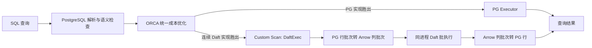
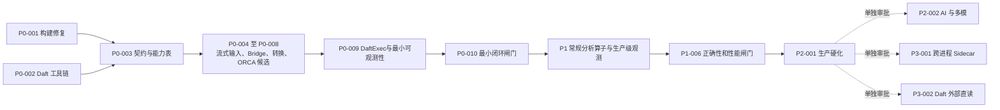

# PG19 + ORCA + Daft 项目领导汇报

> 汇报基准：2026-08-14  
> 数据来源：[04 实施任务清单](04_PG19_ORCA_Daft实施任务清单.yaml)  
> 详细依据：[02 架构与执行流程](02_PG19_ORCA_Daft架构与执行流程详解.md)、[03 开发集成方案](03_PG19_ORCA_Daft开发集成方案.md)  
> 开发执行：[06 大模型执行手册](06_PG19_ORCA_Daft大模型开发执行手册.md)、[07 原子任务清单](07_PG19_ORCA_Daft原子任务清单.json)

## 一、结论先行

本项目要在不修改 PostgreSQL 19 核心代码的前提下，把 ORCA 作为统一的成本优化入口，把适合列式、批量和多模计算的计划片段交给 Daft 执行，同时保留 PostgreSQL 的事务、权限、SQL 语义和执行控制。

当前 **P0 最小工程闭环已于 2026-08-14 完成验收**：41/41 个 P0 原子任务完成，从空目录构建的 P0 门禁为 10/10 PASS、0 FAIL、0 SKIP。C++/Rust Bridge、PG/Arrow 转换、ORCA 中的 PG/Daft 物理候选与成本比较、`Custom Scan (DaftExec)` 以及错误、取消、释放和最小可观测链已经实际打通。P1-001 已被人工批准解锁，但还没有领取或开始。

这个结论不能被扩大为“已证明 Daft 性能更快”。P0 当前只准入 identity Project 和 constant Limit；默认完整成本下 PG 自然胜出。已验证的 Daft winner 来自用户显式开启 `pg_orca.daft_prefer_plan`，将合法 Daft fragment 的完整累计成本只折扣一次为 0.1，用于证明真实选中和执行链可达。Filter、Join、Aggregate、Sort 和代表性能收益是 P1 的验收内容。

本次建议从已完成的 P0 进入 `P1-001`，先加入 Filter 和 Inner/Left HashJoin，再按依赖扩展 Aggregate、Sort/TopN、规则矩阵、资源治理与性能门禁。AI/多模、跨进程 sidecar、Daft 直接读取 S3/Parquet 暂不进入核心承诺，继续保持关闭，待 P1/P2 核心路线通过后分别决策。

## 二、领导需要关注的五个判断

| 判断 | 实事求是的结论 |
|---|---|
| 为什么做 | 单一 PostgreSQL 执行器难以同时覆盖事务型行处理、列式批计算和不断增加的 AI/多模算子；本项目希望让同一条 SQL 在保持语义正确的前提下选择更合适的执行引擎 |
| 为什么用 ORCA | 固定下推并不需要 ORCA；但本项目要在 Scan、Join、Aggregate、Sort、AI 函数、数据转换和执行引擎之间做全局成本比较。ORCA 的 Cascades/Memo 框架更适合持续加入这类候选，也避免把大量全局搜索逻辑硬塞进 PostgreSQL core |
| 为什么用 Daft | Daft 提供 Arrow 列式批执行、并行流水线、外部数据和多模/AI 能力；但“Daft 已实现”不等于“本集成已经可用”，每项能力仍须逐项接通、验证和计价 |
| 当前价值是否已经证明 | 已证明 P0 最小端到端技术闭环：真实 CBO 选中的 `DaftExec` 可经 Rust Bridge 与 Arrow 执行并返回正确结果。尚未证明默认成本下的生产性能收益，也未完成 P1/P2 |
| 最大成功条件 | 先守住 SQL 语义、MVCC、权限、取消和资源释放，再用真实基准证明收益；不能先大范围下推，再补正确性和成本模型 |

## 三、当前状态看板

### 3.1 已完成的 P0 能力

- 固定工具链、修复 bundled Xerces，PostgreSQL 19、pg_orca 和 Daft Bridge 能从空构建目录重建。
- 用唯一能力表生成 C++/Rust 契约，实现 canonical PgDaftPlan v1、稳定 C ABI、动态加载和运行能力校验。
- 实现有界 StreamingScan、PG Datum/Arrow C Data 批转换和纯 Rust Bridge；Rust/Tokio 工作线程不访问 PG 内存或 API。
- 在 ORCA Memo 中建模 PG/Daft 候选、执行格式边界和完整成本；获胜 Daft fragment 被翻译为单个 `Custom Scan (DaftExec)`。
- 实现 `DaftExec` 生命周期、子计划驱动、真实 Rust ABI 执行、取消、错误恢复、资源释放和 P0 EXPLAIN/trace 指标。
- P0 干净门禁 10/10 PASS；显式 prefer 模式下的真实 DaftExec CTAS 返回 3000 行、求和 4501500，与 PG 基线一致。

### 3.2 尚未完成的工程能力

- P1 的 Filter、Inner/Left HashJoin、Aggregate、Sort/TopN 物理候选和完整差分语义尚未实现。
- Daft 优化规则目录已分类，但应进入 ORCA 全局 CBO 的 P1 规则仍需逐项实现和验证。
- P1 的生产级内存/spill 控制、扩展可观测性、统计与成本校准、正确性和性能门禁尚未完成。
- P2 生产硬化和所有延期能力（AI/多模、sidecar、Daft-owned S3/Parquet scan）仍未开始。

### 3.3 任务状态

| 状态 | 数量 | 含义 |
|---|---:|---|
| 已完成 | 10 | `P0-001`至 `P0-010`，其 41 个原子任务和 P0 总门禁均已通过 |
| 已解锁待领取 | 1 | `P1-001`；只是允许开始，当前尚未领取 |
| 等待前置 | 6 | `P1-002`至 `P1-006` 以及 `P2-001` |
| 延期可选 | 3 | `P2-002`、`P3-001`、`P3-002` 不计入当前核心交付 |
| 合计 | 20 | 与 04 任务清单一一对应 |

开发执行层已经把这 20 个父任务拆成 67 个原子任务：当前 41 个 P0 原子任务已完成，`P1-001-A` 已解锁待领取，其他核心任务继续按依赖锁定，3 个可选路线仍延期。领导进度按 20 个父任务汇报；研发日常领取和证据跟踪按 67 个原子任务执行。

## 四、目标架构与边界

核心阶段采用同进程嵌入模式：PostgreSQL backend 负责 SQL 生命周期、事务可见性、权限和最终结果；ORCA 在规划时比较 PostgreSQL 与 Daft 的合法物理实现；胜出的连续 Daft 节点被封装为一个 `DaftExec`；执行时只在片段入口把 PostgreSQL 行批次转成 Arrow 列批次，在出口转回 PostgreSQL 行，中间始终由 Daft 处理列式批数据。

核心边界如下：

- `P0-P2` 默认由 PostgreSQL 扫描 heap/index，并遵守 MVCC、RLS 和权限；不假设 PostgreSQL 一定永久负责所有外部数据读取。
- Daft 直读 S3/Parquet 只属于延期的 `P3-002`，必须针对显式登记的外部表，作为与 `ForeignScan` 并列且有成本的独立候选；不得替换 PG heap/index，也不自动获得 PG MVCC。
- 独立跨进程运行只属于延期的 `P3-001` sidecar；核心方案中的 Daft 与当前 backend 同进程。
- AI/多模只属于延期的 `P2-002`。Daft 源码中存在某个函数，不代表 PG SQL 已经能够安全调用它。

## 五、实施路线和阶段闸门

| 阶段 | 管理目标 | 预计工作量 | 基准完成点 | 退出条件 | 当前状态 |
|---|---|---:|---|---|---|
| P0 基础闭环 | 证明“能安全规划、能执行、能关闭” | 115–171 人日（原始人工估算） | 2026-08-14 实际验收 | Project/Limit 最小混合计划端到端通过；错误、取消、释放、回退边界均可验证 | **已完成** |
| P1 分析能力 | 证明“常规分析查询值得使用” | 72–107 人日 | 需基于 P0 实际情况重新排期 | 结果差分正确，三类负载无灾难性退化，至少有代表性负载证明收益 | P1-001 已解锁待领取 |
| P2-001 生产硬化 | 证明“可控地进入生产” | 25–40 人日 | 2027-04-30 | 默认关闭可部署；开启、禁用、诊断和回滚均有证据 | 等待 P1 |
| P2-002/P3 可选路线 | 扩大 AI、多模、跨进程和外部直读范围 | 130–240 人日 | 未排期 | 核心路线通过后重新立项和评审 | 延期 |

原始核心路线的人工工作量估算为 **212–318 人日**，约合 **10.6–15.9 人月**（按 20 人日/月换算）；延期可选路线另需约 **130–240 人日**。P0 由大模型在已有源码、本地环境和高密度自动化验证下快速完成，不能把该日历耗时等同于通用人工人日，也不应直接用它压缩 P1/P2 承诺。现在应根据 P0 实际修复数、测试耗时和 P1 新算子的语义范围重新核定 P1/P2 日期。

## 六、20 项任务的领导视图

以下表格保留 04 的任务编号、状态和依赖，用管理语言说明每项任务解决什么问题。任务的文件列表、具体命令和完整验收条件仍以 04 为准。

工作量和时间采用以下统一口径：

- `人日`包含设计细化、编码、代码审查、自动化测试、问题修复和验收证据整理，不只是编码时间。
- 基准排期假设从 **2026-08-11** 启动，每周 5 个工作日，并且 PostgreSQL/ORCA、Rust/Daft、集成测试与性能三个能力角色各有至少 1 人全职投入。
- 完成点表示任务的全部验收条件通过，不是代码首次提交日期。日期已考虑一般集成缓冲，但不包含重大上游缺陷、需求扩张或人员中断。
- 工作量不能直接除以 3 得出日历工期：04 中存在严格依赖，而且部分工作只能由特定能力角色完成。任一关键任务超过上限，后续依赖任务的日期随之顺延。
- 延期任务尚未批准范围，因此只给工作量级别和“批准后的预计周期”，不虚构日历完成日期。

| ID | 管理意义 | 状态 | 主要前置 | 预计工作量 | 基准完成点 | 形成的可检查结果 |
|---|---|---|---|---:|---|---|
| P0-001 | 修复 pg_orca 内置 Xerces 的可重复构建 | 已完成 | 无 | 3–5 人日 | 2026-08-14 | 全新环境可干净编译、安装和加载 |
| P0-002 | 建立与冻结源码匹配的 Daft 工具链 | 已完成 | 无 | 4–6 人日 | 2026-08-14 | 人工批准安装范围后，固定 Rust/Python/uv 环境可从新 shell 重现，且 Daft 原始基线测试通过 |
| P0-003 | 统一 C++/Rust 之间的计划语言、ABI 和能力清单 | 已完成 | P0-001、P0-002 | 15–22 人日 | 2026-08-14 | 两端能力摘要一致，非法或未知计划会被拒绝 |
| P0-004 | 让 PostgreSQL 能持续、限流地向 Daft 喂入多个批次 | 已完成 | P0-002、P0-003 | 12–18 人日 | 2026-08-14 | 背压、结束和取消均可验证，不产生无限队列 |
| P0-005 | 建立不依赖 Python 的纯 Rust Daft bridge | 已完成 | P0-003、P0-004 | 15–22 人日 | 2026-08-14 | 稳定动态库接口，panic、所有权和线程启动受控 |
| P0-006 | 在 PG backend 中安全加载并检查 bridge | 已完成 | P0-001、P0-003、P0-005 | 8–12 人日 | 2026-08-14 | 缺库、缺符号或版本不符不会导致 backend 崩溃 |
| P0-007 | 安全完成 PG 行数据与 Arrow 列数据转换 | 已完成 | P0-003 | 15–22 人日 | 2026-08-14 | NULL、边界值、时间和大对象往返正确且无越界释放 |
| P0-008 | 让 ORCA 真正比较初始 PG/Daft 物理候选 | 已完成 | P0-003、P0-006、P0-007 | 20–30 人日 | 2026-08-14 | Project/Limit 可按成本选优，最终计划不再事后偷换引擎 |
| P0-009 | 实现 `DaftExec` 与最小可观测性 | 已完成 | P0-004 至 P0-008 | 15–22 人日 | 2026-08-14 | 全生命周期可运行，且能观察选择/回退、跨边界数据量和分段耗时 |
| P0-010 | 关闭 P0 最小闭环 | 已完成 | P0-009 | 8–12 人日 | 2026-08-14 | 构建、语义、故障和最小观测共同形成 P0 证据包；不可观测即未闭环 |
| P1-001 | 加入 Filter 和 Inner/Left HashJoin | 已解锁待领取 | P0-010 | 15–22 人日 | 待重新排期 | 过滤和首批连接可以参与统一成本选择 |
| P1-002 | 加入常用聚合 | 待前置 | P1-001 | 10–15 人日 | 2027-01-22 | 聚合结果、NULL 和溢出语义通过差分测试 |
| P1-003 | 加入 Sort 和 TopN | 待前置 | P1-002 | 8–12 人日 | 2027-02-05 | 顺序、NULL、LIMIT 和内存行为可验证 |
| P1-004 | 完成 Daft 优化规则的逐项归类 | 待前置 | P1-003 | 12–18 人日 | 2027-02-26 | 无未分类规则，依赖统计的规则不会绕开 ORCA |
| P1-005 | 扩展并硬化观测、内存预算和 spill 控制 | 待前置 | P1-004 | 12–18 人日 | 2027-03-12 | P0 观测覆盖全部 P1 算子，指标可对账并能限制资源 |
| P1-006 | 关闭 P1 正确性与性能闸门 | 待前置 | P1-005 | 15–22 人日 | 2027-03-26 | 三类负载有可复现实验，正确性零差异且无灾难性退化 |
| P2-001 | 完成生产硬化 | 待前置 | P1-006 | 25–40 人日 | 2027-04-30 | 缓存、升级、故障、72 小时稳定性、运维和回滚达到上线要求 |
| P2-002 | 可选接入 AI/多模能力 | 延期 | P2-001 | 60–120 人日 | 未排期；批准后约 12–20 周 | 每个函数逐项完成语义、依赖、成本和测试准入 |
| P3-001 | 可选建设跨进程 Arrow Flight sidecar | 延期 | P2-001 | 30–50 人日 | 未排期；批准后约 8–12 周 | 故障隔离收益足以覆盖序列化和运维成本 |
| P3-002 | 可选让 Daft 直接扫描已登记外部对象 | 延期 | P2-001 | 40–70 人日 | 未排期；批准后约 10–16 周 | snapshot/manifest、权限、凭据和成本模型单独通过评审 |

## 七、关键风险与控制措施

| 风险 | 当前事实 | 控制措施 | 需要升级的条件 |
|---|---|---|---|
| 工具链与构建再现 | P0 已固定 Rust/Python 工具链并修复 Xerces，干净门禁已通过 | 保留固定版本、从空目录构建和源码树污染检查；升级任一上游版本时重跑完整 P0 门禁 | 上游版本变更或新环境无法重现 10/10 PASS |
| PG 与 Daft 语义不一致 | 类型、NULL、排序规则、时间、错误行为可能不同 | 每项能力默认关闭，先做差分测试，再开放 ORCA 候选 | 无法定义或证明等价语义 |
| 行列转换抵消计算收益 | PG heap 输入需要行转列，结果需要列转行 | 转换成本进入 ORCA；优先融合连续 Daft 片段；小数据或窄计算应保留 PG | 代表性负载长期无法覆盖转换成本 |
| 同进程运行影响 backend 稳定性 | Rust/Tokio 和 PG backend 共享进程，但 Rust worker 不能调用 PG API | C ABI 隔离、panic 捕获、限线程、限内存、可取消；生产默认关闭 | 出现无法隔离的崩溃或资源泄漏 |
| 成本模型选错引擎 | 初始成本系数没有实测数据 | 使用可解释的分项成本，基准校准，并保留强制 PG 诊断路径 | P1 仍频繁发生明显误选 |
| AI 能力范围失控 | Daft 的 AI API 多，但 Python UDF、VLLM、GPU 依赖和语义尚未接入 | AI 整体延期；以后按函数逐项立项、逐项准入 | 核心路线被 AI 依赖阻塞 |
| 外部直读破坏一致性预期 | S3/Parquet 不受 PG MVCC 直接保护 | 仅允许显式 external relation；固定 snapshot/manifest；与 ForeignScan 独立比较 | 业务要求对外部对象提供 PG 级事务语义 |

## 八、资源与协作要求

核心路线至少需要三类能力持续协同，不能把任务简单交给单一语言开发者：

| 能力角色 | 主要责任 |
|---|---|
| PostgreSQL/ORCA C++ | 扩展生命周期、PG 语义、ORCA 候选与成本、`CustomScan`、缓存和故障边界 |
| Rust/Daft 执行 | StreamingScan、纯 Rust bridge、Arrow 所有权、Daft 物理计划和异步执行 |
| 集成测试与性能 | 跨语言 ABI、差分正确性、故障注入、内存检查、基准设计和可复现证据 |

进入可选路线时还需补充相应负责人：AI/GPU/model runtime，或对象存储、凭据、安全和数据版本治理。本报告给出的核心工作量为 212–318 人日，是基于当前代码分析和 04 验收范围的初步工程估算；应在 P0 闭环后用实测生产率重新估算，而不能直接作为绩效承诺或固定外部发布日期。

## 九、本次建议审批事项

| 事项 | 建议 | 原因 |
|---|---|---|
| 核心实施范围 | 批准执行 P0、P1、P2-001 | 这是形成可验证价值和生产安全性的最小完整路线 |
| 下一步启动 | 领取 `P1-001-A`，按原子任务依赖实施 Filter 和 Inner/Left HashJoin | P0 已验收，P1-001 已解锁，但不允许跳过语义、成本和差分测试 |
| AI/多模 | 保持 P2-002 延期 | 当前尚无端到端接入和成本证据，不应影响核心闭环 |
| 跨进程 sidecar | 保持 P3-001 延期 | 只有在同进程隔离风险或部署需求明确后才值得承担额外复杂度 |
| Daft 外部直读 | 保持 P3-002 延期 | 需要独立的数据版本、权限、凭据和一致性治理，不能与 PG heap 扫描混为一谈 |
| 性能口径 | P1-006 前不对外承诺加速倍数 | P0 已有端到端功能证据，但 prefer-on winner 不是默认成本下的性能胜出，仍缺 P1 代表性基准 |
| 排期口径 | 在领取 P1-001 时重新形成 P1/P2 承诺日期 | 已有 P0 实际问题和验证数据，应用它校正原始人工估算，不沿用过期基准日期 |
| 上线策略 | P2-001 前始终默认关闭 | 保证扩展可安装、可诊断、可禁用，不影响现有 PG 路径 |

执行包已经给出 P1 性能门槛提案，用来避免“无性能灾难”停留在口号；该阈值必须在 P0-010 看到真实端到端开销后由人工批准或留痕调整，在此之前仍不是对外性能承诺。

## 十、验收与汇报机制

项目不以“代码已提交”作为完成依据，而以 04 的父任务硬验收、07 的原子任务验证命令和执行包中的 PASS/FAIL/SKIP 证据为准。04 的 20 个父任务已经拆为 67 个可领取原子任务；父任务只有在所属原子任务和最终 gate 全部通过后才能完成。建议在每个阶段闸门汇报以下四类结果：

1. **范围**：本阶段承诺任务、实际完成任务和未完成原因。
2. **正确性**：差分用例、错误语义、取消、重复执行和资源释放结果。
3. **稳定性**：崩溃、泄漏、死锁、线程和内存上限的故障注入结果。
4. **性能**：数据规模、计划、PG 基线、Daft 计划、转换成本和端到端耗时；只报告可复现数据。

阶段结论只能为：通过、带明确遗留项通过、未通过。核心决策点是 `P0-010`、`P1-006` 和 `P2-001`；可选路线不得通过改变核心阶段的验收口径来提前进入。

## 十一、源码与版本基线

| 组件 | 冻结版本 |
|---|---|
| PostgreSQL 19beta2 | `7873db5369b967dd53984df34fd800003410d04f` |
| pg_orca | `55339728f8987ff351d3e88e033a0dc3be78465f` |
| Xerces-C | `53c16411466bf90c62617831fe92ed0f41e70882` |
| Daft | `b2fba655a96fe8f2cc5c21915ddc81dbe9610d3a` |

如需变更任一版本，应先重新跑原始基线和已完成阶段的回归测试，再更新 04 的锁定版本和本报告；不能在缺少证据时把上游升级当成普通实现细节。
