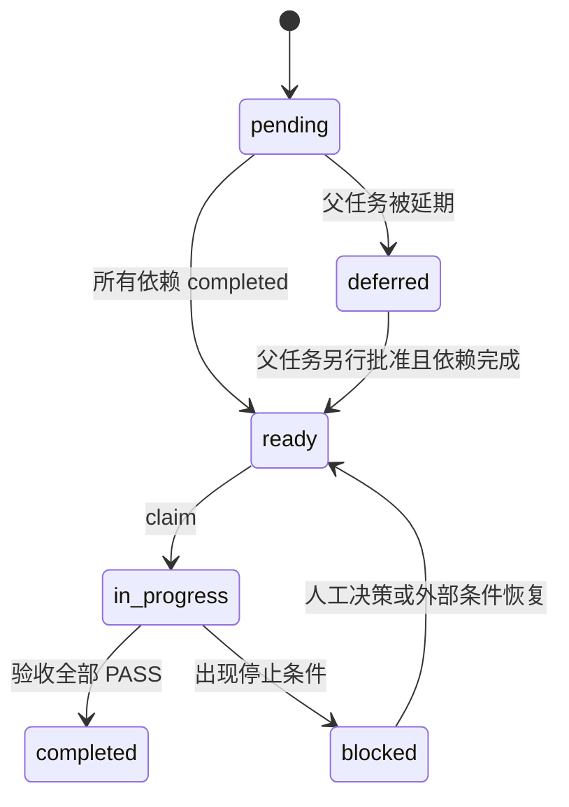

# PG19 + ORCA + Daft 大模型开发执行手册

> 适用对象：具备文件读写、终端、编译、测试和持续任务状态能力的编程智能体  
> 父任务事实：[04 实施任务清单](04_PG19_ORCA_Daft实施任务清单.yaml)  
> 原子任务事实：[07 原子任务清单](07_PG19_ORCA_Daft原子任务清单.json)  
> 支撑文件：[执行包目录](执行包/README.md)

## 1. 这份执行包解决什么问题

02 和 03 负责解释架构与技术规格，04 负责定义 20 个管理级父任务。本执行包把这些内容转换成一般编程智能体能够持续执行的工作协议：

- 把 8–40 人日的父任务拆成可单独编译和验收的原子任务；
- 给每个原子任务规定依赖、允许改动范围、交付物、验证命令和停止条件；
- 用一个机器可校验的状态文件控制领取、阻塞和完成；
- 用统一证据文件记录 base SHA、改动文件、命令、退出码和验收判断；
- 为首次落地 IR、ABI、能力表和 golden tests 提供冻结模板；
- 明确哪些问题可以由模型自行修复，哪些问题必须停止并交给人决策。

本执行包不能代替编译器、测试和阶段评审。它的目标是让模型不再依赖口头补充设计，并且不能在没有证据时把任务标成完成。

## 2. 权威层级

发生冲突时按以下顺序处理：

1. PostgreSQL、pg_orca、Daft 冻结源码和 `daft/AGENTS.md` 中的真实约束；
2. 03 的不可变执行契约、语义、安全和生命周期边界；
3. 04 的父任务范围、依赖和硬验收条件；
4. 07 的原子任务依赖、允许路径和验证入口；
5. 本手册的操作流程；
6. 执行包中的初始模板。

模板与源码冲突时不得悄悄修改语义。先在证据中记录冲突，再判断属于实现细节、规格缺陷还是上游 API 变化。只有实现细节可以在不扩大父任务范围的前提下自行修正。

05 是领导汇报视图，不是开发规格。任务事实以 04 和 07 为准。

## 3. 开发前必须具备的能力

执行模型必须能够：

- 在 `/home/qiumc/data/code/cpp` 中读取和修改文件；
- 运行非交互 shell 命令并取得真实退出码；
- 使用 Git 查看差异和源码 SHA，但不得重置或覆盖用户已有改动；
- 运行 CMake、Ninja、PostgreSQL 测试和 Cargo 测试；
- 在单次上下文结束后继续读取状态与证据文件；
- 遇到权限、网络、凭据或生产环境操作时停止请求授权。

只有聊天能力、不能操作工作区的模型无法执行本方案。

## 4. 执行包目录

```text
公共文档/多模优化与计算/
├── 06_PG19_ORCA_Daft大模型开发执行手册.md
├── 07_PG19_ORCA_Daft原子任务清单.json
└── 执行包/
    ├── README.md
    ├── MODEL_HANDOFF_PROMPT.md
    ├── state/task_state.json
    ├── evidence/TEMPLATE.json
    ├── evidence/README.md
    ├── decisions/DECISION_LOG.md
    ├── specs/pg_daft_capabilities.initial.yaml
    ├── specs/pg_daft_plan_v1.schema.json
    ├── specs/performance_gate.initial.json
    ├── include/daft_pg_bridge_v1.reference.h
    ├── golden/manifest.json
    ├── golden/valid/project_limit_v1.json
    ├── golden/invalid/duplicate_key_v1.json
    ├── golden/invalid/dangling_node_v1.json
    ├── golden/invalid/cycle_v1.json
    ├── golden/invalid/unknown_field_v1.json
    ├── golden/recipes/oversized_plan_v1.json
    ├── templates/integration/*.reference
    └── scripts/
        ├── preflight.sh
        ├── taskctl.py
        └── validate_package.py
```

`执行包/specs`、`include` 和 `golden` 是首次实现的输入模板，不代表三个源码树已经集成。原子任务明确要求复制或生成到目标源码路径并由测试证明后，它们才成为实现事实。

## 5. 第一次接手时的固定步骤

任何模型第一次接手必须依次执行：

```bash
cd /home/qiumc/data/code/cpp

python3 公共文档/多模优化与计算/执行包/scripts/validate_package.py

bash 公共文档/多模优化与计算/执行包/scripts/preflight.sh report

python3 公共文档/多模优化与计算/执行包/scripts/taskctl.py list-ready
```

然后采用两阶段阅读，避免一般能力模型一次性装入 02、03、04、07 的全部长文本后挤掉当前任务上下文：

1. 首次接手固定完整阅读 `01`、本手册、`执行包/README.md`、`DECISION_LOG.md`，以及 03 的第 1、14、15 章；任务涉及 Daft 时同时完整阅读 `daft/AGENTS.md`。
2. 检查 `active_task`；恢复或选择任务后运行 `taskctl.py show <TASK_ID>`。`show` 会把 07 中的任务对象与按父任务解析出的 `reading_route` 一起输出。
3. 完整阅读 `reading_route.design_refs` 指向的 03 设计章节和 04 父任务对象、`source_refs` 指向的冻结源码锚点、`test_refs` 指向的测试入口。
4. 再阅读任务 `allowed_paths` 涉及的现有文件、直接调用者、被调用者和相关测试。目标文件尚未创建时，先读 route 给出的现有基线源码和同目录相邻实现。
5. 02 用于架构论证，05 用于领导汇报；只有当前 route 明确引用或实现中出现架构疑问时才读取相关章节，不用每个原子任务重复通读。

`validate_package.py` 负责检查 20 个父任务的 route 覆盖全部 67 个原子任务，并检查引用路径存在。`show` 没有 `reading_route`、route 引用不存在或设计与冻结源码冲突时，不得 claim。不得只阅读任务标题后开始修改。

## 6. 状态机

原子任务只有以下状态：



规则：

- `07` 是不可在执行过程中随意改动的任务定义；运行状态只写入 `执行包/state/task_state.json`。
- 一个模型同时只能拥有一个 `in_progress` 原子任务。`P0-001` 与 `P0-002` 可以由不同执行者并行，但各自必须使用独立工作分支或明确无重叠文件。
- `ready` 只能由依赖计算得到；不得手工跳过前置任务。
- `completed` 必须存在完整证据且所有强制验收为 `PASS`。
- `SKIP` 只允许用于任务定义中明确标注为非当前平台或非当前 capability 的检查；核心正确性检查不能 `SKIP`。
- `blocked` 必须写清阻塞原因、已尝试动作和解除阻塞所需决定。
- 可选任务初始为 `deferred`，必须由人明确批准后才能解除。

## 7. 原子任务领取与完成流程

### 7.1 领取

```bash
python3 公共文档/多模优化与计算/执行包/scripts/taskctl.py show P0-001-A
python3 公共文档/多模优化与计算/执行包/scripts/preflight.sh task P0-001-A
python3 公共文档/多模优化与计算/执行包/scripts/taskctl.py claim P0-001-A
```

必须先完整阅读 `show` 输出中的任务定义、`reading_route`、关联源码和测试，再执行任务级 preflight；预检失败时保持任务未领取并报告领取前阻塞，不得为了调用 `block` 而先 claim。预检通过后，`claim` 才会检查依赖和当前是否已有其他 `in_progress` 任务，并创建该任务的证据 JSON。

领取后先记录三个源码树的 base SHA 和 dirty 状态。`taskctl.py` 会拒绝与未知已有改动重叠的领取；若重叠文件来自已经完成且有证据的前置原子任务，可以继续，但必须在本任务证据中只登记本次新增改动。无法确认归属时立即阻塞，不得覆盖。

### 7.2 实施

实施时必须遵循：

- 只修改任务 `allowed_paths` 覆盖的文件；发现必须扩大范围时先阻塞并记录原因；
- 公共 ABI、IR 或 capability 变化必须先改规格、schema 和 golden，再改生成代码；
- 新 capability 初始为 false；差分测试通过后才能开启；
- 每完成一个最小步骤立即运行最窄测试，不要等到任务末尾一次性调试；
- 不得修改 PostgreSQL 19 core；
- Rust/Tokio worker 不得调用 PostgreSQL API；
- 不得在 ORCA 选优后运行改变计划含义的 Daft optimizer；
- 不得为了让测试通过而放宽未知类型、表达式、Join 或排序语义。
- 遇到未知 PG Plan、Expr 或 Type 时增加稳定 reject reason，不得猜测映射；
- Daft API 不足时只新增任务所需的最小通用 Rust API，并保持既有 runner 回归通过；
- 不得修改冻结 source lock，除非独立已批准升级任务的 `allowed_paths` 明确包含它，并重跑受影响的全部门槛。

### 7.3 记录命令

每条用于验收的命令都要在证据文件中记录：

```json
{
  "command": "cmake --build ...",
  "started_at": "ISO-8601",
  "exit_code": 0,
  "result": "PASS",
  "log": "工作区内的相对日志路径",
  "notes": "没有隐藏失败或重试"
}
```

不能只写“测试通过”。必须保留真实命令、退出码和工作区内的日志位置。`record` 会确认日志存在并记录 SHA-256，`complete` 会再校验，防止日志被替换。日志不得包含行数据、密码、签名 URL 或凭据。

普通成功命令可以直接由状态工具执行和记录：

```bash
python3 公共文档/多模优化与计算/执行包/scripts/taskctl.py run P0-001-B 1
```

已经人工执行的命令使用 `record` 登记；`P0-001-A` 的已知失败复现也使用该方式，在核对失败签名后把“预期失败得到验证”记录为 PASS，而不是把非零退出码伪装成成功：

```bash
python3 公共文档/多模优化与计算/执行包/scripts/taskctl.py record P0-001-A 2 \
  --exit-code 1 --result PASS --log .build/logs/P0-001-A-build.log \
  --notes "非零退出符合冻结的 DefaultHandler.hpp 缺失签名"
```

逐项记录验收、实际改动文件、脱敏确认和最终 gate：

```bash
python3 公共文档/多模优化与计算/执行包/scripts/taskctl.py accept P0-001-A 1 \
  --result PASS --evidence .build/logs/P0-001-A-build.log
python3 公共文档/多模优化与计算/执行包/scripts/taskctl.py set-changed P0-001-A
python3 公共文档/多模优化与计算/执行包/scripts/taskctl.py set-redaction P0-001-A
python3 公共文档/多模优化与计算/执行包/scripts/taskctl.py set-gate P0-001-A PASS
```

### 7.4 完成

任务完成前执行定义中的全部 `verify`，逐项填写 `acceptance_results`，然后运行：

```bash
python3 公共文档/多模优化与计算/执行包/scripts/taskctl.py check-evidence P0-001-A
python3 公共文档/多模优化与计算/执行包/scripts/taskctl.py complete P0-001-A
```

`complete` 只做机械校验，不能替代技术判断。模型仍须确认：

- 实际差异只在允许路径中；
- 没有把用户原有改动算作自己的交付；
- 所有验收条件与父任务边界一致；
- 没有通过关闭测试、削弱断言或扩大 capability 掩盖问题；
- 没有生成或提交构建产物到源码树。

完成后重新运行 `list-ready`，只领取新解锁的任务。

## 8. 标准工作目录与环境变量

禁止复用含未知状态的构建目录。统一使用：

```bash
export PGD_WORKSPACE=/home/qiumc/data/code/cpp
export PGD_BUILD_ROOT=/home/qiumc/data/code/cpp/.build/pg19-pgorca-daft
export PGD_INSTALL_ROOT=/home/qiumc/data/code/cpp/.install/pg19-pgorca-daft
export PGD_EVIDENCE_ROOT=/home/qiumc/data/code/cpp/公共文档/多模优化与计算/执行包/evidence
export PG_CONFIG="$PGD_INSTALL_ROOT/bin/pg_config"
export PG_REGRESS_SQL="$PGD_WORKSPACE/postgres19/src/test/regress"
```

不得改写 `HOME`、`CODEX_HOME` 或其他系统变量。清理构建目录前必须解析为上述两个明确子目录并确认不指向工作区根目录、用户目录或 `/`。

## 9. 标准验证层级

每个任务使用从窄到宽的验证顺序：

| 层级 | 用途 | 标准入口 |
|---|---|---|
| L0 | 执行包和静态合同 | `validate_package.py`、JSON/schema/golden 检查、C header syntax |
| L1 | 单文件或单 crate | 指定 Rust integration test、生成器 `--check`、指定 C++ target |
| L2 | 组件回归 | `cargo test --locked -p daft-local-plan --no-default-features`、`cargo test --locked -p daft-local-execution --no-default-features`、`cargo test --locked -p daft-pg-bridge --no-default-features`、`pg_orca/test/test.sh --orca-tests` |
| L3 | 跨组件集成 | 干净构建、临时 PG cluster、off/auto/force SQL 差分与取消测试 |
| L4 | 阶段闸门 | P0 全量、P1 TPC-H 与差分、P2 72 小时稳定性和故障注入 |

低层失败时不得继续跑高层来掩盖问题。高层通过也不能替代任务规定的低层语义测试。

## 10. 固定测试入口命名

为避免每个模型创造不同命令，实施时必须保留以下入口名称：

| 能力 | 规定入口 |
|---|---|
| 能力表生成检查 | `python3 pg_orca/tools/gen_daft_capabilities.py --check` |
| Daft streaming source | `cargo test --locked -p daft-local-execution --test streaming_source --no-default-features` |
| Bridge ABI | `cargo test --locked -p daft-pg-bridge --test abi_v1 --no-default-features` |
| Bridge IR | `cargo test --locked -p daft-pg-bridge --test ir_v1 --no-default-features` |
| Arrow 所有权 | `cargo test --locked -p daft-pg-bridge --test arrow_ownership --no-default-features` |
| Bridge 执行 | `cargo test --locked -p daft-pg-bridge --test execution_v1 --no-default-features` |
| PG/Arrow 转换 | `pg_orca/test/test.sh --orca-tests daft_arrow` |
| P0 基础 SQL | `pg_orca/test/test.sh --orca-tests daft_basic daft_fallback` |
| P1 Filter/Join | `pg_orca/test/test.sh --orca-tests daft_filter daft_join` |
| P1 Aggregate | `pg_orca/test/test.sh --orca-tests daft_aggregate` |
| P1 Sort/TopN | `pg_orca/test/test.sh --orca-tests daft_sort_topn` |
| 计划缓存 | `pg_orca/test/test.sh --orca-tests daft_plancache` |
| 取消和错误 | `pg_orca/test/test.sh --orca-tests daft_cancel daft_errors` |
| 集成矩阵 | `integration/pg19-pgorca-daft/run_gate.sh P0`、`P1` 或 `P2` |

相应测试文件尚不存在时，创建它本身就是原子任务交付物；不得把“入口不存在”解释成允许跳过。

## 11. 初始合同模板的使用方法

### 11.1 能力清单

`执行包/specs/pg_daft_capabilities.initial.yaml` 登记冻结规则、非规则物理决策、节点、类型和函数的初始状态。所有 runtime capability 初始都未启用：可后续接入的项保持 `BLOCKED`，与当前 embedded 模式确实不适用的项可标记 `NOT_APPLICABLE`，但必须有冻结代码证据。

能力定义表条目与 `dpg_capabilities()` 的 64 个运行时 bit 不是一一对应。前者负责对每个类型、函数、算子和 ORCA 规则逐项准入；后者只表达可被多个条目共用的运行时前提和执行入口。每个条目需要哪些 bit 必须由 canonical YAML 明确并交由生成器校验；ORCA 规则只存在于 pg_orca 本地登记表，Bridge 不返回“规则位”。

P0-003 实施时：

1. 将模板复制到 `pg_orca/spec/pg_daft_capabilities.yaml`；
2. 对照冻结 Daft 源码完成规则审计；
3. 为每个非 `BLOCKED` 项补充具体源码证据、ORCA Xform ID、测试 ID 和成本函数 ID；
4. 固定 64 位运行时 bit 的编号和含义，并为需要运行时前提的条目填写 `requires_runtime_bits`；
5. 由生成器输出 C++ 和 Rust 静态表，并拒绝重复 bit、超过 63 的 bit、未知 bit 引用以及为 ORCA 规则分配 runtime bit；
6. 只有两边 digest 和 golden test 一致才能完成任务。

不得直接把模板中的 `target_classification` 当作已实现状态。

### 11.2 IR schema 与 golden

`pg_daft_plan_v1.schema.json` 是 v1 合同起点。`golden/valid` 必须由 C++ 序列化、Rust 反序列化并重新 canonicalize；`golden/invalid` 必须逐个得到稳定 reason code。初始 valid fixture 中全零的 `capability_registry_sha256` 只是跨语言 schema、图结构和 canonical roundtrip 测试占位值，不是运行时通配符。真实执行时，当前 registry digest 必须精确相等，且当前 runtime bits 必须包含计划的全部 `required_runtime_capability_bits`；只有在 registry digest 不变时，运行环境多开启一个已登记的无关 bit 才不会导致旧计划失效。

如果实现需要新增 mandatory 字段：先更新 schema、valid golden、invalid golden、protocol feature 和兼容性测试，再改两端代码。删除字段或改变字段含义必须升级 protocol major。

### 11.3 ABI header

`daft_pg_bridge_v1.reference.h` 是 C ABI 冻结输入。P0-003/P0-005 实施时复制到 Daft bridge 的公开 include 目录，并将同一文件安装或生成到 pg_orca 编译输入中。

允许增加向后兼容的 minor 能力查询，但不得：

- 暴露 Rust、C++ STL 或 PostgreSQL 内部类型；
- 用裸指针传递 `PlannedStmt`、`Expr` 或 Rust 对象；
- 改变既有结构字段的顺序、宽度或所有权；
- 让查询 ABI 的函数启动 Tokio runtime。

## 12. 允许模型自行决策的范围

满足所有条件时，模型可以自行选择实现细节：

- 不改变 SQL 语义、ABI/IR 对外含义、任务依赖或 capability 范围；
- 改动完全落在 `allowed_paths`；
- 有窄测试和父任务验收覆盖；
- 不引入新的运行依赖、凭据、网络服务或后台进程；
- 不修改冻结源码版本。

典型例子包括内部函数拆分、局部 Rust 类型名称、私有 helper、测试辅助函数和不改变接口的错误处理重构。

## 13. 必须停止并请求人的情况

本节的 `blocked` 状态用于已经 claim、处于 `in_progress` 的任务。尚未 claim 时若 report/task preflight、权限或外部条件失败，应保持任务原状态、保存可获得的预检输出并报告领取前阻塞；不得先 claim 再 block。

出现以下任一情况必须把任务标为 `blocked`：

- 冻结源码 SHA 与 01/04 不一致；
- 允许路径中已有不明用户改动且无法安全合并；
- 需要修改 PostgreSQL core；
- 需要改变已冻结 ABI major、IR 字段语义或父任务范围；
- PG 与 Daft 结果不一致且无法证明哪一种符合既定 SQL 语义；
- 需要启用当前 `BLOCKED` 的类型、函数、Join、AI、外部扫描或 sidecar；
- 需要安装系统软件、访问外网、使用凭据或改变生产配置，而当前没有授权；`P0-002-A` 是工具链准备的唯一原子任务，仍必须先取得触发任务为 `P0-002` 或 `P0-002-A` 的 APPROVED DEC，之后才能执行 DEC 明确允许的安装命令；
- 基准已知失败以外出现新的上游测试失败；
- 发现成本模型没有数据，却必须以猜测系数决定上线能力；
- 测试出现 backend crash、hang、资源泄漏、数据暴露或无法清理的 spill；
- 任务预计超过 07 工作量上限，或连续三次修复仍是同一根因失败。

阻塞记录必须给出最小复现、日志路径、已经排除的原因和需要人选择的选项，不得只写“遇到问题”。

## 14. 父任务关闭规则

原子任务完成不等于父任务自动完成。父任务只有在以下条件全部满足时才能在 04 中改成 `completed`：

1. 07 中属于该父任务的全部非 deferred 原子任务为 `completed`；对于 `P2-002/P3-001/P3-002`，现有 `-A` 任务只负责冻结子规格并新增经过批准的实施原子任务，`closes_parent=false`，单独完成它不能关闭父任务；
2. 04 中父任务的每条 acceptance 都有证据映射；
3. 父任务最后一个 gate 任务从干净目录运行通过；
4. 三个源码树 SHA、dirty 状态、构建参数和测试计数已记录；
5. 没有把 FAIL 写成已知失败，也没有未经许可的 SKIP；
6. 01、03、04、05 和 capability 文档状态已同步。

父任务状态变化后，必须运行：

```bash
python3 公共文档/多模优化与计算/执行包/scripts/validate_package.py
```

## 15. 阶段人工闸门

以下节点不能只由实施模型自行批准：

| 闸门 | 人工需要确认的内容 |
|---|---|
| P0-003 合同冻结 | ABI/IR 兼容策略、能力粒度、许可证和生成文件归属 |
| P0-010 | 最小闭环正确性、崩溃与取消风险、是否允许进入 P1 |
| P1-006 | 差分结果、成本模型校准、真实收益和无灾难性退化 |
| P2-001 | 72 小时结果、升级回滚、运维责任和默认开关 |
| P2-002 | AI 模型身份、凭据、GPU/Python 生命周期和成本子规格 |
| P3-001 | 跨进程部署、安全、故障隔离与传输成本 |
| P3-002 | 外部 snapshot、权限、凭据和事务声明边界 |

人工没有批准时，后续状态保持 `blocked` 或 `deferred`。

人工批准必须先按 `执行包/decisions/DECISION_LOG.md` 的模板记录为 `DEC-YYYYMMDD-NNN`，状态为 `APPROVED`，且“触发任务”明确包含当前原子任务或父任务 ID。对包含“人工”的 acceptance，以及 07 中 `human_gate_acceptance` 按 1 起始下标显式列出的验收项，`taskctl.py accept --evidence` 必须传入该 DEC ID；对 deferred 任务，`unblock` 的 decision 参数也必须是这样的已批准 DEC ID。工具会同时校验状态和触发任务，不接受模型自行填写“已批准”。`P0-002-A` 使用显式索引，是为了让“取得授权”不会因为没有出现“人工”二字而绕过机械闸门。

P1 的初始性能实验协议和量化门槛见 `执行包/specs/performance_gate.initial.json`。其中阈值在 `P0-010` 前是 proposal，必须由人工依据首个端到端闭环确认或通过 DEC 记录调整；一经批准，同一 P1 报告不得临时改变阈值。成本参数初值全部为 `null`，表示必须实测，不能由模型猜数。

## 16. 唯一模型交接入口

对编程大模型的唯一启动提示词是 [执行包/MODEL_HANDOFF_PROMPT.md](执行包/MODEL_HANDOFF_PROMPT.md)。该文件覆盖首次接手、断点恢复、任务级预检、领取、验证、证据、人工 DEC、阻塞、连续执行和交回条件。

本手册不再复制一份简版提示词，避免两个启动入口随实施升级而产生内容漂移。交接时只需告诉模型：

```text
请完整读取并严格执行：
/home/qiumc/data/code/cpp/公共文档/多模优化与计算/执行包/MODEL_HANDOFF_PROMPT.md
```

## 17. 执行包完成定义

只有满足以下条件，才能声称“文档已经可以作为大模型执行包使用”：

- 07 能被标准 Python 解析，任务 ID 唯一、依赖无环、20 个父任务都有覆盖；
- 初始状态与依赖一致，只有合法任务为 ready；
- 每个原子任务都有允许路径、交付物、验证命令、验收项和停止条件；
- IR schema、ABI header、能力模板和正反 golden 均能通过包自检；
- `taskctl.py` 能完成 list/show/claim/block/check-evidence/complete 的机械约束；
- 01、03、04、05 正确引用 06/07，且 04 仍是父任务事实来源；
- 三个冻结源码树没有因为制作执行包而产生改动。

这套执行协议降低一般能力模型的实施阻力，但不取消编译、测试、性能标定和人工阶段决策。
