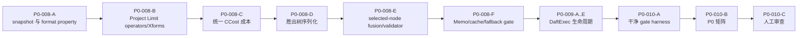

# PG19 + ORCA + Daft 继续开发交接提示词

> 初始生成：2026-08-13；最新断点：2026-08-16（Asia/Shanghai）  
> 工作区：`/home/qiumc/data/code/cpp`  
> 用途：把本文档整份交给具备文件读写、终端、编译和测试能力的编程大模型，从当前断点继续实施剩余原子任务，不是重新开始。

```text
你在 /home/qiumc/data/code/cpp 工作。

你的目标是从已保存的任务状态继续完成 PG19 + ORCA + Daft 的剩余原子任务，实现真实代码并完成规定验证。不得重做已完成任务，不得跳过依赖，不得把编译通过、占位类或早期报告当成集成完成。

本文档只记录断点、风险和继续路线。权威实施规则仍来自 MODEL_HANDOFF_PROMPT.md、06执行手册、07原子任务清单、taskctl show 和每个任务的 reading_route。发生冲突时以权威层级更高的文件为准。
```

## 0A. 2026-08-16 更新（当前最新断点 —— 以本节为准）

> 本节由 2026-08-16 的会话（执行者 `codex`）追加。下方“2026-08-13 更新”及 §1–§9 仅作历史调查记录，其 P0 活动任务、dirty worktree 和“不得 commit”等断点已被本节取代。权威任务状态仍以 `taskctl.py show` 为准。

### 当前任务断点

- `P2-001-C` 已完成，P2 packaging gate 为 12/12 PASS。
- `P2-001-D` 是当前唯一活动任务，actor 为 `codex`，状态为 `in_progress`，以 `DEC-20260816-072` 在最终本地历史上重建 evidence 基线，claim 时间为 `2026-08-16T18:55:15+08:00`；evidence 中的 pg_orca base 精确为 `5277154ae13cfabdeb2f487e385f82e3f50eac71`。
- `DEC-20260816-071` 的 no-Daft canonical Bridge/Arrow 头路径修复已经完成：OFF 构建定义为 `PG_ORCA_ENABLE_DAFT=0`，构建图和最终链接不含 `daft_bridge_loader.cpp.o`/Rust Bridge，`ldd` 无 Daft/Arrow 动态依赖，`nm -D` 无 `dpg_*` 符号；ON 构建仍定义为 1 并包含 loader。最终日志分别为 `evidence/logs/P2-001-D/no-daft-final-after-push-end-fix.log`（SHA-256 `bac634bdeef3552be2de80f80afa62a780ae7b05932a17a166aeb5ee13909924`）和 `daft-enabled-final-after-push-end-fix.log`（SHA-256 `924bb1c84dd02575d1b37ed121138abda8d6771f8bd8332103f3c2f15d5debcf`）。
- 16 项复跑曾暴露 input push 与 Sort pipeline failure 的竞态：Bridge 合法返回 `DPG_END` 时，PG 侧把它误报为通用 push 错误并遮蔽详细 `PGDAFT_SORT_MEMORY_LIMIT`。`DEC-20260816-072` 已批准 `daft_exec.cpp` 的最小修复：释放仍属 PG 的 pending Arrow batch、结束该 source，并让下一次 output poll 返回真实终止或详细 pipeline error。修复后 `daft_sort_topn` 连续 10/10 PASS，最终 tree 上全部 16/16 PASS；日志为 `evidence/logs/P2-001-D/daft-16-after-push-end-fix.log`，SHA-256 `02328892670bf67b3d33a00b511c8d58d65769a30159e19cbb4b2e4c1ab7601c`。
- `P2-001-D` 的正式 P2 gate 尚未开始。冻结合同仍要求 72 小时；关于缩短时长的评估只是技术建议，没有新的 APPROVED DEC，不得擅自把正式门槛改成 12 小时。
- 如果当前在“两种构建 + 16 项基础回归”后收场，并把代码交给新人或新模型从零复验，必须先阅读 `公共文档/多模优化与计算/执行包/新人或新模型从零构建与基础测试指南.md`。该指南明确了未 push 的本地提交传递方式、三个冻结 SHA、隔离干净构建、no-Daft graph/link 检查和基础验收结果格式。
- 已有 3 个未完成草稿：`integration/pg19-pgorca-daft/p2_mixed_workload.sql`、`audit_p2_capabilities.py`、`analyze_p2_trends.py`；`run_mixed_workload.sh` 尚未创建。`integration/` 不是 Git 仓库，这些文件不在下述本地提交中。

### 已创建的本地提交

用户明确授权“合理拆分 commit，先提交”，同时明确禁止 `push`。测试用例历史已按 `DEC-20260816-067/068/069` 合并并封闭默认 schedule 缺口；以下 5 笔提交只存在于当前本地仓库，后续执行者不得 push，也不得假设远端已包含它们。

| 仓库 | 本地提交 | 用途 |
|---|---|---|
| `daft` | `6e79abf feat(execution): add bounded prepared streaming runtime` | bounded/prepared streaming runtime |
| `daft` | `55f7bc2 feat(pg): add PostgreSQL execution bridge and ABI` | PostgreSQL Bridge 及 ABI |
| `pg_orca` | `9fecc8b feat: integrate ORCA-selected Daft execution` | ORCA 选中计划的 Daft 核心集成、no-Daft include 修复及 `DPG_END` 所有权/错误传播修复 |
| `pg_orca` | `13132b1 test: add Daft integration regression suite` | 16 组正式 SQL/expected、完整 schedule、PlanState walker 及混合边界回归 |
| `pg_orca` | `5277154 build: document optional Daft packaging and rollback` | 可选打包与回滚运维文档 |

提交后现场核验状态：

- `daft` 的 `main` 相对 `origin/main` 为 `ahead 2`，已跟踪工作树干净，HEAD 为 `55f7bc2`。
- `pg_orca` 的 `main` 相对 `origin/main` 为 `ahead 3`，工作树完全干净，HEAD 为 `5277154ae13cfabdeb2f487e385f82e3f50eac71`，tree hash 为 `4d396bdf72786afb2a5245d1d8534ea0f3e27981`。历史恢复点依次为 `backup/pre-push-end-fix-20260816 -> 5418953`、`backup/pre-no-daft-include-fix-20260816 -> 1e6f33b`、`backup/pre-regression-formalization-20260816 -> 30b5b72` 和 `backup/pre-test-squash-20260816 -> 6eae1a3`。
- `postgres19` 仍在 detached HEAD `7873db5369b967dd53984df34fd800003410d04f`，工作树干净。
- 提交前后的真实检查包括 Daft streaming/Bridge Rust 测试、failure-injection 测试、capability 生成物 `--check`、Daft ON/OFF 两种 pg_orca 构建图与链接检查、shell/schedule/SQL-expected 校验，以及最终 tree 上 PASS 的 16/16 Daft 单项回归。完整 `test/schedule` 在测试正式化后为 34/34 PASS；其中历史 `olap_mdqa` 用例耗时约 243 秒但正常完成，不是挂死。

### 已清理的遗留文件与恢复点

DEC-20260816-068 已删除 3 个 `.bak`、旧 C++ Arrow builder/Bridge stub 及它们的头文件、重复 `pg_orca_init.cpp`、孤立 `fragment_gate.h` 和旁路 `run_daft_tests.sh`。`daft_planstate.sql` 已重写为正式 pg_regress SQL/expected 并进入 schedule。`pg_orca` 现在没有未跟踪文件，后续执行者不得恢复或重新链接旧伪运行时。

删除前内容的本地恢复归档位于 `pg_orca/.git/codex-recovery/legacy-untracked-DEC-20260816-068.tar.gz`，SHA-256 为 `073db103e0e1dbbb8a45bc7840dd9be99194dd2ed51eede9f7cfaf893081ec0a`。它只用于意外恢复，不属于提交或交付产物，不得 push。

### 恢复时的最小核验

```bash
cd /home/qiumc/data/code/cpp
python3 公共文档/多模优化与计算/执行包/scripts/taskctl.py show P2-001-D
git -C daft status -sb
git -C daft log --oneline origin/main..HEAD
git -C pg_orca status -sb
git -C pg_orca log --oneline origin/main..HEAD
git -C postgres19 status -sb
```

## 0. 2026-08-13 更新（历史断点，已被 §0A 取代）

> 本节由 2026-08-13 的会话（执行者 `Claude-Code-glm-5.2`）追加。下方 §1–§9 是**原始**交接（其中 §1/§2/§4 仍把 P0-008-A 当作活动任务，**已被本节取代**）。

**已完成**：`P0-008-A` 至 `P0-008-F` 全部 `completed`（即整个 P0-008 父任务"把初始 Daft 替代方案接入 ORCA Memo 并序列化胜出计划"闭合）。每个任务都有真实 selftest + 冻结 verify 证据，全部 gate PASS。`validate_package` 仍 `PASS (67 atomic tasks)`。

**新增 DEC**（`执行包/decisions/DECISION_LOG.md`，均用户批准）：
- `DEC-20260813-013`：`daft/src/daft-pg-bridge/src/capabilities.rs` 纯格式 drift（折行，同 digest）→ 加入 P0-008-D allowed_paths 后用 `gen_daft_capabilities.py` 再生成。
- `DEC-20260813-014`：新 P0-008 任务（D/E/F）撞 overturned 遗留文件 overlap 死锁 → 把它们 `state.decision` 设为 `DEC-20260812-006`（仅池化归档用）。
- `DEC-20260813-015`：P0-008-F 的独有遗留文件（daft_bridge_stub.cpp + daft_fallback/plancache/parallel 的 .sql/.out）→ 为 F 创建重开归档 stub 后 resolve-overlap。

**对抗审查**（workflow + 手动）发现并修复了 3 个**P0 不触发**的真实潜在 bug：plan_ir.cpp 的 PROJECT 不填 `output_column_id`、fragment_fusion.cpp 的 `CanFuse` 父子传反、pg_daft_plan.h 的 `std::stoll/stod` 未捕获。均已修。

**下一个 ready 任务**：`P0-009-A`（注册 CustomScan methods 并建立纯 POD DaftExecState，2-3 人日；开启 P0-009 DaftExec 生命周期 5 任务）。直接 `taskctl.py claim P0-009-A --actor "Claude-Code-glm-5.2"` 后按其 `reading_route` 实施。

**继续工作的关键认知（避免重踩）**：
1. **机制级完成**：canonical YAML 把所有 P0 能力标 `BLOCKED` → P0 不生成 Daft 候选 → "live 看到 Daft 双候选/digest-ERROR/rerun"在 P0 不可达；任务用独立纯 C++ selftest 证明机制，live 集成证明递延到 P0-010。最终人工审查门是 **P0-010-C**（模型不得自批）。
2. **新任务 overlap 死锁**：claim 报"overlap unknown existing changes"时，先查文件所有权（grep `evidence/*.json` 的 changed_files），再用 DEC-014/015 模式（设 `decision=DEC-006` 或 DEC 建归档 stub）。
3. **验证方法**：纯 C++ selftest（对 `pg_orca/include/pg_orca/daft/` 纯头，不依赖 PG/ORCA/GPOS）+ 真实回归（`cp .build/pg_orca-pg19-daft/pg_orca.so .install/pg19-debug/lib/postgresql/pg_orca.so && cd pg_orca && PG_CONFIG=../.install/pg19-debug/bin/pg_config bash test/test.sh --orca-tests <names>`）。
4. 详见持久 memory（`p0-008-progress-and-gotchas`）与下方原 §1–§9 的权威规则（除已取代的断点描述）。

## 1. 接手后的第一组操作

先运行下列只读命令，确认断点未被其他执行者改变：

```bash
cd /home/qiumc/data/code/cpp

python3 公共文档/多模优化与计算/执行包/scripts/validate_package.py
bash 公共文档/多模优化与计算/执行包/scripts/preflight.sh report
python3 公共文档/多模优化与计算/执行包/scripts/taskctl.py show P0-008-A
python3 公共文档/多模优化与计算/执行包/scripts/taskctl.py list-ready
```

预期状态：

- `validate_package.py` 输出 `PASS: execution package is consistent (67 atomic tasks)`；
- `active_task` 是 `P0-008-A`；
- `P0-008-A` 是 `in_progress`，actor 为 `Codex-GPT-5.4`；
- 有活动任务时 `list-ready` 不会给出可新领取任务。

如果与上述不同，以 `taskctl.py show` 和 `state/task_state.json` 的当前输出为准，不要手工编辑 state。

接着必须完整阅读：

1. `/home/qiumc/data/code/cpp/公共文档/多模优化与计算/执行包/MODEL_HANDOFF_PROMPT.md`；
2. `/home/qiumc/data/code/cpp/公共文档/多模优化与计算/06_PG19_ORCA_Daft大模型开发执行手册.md`；
3. `P0-008-A` 的 `taskctl show` 完整输出及其 `reading_route`；
4. `03_PG19_ORCA_Daft开发集成方案.md` 第 4、5、6 章中该 route 指向的完整章节；
5. `04_PG19_ORCA_Daft实施任务清单.yaml` 中 `P0-008`；
6. `P0-008-A` 允许路径内的现有代码，以及直接调用者和被调用者。

当前任务已经 claim，不要再运行 `claim`，直接恢复 `P0-008-A`。

## 2. 真实任务状态

截至本文档生成时，有效状态如下：

| 范围 | 状态 | 说明 |
|---|---|---|
| `P0-001-A` 至 `P0-007-D` | `completed` | 其中重开任务已按 `DEC-20260812-006` 及后续决策重做 |
| `P0-008-A` | `in_progress` | 当前唯一活动任务，还未完成 |
| `P0-008-B` 至 `P0-008-F` | `pending` | 必须依次执行 |
| `P0-009-A` 至 `P0-009-E` | `pending` | 必须在 `P0-008-F` 后依次执行 |
| `P0-010-A` 至 `P0-010-B` | `pending` | 建立并运行干净 P0 gate |
| `P0-010-C` | `pending` | 人工审查门；模型不得自行批准 |

三个源码仓库的冻结 HEAD：

| 仓库 | HEAD |
|---|---|
| `postgres19` | `7873db5369b967dd53984df34fd800003410d04f` |
| `pg_orca` | `55339728f8987ff351d3e88e033a0dc3be78465f` |
| `daft` | `b2fba655a96fe8f2cc5c21915ddc81dbe9610d3a` |

源码树是 dirty 的，这些是已完成任务和早期实施留下的未提交改动。不得使用 `git reset --hard`、`git checkout --`、`git clean`，不得覆盖或删除它们。每个任务只登记该任务实际新改动的 `changed_files`。

## 3. 已关闭的最近边界：P0-007-D

`P0-007-D` 已真实完成，不要重做。关键结果：

- 10 种 P0 PG/Arrow 类型全部 roundtrip；
- 覆盖整数、date 边界，PG 与 Arrow `timestamp[us]` 可表示范围的交集边界，全 NULL，空 text/varchar/bytea，1 MiB text 和 1 MiB bytea；
- 每行输入的 PG MemoryContext 在 append 后立即 reset，结果仍可完整返回；
- Arrow array/schema 在非 PG pthread 上 release，二次清理为 no-op；
- 损坏 length、format、offset 和 fingerprint 返回稳定原因字符串；
- 冻结回归 `daft_arrow` 通过；
- 真实 AddressSanitizer 版 PostgreSQL 19beta2 + 插桩 `daft_arrow.cpp` 回归通过，无 UAF、double-free 或越界报告。

可信证据：

```text
公共文档/多模优化与计算/执行包/evidence/P0-007-D.json
公共文档/多模优化与计算/执行包/evidence/logs/P0-007-D/verify-1.log
公共文档/多模优化与计算/执行包/evidence/logs/P0-007-D/verification.log
公共文档/多模优化与计算/执行包/evidence/logs/P0-007-D/asan.log
```

ASAN 隔离构建仍在以下目录，只作证据和后续内存回归备用，不是标准构建目录：

```text
.build/asan-runtime
.build/postgres19-asan-src
.build/pg19-asan
.build/pg_orca-pg19-asan-module
.install/pg19-asan
```

## 4. 当前活动任务 P0-008-A

任务目标：

1. 在一次 planner call 进入 ORCA 前固定一份不可变 capability snapshot；
2. 定义真正可用于判定连接合法性的 `PG_ROW` / `DAFT_ARROW` required/derived execution-format property；
3. 定义显式的 PG-row-to-Arrow 与 Arrow-to-PG 边界 enforcer 类型；
4. `off` 模式不得登记或生成 Daft alternative。

允许修改的路径只有：

```text
pg_orca/gpopt/daft/capability_snapshot.cpp
pg_orca/gpopt/daft/execution_format_property.cpp
pg_orca/gpopt/daft/rule_registry.cpp
pg_orca/include/pg_orca/daft/**
pg_orca/pg_orca.cpp
```

冻结验证：

```bash
cmake --build .build/pg_orca-pg19-daft -j8
```

已完成的是代码和文档调查；尚未为本次重开的 `P0-008-A` 提交新的任务专属源码修复。请从下述调查结论继续。

### 4.1 已确认的现有问题

1. `CapabilitySnapshot` 的无参构造函数直接读取 `pg_orca_daft_enable` 和 `pg_orca_daft_mode_value` 全局变量。它没有保存 Bridge vtable 中的 runtime capability bits、ABI 版本和 capability digest。
2. `implementation_xforms.cpp` 的 Project 和 Limit `Exfp()` 每次都新建一个 `CapabilitySnapshot`。这等价于在优化搜索过程中重新读取可变全局状态，不是“planner call 固定 snapshot”。`implementation_xforms.cpp` 属于后续 `P0-008-B` 的允许路径；A 应先提供可供 B 消费的查询级不可变 context API，B 再删除临时构造。
3. `execution_format_property.h` 当前只是一组独立 C++ wrapper；`execution_format_property.cpp` 基本为空。这些类尚未证明会参与 ORCA optimization context，也没有实际阻止 `PG_ROW -> Daft operator` 或 `DAFT_ARROW -> PG operator` 的非法直连。
4. `rule_registry.cpp` 借用一个外部 snapshot 指针，null 时静默退化。它尚未根据“本地逐项准入条目 ∩ 当前 Bridge runtime bits”生成候选资格。
5. `pg_orca.cpp` 当前只通过 `IsBridgeAvailable()` 生成一个 bool，然后调用 `GPOPTOptimizedPlan()`。它没有在该调用外层持有完整且不可变的 capability snapshot。
6. 现有 `CapabilitySnapshot::LoadConfiguration()` 在 bool 为 true 时还会硬编码开启 `daft.scan.external`。这与设计中 P3-002 external source 保持 `BLOCKED` 冲突，不得保留。
7. `pg_orca/spec/pg_daft_capabilities.yaml` 中 P0 type、SOURCE、PROJECT、LIMIT 仍标为 `BLOCKED`；运行 Bridge 已通过 P0-005/P0-006/P0-007 不等于 canonical registry 自动准入。开启 Project/Limit alternative 前必须有可追溯的本地准入依据，不得仅因 runtime bit 为 1 就开启。
8. 当前 `capabilities_generated.h` 包含 runtime bit 和 optimizer rule 目录，但没有生成 plan-node/type 的 C++ 准入表。不要再手工建立一份与 canonical YAML 无关的“全部可用”清单。

### 4.2 建议的实施形态

先用冻结代码验证下述形态是否能在 `allowed_paths` 内真正接入，不要为迎合建议而伪造属性证明：

1. 让 `CapabilitySnapshot` 成为只能通过 planner 入口传入的值构造的不可变对象；至少包含 mode、availability、ABI major/minor、runtime bits、canonical digest 和准入后的本地 capability entries。
2. `pg_orca_planner()` 只调用一次 `GetBridgeVtable()`，从该 immutable vtable 拷贝快照数据，在 `GPOPTOptimizedPlan()` 整个调用期间持有 snapshot。`off`、不是普通客户端 backend、parallel worker、Bridge 缺失或 ABI/digest 不匹配时，snapshot 明确表示“无 Daft alternative”。
3. 如果使用 scoped/TLS 访问器跨越现有 ORCA C API，它只能发布指向当前 planner stack 上 `const CapabilitySnapshot` 的查询级指针，必须 RAII 恢复之前的指针，不得把 capability 内容做成可变全局。同时必须用测试证明一次优化中读到的地址和 digest 不变。
4. required/derived format 必须是参与候选合法性的真实数据，而不是只有 `ToString()` 的标签。至少要对“直连是否满足”和“需要哪个唯一边界 enforcer”给出完备、可测试的决策，且禁止无意义的往返转换。
5. 边界类型至少必须区分 `PgToArrow`、`ArrowToPg`和 `None/Reject`，且它们的 input/output format 合同不能由调用者随意填写。
6. 如果必须修改 ORCA core 的 `COptCtxt`、`CReqdPropPlan`、`CDrvdPropPlan` 或其他未列入 `allowed_paths` 的文件才能满足“接入 ORCA context”和“属性阻止非法连接”，不得越界修改，必须按执行手册 block 当前任务并说明最小需要扩展的路径。
7. 如果 canonical capability YAML 的 `BLOCKED` 状态阻止后续 Project/Limit 候选准入，也不得由模型私自改规格或自我批准决策；保存证据并请求人工决策。

### 4.3 P0-008-A 完成闭环

实现后，先运行最窄的自测，再用任务工具运行冻结验证：

```bash
cd /home/qiumc/data/code/cpp
python3 公共文档/多模优化与计算/执行包/scripts/taskctl.py run P0-008-A 1
```

不能只用编译日志证明三项 acceptance。需要补充可重复的真实证据，至少证明：

- 一次 planner/optimizer scope 内快照对象地址、runtime bits 和 digest 不变，中途改 GUC 或测试源不会修改已建快照；
- 同 format 可直连，`PG_ROW -> DAFT_ARROW` 只能选 `PgToArrow`，`DAFT_ARROW -> PG_ROW` 只能选 `ArrowToPg`，不支持或无意义往返被拒绝；
- `off` 快照的 `RuleRegistry::RegisterDaftXforms()` 为空，且任何 `ShouldGenerateDaftAlternative()` 都返回 false。

然后依次登记：

```bash
python3 公共文档/多模优化与计算/执行包/scripts/taskctl.py accept P0-008-A 1 --result PASS --evidence '<实际证据引用>'
python3 公共文档/多模优化与计算/执行包/scripts/taskctl.py accept P0-008-A 2 --result PASS --evidence '<实际证据引用>'
python3 公共文档/多模优化与计算/执行包/scripts/taskctl.py accept P0-008-A 3 --result PASS --evidence '<实际证据引用>'

python3 公共文档/多模优化与计算/执行包/scripts/taskctl.py set-changed P0-008-A <只列本任务真实改动的工作区相对路径>
python3 公共文档/多模优化与计算/执行包/scripts/taskctl.py set-redaction P0-008-A
python3 公共文档/多模优化与计算/执行包/scripts/taskctl.py set-gate P0-008-A PASS
python3 公共文档/多模优化与计算/执行包/scripts/taskctl.py check-evidence P0-008-A
python3 公共文档/多模优化与计算/执行包/scripts/taskctl.py complete P0-008-A
```

## 5. P0-008-A 之后的固定顺序

每完成一项，重新运行 `validate_package.py` 和 `taskctl.py list-ready`，然后只领取唯一 ready 任务。顺序为：



后续任务不得沿用早期占位实现的“有文件即完成”逻辑：

- `P0-008-B` 必须证明合法 group 同时存在 PG/Daft candidate，非法语义不生成 candidate，`force` 不绕过 gate。
- `P0-008-C` 必须使用同一 `CCost` 尺度，完整计算 startup、双向转换、compute、内存/spill、结果基数和统计风险；缺失 calibration profile 时关闭依赖候选，不得猜生产系数。
- `P0-008-D/E` 只序列化和融合 ORCA 已经选中的 Daft physical nodes；不得在 `GPOPTOptimizedPlan()` 后重写一棵 PG Plan 或二次选优。
- `P0-008-F` 需要真实 SQL/Memo/cache/fallback/parallel 测试。现有 `daft_memo.sql/out` 中有大量早期评论性“Expected pattern”，不是可用验收测试，后续必须改为可断言的真实回归。
- `P0-009-A..E` 必须建立真实 `CustomScan`/`PlanState`、非阻塞多 source 输入、Arrow 输出、ResourceOwner、cancel、interrupt、EXPLAIN/ANALYZE 和负向 parallel/background-worker 证据；不得依赖 `.full_impl.bak` 或报告中的早期声明。
- `P0-010-A/B` 是干净重建和矩阵门，增量构建不能代替它们。
- `P0-010-C` 要求人工 `APPROVED` 决策。模型只能准备证据和报告，不得为该任务或父任务自行写“人工已批准”。

## 6. 不可信的早期文档和证据

以下文件可用于理解历史，但不得用来证明当前 P0-008/P0-009/P0-010 已完成：

```text
公共文档/多模优化与计算/P0阶段完成报告.md
公共文档/多模优化与计算/最终完成报告.md
公共文档/多模优化与计算/最终工作报告.md
公共文档/多模优化与计算/项目状态总结.md
公共文档/多模优化与计算/执行包/evidence/logs/task-completion-status-detailed.md
公共文档/多模优化与计算/执行包/evidence/logs/P0-008-series-summary.md
公共文档/多模优化与计算/执行包/evidence/logs/P0-009-*/
```

`evidence/reopened/DEC-20260812-006/` 中保存的 P0-008-A/B/C JSON 是被推翻后归档的旧证据，不是当前 PASS 证据。旧 `evidence/logs/P0-008-A/design.log`、`build-verify.log`、`done.log` 也来自重开前的占位实现；不得在当前 acceptance 中重用。

判定一项任务是否完成，只看：

1. `taskctl.py show <TASK_ID>` 的当前 state；
2. 当前 `evidence/<TASK_ID>.json`；
3. 本次实施产生的 verify log、acceptance 映射和 gate；
4. `taskctl.py check-evidence <TASK_ID>` 是否通过。

## 7. 工作区和安全约束

- 保留现有 dirty worktree；不要删除 `.full_impl.bak`，也不要把它当作已编译实现。
- 不得修改 PostgreSQL core。
- 不得修改冻结 source lock 或三个 HEAD。
- 不得自行 commit、push、发布或安装系统软件。
- 没有用户新授权时，不使用外部凭据或生产服务。
- 文件改动使用 `apply_patch`；搜索优先使用 `rg`。
- 一次只有一个 `in_progress` 原子任务；不通过多分支、多代理或手工改 state 绕过。
- 任务需要修改 `allowed_paths` 之外文件时，必须 block，不得先越界修改再补决策。
- 新 capability 默认关闭；Daft 上游有函数或算子不代表 PG 集成已准入。
- Rust/Tokio worker 不得访问 TupleTableSlot、MemoryContext、catalog 或调用 `ExecProcNode()`。
- 消费任何 child tuple 后出错必须 ERROR 并中止事务，不得透明换成另一棵计划。

## 8. 每项任务的固定工作流

对 `P0-008-A` 之后的每个任务：

```bash
cd /home/qiumc/data/code/cpp

python3 公共文档/多模优化与计算/执行包/scripts/taskctl.py show <TASK_ID>
bash 公共文档/多模优化与计算/执行包/scripts/preflight.sh task <TASK_ID>
python3 公共文档/多模优化与计算/执行包/scripts/taskctl.py claim <TASK_ID> --actor <ACTOR>
```

领取前读完 `reading_route`、允许路径、直接调用链、现有测试与旧证据。实现后必须用 `taskctl run`、`accept`、`set-changed`、`set-redaction`、`set-gate`、`check-evidence`、`complete` 完成闭环。任何 verify 失败、acceptance 无证据、核心检查 SKIP 或触发 stop condition 时，都不得 complete。

完成 `P0-010-B` 后，准备 `P0-010-C` 的证据映射和报告，然后停止并请求用户/人工审查者做出明确 APPROVED 决策。在人工批准前，不得开启 P1。

## 9. 向用户报告的口径

每次交回控制权时，只报告：

- 完成了哪些原子任务；
- 实际修改了哪些文件；
- 哪些冻结命令真实 PASS；
- 哪些 acceptance 有什么证据；
- 还剩什么，下一个 ready 任务是什么；
- 如果 blocked，给出最小复现、已尝试动作和需要的人工决定。

不得使用“应该可以”、“理论上完成”、“文件已存在”、“Daft 原生支持”代替实际验证。
